# TESS transit candidates, two further results and notable eclipsing binaries, 2026

Transit candidates TIC 402710280, TIC 324429952, TIC 89247735 and TIC 455017950 (sections 1-4); the eclipsing binary
TIC 11613676 and the planet TOI-540 b (sections 5.1, 5.2); eight new eclipsing binaries (section 5.3).

Status: computational results from public data, not peer reviewed. Date of this record: 2026-10-19 (UTC). Author: A. Zarco.

> [!IMPORTANT]
> **Produced by AI models** under the direction of the repository owner; not peer reviewed, and not checked by a
> professional astronomer. See [`AI_DISCLOSURE.md`](AI_DISCLOSURE.md). The four candidates are leads for independent
> follow-up, not discoveries; none is confirmed. Credit for confirming, refining or refuting them belongs to whoever
> does that work. To refer to this record, please cite the archived repository (Zenodo DOI: to be added).
> Questions, checks and corrections: [GitHub issues](https://github.com/alejandrozarco/tess-candidates-2026/issues).

Four stars observed in TESS full-frame images show periodic transit-shaped dips that are not listed as TOI or CTOI, in
the NASA Exoplanet Archive, VSX, SIMBAD, the Gaia DR3 variability and non-single-star tables, VizieR or ADS (checks
dated in sections 1.8, 2.7, 3.8 and 4.8; for TIC 89247735 the live TOI and CTOI lists and the NASA Exoplanet Archive could
not be queried on 2026-10-18, and the ExoFOP lists of 2026-10-15 do not contain it). TIC 402710280 (K dwarf, 67 pc,
$`T = 9.24`$): $`P = 36.34005`$ d, depth about 1680 ppm, duration 5.3 h, flat-bottomed,
$`R_\mathrm{p} \approx 3.7\,R_\oplus`$, four transits in sectors 39, 93, 100 and 102 whose mid-transit times deviate
from a linear ephemeris by up to 29 min; TRICERATOPS false-positive probability about $`10^{-3}`$; two public HARPS
epochs give a radial-velocity change of $`-4.1 \pm 1.8`$ m/s between orbital phases 0.046 and 0.074. TIC 324429952 (G
dwarf, 108 pc, $`T = 9.64`$): $`P = 42.37574`$ d, depth about 1500 ppm, duration 3.8-4.3 h,
$`R_\mathrm{p} \approx 3.9\,R_\oplus`$, eight transits in sectors 13 to 103 on a linear ephemeris; TRICERATOPS
false-positive probability about 0.03. TIC 89247735 (SCR J1820-4533, K5 dwarf, 105 pc, $`T = 11.14`$): $`P = 18.323173`$
d, dilution-corrected depth 1.13-1.22 % (raw aperture depth 0.70-0.93 %; TIC contamination ratio 0.27), duration 4.5 h,
flat-bottomed, $`R_\mathrm{p} = 8.7 \pm 0.6\,R_\oplus`$ ($`0.78\,R_\mathrm{J}`$) with the stellar radius from an SED
fit ($`9.1`$-$`9.4\,R_\oplus`$ with the TIC radius), four transits in sectors 66, 93 (two) and 104 on a linear ephemeris;
TRICERATOPS false-positive probability $`\lesssim 3 \times 10^{-3}`$ (three seeds); the Gaia DR3 radial-velocity scatter limits a
companion at this period to $`M_2 \sin i < 29\,M_\mathrm{J}`$.
TIC 455017950 (HD 134147, G9/K0 dwarf, 65 pc, $`T = 9.14`$): $`P = 40.60566`$ d, dilution-corrected depth about
1310 ppm (raw aperture depth 1180-1270 ppm), duration 4.7 h, $`R_\mathrm{p} = 3.16 \pm 0.12\,R_\oplus`$ with the stellar
radius from an SED fit, five transits in sectors 38, 65, 99, 100 and 102 (the sector-99 transit at the end of an
orbit); the mid-transit times deviate from a linear ephemeris by up to 12 min, which is not an established
transit-timing variation; TRICERATOPS false-positive probability $`(6 \pm 4) \times 10^{-4}`$ with the published SOAR
speckle contrast curve (five seeds); the Gaia DR3 radial-velocity scatter limits a companion at this period to
$`M_2 \sin i < 17\,M_\mathrm{J}`$.
No high-resolution imaging and no radial velocities were obtained for this work.
The tables in `data/` are recomputed from public MAST, Gaia and ESO products by the scripts in `scripts/` (exceptions in
section 7).

Two further results (section 5). TIC 11613676 (CD-30 448, K dwarf, $`T = 10.50`$) is an eclipsing binary with
$`P = 12.1158`$ d whose eclipses were absent in TESS sector 3 (2018; depth $`< 0.04`$ %), present in sector 30 (2020;
0.69 % and 0.53 %), 5.4 % and 2.2 % deep in sector 97 (2025) and shallower in sectors 104 and 106 (2026; 4.0 % and
1.7 % in sector 106); the eclipse times deviate from a linear ephemeris by up to 30 min, Gaia DR3 gives RUWE 48 and a
radial-velocity amplitude of 33 km/s, and the geometric model adopted here has the orbital inclination oscillating
with a period of about 23 yr, as nodal precession by a third body would produce; the
star has no variable-star or eclipsing-binary entry in the catalogues checked. TOI-540 b (Ment et al. 2021), a known
planet, transits in TESS sectors 4-32 (2018-2020) at about 1.7 ppt; in TESS sector 98 (2025-11 to 2026-01) the transits
are not detected in any product examined ($`83 \pm 268`$ ppm). The checks find no instrumental cause; ground-based
photometry of one transit (windows in section 5.2.9) would decide between a data problem and a change of the transit
geometry.

Eight eclipsing binaries without a previous eclipse report in the catalogues checked (section 5.3): TIC 13957664, a
single 2.0 % eclipse at the conjunction predicted by its Gaia DR3 astrometric+spectroscopic orbit ($`P = 245.66`$ d,
$`i = 91.1 \pm 0.8`$ deg); TIC 304936165, an eccentric 61.7-d Gaia SB1 with one eclipse per orbit near periastron;
four Gaia SB1s whose eclipse periods match the spectroscopic periods (TIC 120522352, 8.517 d; TIC 382523691, 4.915 d;
TIC 261702897, 6.934 d; TIC 265436769, 15.475 d); CPD-62 2890 (TIC 433642561) in the open cluster NGC 4609, with
17-27 % eclipses and $`P = 356.18/n`$ d; and the 1.7075-d eclipsing binary TIC 245068282, which shares the parallax
and proper motion of a G dwarf 13.2" away.

## Contents

| path | content |
|---|---|
| `README.md` | this document |
| `AI_DISCLOSURE.md` | how the content was produced |
| `data/transit_times_<tic>.csv` | mid-transit times, errors, O-C, per-epoch depths |
| `data/folded_<tic>.csv` | detrended light curve of every transit epoch (TTV-corrected) with the model |
| `data/model_<tic>.csv` | transit model curve used in the figures |
| `data/sectors_<tic>.csv` | TESS sectors used, cadence, spans, predicted transits and their coverage |
| `data/predicted_transits_<tic>.csv` | predicted mid-transit times for the 12 months from 2026-10-18 |
| `data/tess_sectors_<tic>.csv` | TESS sectors (observed and future) in which the target is on silicon |
| `data/diffimage_<tic>.csv`, `data/diffimage_sources_<tic>.csv` | per-sector difference images and source pixel positions |
| `data/diffimage_centroids_<tic>.csv` | difference-image centroid offsets per sector or epoch (TIC 324429952, TIC 89247735, TIC 455017950) |
| `data/harps_public_rvs.csv` | the two public HARPS epochs of TIC 402710280 |
| `data/triceratops_input_<tic>.csv` | the binned light curve given to TRICERATOPS |
| `data/sed_<tic>.csv` | photometry, model magnitudes and residuals of the SED fits of TIC 89247735 and TIC 455017950 |
| `data/fit_free_dilution_<tic>.csv` | posterior percentiles of the joint transit fit with free dilution, and the photoeccentric constraint (TIC 89247735, TIC 455017950) |
| `data/fit_free_dilution_rho_455017950.csv` | the same fit with the stellar-density prior (adopted for TIC 455017950) |
| `data/triceratops/` | TRICERATOPS scenario tables (`probs_*.csv`, verbatim), run index (`runs.csv`), per-configuration summary (`summary.csv`), Gaia background samples, the assumed contrast curve of the reference runs, the published SOAR contrast curve of TIC 455017950 |
| `data/eclipse_times_11613676.csv`, `data/depths_11613676.csv` | TIC 11613676: per-eclipse fits of every light curve; depth and duration per sector and eclipse (section 5.1) |
| `data/sectors_11613676.csv`, `data/diffimage_11613676.csv`, `data/checks_11613676.csv`, `data/profiles_11613676.csv` | TIC 11613676: sectors and aperture contamination; difference-image fits; period checks; per-sector eclipse profiles |
| `data/eclipse_model_11613676.csv`, `data/model_history_11613676.csv`, `data/predicted_eclipses_11613676.csv` | TIC 11613676: geometric eclipse models and their eclipse history; predicted eclipses for the 12 months from 2026-10-19 |
| `data/ephemeris_200322593.csv`, `data/transit_depths_200322593.csv` | TOI-540 b: transit shape and ephemeris from sectors 4-32; depth and mid-transit time per sector (section 5.2) |
| `data/s98_tests_200322593.csv`, `data/injection_200322593.csv`, `data/timing_audit_200322593.csv`, `data/control_planets_s98.csv` | TOI-540 b: sector-98 tests, injected transits, time-stamp audit, control planets |
| `data/bt_fits_200322593.csv`, `data/perturber_200322593.csv`, `data/folded_200322593.csv`, `data/ground_windows_200322593.csv` | TOI-540 b: impact parameter per epoch group; order-of-magnitude companion masses; folded light curves; ground-based transit windows |
| `data/notable_ebs_2026.csv` | the eight eclipsing binaries of section 5.3: identifiers, periods, eclipse epochs, depths, Gaia DR3 orbits |
| `figures/` | `fold_`, `epochs_`, `oc_`, `diffimage_` figures (sections 1-4) and `eb_history_11613676`, `eb_profiles_11613676`, `toi540_sectors`, `toi540_depths` (section 5), light and dark SVG, made by `figures/make_figures.py` from `data/` |
| `scripts/` | download, photometry, fit, difference images, alias/secondary search, event checks, dilution correction, Gaia companion limits, prediction, TRICERATOPS and table scripts; SED fit and free-dilution fit (TIC 89247735, TIC 455017950); `other_download.py`, `eb_eclipses.py`, `eb_model.py`, `toi540_analysis.py`, `toi540_controls.py`, `toi540_timing.py` (section 5) |
| `requirements.txt`, `LICENSE`, `CITATION.cff`, `.zenodo.json`, `MANIFEST.sha256` | environment, licence, citation metadata, checksums |

Lines starting with `#` in the CSV files are comments that identify the file and its columns.
Times: BTJD = BJD$`_\mathrm{TDB}`$ $`-`$ 2457000. Predicted times in UTC are geocentric (barycentric light-travel time toward the target removed). All mid-transit times come from TESScut cutouts or SPOC light curves
(section 6 on the QLP timing notice). For TIC 89247735 two transits fall in sector 93; its tables label each transit
by its epoch (cycle number) as well as its sector. For TIC 455017950 the epoch is the cycle number relative to the
sector-99 transit.

## 1. TIC 402710280

### 1.1 Host star

| quantity | value | source |
|---|---|---|
| identifiers | TIC 402710280, Gaia DR3 5828441289812582400, TYC 9041-3677-1, 2MASS J16340568-6332588 | SIMBAD, ExoFOP |
| position (ICRS, epoch 2016.0) | RA 248.5242026, Dec $`-`$63.5496191 | Gaia DR3 |
| proper motion (mas/yr) | 59.909, 13.685 | Gaia DR3 |
| parallax (mas) | $`14.9636 \pm 0.0137`$ | Gaia DR3 |
| distance (pc) | $`66.63 \pm 0.14`$ | TIC v8.2 |
| $`G`$, $`BP-RP`$ | 9.781, 1.023 | Gaia DR3 |
| $`T`$, $`V`$, $`B`$, $`J`$, $`H`$, $`K`$ | 9.243, 9.982, 10.828, 8.528, 8.120, 8.026 | TIC v8.2 (ExoFOP) |
| $`T_\mathrm{eff}`$ (K) | $`5182 \pm 121`$ (TIC); 5089 (Gaia GSP-Phot) | TIC v8.2; Gaia DR3 |
| $`R_\star`$ ($`R_\odot`$) | $`0.817 \pm 0.047`$ | TIC v8.2 |
| $`M_\star`$ ($`M_\odot`$) | $`0.88 \pm 0.11`$ | TIC v8.2 |
| $`\log g`$ | $`4.558 \pm 0.083`$ | TIC v8.2 |
| $`\rho_\star`$ (g cm$`^{-3}`$) | $`2.27 \pm 0.53`$ | TIC v8.2 |
| RUWE; `ipd_frac_multi_peak`; `non_single_star` | 1.001; 0; 0 | Gaia DR3 |
| radial velocity (km/s) | $`0.63 \pm 0.17`$ (26 transits); `rv_amplitude_robust` 1.93 | Gaia DR3 |
| TIC contamination ratio | 0.060 | TIC v8.2 |
| nearest Gaia DR3 source | 5828441289812582656, $`G = 16.15`$, separation 2.3" at epoch 2016.0 (up to about 3" at the TESS epochs, the target moving at 61 mas/yr); its parallax places it at about 1.45 kpc | Gaia DR3 |
| X-ray | an eRASS1 source is matched to the target (VizieR J/A+A/682/A34) | eROSITA |

### 1.2 Transits and ephemeris

Common-shape fit of the four transits in the TESScut $`r = 2.0`$ px circular-aperture photometry (`scripts/fit_transits.py`;
batman model, quadratic limb darkening $`u = (0.46, 0.19)`$, one quadratic baseline per epoch solved jointly, quality-0
cadences within $`\pm 1`$ d of each transit):

| quantity | value |
|---|---|
| $`P`$ (d) | $`36.34005 \pm 0.00006`$ |
| $`T_0`$ (BJD$`_\mathrm{TDB}`$) | $`2461128.92695 \pm 0.00140`$ (BTJD $`4128.92695`$) |
| $`k = R_\mathrm{p}/R_\star`$ | $`0.041 \pm 0.004`$ |
| depth $`k^2`$ | about 1680 ppm (per epoch 1619-1759 ppm, table 1.3) |
| $`T_{14}`$ (h) | 5.27 |
| $`a/R_\star`$ | 54.8 |
| $`b`$ | 0 (at the bound of the fit; $`b \approx 0.3`$ for the TIC density) |
| $`\rho_\star`$ from $`a/R_\star`$, circular orbit (g cm$`^{-3}`$) | 2.36 (TIC: $`2.27 \pm 0.53`$) |
| $`R_\mathrm{p} = k R_\star`$ ($`R_\oplus`$) | $`3.7 \pm 0.4`$ (TRICERATOPS best-fit planet radius 3.76) |
| $`a = (a/R_\star) R_\star`$ (au) | 0.21 |
| detection-stage trapezoid (3 $`\times`$ 3-pixel box, five events incl. S66) | depth $`1835 \pm 36`$ ppm, $`T_{14} = 5.03 \pm 0.06`$ h, $`T_\mathrm{flat}/T_{14} = 0.96`$ |

The $`\pm 0.004`$ on $`k`$ covers the spread between apertures ($`r`$ = 1.5, 2.0, 3.0 px) and baseline choices; the formal
error of the single fit is smaller. The QLP detrended light curves show the transits at about 550 ppm (the detrending
suppresses them); the QLP SAP flux and the TESS-SPOC, TARS and TESScut photometry show them at the depths given here.

### 1.3 Transit epochs and O-C

`data/transit_times_402710280.csv`. Errors are the larger of (formal error $`\times \beta`$) and the prayer-bead error,
where $`\beta`$ is the time-averaging factor of the residuals over 20-90 min bins.

| epoch | sector | $`t_c`$ (BTJD) | error (min) | O $`-`$ C (min) | depth (ppm) | note |
|---|---|---|---|---|---|---|
| $`-48`$ | 39 | 2384.609329 | 3.4 | $`+6.9`$ | $`1664 \pm 84`$ | |
| $`-28`$ | 66 | 3111.397293 | 25.6 | $`-11.9`$ | $`1962 \pm 162`$ | scattered light; not used |
| $`-8`$ | 93 | 3838.186504 | 2.8 | $`-28.9`$ | $`1619 \pm 72`$ | |
| $`-1`$ | 100 | 4092.585400 | 4.9 | $`-2.2`$ | $`1643 \pm 95`$ | |
| 0 | 102 | 4128.943317 | 2.7 | $`+23.6`$ | $`1759 \pm 67`$ | |

Linear ephemeris through the four used epochs: $`\chi^2 = 190`$ for 2 degrees of freedom. The pattern is the same for
$`r`$ = 1.5, 2.0 and 3.0 px apertures, for linear, quadratic and cubic baselines, and in the QLP SAP light curves (the QLP
time stamps themselves were not used; section 6). The sector-103 transit (BTJD 4165.27) falls in a data gap; sectors 12
and 101 contain no predicted transit.

<picture><source srcset="figures/fold_402710280_dark.svg" media="(prefers-color-scheme: dark)">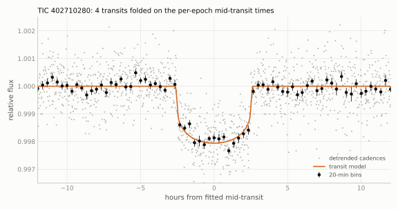</picture>

<picture><source srcset="figures/epochs_402710280_dark.svg" media="(prefers-color-scheme: dark)">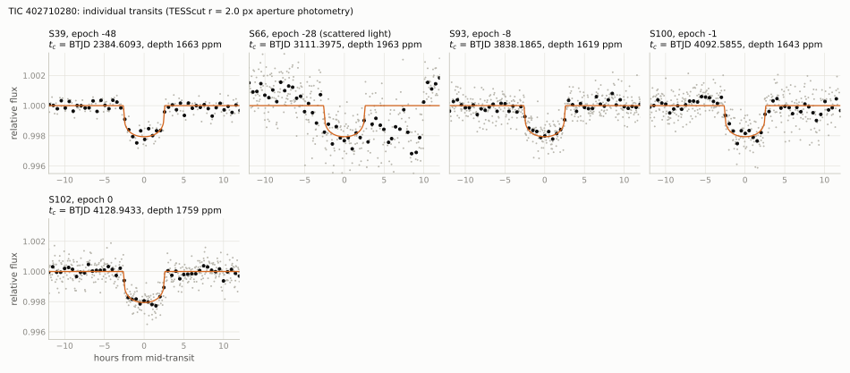</picture>

<picture><source srcset="figures/oc_402710280_dark.svg" media="(prefers-color-scheme: dark)">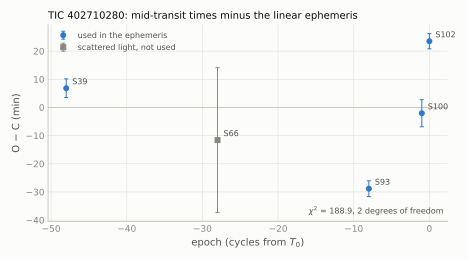</picture>

### 1.4 Checks against false positives

- The four transits are present in every public light curve of the star (QLP SAP, TESS-SPOC SAP and PDCSAP, TARS) and in
  the independent TESScut photometry; the sector-66 event (BTJD 3111.397) lies in scattered light and is kept out of the
  ephemeris.
- Odd and even transits agree in depth (difference 0.4 $`\sigma`$).
- Secondary eclipse: $`< 170`$ ppm (3 $`\sigma`$) at phase 0.5 (`scripts/alias_secondary_search.py`).
- Period aliases $`P/k`$, $`k = 2`$-12: the predicted epochs that fall in the data show no transit.
- Transit shape: grazing geometries are disfavoured ($`\Delta\chi^2 = 95`$ over the $`b`$ profile), so a host diluted by
  more than 0.4 mag is excluded; the 2.3" neighbour ($`G = 16.15`$, 6.4 mag fainter, background) is excluded as the host
  on this ground.
- Difference images of sectors 39, 93, 100 and 102 peak on the target (section 1.5); in-transit centroid shifts exclude
  the stars at 39-60" at more than 10 $`\sigma`$.
- Gaia DR3: RUWE 1.001, no multi-peak detections, no non-single-star solution; the robust radial-velocity amplitude of
  1.93 km/s over 26 transits limits a companion at this period to below about 20 $`M_\mathrm{J}`$.
- The archival HARPS epochs (section 1.7) exclude stellar and brown-dwarf companions at $`P = 36.34`$ d.

### 1.5 Difference-image localisation

`data/diffimage_402710280.csv`, `data/diffimage_sources_402710280.csv`, `scripts/difference_images.py`. The difference
image (out-of-transit model minus in-transit mean of every cutout pixel) is fitted with a free 2-D Gaussian and compared
with the out-of-transit image; the dimming is centred on the target in all four sectors, and the stars at 39", 54" and
60" are excluded at more than 10 $`\sigma`$. The 2.3" neighbour is unresolved at the 21" pixel scale and is constrained
only by the transit shape (section 1.4) and by the TRICERATOPS run of section 1.6.

<picture><source srcset="figures/diffimage_402710280_dark.svg" media="(prefers-color-scheme: dark)">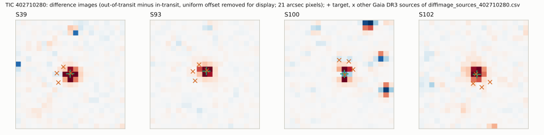</picture>

### 1.6 TRICERATOPS

TRICERATOPS 1.1.0 (Giacalone et al. 2021). Input: the TTV-corrected fold of the four TESScut epochs, each divided by its
jointly fitted quadratic baseline ($`\pm 1.0`$ d), 10-min inverse-variance-weighted bins within $`\pm 0.5`$ d (144 bins;
out-of-transit bin scatter 220 ppm, used as the single flux error); raw aperture flux with the per-sector $`r < 2.0`$ px
apertures given to `calc_depths` (`dilution_corrected=False`); background population from Gaia DR3 (the TRILEGAL service
was not reachable); $`N = 10^6`$ draws, `nsamples=20`, 10-min exposure time; 10 random seeds. No contrast curve.

| configuration | seeds | FPP mean $`\pm`$ std | FPP median (range) | NFPP |
|---|---|---|---|---|
| nominal | 10 | $`0.0011 \pm 0.0021`$ | $`2.6 \times 10^{-4}`$ ($`2.8 \times 10^{-6}`$ to $`6.5 \times 10^{-3}`$) | $`\sim 10^{-25}`$ |
| flux errors $`\times 1.5`$ | 5 | $`0.0049 \pm 0.0046`$ | $`3.4 \times 10^{-3}`$ ($`1.8 \times 10^{-3}`$ to $`1.3 \times 10^{-2}`$) | $`\sim 10^{-11}`$ |
| 2.3" neighbour set to a K dwarf (0.85 $`M_\odot`$, 0.80 $`R_\odot`$, 5200 K; it has no TIC parameters) | 5 | $`0.0021 \pm 0.0027`$ | $`7.1 \times 10^{-4}`$ ($`1.8 \times 10^{-4}`$ to $`6.5 \times 10^{-3}`$) | $`\sim 10^{-25}`$ |

Mean scenario probabilities of the nominal runs: TP 0.84, PTP 0.125, DTP 0.034, STP 0.0011 (the whole FPP); every
eclipsing-binary scenario on the target or on neighbours is below $`10^{-6}`$. All nominal seeds and four of the five
runs with inflated errors are below the thresholds FPP $`< 0.015`$ and NFPP $`< 0.001`$ of Giacalone et al. (2021). Runs
with an assumed speckle contrast curve are included in `data/triceratops/` for reference only (`cc_hypothetical = True`
in `runs.csv`); they do not represent an observation.

### 1.7 Archival radial velocities

The ESO Science Archive holds fifteen HARPS science exposures of the star: two public (2025-08-25 and 2025-08-26, programme
112.261U.004) and thirteen proprietary (2026-02-20 to 2026-04-12, programme 116.29B6.001, release 2027-02 to 2027-04, not accessed). The
two public epochs were retrieved anonymously (`data/harps_public_rvs.csv`, with the archive identifiers and checksums)
and the DRS 3.8 pipeline values (K5 mask cross-correlation) are used as delivered:

| date (UTC) | BJD$`_\mathrm{TDB}`$ | RV (m/s) | FWHM (km/s) | contrast (%) | bisector span (m/s) | orbital phase |
|---|---|---|---|---|---|---|
| 2025-08-25 01:18:46 | 2460912.562865 | $`800.94 \pm 1.07`$ | 6.329 | 42.7 | 44.9 | 0.046 |
| 2025-08-26 01:32:12 | 2460913.572387 | $`796.85 \pm 1.42`$ | 6.323 | 42.8 | 35.1 | 0.074 |

$`\Delta\mathrm{RV} = -4.1 \pm 1.8`$ m/s. On the transit ephemeris with a circular orbit the two epochs sample
$`\Delta\mathrm{RV} = -0.162\,K`$, i.e. 16 % of the semi-amplitude, so $`K = 25 \pm 11`$ m/s (photon noise only),
$`\lvert K\rvert < 58`$ m/s at 3 $`\sigma`$ and $`M_2 \sin i < 0.87\,M_\mathrm{J}`$ for $`M_\star = 0.88\,M_\odot`$. A
stellar or brown-dwarf companion at $`P = 36.34`$ d would have produced $`\Delta\mathrm{RV}`$ between $`-0.14`$ km/s
(13 $`M_\mathrm{J}`$, $`K = 0.86`$ km/s) and $`-2.8`$ km/s (0.3 $`M_\odot`$, $`K = 17.3`$ km/s) over the same baseline. A
sub-Neptune of 10-20 $`M_\oplus`$ ($`K`$ = 2-4 m/s) is not detectable with two epochs. The DRS cross-correlation function
is a single Gaussian on both nights (identical FWHM and contrast), and a $`\pm 400`$ km/s self-mask cross-correlation
of the spectra shows no second component above about 0.5 % of the continuum; the star is not double-lined. The Ca II K
line shows a central emission reversal on both nights, i.e. the K dwarf is chromospherically active and radial-velocity
jitter of several m/s is to be expected.

### 1.8 Catalogue and literature checks

All queries were run with a positive control (a known object returned by the same query).

| date | source | result |
|---|---|---|
| 2026-10-15 | VSX (15"), SIMBAD (10"; the star is TYC 9041-3677-1, type high-proper-motion star, 3 references) | no variability or planet entry |
| 2026-10-15 | Gaia DR3 `vari_*` tables (10) and `nss_*` tables | no entry |
| 2026-10-15 | ExoFOP TOI list (8151 rows), CTOI list (5138 rows), target page | no TOI, no CTOI |
| 2026-10-15 | NASA Exoplanet Archive (`toi`, `ps`, `pscomppars`, `td`) | no entry |
| 2026-10-15 | ADS full text, 17 identifier strings (TIC, Gaia DR2/DR3, TYC, 2MASS, UCAC4, WISE) | no publication on the star |
| 2026-10-15 | source files of 14 arXiv papers on TESS duo- and single-transit candidates | not listed |
| 2026-10-15 | VizieR, all tables within 5" (116 tables) | catalogue entries only; no planet or eclipse table |
| 2026-10-15 | TESS-SPOC FFI target lists; MAST data validation products | in the TESS-SPOC target list for two sectors; no SPOC threshold-crossing event |
| 2026-10-18 | ESO Science Archive (position and object-name queries, programme pages) | fifteen HARPS exposures (section 1.7); no other instrument |
| 2026-10-18 | ADS (identifier strings, repeat) | no publication |

Not checked: KELT and ASAS-SN light curves; catalogue tables that exist only outside the arXiv source files searched.

### 1.9 Predicted transits (2026-10-18 to 2027-10-18)

`data/predicted_transits_402710280.csv`. Errors are the propagated linear-ephemeris errors; the observed O-C of up to
29 min means a timing window of at least $`\pm 30`$ min should be added. $`T_{14} = 5.27`$ h.

| epoch | mid-transit (UTC) | BJD$`_\mathrm{TDB}`$ | ephemeris error (min) | TESS |
|---|---|---|---|---|
| 6 | 2026-11-02 11:16 | 2461346.9673 | 2.1 | |
| 7 | 2026-12-08 19:27 | 2461383.3073 | 2.1 | |
| 8 | 2027-01-14 03:36 | 2461419.6474 | 2.1 | |
| 9 | 2027-02-19 11:42 | 2461455.9874 | 2.2 | sector 114 |
| 10 | 2027-03-27 19:48 | 2461492.3275 | 2.2 | |
| 11 | 2027-05-03 03:54 | 2461528.6675 | 2.2 | |
| 12 | 2027-06-08 12:03 | 2461565.0076 | 2.3 | |
| 13 | 2027-07-14 20:14 | 2461601.3476 | 2.3 | |
| 14 | 2027-08-20 04:26 | 2461637.6877 | 2.4 | |
| 15 | 2027-09-25 12:40 | 2461674.0277 | 2.4 | |

TESS (tess-point 0.9.5): the star was on silicon in sectors 12, 39, 66, 93, 100, 101, 102 and 103 and will be in sectors
113 and 114; the nominal sector-113 window contains no transit, the sector-114 window contains epoch 9
(`data/tess_sectors_402710280.csv`).

## 2. TIC 324429952

### 2.1 Host star

| quantity | value | source |
|---|---|---|
| identifiers | TIC 324429952, Gaia DR3 6416596855786566528, CD-73 1398, TYC 9300-1959-1, 2MASS J19035007-7306494, RAVE J190350.1-730649 | SIMBAD, ExoFOP |
| position (ICRS, epoch 2016.0) | RA 285.9590554, Dec $`-`$73.1140172 | Gaia DR3 |
| proper motion (mas/yr) | 25.209, $`-`$66.783 | Gaia DR3 |
| parallax (mas) | $`9.2400 \pm 0.0139`$ | Gaia DR3 |
| distance (pc) | $`107.92 \pm 0.32`$ | TIC v8.2 |
| $`G`$, $`BP-RP`$ | 10.093, 0.855 | Gaia DR3 |
| $`T`$, $`V`$, $`B`$, $`J`$, $`H`$, $`K`$ | 9.637, 10.235, 10.988, 9.050, 8.760, 8.652 | TIC v8.2 (ExoFOP) |
| $`T_\mathrm{eff}`$ (K) | $`5737 \pm 132`$ (TIC); 5778 (Gaia GSP-Phot) | TIC v8.2; Gaia DR3 |
| $`R_\star`$ ($`R_\odot`$) | $`0.933 \pm 0.047`$ | TIC v8.2 |
| $`M_\star`$ ($`M_\odot`$) | $`1.02 \pm 0.13`$ | TIC v8.2 |
| $`\log g`$ | $`4.507 \pm 0.078`$ (TIC); 4.52 (Gaia GSP-Phot) | TIC v8.2; Gaia DR3 |
| $`\rho_\star`$ (g cm$`^{-3}`$) | $`1.77 \pm 0.39`$ | TIC v8.2 |
| RUWE; `ipd_frac_multi_peak`; `non_single_star` | 1.090; 0; 0 | Gaia DR3 |
| radial velocity (km/s) | $`-18.94`$ (24 transits); `rv_amplitude_robust` 3.38; `rv_chisq_pvalue` 0.047 | Gaia DR3 |
| variability | Gaia `phot_variable_flag` VARIABLE, classifier SOLAR_LIKE; VSX type ROT without period; rotation period 7.5 d in TESS rotation catalogues (VizieR J/ApJ/935/90: 7.48 d; J/ApJS/276/57: 7.52 d; J/A+A/709/A180: 7.52 d; J/AJ/167/189: 7.65 d; J/ApJS/281/52: 7.73 d) | Gaia DR3, VSX, VizieR |
| TIC contamination ratio | 0.011 | TIC v8.2 |
| common-proper-motion companion | Gaia DR3 6416597615998643200 at 43.6" (epoch 2016.0): $`G = 15.17`$, $`BP-RP = 2.93`$, parallax $`9.30 \pm 0.03`$ mas, proper motion (24.34, $`-`$66.26) mas/yr, $`T_\mathrm{eff}`$ 3289 K (GSP-Phot); shows flares in the cutouts | Gaia DR3 |

### 2.2 Transits and ephemeris

Common-shape fit of the eight transits (`scripts/fit_transits.py`): TESScut $`r = 2.0`$ px photometry for sectors 27 to
103 and the SPOC 2-min SAP light curve for sector 13; batman model with $`u = (0.40, 0.21)`$; quadratic baselines per
epoch over $`\pm 1`$ d. With all three shape parameters free the fit gives $`k = 0.0394 \pm 0.0017`$, $`b = 0.84 \pm 0.06`$,
$`a/R_\star = 50.1 \pm 9.0`$ ($`\rho_\star = 1.32`$ g cm$`^{-3}`$). The $`\chi^2`$ profile over $`b`$ is flat
($`\Delta\chi^2 \le 1.3`$) for $`b \le 0.85`$ and rises to 20 at $`b = 0.95`$ and 31 at $`b = 1.0`$; with $`a/R_\star`$
fixed to the TIC density, $`b = 0.80`$ is within $`\Delta\chi^2 = 1.5`$ of the free minimum while $`b \le 0.70`$ is
worse by $`\Delta\chi^2 \ge 59`$. The adopted shape is the density-constrained solution:

| quantity | value |
|---|---|
| $`P`$ (d) | $`42.37574 \pm 0.00008`$ |
| $`T_0`$ (BJD$`_\mathrm{TDB}`$) | $`2461174.88770 \pm 0.00290`$ (BTJD $`4174.88770`$) |
| $`k = R_\mathrm{p}/R_\star`$ | $`0.0386 \pm 0.0018`$ |
| depth $`k^2`$ | about 1490 ppm (per epoch 634-2215 ppm, table 2.3) |
| $`b`$ | $`0.80 \pm 0.09`$ |
| $`a/R_\star`$ | $`55.9 \pm 11.3`$ ($`\rho_\star = 1.84`$ g cm$`^{-3}`$, circular; TIC $`1.77 \pm 0.39`$) |
| $`T_{14}`$ (h) | 3.84 (model); detection-stage trapezoid $`4.32 \pm 0.15`$ h with $`T_{23} = 2.3`$ h |
| $`R_\mathrm{p} = k R_\star`$ ($`R_\oplus`$) | $`3.9 \pm 0.3`$ (3.6-4.4 across detrending choices; TRICERATOPS best fit 3.8) |
| $`a`$ (au) | 0.24 |
| detection-stage values (3 $`\times`$ 3-pixel box) | depth $`1433 \pm 51`$ ppm; $`P = 42.375818 \pm 0.000071`$ d; QLP detrended flux shows about 800 ppm |

### 2.3 Transit epochs and O-C

`data/transit_times_324429952.csv`; errors as in section 1.3.

| epoch | sector | product | $`t_c`$ (BTJD) | error (min) | O $`-`$ C (min) | depth (ppm) |
|---|---|---|---|---|---|---|
| $`-59`$ | 13 | SPOC 2-min SAP | 1674.722669 | 8.3 | $`+5.2`$ | $`1432 \pm 129`$ |
| $`-50`$ | 27 | TESScut | 2056.100882 | 4.1 | $`+0.3`$ | $`1553 \pm 111`$ |
| $`-25`$ | 66 | TESScut | 3115.491792 | 4.8 | $`-3.5`$ | $`1496 \pm 110`$ |
| $`-8`$ | 93 | TESScut | 3835.883771 | 18.8 | $`+2.9`$ | $`2215 \pm 146`$ |
| $`-7`$ | 94 | TESScut | 3878.255474 | 5.4 | $`-2.9`$ | $`1349 \pm 113`$ |
| $`-2`$ | 100 | TESScut | 4090.139084 | 9.7 | $`+4.1`$ | $`634 \pm 142`$ |
| $`-1`$ | 102 | TESScut | 4132.517034 | 20.5 | $`+7.3`$ | $`1649 \pm 148`$ |
| 0 | 103 | TESScut | 4174.897401 | 11.1 | $`+14.0`$ | $`1620 \pm 138`$ |

Linear ephemeris: $`\chi^2 = 3.1`$ for 6 degrees of freedom; no transit-timing variation is detected. The per-epoch
depths of sectors 93 and 100 differ from the others; both sectors have the largest red-noise factors ($`\beta`$ = 2.4
and 2.0). The predicted transits of sectors 39, 67 and 101 fall outside the data (`data/sectors_324429952.csv`).

<picture><source srcset="figures/fold_324429952_dark.svg" media="(prefers-color-scheme: dark)">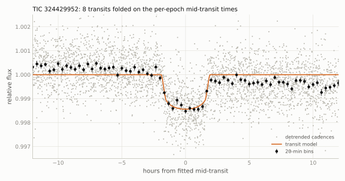</picture>

<picture><source srcset="figures/epochs_324429952_dark.svg" media="(prefers-color-scheme: dark)">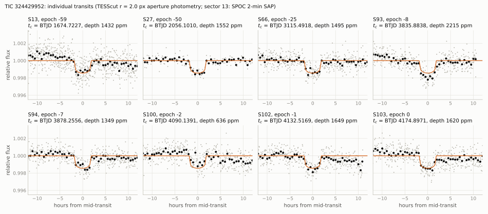</picture>

<picture><source srcset="figures/oc_324429952_dark.svg" media="(prefers-color-scheme: dark)">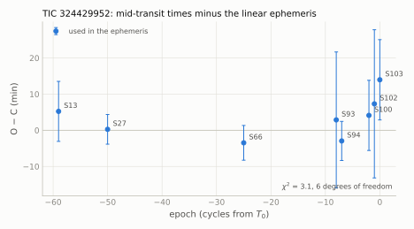</picture>

### 2.4 Checks against false positives

- The sector-13 transit is in the SPOC 2-min light curve (SAP and PDCSAP, 1429-1516 ppm, 13 $`\sigma`$) with no
  in-transit shift of the SPOC flux-weighted centroid; all eight epochs are present in independent photometry (QLP SAP
  for every sector; TESS-SPOC SAP and PDCSAP for sectors 13, 27 and 66; eleanor-lite and TARS where available; the
  TESScut circular apertures of this record). No SPOC threshold-crossing event exists.
- Odd and even transits agree (detection stage: $`1421 \pm 63`$ vs $`1445 \pm 63`$ ppm; 0.4 $`\sigma`$).
- Secondary eclipse: $`< 500`$ ppm at phase 0.5.
- Period aliases $`P/k`$, $`k = 2`$-12, are excluded by covered epochs without transit (for $`P/2`$: sector 94 at BTJD
  3857.08, $`-403 \pm 136`$ ppm; sector 67 at 3136.71, $`287 \pm 127`$ ppm; sector 101 at 4111.33, flat).
- Localisation: joint PSF fits to the difference images of six sectors put the dimming on the target at 7-10 $`\sigma`$
  and not on the common-proper-motion M dwarf at 43.6", which would need eclipses of about 35 % and shows none in its
  own pixels (section 2.5).
- Gaia DR3: RUWE 1.09, no multi-peak detections, no non-single-star solution; the robust radial-velocity amplitude of
  3.4 km/s over 24 transits limits a companion at this period to below about 30 $`M_\mathrm{J}`$.
- The transit depth does not depend on the phase of the 7.5-d rotational modulation; all eight transits fall near
  minima of the modulation (2.5 $`\sigma`$ against a random distribution), which is noted and not explained.

### 2.5 Difference-image localisation

`data/diffimage_324429952.csv`, `data/diffimage_sources_324429952.csv`, `data/diffimage_centroids_324429952.csv`. The
difference-image centroid offsets from the out-of-transit centroid, weighted over the eight sectors, are
$`\Delta\mathrm{E} = -2.7 \pm 1.7`$" and $`\Delta\mathrm{N} = +5.5 \pm 3.0`$" ($`\chi^2 = 22.5`$ for 16 degrees of freedom
against zero); the M dwarf lies 43.6" away. The joint PSF fit in the six sectors with 200-s or 10-min cadence assigns
the dimming to the target at 7-10 $`\sigma`$.

<picture><source srcset="figures/diffimage_324429952_dark.svg" media="(prefers-color-scheme: dark)">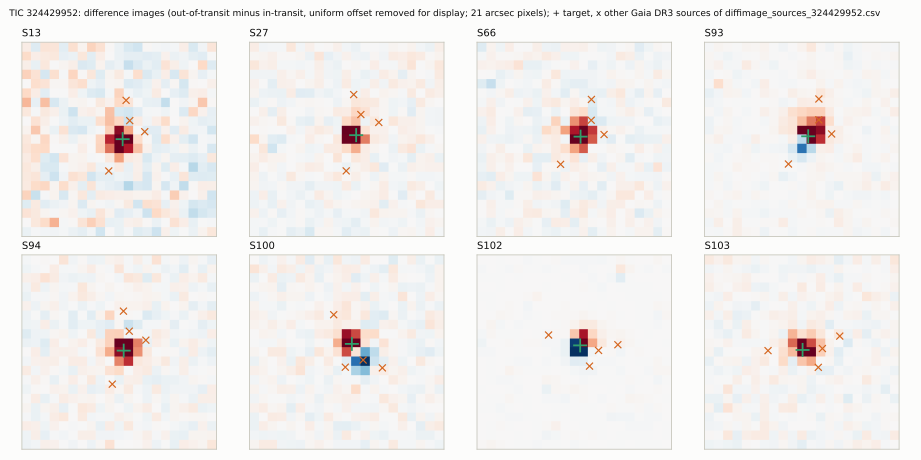</picture>

### 2.6 TRICERATOPS

Same set-up as section 1.6 with all eight epochs (sector 13: SPOC aperture and 2-min SAP flux), baselines over
$`\pm 0.6`$ d (nominal), 144 bins, out-of-transit bin scatter 178 ppm, lag-1 autocorrelation of the out-of-transit bins
0.21 (0.72 with $`\pm 1.0`$ d baselines).

| configuration | seeds | FPP mean $`\pm`$ std | FPP median (range) | NFPP |
|---|---|---|---|---|
| nominal ($`\pm 0.6`$ d baselines) | 10 | $`0.033 \pm 0.015`$ | 0.036 (0.011 to 0.061) | $`3 \times 10^{-7}`$ |
| $`\pm 1.0`$ d baselines | 5 | $`0.095 \pm 0.025`$ | 0.105 (0.060 to 0.12) | $`8 \times 10^{-5}`$ |
| flux errors $`\times 1.5`$ | 5 | $`0.073 \pm 0.018`$ | 0.073 (0.049 to 0.099) | $`2 \times 10^{-5}`$ |
| sectors 93 and 100 left out | 5 | $`0.052 \pm 0.019`$ | 0.055 (0.027 to 0.079) | $`3 \times 10^{-6}`$ |

Mean scenario probabilities of the nominal runs: TP 0.805, PTP 0.156, STP 0.0135, SEB 0.0193, DTP 0.0067; scenarios on
the M dwarf (NTP, NEB) are at or below $`10^{-4}`$. The FPP is in the range Giacalone et al. (2021) call "likely planet"
(FPP $`< 0.5`$, NFPP $`< 0.001`$) and above their threshold for statistical validation (0.015). The companion scenarios
STP and SEB carry the FPP, which the V-shaped fold ($`b \approx 0.8`$) leaves room for. Reference runs with an assumed
contrast curve (FPP $`0.0089 \pm 0.004`$) are in `data/triceratops/`, flagged as hypothetical.

### 2.7 Catalogue and literature checks

| date | source | result |
|---|---|---|
| 2026-10-15 | VSX (60") | the star, type ROT, no period |
| 2026-10-15 | SIMBAD (30") | CD-73 1398, high-proper-motion star, 4 references; no planet or eclipse |
| 2026-10-15 | Gaia DR3 `vari_*` and `nss_*` tables | `vari_classifier_result` SOLAR_LIKE; no eclipse, transit or NSS entry |
| 2026-10-14/15 | ExoFOP TOI (8151 rows) and CTOI (5138 rows) lists, target page | no TOI, no CTOI |
| 2026-10-15 | NASA Exoplanet Archive (4 tables) | no entry |
| 2026-10-15 | ADS full text, 27 name strings | no publication on the star beyond catalogue papers |
| 2026-10-15 | VizieR, all tables within 5" (151 tables); Prsa et al. 2022 TESS eclipsing binaries (J/ApJS/258/16); Kostov et al. 2025 (J/ApJS/279/50) | rotation-period entries only; no eclipse or planet entry |
| 2026-10-15 | source files of 20 arXiv transit-candidate papers; RAVEN and T16 candidate tables; MAST data-validation products | not listed; no SPOC threshold-crossing event |
| 2026-10-18 | ESO Science Archive (5" cone) | no data |

### 2.8 Predicted transits (2026-10-18 to 2027-10-18)

`data/predicted_transits_324429952.csv`; $`T_{14}`$ = 3.8-4.3 h.

| epoch | mid-transit (UTC) | BJD$`_\mathrm{TDB}`$ | ephemeris error (min) | TESS |
|---|---|---|---|---|
| 4 | 2026-10-30 21:24 | 2461344.3907 | 4.2 | |
| 5 | 2026-12-12 06:27 | 2461386.7664 | 4.2 | |
| 6 | 2027-01-23 15:28 | 2461429.1421 | 4.2 | |
| 7 | 2027-03-07 00:26 | 2461471.5179 | 4.3 | sector 114 |
| 8 | 2027-04-18 09:23 | 2461513.8936 | 4.3 | |
| 9 | 2027-05-30 18:21 | 2461556.2694 | 4.3 | |
| 10 | 2027-07-12 03:22 | 2461598.6451 | 4.3 | |
| 11 | 2027-08-23 12:25 | 2461641.0208 | 4.4 | |
| 12 | 2027-10-04 21:30 | 2461683.3966 | 4.4 | |

TESS: on silicon in sectors 13, 27, 39, 66, 67, 93, 94, 100, 101, 102 and 103, and in sector 114 (epoch 7).

## 3. TIC 89247735

### 3.1 Host star

| quantity | value | source |
|---|---|---|
| identifiers | TIC 89247735, Gaia DR3 6708071581514074368, SCR J1820-4533, 2MASS J18205368-4533401, UCAC4 223-171234, AllWISE J182053.64-453341.2, DENIS J182053.6-453340 | SIMBAD, TIC, VizieR |
| position (ICRS, epoch 2016.0) | RA 275.2234461, Dec $`-`$45.5616378 | Gaia DR3 |
| proper motion (mas/yr) | $`-`$39.073, $`-`$105.840 | Gaia DR3 |
| parallax (mas) | $`9.5397 \pm 0.0202`$ | Gaia DR3 |
| distance (pc) | $`105.66 \pm 0.62`$ | TIC v8.2 |
| $`G`$, $`BP-RP`$ | 11.851, 1.452 | Gaia DR3 |
| $`T`$, $`V`$, $`B`$, $`J`$, $`H`$, $`K`$ | 11.138, 12.213, 13.451, 10.154, 9.606, 9.444 | TIC v8.2 |
| $`T_\mathrm{eff}`$ (K) | $`4394 \pm 125`$ (TIC); 4614 (Gaia GSP-Phot) | TIC v8.2; Gaia DR3 |
| $`R_\star`$ ($`R_\odot`$) | $`0.785 \pm 0.066`$ | TIC v8.2 |
| $`M_\star`$ ($`M_\odot`$) | $`0.69 \pm 0.08`$ | TIC v8.2 |
| $`\log g`$ | $`4.488 \pm 0.103`$ (TIC); 4.60 (Gaia GSP-Phot) | TIC v8.2; Gaia DR3 |
| $`\rho_\star`$ (g cm$`^{-3}`$) | $`1.43 \pm 0.43`$ | TIC v8.2 |
| RUWE; `ipd_frac_multi_peak`; `ipd_gof_harmonic_amplitude`; `non_single_star` | 1.099; 0; 0.0123; 0 | Gaia DR3 |
| `astrometric_excess_noise` (mas; significance) | 0.086; 8.7 | Gaia DR3 |
| radial velocity (km/s) | $`-21.62 \pm 0.54`$ (14 transits, 4 deblended); `rv_amplitude_robust` 5.68; `rv_chisq_pvalue` 0.52; `rv_renormalised_gof` $`-`$0.16 | Gaia DR3 |
| variability | `phot_variable_flag` NOT_AVAILABLE; no entry in the Gaia DR3 `vari_*` (6) and `nss_*` (4) tables | Gaia DR3 |
| Hipparcos, Tycho-2, Hipparcos-Gaia accelerations | not listed (no proper-motion anomaly available) | VizieR I/239, I/259, J/ApJS/254/42 |
| TIC contamination ratio | 0.274 | TIC v8.2 |
| Gaia DR3 sources within 60" | 136 (53 with $`G < 19`$); the nearest with $`G < 18`$ is Gaia DR3 6708071581515491456 (TIC 89247731), $`G = 15.49`$, 9.5", parallax 0.46 mas (background) | Gaia DR3 |
| SED fit ($`A_V = 0`$, without SkyMapper $`u`$, $`v`$) | $`T_\mathrm{eff} = 4490`$ K, $`R_\star = 0.717\,R_\odot`$, $`L_\star = 0.188\,L_\odot`$; $`\chi^2 = 138`$ for 12 degrees of freedom | this work (`scripts/sed_fit.py`, `data/sed_89247735.csv`); photometry: Gaia DR3 $`G`$, $`BP`$, $`RP`$; SkyMapper DR4 $`g`$, $`r`$, $`i`$, $`z`$ (PSF); APASS DR9 $`B`$, $`V`$; 2MASS $`J`$, $`H`$, $`K_s`$; AllWISE W1-W3 |
| adopted $`T_\mathrm{eff}`$ (K), $`L_\star`$ ($`L_\odot`$), $`R_\star`$ ($`R_\odot`$) | $`4430 \pm 100`$, $`0.190 \pm 0.008`$, $`0.74 \pm 0.04`$ | this work (text below the table) |
| adopted $`M_\star`$ ($`M_\odot`$), $`\rho_\star`$ (g cm$`^{-3}`$) | $`0.69 \pm 0.03`$, $`2.40 \pm 0.40`$ | this work: Mann et al. (2019) $`M_{K_s}`$ relation; $`\rho_\star`$ from $`M_\star`$ and $`R_\star`$ |
| [Fe/H] | $`+0.23 \pm 0.02`$ (formal error); $`+0.21`$ and $`+0.22`$ in two other catalogues based on Gaia XP spectra; adopted about $`+0.2`$ | Zhang, Green & Rix (2023), Gaia XP spectra; VizieR J/ApJ/984/58, J/A+A/685/A59 |
| extinction | $`E(B-V) = 0.005 \pm 0.008`$; Gaia GSP-Phot $`A_G = 0.24`$ (not adopted, text below) | Zhang, Green & Rix (2023); Gaia DR3 |

SED fit (`scripts/sed_fit.py`): Castelli & Kurucz (2003) model spectra from the SVO Theoretical Spectra service
($`T_\mathrm{eff}`$ 3750-5000 K, $`\log g`$ 4.5 and 5.0, [M/H] 0.0, $`+0.2`$, $`+0.5`$), synthetic photometry with the
SVO filter curves and zero points, a free scale $`(R_\star/d)^2`$ with $`d = 1/\varpi = 104.83`$ pc, $`A_V = 0`$ and
an error floor of 0.02 mag. SkyMapper $`u`$ and $`v`$ are left out of the reference fit because the model ultraviolet
is unreliable for K dwarfs (with them: 4490 K, $`\chi^2 = 345`$ for 14 degrees of freedom); WISE W4 is an upper limit,
the VHS $`J`$ and $`K_s`$ magnitudes are saturated, and GALEX has no coverage at this position. The fit is formally poor
(largest residuals W3 $`+0.36`$ mag, $`H`$ $`+0.09`$ mag, $`V`$ $`-0.05`$ mag), so its statistical errors (Monte Carlo
over the photometric and parallax errors: $`\pm 8`$ K, $`\pm 0.004\,R_\odot`$) are not meaningful; the model grid
dominates: $`T_\mathrm{eff}`$ = 4450-4490 K for [M/H] = 0.0 to $`+0.5`$, and 4530-4630 K for $`A_V`$ = 0.05-0.20, which
the fit does not distinguish from $`A_V = 0`$ ($`\chi^2`$ = 137.3-138.4). The luminosity depends less on the model:
0.187-0.188 $`L_\odot`$ from the fits at $`A_V = 0`$, and 0.195 $`L_\odot`$ from $`M_G = 6.749`$ with the bolometric
correction of Andrae et al. (2018) for 4450 K. Other $`T_\mathrm{eff}`$ values: TIC v8.2 $`4394 \pm 125`$ K; Zhang,
Green & Rix (2023) $`4261 \pm 12`$ K (formal error); 4592, 4478 and 4454 K (VizieR J/ApJ/984/58, J/A+A/685/A59,
J/AJ/158/93); Gaia GSP-Phot 4614 K and GSP-Spec 4114 K. Adopted: $`T_\mathrm{eff} = 4430 \pm 100`$ K,
$`L_\star = 0.190 \pm 0.008\,L_\odot`$ and $`R_\star = \sqrt{L_\star}\,(T_\mathrm{eff}/5772\,\mathrm{K})^{-2}
= 0.74 \pm 0.04\,R_\odot`$ (solar units). Other radius estimates: $`0.744\,R_\odot`$ from the Mann et al. (2015)
$`R`$-$`M_{K_s}`$ relation ($`M_{K_s} = 4.34`$, 0.26 mag brighter than its calibrated range), $`0.78\,R_\odot`$ from the
Kervella et al. (2004) $`V-K`$ surface-brightness relation, and $`0.785 \pm 0.066\,R_\odot`$ (TIC). The Mann et al.
(2019) $`M_{K_s}`$ relation (fifth order, no [Fe/H] term) gives $`0.694\,M_\odot`$. Extinction: $`E(B-V)`$ is
consistent with 0 (Zhang, Green & Rix 2023), and the Schlegel et al. (1998) column along the line of sight, 0.069, is an
upper bound. Gaia GSP-Phot gives $`A_G = 0.24`$ mag together with [M/H] $`= +0.80`$; the Gaia FLAME luminosity
(0.220 $`L_\odot`$; FLAME radius 0.734 $`R_\odot`$), which uses that extinction, is higher than the SED value. A value
from a 3D extinction map (Stilism) could not be retrieved (host not reachable on 2026-10-18).

### 3.2 Transits and ephemeris

TESScut cutouts of sectors 13, 66, 93 and 104 are requested at the Gaia DR3 position, and the photometric apertures are
centred on the proper-motion-corrected position of each sector (the star moves 0.11"/yr). Common-shape fit of the four
transits in the $`r = 2.0`$ px circular-aperture photometry (`scripts/fit_transits.py`; batman model, quadratic limb
darkening $`u = (0.52, 0.18)`$, one quadratic baseline per epoch solved jointly, quality-0 cadences within
$`\pm 0.8`$ d of each transit):

| quantity | value |
|---|---|
| $`P`$ (d) | $`18.323173 \pm 0.000031`$ |
| $`T_0`$ (BJD$`_\mathrm{TDB}`$) | $`2461196.80899 \pm 0.00100`$ (BTJD $`4196.80899`$) |
| $`k = R_\mathrm{p}/R_\star`$, raw aperture flux | $`0.0909 \pm 0.0006`$ (depth $`k^2`$ = 8259 ppm; per epoch 7801-8572 ppm, table 3.3) |
| $`b`$ | 0.00 (at the bound of the fit; $`\chi^2`$ profile below) |
| $`a/R_\star`$ | $`33.9 \pm 0.2`$ ($`\rho_\star = 2.20`$ g cm$`^{-3}`$ for a circular orbit; TIC $`1.43 \pm 0.43`$) |
| $`T_{14}`$, $`T_{23}`$ (h) | 4.50, 3.75 ($`T_{23}/T_{14} = 0.83`$: flat-bottomed) |
| same fit with $`a/R_\star = 29.4`$ (TIC density) | $`k = 0.0948`$, $`b = 0.51`$, $`T_{14} = 4.62`$ h, $`\Delta\chi^2 = +0.9`$ |
| $`r = 1.5`$ px; $`r = 3.0`$ px apertures | $`k = 0.0963`$, $`b = 0.40`$, $`a/R_\star = 31.4`$; $`k = 0.0836`$, $`b = 0.00`$, $`a/R_\star = 33.6`$ |
| baselines over $`\pm 0.6`$ d, linear | $`k = 0.0906`$, $`b = 0.00`$, $`a/R_\star = 34.0`$, $`T_{14} = 4.50`$ h |
| $`R_\mathrm{p}`$, dilution corrected ($`R_\oplus`$) | 9.1-9.4 (0.81-0.84 $`R_\mathrm{J}`$) with the TIC radius (table below); adopted $`8.7 \pm 0.6`$ ($`0.78 \pm 0.05\,R_\mathrm{J}`$) with the SED radius and free dilution (below) |
| detection-stage values (3 $`\times`$ 3-pixel box) | $`P = 18.323343 \pm 0.00012`$ d (box search); depth 0.95-1.01 % per epoch; $`R_\mathrm{p} = 8.5\,R_\oplus`$ without dilution correction |

$`\chi^2`$ profile over $`b`$ ($`r = 2.0`$ px, per-epoch noise fixed at the values of the free fit, `--bfix`):
$`\Delta\chi^2`$ = 0.2, 0.9, 2.2, 8.5, 40.4, 80.8, 139.7 and 163.8 for $`b`$ = 0.3, 0.5, 0.6, 0.7, 0.8, 0.85, 0.9 and
0.95. Grazing geometries are excluded ($`\Delta\chi^2 \ge 40`$ for $`b \ge 0.8`$, where $`k = 0.106`$), so the
light curve cannot be diluted by more than a factor of about 1.8 with respect to the raw aperture depth. The ratio of
the circular-orbit density at $`b = 0`$ to the TIC density is $`1.54 \pm 0.47`$: the shape is consistent with a
circular orbit at $`b \approx 0.5`$ or, for $`b = 0`$, with $`e \ge 0.14`$ ($`\omega = 90^\circ`$). The constraint
with the SED-based density is given below (photoeccentric).

Dilution: the TIC contamination ratio is 0.274 and the raw depth depends on the aperture. The target flux fraction of
each aperture (`scripts/dilution_correction.py`) is computed from the Gaia DR3 $`G`$-band fluxes of all 136 sources
within 60", placed at their proper-motion-corrected positions with the Gaussian PSF fitted to the out-of-transit image
of each epoch (sigma 0.58-0.73 px) and with 1.5 times that sigma, and averaged. For comparison, the TIC contamination
ratio corresponds to a fraction of 0.78, and TRICERATOPS gives 0.739 for the $`r = 2.0`$ px apertures.

| aperture | raw depth $`k^2`$ (ppm) | target flux fraction | corrected depth (ppm) | $`k`$ | $`R_\mathrm{p}`$ ($`R_\oplus`$) | $`R_\mathrm{p}`$ ($`R_\mathrm{J}`$) |
|---|---|---|---|---|---|---|
| $`r = 1.5`$ px | 9275 | 0.796 | 11645 | 0.108 | 9.2 | 0.82 |
| $`r = 2.0`$ px | 8259 | 0.730 | 11310 | 0.106 | 9.1 | 0.81 |
| $`r = 3.0`$ px | 6995 | 0.575 | 12174 | 0.110 | 9.4 | 0.84 |

The radii use $`R_\star = 0.785 \pm 0.066\,R_\odot`$ (TIC v8.2), whose 8 % error is not included in the range.
Sources beyond 60" are not included in the flux model.

Joint fit with free dilution (`scripts/fit_free_dilution.py`, `data/fit_free_dilution_89247735.csv`): the raw
$`r = 2.0`$ px flux of the four epochs (quality 0, $`\pm 0.8`$ d, 2619 points) is fitted with
$`F = f_t\,T(t) + (1 - f_t)`$, where the target flux fraction $`f_t`$ has the prior $`N(0.735, 0.03)`$ from the flux
model above (0.70-0.78 by epoch). Free parameters: $`k`$, $`b`$, the circular-orbit density $`\rho_\mathrm{circ}`$,
the limb darkening (Kipping $`q_1`$, $`q_2`$; Gaussian priors $`u_1 = 0.52 \pm 0.1`$, $`u_2 = 0.18 \pm 0.1`$), $`f_t`$
and four mid-transit times; a quadratic baseline per epoch is solved linearly, and the per-epoch noise is fixed at the
residual rms of the common-shape fit. emcee, 40 walkers $`\times`$ 3000 steps, the first 1000 discarded (autocorrelation
times 106-195 steps); best $`\chi^2 = 2614.1`$ for 2619 points.

| quantity | median and 68 % interval (95 % interval) |
|---|---|
| $`k = R_\mathrm{p}/R_\star`$ (undiluted) | $`0.1075^{+0.0035}_{-0.0031}`$ (0.1016-0.1149) |
| depth $`k^2`$ (ppm) | $`11560^{+755}_{-657}`$ |
| $`f_t`$ | $`0.737 \pm 0.030`$ (equal to the prior) |
| $`b`$ | $`0.27^{+0.19}_{-0.18}`$ (0.01-0.57) |
| $`a/R_\star`$; $`\rho_\mathrm{circ}`$ (g cm$`^{-3}`$) | $`32.7^{+1.0}_{-2.1}`$; $`1.97^{+0.20}_{-0.36}`$ |
| $`T_{14}`$, $`T_{23}`$ (h) | $`4.60^{+0.07}_{-0.06}`$, $`3.63^{+0.08}_{-0.14}`$ |
| $`R_\mathrm{p}`$ ($`R_\star = 0.74 \pm 0.04\,R_\odot`$) | $`8.68^{+0.54}_{-0.52}\,R_\oplus`$ = $`0.774^{+0.048}_{-0.046}\,R_\mathrm{J}`$ (7.7-9.8 $`R_\oplus`$) |

A second chain of the same model with a different random seed gave $`k = 0.1082^{+0.0042}_{-0.0033}`$, depth
11700 ppm, $`b = 0.30^{+0.21}_{-0.20}`$ and $`R_\mathrm{p} = 8.74^{+0.55}_{-0.53}\,R_\oplus`$; the differences show the
Monte Carlo precision of the chains. Adopted: $`R_\mathrm{p} = 8.7 \pm 0.6\,R_\oplus`$ ($`0.78 \pm 0.05\,R_\mathrm{J}`$),
true depth 1.16-1.17 %. The error is dominated by $`R_\star`$ (5 %) and $`f_t`$ (4 %). The values 9.1-9.4 $`R_\oplus`$
of the table above use the TIC radius.

Photoeccentric constraint (Dawson & Johnson 2012; same script): with $`\rho_\star = M_\star/R_\star^3`$ drawn from
$`M_\star = 0.69 \pm 0.03\,M_\odot`$ and $`R_\star = 0.74 \pm 0.04\,R_\odot`$ ($`\rho_\star = 2.40^{+0.45}_{-0.37}`$
g cm$`^{-3}`$), $`\rho_\mathrm{circ}/\rho_\star = 0.79^{+0.18}_{-0.17}`$. Uniform priors on $`e`$ in [0, 0.95) and on
$`\omega`$ give $`e = 0.18^{+0.31}_{-0.13}`$, $`e < 0.30`$ (68 %) and $`e < 0.74`$ (95 %); the Savage-Dickey density
ratio at $`e = 0`$ is 3.0 (second chain: $`e = 0.19^{+0.31}_{-0.14}`$, $`e < 0.74`$, ratio 2.8). The light curve is
consistent with a circular orbit at $`b \approx 0.3`$; the eccentricity is not measured.

### 3.3 Transit epochs and O-C

`data/transit_times_89247735.csv`; errors as in section 1.3. Depths are raw $`r = 2.0`$ px depths (not dilution
corrected).

| epoch | sector | $`t_c`$ (BTJD) | error (min) | O $`-`$ C (min) | depth (ppm) | note |
|---|---|---|---|---|---|---|
| $`-59`$ | 66 | 3115.741814 | 1.8 | $`+0.0`$ | $`8572 \pm 215`$ | 10.6 d into orbit 2 |
| $`-20`$ | 93 | 3830.346317 | 1.7 | $`+1.1`$ | $`7801 \pm 235`$ | 0.49 d after the start of the sector |
| $`-19`$ | 93 | 3848.668007 | 1.5 | $`-1.0`$ | $`8227 \pm 207`$ | 12.1 d into orbit 2 |
| 0 | 104 | 4196.809127 | 2.2 | $`+0.2`$ | $`8419 \pm 264`$ | 11.8 d into orbit 2 |

Linear ephemeris: $`\chi^2 = 0.9`$ for 2 degrees of freedom; no transit-timing variation is detected. The predicted
sector-13 transit (epoch $`-138`$, BTJD 1668.211) falls in the mid-sector gap (BTJD 1667.683-1668.641, no cadence of
any quality within $`\pm 0.3`$ d), and the predicted transit at the start of sector 104 (BTJD 4178.486) precedes the
first cadence (4178.587), so the four transits come from three sectors (`data/sectors_89247735.csv`).

<picture><source srcset="figures/fold_89247735_dark.svg" media="(prefers-color-scheme: dark)">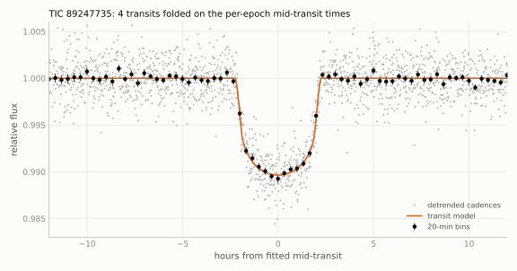</picture>

<picture><source srcset="figures/epochs_89247735_dark.svg" media="(prefers-color-scheme: dark)">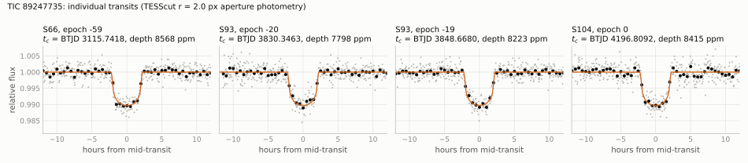</picture>

<picture><source srcset="figures/oc_89247735_dark.svg" media="(prefers-color-scheme: dark)">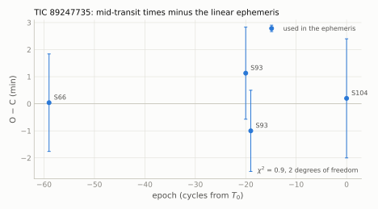</picture>

### 3.4 Checks against false positives

- Public light curves (4.45-h box, quadratic baseline, quality 0): QLP SAP flux shows the transits at
  $`10431 \pm 283`$ ppm (sector 66), $`11377 \pm 285`$ ppm (sector 93, epoch $`-19`$) and $`10365 \pm 257`$ ppm
  (sector 104, 62 % coverage); TARS at $`10705 \pm 251`$, $`9428 \pm 301`$ and $`11852 \pm 297`$ ppm (sector 66;
  sector 93, epochs $`-20`$ and $`-19`$). QLP flags every cadence of the epoch $`-20`$ transit (with all cadences:
  $`10429 \pm 360`$ ppm) and 38 % of the epoch-0 transit. The transits are also present in the QLP KSPSAP, DET and
  SYS_RM fluxes. No TESS-SPOC, TGLC or eleanor product exists for sectors 66, 93 and 104; the sector-13 products
  contain no transit (section 3.3).
- Odd and even transits agree in depth (table 3.3): $`8393 \pm 149`$ ppm (odd) and $`8074 \pm 175`$ ppm (even),
  1.4 $`\sigma`$.
- Period aliases (`scripts/alias_secondary_search.py`): for $`P/2 = 9.1616`$ d the five covered predicted epochs show
  no transit ($`-3 \pm 209`$, $`510 \pm 269`$, $`-440 \pm 223`$, $`122 \pm 203`$ and $`506 \pm 210`$ ppm at BTJD
  1659.05, 1677.37, 3106.58, 3839.51 and 4187.65); $`P/3`$: 8 covered epochs without transit; $`P/4`$: 16;
  $`P/k`$, $`k`$ = 5-12: 17-53 each. $`2P`$ is excluded by the two consecutive transits of sector 93 (epochs $`-20`$
  and $`-19`$) and by the equal depths of all four epochs.
- Secondary eclipse (same script): the five covered phase-0.5 epochs give a weighted mean of $`4 \pm 98`$ ppm (3
  $`\sigma`$ limit 299 ppm, white noise); the robust scatter of box depths over all off-transit phases is 165 ppm
  (3 $`\sigma`$ limit 494 ppm), and the deepest box at any off-transit phase is 900 ppm (phase $`-0.22`$, three
  epochs).
- Other dips: the box search finds six non-transit events of 1100-2500 ppm at $`r = 2.0`$ px (BTJD 1682.134,
  3111.729, 3836.585, 3843.075, 3849.745 and 4185.066). `scripts/event_checks.py`: each of them changes depth with the
  aperture radius, moves the flux-weighted centroid, coincides with flagged cadences or a background excursion, or is
  absent in QLP SAP, so none behaves like a dip on the target (for example BTJD 4185.066: 4530, 5523 and 6101 ppm in
  the $`r`$ = 1.5, 2.0 and 3.0 px apertures, a centroid shift, QLP SAP $`740 \pm 406`$ ppm; BTJD 3849.745: 26 flagged
  cadences in the box; BTJD 3843.075: a dip of 1.06 % in the $`r = 1.5`$ px aperture but a rise of 0.16 % at $`r = 2.0`$ px,
  during a large background excursion).
- Spacecraft orbit: $`P`$ is not within 4 % of 13.7 d$`/n`$ or 27.4 d$`/n`$ ($`n`$ = 1-8). The epoch $`-20`$ transit
  lies 0.49 d after the start of sector 93, where orbit-start ramps occur; it has the same depth, duration and timing
  ($`\mathrm{O-C} = +1.1`$ min) as the other three and is followed one period later by the epoch $`-19`$ transit, so it
  is kept. The other three transits lie 10.6-12.1 d into the second orbit of their sectors.
- Ellipsoidal variation and Doppler beaming: no usable limit. Fits of $`\cos\phi`$, $`\sin\phi`$, $`\cos 2\phi`$,
  $`\sin 2\phi`$ to the out-of-transit light curve give $`\cos 2\phi = +106 \pm 204`$ ppm and
  $`\sin\phi = -142 \pm 222`$ ppm (1.0-d biweight detrending) and $`+340 \pm 445`$ and $`-283 \pm 367`$ ppm (5.0-d),
  but an injected $`-200`$ ppm $`\cos 2\phi`$ term is recovered as only $`-4`$ and $`-83`$ ppm after the two
  detrendings (`--harmonics`). The amplitudes expected on this star, ellipsoidal 1.7/4.5/16.7 ppm and beaming
  40/103/325 ppm for companions of 0.03/0.08/0.3 $`M_\odot`$ (`scripts/gaia_companion_limits.py`), are below what these
  data can test; the companion-mass limit comes from the Gaia radial velocities (section 3.7).
- Dilution: the raw depth is 0.70-0.93 % depending on the aperture ($`r`$ = 3.0-1.5 px), as expected for a TIC
  contamination ratio of 0.274; after correction with the Gaia flux model the three apertures agree within 8 %
  (1.13-1.22 %, section 3.2).
- Localisation: the dimming is centred on the target in all four epochs, and every Gaia DR3 source other than the
  target is disfavoured as the host (section 3.5).
- Gaia DR3: RUWE 1.099, `ipd_frac_multi_peak` 0, no non-single-star solution; the radial-velocity scatter limits a
  companion at this period to $`M_2 \sin i < 29\,M_\mathrm{J}`$ (section 3.7).

### 3.5 Difference-image localisation

`data/diffimage_89247735.csv`, `data/diffimage_sources_89247735.csv`, `data/diffimage_centroids_89247735.csv`,
`scripts/difference_images.py` (settings `diff` in `scripts/targets.py`: linear out-of-transit model of every pixel,
in-transit window $`\pm 0.07`$ d). Centroid offsets of the difference image from the out-of-transit image, with the
scatter of the same measurement over 59-71 off-transit windows:

| epoch | sector | offset (px) | scatter (px) | offset (") | PSF sigma (px) | $`\Delta\chi^2`$ of the 9.5" star | its implied eclipse depth |
|---|---|---|---|---|---|---|---|
| $`-59`$ | 66 | ($`+0.003`$, $`+0.072`$) | (0.144, 0.285) | ($`-0.1`$, $`+1.5`$) | 0.67 | +203 | 28 % |
| $`-20`$ | 93 | ($`+0.179`$, $`+0.166`$) | (0.163, 0.214) | ($`+3.3`$, $`+3.9`$) | 0.73 | +95 | 36 % |
| $`-19`$ | 93 | ($`+0.021`$, $`+0.070`$) | (0.159, 0.178) | ($`+0.3`$, $`+1.5`$) | 0.69 | +274 | 35 % |
| 0 | 104 | ($`-0.081`$, $`-0.021`$) | (0.157, 0.148) | ($`+0.8`$, $`+1.6`$) | 0.58 | +192 | 29 % |

Offsets in pixels are cutout column and row; in arcsec East and North. The largest offset is 0.18 px (epoch $`-20`$,
1.1 $`\sigma`$); the weighted mean is $`\Delta\mathrm{E} = +1.0 \pm 1.6`$", $`\Delta\mathrm{N} = +2.0 \pm 2.0`$"
($`\chi^2 = 2.3`$ for 8 degrees of freedom against zero). The Gaia PSF-position test fits each difference image with
the out-of-transit PSF placed at every Gaia DR3 source with $`G < 19`$ within 60" (53 sources). Summed over the four
epochs, the target is preferred over the 9.5" star (Gaia DR3 6708071581515491456, TIC 89247731, $`G = 15.49`$,
$`T = 15.04`$, parallax 0.46 mas) by $`\Delta\chi^2 = 764`$, over the 12.4" star ($`G = 17.66`$) by 1385 and over
every other source by more than 1700. The 9.5" star would need a 28-36 % eclipse (PSF fit) or a 41 % eclipse
(TRICERATOPS flux ratio 0.020), which the flat-bottomed transit shape also excludes (section 3.2). The Gaia sources at
2-5" ($`G`$ = 19.1-20.2, flux ratios 4-10 $`\times 10^{-4}`$) are unresolved; they would need eclipses deeper than
100 % and cannot host the signal. Of the six stars TRICERATOPS lists as possible hosts, the other five (TIC 89247731 at
9.4", TIC 89247717 at 27.4", TIC 89247711 at 27.8", TIC 89247730 at 49.5" and TIC 89247686 at 53.4") would need
eclipses of 41 %, 29 %, 24 %, 12 % and 98 %.

<picture><source srcset="figures/diffimage_89247735_dark.svg" media="(prefers-color-scheme: dark)">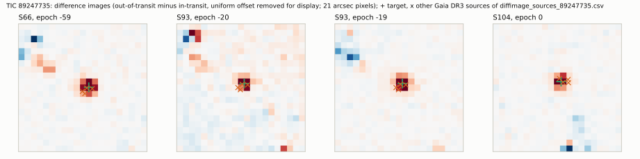</picture>

### 3.6 TRICERATOPS

Same set-up as section 1.6, with the four epochs (sectors 66, 93 and 104; per-sector $`r < 2.0`$ px apertures of 11,
14 and 12 pixels), baselines over $`\pm 0.8`$ d, 144 bins, out-of-transit bin scatter 542 ppm, transit depth
$`k^2 = 0.00826`$ (raw aperture flux, `dilution_corrected=False`), Gaia DR3 background (12918 stars), 3 seeds. No
contrast curve.

| seed | FPP | NFPP | degenerate |
|---|---|---|---|
| 1 | $`4.2 \times 10^{-15}`$ | $`4.8 \times 10^{-63}`$ | no |
| 2 | $`1.5 \times 10^{-3}`$ | $`1.7 \times 10^{-62}`$ | no |
| 3 | $`2.7 \times 10^{-3}`$ | $`4.4 \times 10^{-63}`$ | no |

Mean scenario probabilities: TP 0.608, PTP 0.294, DTP 0.096, STP 0.0014; best-fit planet radius of the TP scenario
9.1-9.5 $`R_\oplus`$. In every seed the FPP consists of the STP scenario alone (a planet transiting an unresolved
bound companion); every eclipsing-binary scenario, on the target or on a neighbour, is below $`10^{-40}`$. All three
seeds are below the thresholds FPP $`< 0.015`$ and NFPP $`< 0.001`$ of Giacalone et al. (2021), but the seed-to-seed
range ($`4 \times 10^{-15}`$ to $`2.7 \times 10^{-3}`$) means that the FPP is known only as an upper value of about
$`3 \times 10^{-3}`$; more seeds would be needed for a mean. A brown dwarf or very-low-mass star transiting the target
is not a TRICERATOPS scenario; it is constrained only by the Gaia radial velocities (section 3.7).

### 3.7 Companion-mass limits from Gaia

`scripts/gaia_companion_limits.py`.

- Radial velocity: 14 Gaia transits, `rv_chisq_pvalue` 0.52 (no significant variability), `rv_amplitude_robust`
  5.68 km/s. Taking `rv_amplitude_robust` as an upper bound on $`2K`$ gives $`K < 2.84`$ km/s and, for
  $`M_\star = 0.69\,M_\odot`$ and $`P = 18.32`$ d ($`K = 98.7`$ m/s per $`M_\mathrm{J}`$),
  $`M_2 \sin i < 29\,M_\mathrm{J}`$. Stellar companions at this period are excluded; brown dwarfs below about
  $`30\,M_\mathrm{J}`$ and planets are not.
- Astrometry: the semi-amplitude of the star's orbit is 0.05 mas for a 30 $`M_\mathrm{J}`$ companion and 0.39 mas for
  0.3 $`M_\odot`$ (companion light neglected), so Gaia DR3 astrometry is sensitive only to stellar companions; RUWE
  1.099 does not indicate one but is not a formal limit.
- No proper-motion anomaly is available (the star is not in Hipparcos).

### 3.8 Catalogue and literature checks

All queries were run with a positive control.

| date | source | control | result |
|---|---|---|---|
| 2026-10-18 | VSX (120"; API and VizieR B/vsx) | AM Her | two variables found by Gaia, at 52" (ROT, $`G = 14.95`$) and 110" (DSCT/GDOR/SXPHE, $`G = 17.9`$); nothing at the target |
| 2026-10-18 | SIMBAD (60") | AM Her | SCR J1820-4533, high-proper-motion star, 1 reference (Boyd et al. 2011, proper-motion discovery) |
| 2026-10-18 | Gaia DR3 `vari_*` (6) and `nss_*` (4) tables | a row of each table | no entry |
| 2026-10-18 | ADS full text, 24 identifier strings (TIC, Gaia DR2/DR3, SCR, 2MASS, UCAC4, AllWISE, CatWISE, DENIS, SkyMapper) | "WD 0752-146" | no publication on the star (the string "TIC-89247735" matches 21 unrelated catalogue records of 1995-96) |
| 2026-10-18 | VizieR, all tables within 5" (70 tables) | AM Her (253 tables) | catalogue photometry and astrometry only; no period, eclipse or planet table |
| 2026-10-18 | Kostov et al. 2025 (J/ApJS/279/50) | three TIC entries | not among the new (table 3) or known (table 4) eclipsing binaries; listed in table 2, the list of about 900,000 searched targets |
| 2026-10-18 | Prsa et al. 2022 (J/ApJS/258/16); Valizadegan et al. 2025 (J/AJ/170/287, tables 5, 13, 14, 16); Mueller-Horn et al. 2026 (J/A+A/709/A62) | entries of each table | not listed |
| 2026-10-18 | source files of 14 arXiv papers on TESS duo- and single-transit candidates (TIC, Gaia, 2MASS ids and coordinates) | - | not listed |
| 2026-10-18 | ESO Science Archive: ObsCore 10" cone and raw science frames in a $`\pm 72`$" box, all instruments; object-name queries | TIC 402710280 (5 ObsCore rows, 15 HARPS frames) | no data |
| 2026-10-15 | ExoFOP TOI list (8151 rows) and CTOI list (5138 rows) | TOI-700 (TIC 150428135) in the TOI list | no TOI, no CTOI |
| 2026-10-18 | ExoFOP TOI and CTOI lists and target page; NASA Exoplanet Archive `toi`, `ps`, `pscomppars`, `td` tables | TOI-700 (TIC 150428135) | not reachable: ExoFOP returned the body "Array" for the control and the target, the NASA Exoplanet Archive returned HTTP 503 and 403 and database-connection errors for the control query (18:19-18:45 UTC) |

The live TOI and CTOI lists and the NASA Exoplanet Archive could not be queried on 2026-10-18; the ExoFOP lists of
2026-10-15 do not contain the star, and a TOI issued after that date cannot be excluded. Archival ground-based light
curves: section 3.11.

### 3.9 Predicted transits (2026-10-18 to 2027-10-18)

`data/predicted_transits_89247735.csv`; $`T_{14} = 4.50`$ h.

| epoch | mid-transit (UTC) | BJD$`_\mathrm{TDB}`$ | ephemeris error (min) | TESS |
|---|---|---|---|---|
| 8 | 2026-10-29 21:30 | 2461343.3944 | 1.5 | |
| 9 | 2026-11-17 05:17 | 2461361.7175 | 1.5 | |
| 10 | 2026-12-05 13:04 | 2461380.0407 | 1.5 | |
| 11 | 2026-12-23 20:50 | 2461398.3639 | 1.5 | |
| 12 | 2027-01-11 04:35 | 2461416.6871 | 1.5 | |
| 13 | 2027-01-29 12:19 | 2461435.0102 | 1.6 | |
| 14 | 2027-02-16 20:03 | 2461453.3334 | 1.6 | |
| 15 | 2027-03-07 03:46 | 2461471.6566 | 1.6 | |
| 16 | 2027-03-25 11:29 | 2461489.9798 | 1.6 | |
| 17 | 2027-04-12 19:12 | 2461508.3029 | 1.6 | |
| 18 | 2027-05-01 02:55 | 2461526.6261 | 1.6 | |
| 19 | 2027-05-19 10:39 | 2461544.9493 | 1.7 | |
| 20 | 2027-06-06 18:23 | 2461563.2725 | 1.7 | |
| 21 | 2027-06-25 02:08 | 2461581.5956 | 1.7 | |
| 22 | 2027-07-13 09:54 | 2461599.9188 | 1.7 | |
| 23 | 2027-07-31 17:40 | 2461618.2420 | 1.8 | |
| 24 | 2027-08-19 01:27 | 2461636.5651 | 1.8 | |
| 25 | 2027-09-06 09:15 | 2461654.8883 | 1.8 | |
| 26 | 2027-09-24 17:02 | 2461673.2115 | 1.8 | |
| 27 | 2027-10-13 00:50 | 2461691.5347 | 1.9 | |

TESS (tess-point 0.9.5.post1): the star was on silicon in sectors 13, 66, 93 and 104; no later sector up to 134 (the
end of the tess-point pointing table, mid-time 2028-08-30) covers it (`data/tess_sectors_89247735.csv`).

### 3.10 Search for additional transiting signals

Data: the TESScut $`r = 2.0`$ px light curves of sectors 13 (30-min cadence), 66, 93 and 104 (200-s), quality 0, the
four transits masked ($`\pm 1.125\,T_{14}`$), 1.0-d biweight detrending (wotan), $`6\sigma`$ clipping. Masked as
systematics: cadences with background above 1.5 times the sector median, 0.25 d at each gap longer than 0.1 d and at
the sector edges, BTJD 4197.55-4197.85 (a common-mode feature of sector 104), and $`\pm 0.3`$ d around the six
non-transit events of section 3.4. Masked fractions 8, 28, 14 and 12 % (sectors 13, 66, 93, 104); noise per hour 570,
440, 410 and 460 ppm. Every search was repeated on the inverted light curves, whose maxima set the thresholds.

- Periodic, 0.5-13.5 d: box least squares per sector (10-min bins, durations 1-8 h), the $`\Delta\chi^2`$ of each
  duration divided by the square of its red-noise factor (1.00-1.25), summed over the four sectors with the phase free
  per sector. Highest peak $`P = 0.590`$ d, stacked S/N 9.18; inverted light curves: 0.591 d, 8.96, from the same
  sector-13 feature. No other peak exceeds the inverted maximum. Transit least squares per sector: SDE 4.6-8.3, each
  below the SDE of the inverted light curve of the same sector (5.6-8.0) or within 0.3 of it, and none above 9.
- Single events (box filter, durations 1-8 h, red-noise normalised): maximum S/N of the inverted light curves 4.7. Two
  events exceed it: BTJD 3854.641 (S/N 5.9, 3 h, $`1430 \pm 330`$ ppm; background 1.39 times higher in the window,
  0.5 d before the end of sector 93, QLP SAP $`320 \pm 580`$ ppm) and BTJD 4179.568 (S/N 5.1, 8 h, at the end of the
  orbit-start ramp of sector 104; $`-20`$ to $`-660`$ ppm with a local quadratic baseline). Neither is a transit-like
  dip on the target.

Sensitivity (injection and recovery, 210 transits, 6 per cell): batman transits (circular, $`b`$ uniform in 0-0.7,
$`R_\star = 0.74\,R_\odot`$, $`M_\star = 0.69\,M_\odot`$, diluted with $`f_t = 0.735`$) multiplied into the raw
TESScut flux and passed through the same detrending, masks and searches. Recovered: stacked box-search S/N $`\ge 9.5`$
at $`P`$, $`P/2`$ or $`2P`$ (within 1 %) for $`P \le 13.5`$ d; for longer periods at least one injected transit found by
the single-event filter at S/N $`\ge 6.0`$. Fraction recovered:

| $`R_\mathrm{p}`$ ($`R_\oplus`$) \ $`P`$ (d) | 1 | 3 | 7 | 12 | 20 | 35 | 60 |
|---|---|---|---|---|---|---|---|
| 1.5 | 0 | 0 | 0 | 0 | 0 | 0 | 0 |
| 2.0 | 0.83 | 0 | 0 | 0 | 0 | 0 | 0 |
| 3.0 | 1 | 1 | 0.83 | 0.83 | 0 | 0.17 | 0 |
| 4.0 | 1 | 1 | 1 | 1 | 1 | 0.67 | 0.50 |
| 6.0 | 1 | 1 | 1 | 1 | 1 | 1 | 0.50 |

At 35 and 60 d the losses at 4-6 $`R_\oplus`$ are injections without a transit in the unmasked data; every injection
with a transit in the data was recovered. No second transiting signal is found. Planets larger than about
3 $`R_\oplus`$ with $`P \lesssim 13`$ d, and larger than about 4 $`R_\oplus`$ out to 60 d when a transit falls in the
data, would have been detected; planets below about 2-3 $`R_\oplus`$ are not excluded at any period.

### 3.11 Archival ground-based photometry

The ephemeris of section 3.2 propagates to a mid-transit uncertainty of 1.2-21 min at the epochs of the archival data
(2000-2026), 0.4-8 % of $`T_{14}`$. Fold test: times converted to BJD$`_\mathrm{TDB}`$, in-transit points within
1.69 h of the predicted mid-time, out-of-transit points more than $`T_{14}/2 + 0.02`$ d from it; depth
$`1 - \langle f_\mathrm{in} \rangle / \langle f_\mathrm{out} \rangle`$ against an expected 1.15 % (undiluted
aperture), compared with 2000 random ephemeris shifts.

| data set | coverage | points in predicted transits | result |
|---|---|---|---|
| ASAS-SN v1 photometry database ($`V`$) | 144 points, 2016-03-17 to 2018-09-28, scatter 1.15 % | 3 (cycles $`-204`$, $`-174`$, $`-164`$) | mean depth $`3.4 \pm 0.6`$ %, $`3.9\sigma`$ deeper than expected; not a detection |
| ATLAS forced photometry ($`c`$, $`o`$) | 2671 points, 2017-06-30 to 2026-10-17 | $`c`$: 0; $`o`$: 9 on 2 nights | no constraint: saturated at this brightness (median PSF-fit $`\chi^2/N`$ 2469); expected transit S/N 0.3 |
| ASAS-3 ($`V`$) | 751 grade A/B points, 2000-2009, scatter 5.4 % | 9 | $`5.6 \pm 3.2`$ %; no constraint |
| SuperWASP DR1 | no data: nearest DR1 object 0.92 deg away | - | not covered |
| SkyMapper DR4 | 63 epochs ($`uvgriz`$), 2015-08 to 2021-08 | 0 | no constraint |
| NEOWISE single exposures | 202 good exposures in 21 visits, 2014-2024 | 0 | no constraint |
| Gaia DR3 epoch photometry; ZTF | none (`has_epoch_photometry` False); outside the ZTF footprint (Dec $`-45.6`$) | - | - |
| KELT-South (field S36, 2013-05-15 to 2018-10-17) | the target lies in the field | - | not retrieved (below) |
| ASAS-SN Sky Patrol v2 ($`V`$, $`g`$) | - | - | not retrieved (below) |

The three ASAS-SN v1 points (relative fluxes 0.946, 0.972 and 0.985, at $`+0.11`$, $`-1.17`$ and $`+0.70`$ h from the
predicted mid-times) are the first, third and fifth faintest of the 144 points; their mean depth is three times the
TESS depth, and two other points of the light curve are also below 0.98. They are not counted as a detection and add
no period information. No archival data set detects the transit, and none refines the period.

Not retrieved on 2026-10-18 (holes, not non-detections): the KELT-South light curves, which are served by the NASA
Exoplanet Archive, whose database returned Oracle errors (ORA-00604, ORA-01653) for the target and for a control
position at about 19:00, 19:16 and 20:28 UTC; the NASA Exoplanet Archive tables in general (section 3.8); the ASAS-SN
Sky Patrol v2 light-curve service (out of service); SPHEREx epochs (IRSA TAP connection reset twice). Positive
controls: WASP-17 (SuperWASP), Proxima Centauri (NEOWISE).

## 4. TIC 455017950

### 4.1 Host star

| quantity | value | source |
|---|---|---|
| identifiers | TIC 455017950, HD 134147, HIP 74344, CPD-64 3112, TYC 9029-1371-1, 2MASS J15113819-6456121, Gaia DR3 (= DR2) 5825217968423162752, 1RXS J151138.2-645610, 3eRASS J151137.5-645611 | SIMBAD, VizieR |
| position (ICRS, epoch 2016.0) | RA 227.9087992, Dec $`-`$64.9369219 | Gaia DR3 |
| proper motion (mas/yr) | $`-`$38.134, $`-`$46.527 | Gaia DR3 |
| parallax (mas) | $`15.3588 \pm 0.0129`$ | Gaia DR3 |
| distance (pc) | $`65.09 \pm 0.13`$ | TIC v8.2 |
| $`G`$, $`BP-RP`$ | 9.659, 0.985 | Gaia DR3 |
| $`T`$, $`V`$, $`B`$, $`J`$, $`H`$, $`K`$ | 9.142, 9.86, 10.611, 8.448, 8.065, 7.977 | TIC v8.2 (ExoFOP) |
| spectral type | G8/K0V | Houk & Cowley (1975) |
| $`T_\mathrm{eff}`$ (K) | $`5312 \pm 118`$ (TIC); 5314 (Gaia GSP-Phot); 5315 (Gaia GSP-Spec); $`5323 \pm 100`$ (infrared flux method, Casagrande et al. 2011); $`5309 \pm 48`$ (Masana et al. 2006) | TIC v8.2; Gaia DR3; VizieR J/A+A/530/A138; PASTEL |
| $`R_\star`$, $`M_\star`$ (TIC) | $`0.794 \pm 0.042\,R_\odot`$, $`0.91 \pm 0.11\,M_\odot`$ ($`\log g = 4.597 \pm 0.079`$, $`\rho_\star = 2.56 \pm 0.58`$ g cm$`^{-3}`$) | TIC v8.2 |
| RUWE; `ipd_frac_multi_peak`; `ipd_gof_harmonic_amplitude`; `non_single_star` | 0.899; 0; 0.0106; 0 | Gaia DR3 |
| `astrometric_excess_noise` (mas; significance); `duplicated_source` | 0.069; 9.4; True (also set for 8.5 % of a random sample of stars with $`G`$ = 9.4-9.9) | Gaia DR3 |
| radial velocity (km/s) | $`-8.23 \pm 0.15`$ (49 transits, 25 deblended); `rv_amplitude_robust` 2.18; `rv_chisq_pvalue` 0.028; `rv_renormalised_gof` 0.51 | Gaia DR3 |
| other radial velocities (km/s) | CORAVEL $`-8.4 \pm 0.1`$ (2 epochs 400 d apart, $`P(\chi^2) = 0.92`$), $`v \sin i = 3`$ km/s; Pulkovo $`-8.0 \pm 0.4`$; Gaia DR2 $`-8.42 \pm 0.25`$ | VizieR V/117, III/252, I/345 |
| variability | Gaia `phot_variable_flag` VARIABLE, classifier SOLAR_LIKE, `vari_rotation_modulation` period 3.387 d (also the only VSX entry, type ROT); TESS rotation period 8.3 d (text below) | Gaia DR3, VSX |
| Hipparcos | field H61 (`Qual`) = S, "suspected non-single" (set for 7624 of 118,218 entries); no variability flag, $`Hp`$ scatter 0.039 mag; Hipparcos 2 (van Leeuwen 2007): single-star 5-parameter solution, F2 = 0.00 over 198 transits | VizieR I/239, I/311 |
| Hipparcos-Gaia accelerations | HGCA $`\chi^2 = 0.58`$; Kervella et al. (2022) proper-motion-anomaly S/N 0.97, 0.87, 1.28 (no binary flag) | VizieR J/ApJS/254/42, J/A+A/657/A7 |
| high-resolution imaging | SOAR HRCam speckle, $`I`$ band, epoch 2019.54: unresolved, $`5\sigma`$ contrast $`\Delta m = 2.74`$ at 0.15" and 4.00 at 1" | Tokovinin et al. (2020), VizieR J/AJ/160/7 (table 3) |
| X-ray | 2RXS: $`F_X = 1.2 \times 10^{-13}`$ erg s$`^{-1}`$ cm$`^{-2}`$; 3eRASS (eROSITA DR2, 0.2-2.3 keV, 3.8" from the target): $`9.0 \times 10^{-14}`$; $`\log L_X/L_\mathrm{bol} = -4.46`$ and $`-4.58`$ | VizieR J/A+A/712/A171 |
| TIC contamination ratio | 0.051 | TIC v8.2 |
| Gaia DR3 sources within 60" | 232 (51 with $`G < 19`$); nearest: Gaia DR3 5825217968399119488, $`G = 17.77`$, 6.1"; nearest with $`G < 17`$: Gaia DR3 5825217964086439552 (TIC 455017931), $`G = 14.91`$, 10.0", parallax 0.53 mas (background) | Gaia DR3 |
| SED fit ($`A_V = 0`$, without SkyMapper $`u`$, $`v`$) | $`T_\mathrm{eff} = 5260`$ K, $`R_\star = 0.805\,R_\odot`$, $`L_\star = 0.447\,L_\odot`$; $`\chi^2 = 15.0`$ for 11 degrees of freedom | this work (`scripts/sed_fit.py`, `data/sed_455017950.csv`); photometry: Gaia DR3 $`G`$, $`BP`$, $`RP`$; Tycho-2 $`B_T`$, $`V_T`$; SkyMapper DR4 $`g`$, $`r`$, $`i`$, $`z`$ (PSF); 2MASS $`J`$, $`H`$, $`K_s`$; AllWISE W1, W2 |
| adopted $`T_\mathrm{eff}`$ (K), $`L_\star`$ ($`L_\odot`$), $`R_\star`$ ($`R_\odot`$) | $`5300 \pm 60`$, $`0.455 \pm 0.02`$, $`0.800 \pm 0.024`$ | this work (text below the table) |
| adopted $`M_\star`$ ($`M_\odot`$), $`\log g`$, $`\rho_\star`$ (g cm$`^{-3}`$) | $`0.88 \pm 0.05`$, $`4.58 \pm 0.03`$, $`2.42 \pm 0.26`$ | this work: Torres et al. (2010) relation; $`\rho_\star`$ from $`M_\star`$ and $`R_\star`$ |
| [Fe/H] | $`-0.13`$ (Casagrande et al. 2011), $`-0.16`$ (GCS), $`-0.07`$ (GSP-Phot), $`+0.08`$ (GSP-Spec); adopted $`-0.10 \pm 0.10`$ | VizieR J/A+A/530/A138, V/130; Gaia DR3 |
| rotation; age | $`P_\mathrm{rot} = 8.3`$ d; gyrochronological age 0.3-0.5 Gyr | this work (text below) |
| kinematics | $`(U, V, W)_\mathrm{LSR} = (-7.3, +5.5, +1.9)`$ km/s, $`\lvert v_\mathrm{LSR} \rvert = 9.3`$ km/s; thin disc (thick-disc to thin-disc probability ratio 0.006, Bensby et al. 2014) | this work, from the Gaia DR3 astrometry and radial velocity |

SED fit (`scripts/sed_fit.py`): Castelli & Kurucz (2003) model spectra ($`T_\mathrm{eff}`$ 4750-6000 K, $`\log g`$ 4.5
and 5.0, [M/H] $`-0.5`$, 0.0, $`+0.2`$), synthetic photometry with the SVO filter curves and zero points, a free scale,
$`d = 1/(\varpi + 0.02\,\mathrm{mas}) = 65.02`$ pc, $`A_V = 0`$ and an error floor of 0.03 mag. With all bands:
5290 K, $`0.797\,R_\odot`$, $`0.448\,L_\odot`$, $`\chi^2 = 21.3`$ for 13 degrees of freedom; [M/H] = $`-0.5`$ to
$`+0.2`$: 5230-5270 K; $`A_V`$ = 0.05, 0.10, 0.20: 5310, 5370 and 5480 K, $`L_\star`$ = 0.461, 0.477 and
0.508 $`L_\odot`$, $`\chi^2`$ = 14.0, 13.2 and 11.9, so the SED alone does not separate $`T_\mathrm{eff}`$ from the
extinction. A Monte Carlo fit of the same photometry with $`A_V`$ free in 0-0.05 (Tycho-2 errors added in quadrature
to 0.03 mag; no script in this repository) gave $`5286 \pm 31`$ K, $`0.804 \pm 0.009\,R_\odot`$,
$`0.455 \pm 0.006\,L_\odot`$ and $`A_V = 0.03 \pm 0.02`$. The extinction is close to 0: the star lies at 65 pc,
inside the Local Bubble; Casagrande et al. (2011) give $`E(B-V) = 0.00`$; the Schlegel et al. (1998) value of 0.58
is the full column at Galactic latitude $`-6^\circ`$ and does not apply at this distance; and the spectroscopic and
infrared-flux-method $`T_\mathrm{eff}`$ values (5309-5323 K) agree with the low-extinction fits. Luminosity: SED
0.447-0.461 $`L_\odot`$ ($`A_V`$ = 0-0.05), 0.433 $`L_\odot`$ from the infrared-flux-method bolometric flux of
Casagrande et al. (2011) ($`3.265 \times 10^{-9}`$ erg s$`^{-1}`$ cm$`^{-2}`$), and 0.475 $`L_\odot`$ (Gaia FLAME).
Adopted: $`T_\mathrm{eff} = 5300 \pm 60`$ K (spread of the SED fits with $`A_V \le 0.05`$, the infrared flux method,
Masana et al. 2006, GSP-Phot and GSP-Spec), $`L_\star = 0.455 \pm 0.02\,L_\odot`$ and
$`R_\star = \sqrt{L_\star}\,(T_\mathrm{eff}/5772\,\mathrm{K})^{-2} = 0.800 \pm 0.024\,R_\odot`$ (solar units;
error with a 3 % floor). Other radius values: 0.797-0.805 $`R_\odot`$ (SED fits), 0.813 $`R_\odot`$ (FLAME and
GSP-Phot), $`0.794 \pm 0.042\,R_\odot`$ (TIC). Mass: $`0.87 \pm 0.055\,M_\odot`$ from the Torres et al. (2010)
relation, 0.907 (FLAME), 0.85 (Casagrande et al. 2011) and 0.81 $`M_\odot`$ (GCS); adopted $`0.88 \pm 0.05\,M_\odot`$.
The star lies on the main sequence for its $`T_\mathrm{eff}`$ ($`M_G = 5.59`$; GCS: 0.25 mag above the zero-age main
sequence), and the SED radius agrees with the spectroscopic $`\log g`$ of 4.61 (Casagrande et al. 2011); an unresolved
companion contributing more than about 20 % of the $`G`$-band flux is disfavoured.

Rotation and activity: the TESScut light curves show a spot modulation of 1.5-2.7 % (5-95 % range) with periods of
8.18-8.49 d (Lomb-Scargle; sector 38: 4.0 d, half the period) and 8.06-8.40 d (autocorrelation) in all eight sectors.
The Gaia DR3 period of 3.387 d does not appear in the TESS data; other catalogue values are 8.67 d (VizieR
J/ApJS/276/57), 6.82 d, 3.99 d and 1.13 d (KELT). With $`R_\star = 0.80\,R_\odot`$, $`P_\mathrm{rot} = 8.3`$ d gives an
equatorial velocity of 4.9 km/s, consistent with the CORAVEL $`v \sin i = 3`$ km/s. Gyrochronology with
$`B-V = 0.756 \pm 0.03`$: 445 (413-482) Myr (Mamajek & Hillenbrand 2008) and 321 (290-358) Myr (Barnes 2007); the
X-ray level ($`\log L_X/L_\mathrm{bol} = -4.6`$ to $`-4.5`$; the Wright et al. 2011 relation predicts $`-4.3`$ to
$`-4.6`$ at a Rossby number of about 0.5) and the Gaia FLAME age (0.2-2.6 Gyr) agree; adopted age 0.3-0.5 Gyr. The
SPYGLASS young-star probability is 0.003 (VizieR). The Gaia DR3 ESP-CS Ca II infrared-triplet activity index is
0.0396 nm. No flares are listed for the star in two TESS flare catalogues. No public high-resolution spectrum exists
(section 4.8), so no Ca II H and K, lithium or spectroscopic $`v \sin i`$ measurement beyond CORAVEL is available.
Membership in moving groups was not tested.

Hipparcos "suspected non-single" flag: the Geneva-Copenhagen Survey flags the star as a binary (`fb = *` in Nordström et
al. 2004, `fb = 1` in Holmberg et al. 2009, "confirmed or suspected binary of any type, from photometry, radial velocity
or astrometry"). The flag does not come from the radial velocities ($`P(\chi^2) = 0.92`$ against the survey criterion
$`P < 0.01`$), from a visual companion (no CCDM, TDSC, WDS or SB9 entry within 60") or from a photometric-distance
discrepancy; it corresponds to the Hipparcos main-catalogue field H61 = S. The Hipparcos documentation does not say which
diagnostic set it for this star. Later data do not show a companion: the Hipparcos 2 solution is single-star with
F2 = 0.00, Gaia DR3 gives RUWE 0.899, `ipd_frac_multi_peak` 0 and no non-single-star solution, the HGCA and the
Kervella et al. (2022) proper-motion anomalies are not significant, and SOAR speckle did not resolve the star. The
companion limits are combined in section 4.6.

### 4.2 Transits and ephemeris

TESScut cutouts of sectors 12, 38, 39, 65, 99, 100, 101 and 102 are requested at the Gaia DR3 position, and the
apertures are centred on the proper-motion-corrected position of each sector. Five transits are covered (sectors 38,
65, 99, 100 and 102; cycles $`-42`$, $`-24`$, 0, 1 and 2); sector 12 contains no predicted transit (cycles $`-60`$ and
$`-59`$ fall outside the data), sector 39 ends 0.94 d before cycle $`-41`$, and sector 101 contains none. Common-shape fit
of the five transits in the $`r = 2.0`$ px circular-aperture photometry (`scripts/fit_transits.py`; batman model,
quadratic limb darkening $`u = (0.42, 0.20)`$, one quadratic baseline per epoch solved jointly, quality-0 cadences within
$`\pm 0.8`$ d of each transit):

| quantity | $`r = 2.0`$ px, $`\pm 0.8`$ d, quadratic (nominal) | $`a/R_\star`$ fixed at the TIC density (60.6) | $`r = 1.5`$ px | $`r = 3.0`$ px | $`\pm 0.6`$ d, cubic | $`\pm 1.0`$ d, cubic |
|---|---|---|---|---|---|---|
| $`k = R_\mathrm{p}/R_\star`$, raw aperture flux | 0.0347 | 0.0357 | 0.0347 | 0.0343 | 0.0344 | 0.0347 |
| depth $`k^2`$ (ppm) | 1205 | 1271 | 1201 | 1179 | 1184 | 1206 |
| $`b`$ | 0.12 (not constrained) | 0.47 | 0.00 | 0.03 | 0.00 | 0.03 |
| $`a/R_\star`$ | 67.6 | 60.6 | 69.1 | 67.6 | 68.3 | 68.1 |
| $`T_{14}`$, $`T_{23}`$ (h) | 4.72, 4.39 | 4.73, 4.31 | 4.64, 4.33 | 4.75, 4.43 | 4.70, 4.38 | 4.71, 4.40 |
| $`\chi^2`$ (points) | 2746.3 (2747) | 2746.6 | 2746.9 | 2746.6 | 2084.9 (2086) | 3409.3 (3410) |
| linear-ephemeris $`\chi^2`$ (3 degrees of freedom) | 9.3 | 5.6 | 3.9 | 10.8 | 18.1 | 15.5 |

Linear ephemeris of the nominal fit: $`P = 40.605660 \pm 0.000074`$ d, $`T_0 = 2461055.48930 \pm 0.00179`$
BJD$`_\mathrm{TDB}`$ (BTJD 4055.48930). The depth is the same in all apertures, as expected for a source on the target;
with limb darkening the central depth is about $`1.2\,k^2`$.

$`\chi^2`$ profile over $`b`$ (per-epoch noise fixed at the values of the nominal fit, `--bfix`): $`\Delta\chi^2`$ = 0.2,
0.4, 0.8, 1.3, 1.1, 0.9 and 3.4 for $`b`$ = 0.3, 0.5, 0.6, 0.7, 0.8, 0.85 and 0.9 (relative to $`b = 0`$), so $`b`$ is
not constrained below about 0.9. Ingress and egress (about 10 min for a planet) are not resolved: a diluted eclipse of a
larger body (radius ratio fixed at 0.2, 0.3, 0.4 or 0.5, eclipse depth scaled freely) fits equally well ($`\chi^2`$ =
2746.3-2746.7 against 2746.2 for the planet model; no script in this repository). The transit shape therefore does not
exclude a blended eclipsing binary by itself; the stellar density does: $`a/R_\star`$ = 55-69 for $`b \le 0.6`$ implies
a circular-orbit density of 1.9-3.8 g cm$`^{-3}`$, i.e. a dwarf host, while the brightest neighbour, the $`G = 14.91`$
star at 10" ($`M_G \approx 3.5`$ for its parallax, a turnoff star or subgiant), would need $`a/R_\star \approx 25`$ and
$`T_{14} > 10`$ h at $`b = 0`$, a grazing geometry or a high eccentricity.

Dilution (`scripts/dilution_correction.py`, Gaia DR3 $`G`$-band fluxes of the 231 sources with a $`G`$ magnitude within
60", per-epoch Gaussian PSF of sigma 0.59-0.80 px and 1.5 times that):

| aperture | raw depth $`k^2`$ (ppm) | target flux fraction | corrected depth (ppm) | $`k`$ | $`R_\mathrm{p}`$ ($`R_\oplus`$, TIC $`R_\star`$) |
|---|---|---|---|---|---|
| $`r = 1.5`$ px | 1201 | 0.977 | 1230 | 0.0351 | 3.0 |
| $`r = 2.0`$ px | 1205 | 0.965 | 1248 | 0.0353 | 3.1 |
| $`r = 3.0`$ px | 1179 | 0.940 | 1254 | 0.0354 | 3.1 |

For comparison, the TIC contamination ratio of 0.051 corresponds to a fraction of 0.951, and TRICERATOPS gives 0.950 for
the $`r = 2.0`$ px apertures.

Joint fit with the stellar-density prior (`scripts/fit_free_dilution.py --rho-prior`,
`data/fit_free_dilution_rho_455017950.csv`; adopted): raw $`r = 2.0`$ px flux of the five epochs (quality 0,
$`\pm 0.8`$ d, 2749 points), $`F = f_t\,T(t) + (1 - f_t)`$ with $`f_t \sim N(0.966, 0.010)`$ (the per-epoch fractions
of the table above, 0.962-0.969), Kipping $`q_1`$, $`q_2`$ with Gaussian priors $`u_1 = 0.42 \pm 0.1`$,
$`u_2 = 0.20 \pm 0.1`$, a circular orbit, the circular-orbit density with the prior $`2.40 \pm 0.30`$ g cm$`^{-3}`$, five
free mid-transit times, a quadratic baseline per epoch solved linearly, per-epoch noise fixed at the residual rms of the
common-shape fit (357-779 ppm); exposure time = cadence (600 s in sector 38, 200 s otherwise). emcee, 44 walkers
$`\times`$ 6000 steps, the first 2000 discarded. The same model without the density prior
(`data/fit_free_dilution_455017950.csv`) gives the circular-orbit density from the light curve alone.

| quantity | with the density prior (adopted); median and 68 % interval (95 % interval) | without the density prior |
|---|---|---|
| $`k = R_\mathrm{p}/R_\star`$ (undiluted) | $`0.0362^{+0.0008}_{-0.0009}`$ (0.0345-0.0378) | $`0.0364^{+0.0030}_{-0.0014}`$ (0.0341-0.0419) |
| depth $`k^2`$ (ppm) | $`1310^{+62}_{-62}`$ | $`1327^{+226}_{-98}`$ |
| $`f_t`$ | $`0.966 \pm 0.010`$ (equal to the prior) | $`0.965 \pm 0.010`$ |
| $`b`$ | $`0.49^{+0.07}_{-0.09}`$ (0.29-0.62) | $`0.47^{+0.33}_{-0.33}`$ (0.02-0.88) |
| $`a/R_\star`$; $`\rho_\mathrm{circ}`$ (g cm$`^{-3}`$) | $`60.0^{+2.5}_{-2.5}`$; $`2.48^{+0.32}_{-0.30}`$ | $`60.6^{+7.0}_{-18.3}`$; $`2.56^{+1.00}_{-1.69}`$ (0.43-3.91) |
| $`T_{14}`$, $`T_{23}`$ (h) | $`4.74^{+0.08}_{-0.09}`$, $`4.31^{+0.10}_{-0.11}`$ | $`4.74^{+0.16}_{-0.11}`$, $`4.27^{+0.13}_{-0.39}`$ |
| $`R_\mathrm{p}`$ ($`R_\star = 0.800 \pm 0.024\,R_\odot`$) | $`3.16^{+0.12}_{-0.12}\,R_\oplus`$ = $`0.282 \pm 0.011\,R_\mathrm{J}`$ (2.93-3.39 $`R_\oplus`$) | $`3.19^{+0.26}_{-0.16}\,R_\oplus`$ |
| best $`\chi^2`$ (2749 points); autocorrelation times (steps) | 2763.6; 115-146 | 2763.5; 215-479 |

An independent implementation of the same model (2746 points, windows centred on the linear ephemeris; no script in this
repository) gave $`k = 0.0363^{+0.0008}_{-0.0009}`$, $`b = 0.49 \pm 0.08`$ and $`R_\mathrm{p} = 3.17 \pm 0.13\,R_\oplus`$
with the prior, and $`b = 0.36^{+0.30}_{-0.24}`$ and $`\rho_\mathrm{circ} = 2.98^{+0.64}_{-1.38}`$ g cm$`^{-3}`$ without
it; without the prior $`b`$ and $`\rho_\mathrm{circ}`$ are degenerate, and the chains converge slowly.

Adopted: $`R_\mathrm{p} = 3.16 \pm 0.12\,R_\oplus`$ ($`R_\star = 0.800 \pm 0.024\,R_\odot`$), true depth about 1310 ppm.
With $`M_\star = 0.88\,M_\odot`$: $`a = 0.2215`$ au ($`a/R_\star = 59.5`$ from the physical values), equilibrium
temperature 486 K (zero albedo, full redistribution) and insolation 9.3 times that of the Earth. With the TIC radius and
the common-shape fit the radius is 3.0-3.1 $`R_\oplus`$ (table above).

Photoeccentric constraint (Dawson & Johnson 2012; the fit without the density prior): with
$`\rho_\star = M_\star/R_\star^3`$ drawn from $`M_\star = 0.88 \pm 0.05\,M_\odot`$ and $`R_\star = 0.800 \pm 0.024\,R_\odot`$
($`\rho_\star = 2.42^{+0.27}_{-0.24}`$ g cm$`^{-3}`$), $`\rho_\mathrm{circ}/\rho_\star = 1.04^{+0.44}_{-0.68}`$. Uniform
priors on $`e`$ in [0, 0.95) and on $`\omega`$ give $`e = 0.24^{+0.33}_{-0.16}`$, $`e < 0.39`$ (68 %) and $`e < 0.78`$
(95 %); the Savage-Dickey density ratio at $`e = 0`$ is 1.8 (independent implementation: $`e < 0.34`$ and $`< 0.76`$,
ratio 2.0). The light curve is consistent with a circular orbit at $`b \approx 0.5`$; the eccentricity is not measured.
The one-sided 95 % upper limit on $`\rho_\mathrm{circ}`$ is 3.8 g cm$`^{-3}`$.

### 4.3 Transit epochs and O-C

`data/transit_times_455017950.csv`; errors as in section 1.3. Depths are raw $`r = 2.0`$ px depths (not dilution
corrected).

| epoch | sector | $`t_c`$ (BTJD) | error (min) | O $`-`$ C (min) | depth (ppm) | note |
|---|---|---|---|---|---|---|
| $`-42`$ | 38 | 2350.050711 | 3.8 | $`-1.3`$ | $`1173 \pm 74`$ | 10-min cadence |
| $`-24`$ | 65 | 3080.955942 | 4.4 | $`+3.6`$ | $`1130 \pm 90`$ | |
| 0 | 99 | 4055.486562 | 3.7 | $`-3.9`$ | $`1270 \pm 79`$ | end of orbit 1; text below |
| 1 | 100 | 4096.088637 | 6.0 | $`-9.1`$ | $`1198 \pm 83`$ | |
| 2 | 102 | 4136.708782 | 5.2 | $`+11.8`$ | $`1254 \pm 92`$ | |

Linear ephemeris: $`\chi^2 = 9.3`$ for 3 degrees of freedom ($`p = 0.025`$). Across the fit variants of section 4.2 the
linear-ephemeris $`\chi^2`$ is 3.9-18.1; epoch 2 is late by +8.5 to +16.4 min and epoch 1 early by $`-5.8`$ to
$`-9.1`$ min in every variant (the two are one cycle apart). Without epoch 0, $`P = 40.605747 \pm 0.000088`$ d
($`\chi^2 = 7.6`$ for 2 degrees of freedom).

Epoch 0 lies at the end of the first orbit of sector 99: the data end at BTJD 4055.735, 3.6 h after egress, on a falling
slope of the spot modulation. Its depth in the joint fit is model-dependent: a 4.7-h box gives 2304 ppm after a 1.0-d
biweight detrending and 597 ppm after a robust spline with 0.5-d knots. It agrees with the ephemeris but is not an
independent confirmation; the period rests on epochs $`-42`$, $`-24`$, 1 and 2. The other four transits lie inside their
orbits, without flagged cadences, background excursions or centroid steps.

Transit-timing variations (no script in this repository): mid-transit times were also measured with the transit shape
fixed and a free depth scale, with a quadratic baseline over $`\pm 0.8`$ d (error = the largest of formal $`\times \beta`$,
prayer-bead and the scatter of the same model injected at about 60 off-transit times of the same sector, 2.4-4.8 min) and
with a Gaussian-process baseline (Matérn-3/2 kernel, celerite, over $`\pm 1.2`$ d; fitted timescales 3-7 d), in the
TESScut photometry and in the QLP SAP light curves (an independent aperture and background; the QLP time stamps of
sectors 99-104 carry the timing error of section 6, so these sets are a consistency check only). O $`-`$ C (min) against
each set's own linear ephemeris:

| set | epoch $`-42`$ | $`-24`$ | 0 | 1 | 2 | $`\chi^2`$ (3 dof) | $`p`$ | $`p`$ without epoch 2 |
|---|---|---|---|---|---|---|---|---|
| TESScut, polynomial | $`-1.2 \pm 4.2`$ | $`+3.7 \pm 5.0`$ | $`-4.6 \pm 3.8`$ | $`-9.5 \pm 5.9`$ | $`+11.8 \pm 4.8`$ | 10.8 | 0.013 | 0.38 |
| QLP SAP, polynomial | $`-1.4 \pm 4.1`$ | $`+1.9 \pm 3.4`$ | $`-2.9 \pm 3.5`$ | $`-9.4 \pm 6.6`$ | $`+8.7 \pm 4.9`$ | 6.3 | 0.099 | 0.41 |
| TESS-SPOC (epoch $`-42`$), SPOC 2-min (epoch $`-24`$), QLP (others) | $`-1.1 \pm 3.9`$ | $`+2.3 \pm 4.0`$ | $`-2.8 \pm 3.5`$ | $`-9.3 \pm 6.6`$ | $`+8.7 \pm 4.9`$ | 6.3 | 0.100 | 0.43 |
| TESScut, Gaussian process | $`-3.2 \pm 5.0`$ | $`+2.4 \pm 3.1`$ | $`-2.7 \pm 5.4`$ | $`-5.3 \pm 2.6`$ | $`+14.7 \pm 4.5`$ | 16.1 | 0.001 | 0.32 |
| QLP SAP, Gaussian process | $`-2.8 \pm 5.1`$ | $`+1.5 \pm 2.7`$ | $`-2.0 \pm 3.3`$ | $`-6.2 \pm 4.0`$ | $`+9.2 \pm 4.4`$ | 7.8 | 0.051 | 0.39 |

A transit-timing variation is not established. Epoch 2 is 2-3 $`\sigma`$ late in every set, and the significance of the
departure from a linear ephemeris depends on the photometry ($`p`$ = 0.001-0.10); without epoch 2 every set is
consistent with a linear ephemeris ($`p`$ = 0.32-0.43), and no other epoch deviates by more than about 2 $`\sigma`$. The
same photons give +8.7 min (QLP aperture) and +11.8 min (TESScut aperture) for epoch 2. A systematic error of 5-10 min in
sector 102, for example from the slope of the spot modulation across the transit, cannot be excluded. A quadratic
ephemeris is not preferred ($`\Delta\chi^2`$ = 0.1-0.6, $`\Delta\mathrm{BIC}`$ = +1.0 to +1.5). A sinusoid scan
(super-periods $`2.1P`$ to 5000 d) gives best super-periods of 271-543 d with $`\Delta\chi^2`$ = 6.3-16.1 and
false-alarm probabilities of 0.00-0.01 (TESScut sets) and 0.06-0.10 (QLP and mixed sets) from 500 white-noise
simulations; these fits have four parameters for five points. The 95 % upper limit on a sinusoidal amplitude is 55 min
(median over super-periods 85-5000 d; 10-90 %: 20 to more than 90 min) for the TESScut polynomial set and 40-47 min for
the QLP sets; near first-order resonances (Lithwick, Xie & Wu 2012, zero free eccentricity) only perturbers of tens of
Earth masses are excluded (for example $`< 18`$-19 $`M_\oplus`$ for exterior 2:1 or 3:2 perturbers 1 % from resonance).
The best-fit sinusoids of the five sets predict +44 to +150 min at cycle 10 (TESS sector 114, 2027-02-25), against
$`\pm 3`$ min for the linear ephemeris, so one further transit timed to 4-5 min would test them.

<picture><source srcset="figures/fold_455017950_dark.svg" media="(prefers-color-scheme: dark)">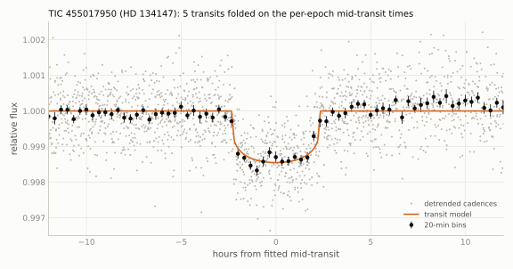</picture>

<picture><source srcset="figures/epochs_455017950_dark.svg" media="(prefers-color-scheme: dark)">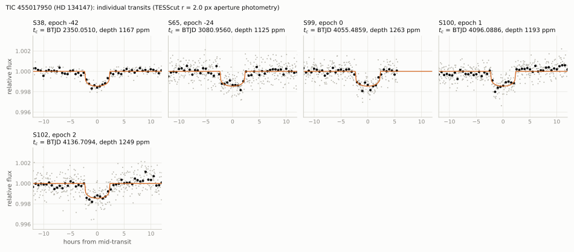</picture>

<picture><source srcset="figures/oc_455017950_dark.svg" media="(prefers-color-scheme: dark)">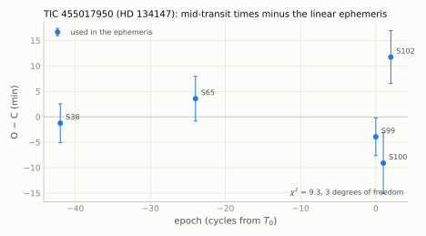</picture>

### 4.4 Checks against false positives

- Public light curves (4.7-h box, quadratic baseline over $`\pm 1`$ d, quality 0; no script in this repository): QLP SAP
  flux shows the transits at $`1337 \pm 86`$, $`1457 \pm 88`$, $`1208 \pm 59`$, $`1114 \pm 72`$ and $`1307 \pm 81`$ ppm
  (epochs $`-42`$, $`-24`$, 0, 1, 2); TESS-SPOC SAP at $`1355 \pm 76`$ and $`1293 \pm 74`$ ppm (epochs $`-42`$, $`-24`$);
  the SPOC 2-min SAP light curve of sector 65 (a guest-investigator target in that sector, section 4.8) at
  $`1316 \pm 74`$ ppm, and its common-shape fit gives $`k^2 = 1132 \pm 70`$ ppm and a mid-time 1.8 min before the TESScut
  value (CROWDSAP 0.945); TARS at $`1709 \pm 187`$ and $`1764 \pm 218`$ ppm (epochs $`-42`$, $`-24`$). The QLP detrended
  fluxes (DET, KSPSAP), which are flattened against the spot modulation, show the transits at about half depth.
- Odd and even transits agree in depth (table 4.3): $`1198 \pm 83`$ ppm (odd, epoch 1) and $`1207 \pm 41`$ ppm (even),
  0.1 $`\sigma`$.
- Period aliases (`scripts/alias_secondary_search.py`, 1.0-d biweight detrending, box of $`0.8\,T_{14}`$): for
  $`P/2 = 20.3028`$ d the three covered half-period epochs show no transit ($`-19 \pm 69`$, $`-145 \pm 76`$ and
  $`268 \pm 82`$ ppm at BTJD 2370.354, 4075.792 and 4116.398; the sector-12 half-period epoch is in the mid-sector gap);
  $`P/3`$: 10 covered epochs without transit; $`P/4`$: 13; $`P/k`$, $`k`$ = 5-12: 19-47 each. $`2P`$ is excluded by the
  consecutive cycles 0, 1 and 2 and by the equal depths of odd and even transits.
- Secondary eclipse (same script): the three covered phase-0.5 epochs give a weighted mean of $`-2 \pm 44`$ ppm
  (3 $`\sigma`$ limit 132 ppm, white noise); the robust scatter of box depths over all off-transit phases is 230 ppm
  (3 $`\sigma`$ limit 691 ppm), and the deepest box at any off-transit phase is 1774 ppm (phase $`+0.43`$, three epochs,
  from the data-edge events below). With a robust spline of 0.5-d knots instead of the biweight filter (no script in this
  repository) the phase-0.5 mean is $`7 \pm 42`$ ppm and the 3 $`\sigma`$ limit from the scatter over phases is 343 ppm.
- Red noise and phase-shift test (no script in this repository; 4.7-h box after the spline and the biweight
  detrendings): of 1918 random single windows away from the transits, 14 and 23 reach the depth of the shallowest transit
  in the same detrending, mostly at data edges, so a single dip of this depth would not be significant on this star. For
  1880 trial shifts of $`T_0`$ at the same period, none reaches the mean box depth of the real ephemeris over the covered
  epochs (spline: 981 ppm against a shifted maximum of 494 ppm and a scatter of 89 ppm, about 11 $`\sigma`$; biweight:
  1373 against 900 and 286 ppm).
- Spot modulation: the star varies by 1.5-2.7 % with $`P_\mathrm{rot} = 8.3`$ d (section 4.1); $`P`$ is not within
  4 % of 13.7 d$`/n`$ or 27.4 d$`/n`$ ($`n`$ = 1-8).
- Other dips: the box search finds events of 1100-2400 ppm off the ephemeris, all at orbit or sector edges, on
  scattered-light ramps or at pointing steps. `scripts/event_checks.py` on six of them: BTJD 2346.001 (4045, 1847 and
  1196 ppm in the $`r`$ = 1.5, 2.0 and 3.0 px apertures, orbit end), 3089.995 (11 flagged cadences in the box, a
  background excursion of 0.8 %, orbit end), 4073.054 (21 flagged cadences, end of sector 99), 4119.794 (centroid shift),
  4133.134 (2214, 2441 and 460 ppm, centroid shift, QLP SAP $`-512 \pm 80`$ ppm) and 4138.374 (background 22 % above its
  baseline, a scattered-light ramp); none behaves like a dip on the target.
- Localisation: the dimming is centred on the target in all five epochs, and every Gaia DR3 source other than the target
  is disfavoured as the host (section 4.5).
- Gaia DR3: RUWE 0.899, `ipd_frac_multi_peak` 0, no non-single-star solution; the radial-velocity scatter limits a
  companion at this period to $`M_2 \sin i < 17\,M_\mathrm{J}`$ (section 4.6).

### 4.5 Difference-image localisation

`data/diffimage_455017950.csv`, `data/diffimage_sources_455017950.csv`, `data/diffimage_centroids_455017950.csv`,
`scripts/difference_images.py` (settings `diff` in `scripts/targets.py`: quadratic out-of-transit model of every pixel
over $`\pm 0.7`$ d, in-transit window $`\pm 0.07`$ d; with a linear model the transit of epoch 1, which lies on a maximum
of the spot modulation, is not recovered in the difference image). Centroid offsets of the difference image from the
out-of-transit image, with the scatter of the same measurement over 51-73 off-transit windows:

| epoch | sector | offset (px) | scatter (px) | offset (") | PSF sigma (px) | $`\Delta\chi^2`$ of the 10.0" star | its implied eclipse depth |
|---|---|---|---|---|---|---|---|
| $`-42`$ | 38 | ($`-0.003`$, $`-0.080`$) | (0.442, 0.268) | ($`-0.4`$, $`-1.6`$) | 0.80 | +328 | 25 % |
| $`-24`$ | 65 | ($`-0.078`$, $`+0.303`$) | (0.272, 0.405) | ($`+0.1`$, $`+6.6`$) | 0.67 | $`-21`$ | 18 % |
| 0 | 99 | ($`-0.056`$, $`-0.028`$) | (0.281, 0.294) | ($`+0.7`$, $`-1.1`$) | 0.70 | +591 | 21 % |
| 1 | 100 | ($`-0.096`$, $`-0.083`$) | (0.285, 0.407) | ($`-1.1`$, $`+2.3`$) | 0.65 | +781 | 14 % |
| 2 | 102 | ($`+0.207`$, $`+0.225`$) | (0.276, 0.630) | ($`+0.7`$, $`+6.4`$) | 0.59 | $`-12`$ | 16 % |

Offsets in pixels are cutout column and row; in arcsec East and North. Every offset is below 1 $`\sigma`$; the weighted
mean is $`\Delta\mathrm{E} = +0.1 \pm 2.7`$", $`\Delta\mathrm{N} = +0.8 \pm 3.2`$" ($`\chi^2 = 1.1`$ for 10 degrees of
freedom against zero). The Gaia PSF-position test fits each difference image with the out-of-transit PSF placed at every
Gaia DR3 source with $`G < 19`$ within 60" (51 sources). Summed over the five epochs, the target is preferred over the
10.0" star (Gaia DR3 5825217964086439552, TIC 455017931, $`G = 14.91`$, parallax 0.53 mas) by $`\Delta\chi^2 = 1666`$,
over the 6.1" star ($`G = 17.77`$; it would need an eclipse deeper than 200 %) by 689, over the 8.5" star
($`G = 18.05`$) by 980 and over every other source by more than 3500. The 10.0" star lies 0.5 px from the target and is
mildly preferred in epochs $`-24`$ and 2, so the pixel data constrain it only in the sum over epochs; it would need a
14-25 % eclipse. TRICERATOPS lists nine stars that could produce the signal with an eclipse of at most 100 %: the target,
TIC 455017931 (the 10.0" star; 14.3 %), TIC 455017929 (26.0", 70 %), TIC 455017999 (28.0", 68 %), TIC 455018032 (46.0",
35 %), TIC 455017864 (50.8", 33 %), TIC 455017994 (53.0", 32 %), TIC 455017954 (68.9", 87 %) and TIC 455017861 (70.9",
28 %); the difference images disfavour every one of them within 60", and the two beyond 60" lie 3.3 px from the target,
where the difference images show no signal.

<picture><source srcset="figures/diffimage_455017950_dark.svg" media="(prefers-color-scheme: dark)">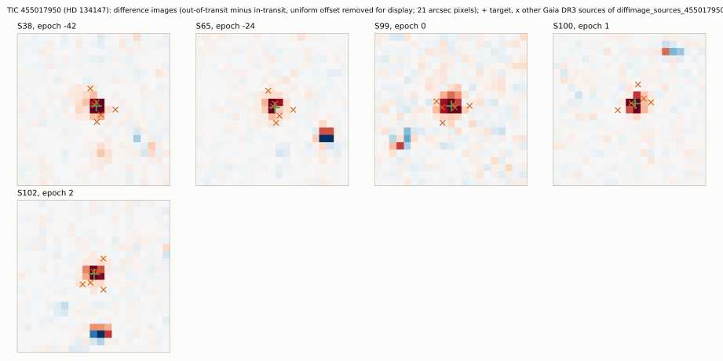</picture>

### 4.6 Companion limits

- Gaia radial velocities (`scripts/gaia_companion_limits.py`): 49 transits, `rv_chisq_pvalue` 0.028 (not flagged as
  variable), `rv_amplitude_robust` 2.18 km/s. Taken as an upper bound on $`2K`$: $`K < 1.09`$ km/s and, for
  $`M_\star = 0.91\,M_\odot`$ (TIC) and $`P = 40.61`$ d ($`K = 63.0`$ m/s per $`M_\mathrm{J}`$),
  $`M_2 \sin i < 17\,M_\mathrm{J}`$. Simulations with random orbital phases and the per-transit noise implied by
  `radial_velocity_error` (0.48 km/s; Katz et al. 2023) and the $`\chi^2`$ p-value give a 95 % limit of
  $`K < 0.67`$-0.77 km/s for periods of 1-1000 d, i.e. $`M_2 \sin i < 10\,M_\mathrm{J}`$ at the transit period (no script
  in this repository). A stellar companion at the transit period, or any stellar companion with $`P \lesssim 10^3`$ d, is
  excluded; a brown dwarf below about 10-17 $`M_\mathrm{J}`$ is not.
- Long-term radial velocity: CORAVEL (1990s, $`-8.4 \pm 0.3`$ km/s with the zero-point allowance) and Gaia DR3
  ($`-8.23 \pm 0.15`$ km/s) agree, $`\lvert\Delta v\rvert < 0.9`$ km/s (3 $`\sigma`$); Pulkovo and Gaia DR2 agree within
  0.4 km/s.
- Astrometry: RUWE 0.899, no non-single-star solution; simulated Gaia DR3 sampling (assumed along-scan error 0.10 mas
  per CCD) excludes companions of 0.1-0.8 $`M_\odot`$ with periods of about $`10^2`$ to $`10^4`$ d (0.5-10 au), where
  90 % of orientations would give RUWE > 1.25. HGCA $`\chi^2 = 0.58`$ and the Kervella et al. (2022) proper-motion
  anomaly (S/N $`\le 1.28`$) give sensitivities of 2.8, 2.6, 2.6 and 12.5 $`M_\mathrm{J}`$ at 3, 5, 10 and 30 au, so
  stellar companions at 3-30 au are excluded. At the transit period the photocentre semi-amplitude is 0.11 mas for
  30 $`M_\mathrm{J}`$ (`scripts/gaia_companion_limits.py`), so the astrometry adds nothing for the transiting body.
- SOAR HRCam speckle (Tokovinin et al. 2020; $`I`$ band, epoch 2019.54): no companion with $`\Delta m < 2.74`$ beyond
  0.15" (9.8 au) or $`\Delta m < 4.0`$ beyond 1" (65 au); inner working angle 0.054" (3.5 au).
- Luminosity: the SED radius and the spectroscopic $`\log g`$ agree, so a companion contributing more than about 20 % of
  the $`G`$-band flux ($`M_2 \gtrsim 0.65\,M_\odot`$) is excluded at any separation.
- Gaia resolution (approximate sensitivities, not an observation): no Gaia DR3 source within 6.0".
- Transit density: the circular-orbit density from the light curve alone is below 3.8 g cm$`^{-3}`$ (95 %; section 4.2). A planet
  transiting a bound companion of mass $`M_2`$ (the STP scenario of TRICERATOPS) needs, for a circular orbit,
  $`\rho(M_2) \le \rho_\mathrm{circ}`$, i.e. $`M_2 \gtrsim 0.65\,M_\odot`$; for lower masses it needs an eccentric orbit
  with the transit near apoastron, $`e \ge`$ 0.04, 0.19, 0.29, 0.44, 0.57, 0.63 and 0.73-0.77 for $`M_2`$ = 0.6, 0.5,
  0.4, 0.3, 0.2, 0.15 and 0.1-0.08 $`M_\odot`$, and a planet of 5.7-13.7 $`R_\oplus`$.

Combined on a grid of 11 companion masses and 10 separations (0.5-100 au; no script in this repository): every
companion of 0.5-0.88 $`M_\odot`$ is excluded at every separation tested; companions of 0.08-0.4 $`M_\odot`$ remain only at
65 au or more (1.0-1.5"); between the grid points, companions of about 0.3-0.45 $`M_\odot`$ ($`\Delta T`$ = 2.7-4.0) at
about 30-65 au (0.5-1") are not excluded by any constraint used here. These limits use an assumed Gaia along-scan error,
an approximate mass-luminosity relation and an approximate Gaia resolution curve.

### 4.7 TRICERATOPS

TRICERATOPS 1.1.0, set-up as in section 1.6: the five epochs (sectors 38, 65, 99, 100 and 102; per-sector $`r < 2.0`$ px
apertures of 12-14 pixels), each divided by its jointly fitted quadratic baseline ($`\pm 0.8`$ d), 144 bins of 10 min,
out-of-transit bin scatter 180 ppm, transit depth $`k^2 = 0.001207`$ (raw aperture flux, `dilution_corrected=False`;
TRICERATOPS target flux ratio 0.950), Gaia DR3 background (24030 stars), $`N = 10^6`$, `nsamples=20`. Contrast curve: the
SOAR $`I`$-band limits of Tokovinin et al. (2020) (0.054", 0; 0.15", 2.74; 1.0", 4.00; 1.5", 4.00;
`data/triceratops/cc_HIP74344_SOAR2019_I.txt`), applied with `filt='TESS'`, i.e. assuming the $`I`$-band contrast in the
TESS band.

| configuration | seeds | FPP mean $`\pm`$ std | FPP median (range) | NFPP |
|---|---|---|---|---|
| SOAR contrast curve | 5 | $`(6.2 \pm 4.2) \times 10^{-4}`$ | $`5.5 \times 10^{-4}`$ ($`2.4 \times 10^{-4}`$ to $`1.3 \times 10^{-3}`$) | $`\le 9.1 \times 10^{-11}`$ |
| no contrast curve | 2 | $`(4.9 \pm 1.8) \times 10^{-3}`$ | ($`3.6 \times 10^{-3}`$, $`6.2 \times 10^{-3}`$) | $`\le 8.4 \times 10^{-11}`$ |

Mean scenario probabilities of the runs with the contrast curve: TP 0.843, PTP 0.114, DTP 0.043, STP $`6.1 \times 10^{-4}`$
(98 % of the FPP), BEB $`2.7 \times 10^{-6}`$, SEB $`3.7 \times 10^{-7}`$; every scenario on a neighbouring star is below
$`10^{-10}`$; best-fit planet radius of the TP scenario 3.09-3.17 $`R_\oplus`$. Every seed is below the thresholds
FPP $`< 0.015`$ and NFPP $`< 0.001`$ of Giacalone et al. (2021). The detection-stage runs (3 seeds each, same contrast
curve) gave 0.0008-0.0012 with and 0.006-0.013 without it. TRICERATOPS does not use the Gaia radial-velocity limit, the
astrometric limits or the luminosity limit of section 4.6. In the five runs with the contrast curve the best-fit STP host
has 0.62-0.91 $`M_\odot`$ (a 4.4-6.7 $`R_\oplus`$ planet, $`e`$ = 0.08-0.46), a region that section 4.6 excludes; the
remaining STP configurations need a companion of $`\lesssim 0.4\,M_\odot`$ beyond about 30 au, an eccentric orbit and a
7-14 $`R_\oplus`$ planet. The STP term is therefore an overestimate; TRICERATOPS was not re-run with these constraints, so
the reduction is not quantified. The STP term also depends on the companion prior inside 0.15" and below
$`\Delta m = 2.74`$, which no available data constrain.

### 4.8 Catalogue and literature checks

All queries were run with a positive control.

| date (UTC) | source | control | result |
|---|---|---|---|
| 2026-10-18 23:25-23:28 | ExoFOP target page (JSON) and the TOI (8151 rows) and CTOI (5138 rows) lists, live | TOI-700 (TIC 150428135): four TOIs on its target page and four rows in the TOI list | no TOI, no CTOI; no imaging, spectroscopy, time-series or file uploads on the target page |
| 2026-10-18 22:33-22:34 | ExoFOP target page; NASA Exoplanet Archive TOI table (8151 rows, last row created 2026-10-08) and `pscomppars` | TOI-700 | no TOI, no CTOI, no entry |
| 2026-10-18 | SPOC threshold-crossing-event bulk files: the 13 files that include sector 12 or 65 (single-sector and multi-sector runs); MAST data-validation products | TOI-125 (TIC 261136679) in 8 of the files | not listed; no data-validation report (the 2-min data contain one transit, sector 65) |
| 2026-10-18 | TESS guest-investigator target lists of Cycles 1-9 (848 lists) and the sector target lists | coordinate matches in other lists are other TIC entries | the 2-min data of sector 65 come from programme G05121 (Cycle 5, "Modeling Complex Flares With TESS 20-Second Data", a flare programme), the only programme that lists the star; the 2-min data of sector 12 come from the candidate target list (priority 0.160); no 2-min data in sectors 38, 39, 99-102; no Cycle 8-9 programme requests the star |
| 2026-10-18 | SOAR speckle surveys of TESS objects of interest (Ziegler et al. 2020, 2021; VizieR J/AJ/159/19, J/AJ/162/192; full tables by TIC, HIP, HD) | TOI-125 in Ziegler et al. (2020) | not listed; the Tokovinin et al. (2020) observation belongs to their own programmes (orbits, hierarchical systems, Hipparcos binaries, neglected binaries) |
| 2026-10-18 | ESO Science Archive: ObsCore 10" cone and raw frames of all instruments in a $`\pm 72`$" box; object-name queries (HD 134147, HIP 74344, TIC 455017950) | TIC 402710280 (13 ObsCore products, 41 raw frames) | no data (no HARPS, FEROS, UVES, ESPRESSO or CORALIE frames) |
| 2026-10-18 | radial-velocity catalogues: HARPS RVBank (Trifonov et al. 2020), Keck/HIRES (Butler et al. 2017), California Legacy Survey (Rosenthal et al. 2021) | tau Cet | not listed |
| 2026-10-18 | exoplanet.eu (8376 rows), Open Exoplanet Catalogue | pi Men, TOI-700 | nothing within 3 deg; no name match |
| 2026-10-18 | CHEOPS archive (public and proprietary visit list); LCO science archive (public frames); MAST, all missions within 30" | TOI-178 (80 visits); TOI-700; HD 209458 | no CHEOPS visit within 0.3 deg; no public LCO frames; MAST holds TESS products and one GALEX AIS image |
| 2026-10-18 | ADS full text, about 30 identifier strings (TIC, HD, HIP, HIC, CPD, TYC, GSC, PPM, 2MASS, Gaia DR1/DR2/DR3, 1RXS, uvby98, J1511-6456, "HD 134147 b"), abstract and title fields | "WD 0752-146" (1), "HD 22946" (12), "TOI-4600" (12) | no publication on the star beyond catalogues (the string "TIC-455017950" matches 21 unrelated 1995-96 catalogue records); the `object:` field search returned HTTP 400, also for the control |
| 2026-10-18 | SIMBAD, all 27 references read by title | - | catalogues, radial-velocity compilations, the Tokovinin et al. (2020) speckle survey, proper-motion anomalies, Gaia rotation periods, target lists; none reports a transit, a planet or radial-velocity variability |
| 2026-10-18 | VizieR, all tables within 5" (156 tables, every J/ table read) | AM Her (228 tables) | photometry, astrometry, stellar parameters, X-ray, rotation (8.67 d), flare searches (no flares), Green et al. (2023) ellipsoidal-variable search (score 0.0), a TESS-SPOC target sample; no transit, eclipse, planet or radial-velocity-variability table |
| 2026-10-18 | VSX; Gaia DR3 `vari_*` and `nss_*` tables (4 non-single-star tables) | AM Her; a row of each table | VSX: the Gaia DR3 rotation entry (ROT, 3.38674 d) only; Gaia: `vari_classifier_result` SOLAR_LIKE and `vari_rotation_modulation` only, no eclipsing-binary, planetary-transit or non-single-star entry |
| 2026-10-18 | source files of 14 arXiv papers on TESS duo- and single-transit candidates (TIC, HD, HIP, Gaia ids and coordinates) | - | not listed |

Not checked or not reachable: RAVE DR6, the Zhang et al. (2023) Gaia XP parameters, GALEX GUVcat and two Ca II H and K
tables (VizieR returned no rows for the target and for a control, so these are unverified); GALAH DR3, APOGEE DR17,
GALEX AIS and Boro Saikia et al. (2018) were verified and have no entry. Observations scheduled but not yet executed, and
proprietary data of facilities without a public archive, cannot be checked.

### 4.9 Predicted transits (2026-10-18 to 2027-10-18)

`data/predicted_transits_455017950.csv`. Errors are the propagated linear-ephemeris errors; because of the O-C of up to
+12 min (section 4.3) a timing window of at least $`\pm 15`$ min should be added. $`T_{14} = 4.74`$ h.

| epoch | mid-transit (UTC) | BJD$`_\mathrm{TDB}`$ | ephemeris error (min) | TESS |
|---|---|---|---|---|
| 7 | 2026-10-26 05:33 | 2461339.7289 | 2.7 |  |
| 8 | 2026-12-05 20:06 | 2461380.3346 | 2.7 |  |
| 9 | 2027-01-15 10:36 | 2461420.9402 | 2.8 |  |
| 10 | 2027-02-25 01:04 | 2461461.5459 | 2.8 | sector 114 |
| 11 | 2027-04-06 15:33 | 2461502.1516 | 2.8 |  |
| 12 | 2027-05-17 06:03 | 2461542.7572 | 2.9 |  |
| 13 | 2027-06-26 20:36 | 2461583.3629 | 2.9 |  |
| 14 | 2027-08-06 11:11 | 2461623.9685 | 3.0 |  |
| 15 | 2027-09-16 01:47 | 2461664.5742 | 3.0 |  |

TESS (tess-point 0.9.5.post1): the star was on silicon in sectors 12, 38, 39, 65, 99, 100, 101 and 102 and will be in
sectors 113 (camera 4, CCD 4) and 114 (camera 3, CCD 4) (`data/tess_sectors_455017950.csv`). The nominal sector-113
window (2027-01-16 to 2027-02-13) contains no transit; epoch 9 (2027-01-15 10:36 UTC) falls about 1.4 d before its
nominal start, and the actual start is not yet published. The sector-114 window contains epoch 10 (2027-02-25 01:04 UTC),
about 2.5 d before the nominal mid-sector; the published TESS orbit-time table ends at sector 111, so the position of
this transit relative to the mid-sector gap is not known. No guest-investigator programme of Cycles 8-9 requests 2-min
data for the star. From the ground (altitude above 30$`^\circ`$, Sun below $`-12^\circ`$; no script in this repository),
complete transits with 1 h of baseline on each side are observable on 2027-04-06 from Siding Spring and on 2027-06-26
from SAAO, a complete transit without full baselines on 2027-05-17 from the Chilean sites, 99 % of the transit of
2027-08-06 from Siding Spring and 92 % of that of 2027-02-25 from SAAO.

### 4.10 Search for additional transiting signals

No script in this repository. Data: the TESScut $`r = 2.0`$ px light curves of all eight sectors (sector 12: 30-min
cadence; 38, 39: 10 min; 65, 99-102: 200 s), quality 0; 1.0 d removed after gaps longer than 0.5 d, 0.5 d after and
0.15 d before shorter gaps of more than 0.1 d, cadences with background above 1.5 times the sector median, and
$`\pm 0.3`$ d around the six events of section 4.4 (49,414 of 60,043 cadences kept). Two detrendings with flares
masked: 1.0-d biweight and a robust spline with 0.5-d knots (1-h rms 270-460 and 160-240 ppm per sector). The known
transits are masked ($`\pm 0.20`$ d) in the searches. Every search was repeated on the inverted light curves.

- Periodic, 0.5-80 d: box least squares (20-min bins, durations 1-8 h by period range), with the signal detection
  efficiency (SDE) from a running median and MAD. Peaks above the inverted-flux maxima (SDE 9.1-9.5) are the lower edge of
  the period grid (0.50 d, also present in the inverted runs), combinations of two to four events at segment edges
  (77-79 d), and a 12.39-d peak in the spline detrending only (SDE 10.1, 361 ppm), whose epoch-by-epoch depth against
  local baselines is $`44 \pm 28`$ ppm (spline) and $`-11 \pm 25`$ ppm (biweight). The search does not recover the known
  transit blindly (SDE 2.1 and 6.9 at its period in the two detrendings): the spot residuals limit blind detection of
  1-1.3 ppt, 4-5 h transits to about this level.
- Single events (box filter, 1-24 h): every event with a single-event statistic of 5 or more lies at a segment edge,
  depends on the aperture (for example BTJD 2382.34: 2710, 1626 and 1160 ppm in the $`r`$ = 1.5, 2.0 and 3.0 px
  apertures), or shows no dip against a local quadratic baseline ($`-289`$ to +334 ppm, all within 2.2 $`\sigma`$).

Sensitivity (injection and recovery, 150 transits; batman, circular, $`b`$ uniform in 0-0.9, $`R_\star = 0.80\,R_\odot`$,
$`\rho_\star = 2.40`$ g cm$`^{-3}`$, diluted with $`f_t = 0.966`$, $`P`$ log-uniform in 0.5-80 d, $`R_\mathrm{p}`$
uniform in 1-4.5 $`R_\oplus`$), injected into the raw flux and passed through the same cleaning, detrending and searches;
recovered by the biweight search (periodic or single-event) or the spline periodic search:

| $`P`$ (d) \ $`R_\mathrm{p}`$ ($`R_\oplus`$) | 1-2 | 2-3 | 3-4.5 |
|---|---|---|---|
| 0.5-3 | 8/8 | 21/21 | 24/24 |
| 3-10 | 3/7 | 5/5 | 14/14 |
| 10-30 | 2/10 | 7/9 | 12/12 |
| 30-80 | 0/9 | 0/11 | 11/20 |

No second transiting signal is found. The search is complete for planets of 3 $`R_\oplus`$ or more out to 30 d, for
2-3 $`R_\oplus`$ below 10 d (7 of 9 at 10-30 d) and for all radii above 1 $`R_\oplus`$ below 3 d; it recovers about half
of the 3-4.5 $`R_\oplus`$ planets at 30-80 d and none smaller than 3 $`R_\oplus`$ beyond 30 d.

### 4.11 Archival photometry

No script in this repository. The ephemeris propagates to 1-$`\sigma`$ mid-transit uncertainties of 15-36 min at the
epochs of the archival data (1989-2026), including a $`\pm 15`$ min allowance for timing variations; the cycle count is
unambiguous (at most 0.13 $`T_{14}`$).

| data set | control | coverage | points in predicted transits | result |
|---|---|---|---|---|
| Hipparcos epoch photometry | HIP 71683 | 195 transits, 1989.95-1993.15, scatter 2.3-3.0 % | 3 points, one event (cycle $`-311`$) | 3 $`\sigma`$ excluded depth 20 ppt; no constraint |
| ASAS-3 ($`V`$, grades A and B) | Proxima Centauri | 608 points, 2001-2009, scatter 1.9 % | 2 points (cycles $`-196`$, $`-168`$) | 60 ppt; no constraint |
| ASAS-SN v1 photometry database | two control cones | 152 points, 2016-2018 | 0 (nearest 3.4 h from a mid-transit) | no constraint |
| KELT-South field S37 (light curve lc_016659; identification probable, 8.1" off) | field S36 | 2013-2015, about 1000 points in each of two orientations | east 0; west 2 (cycle $`-104`$) | 16-27 ppt; no constraint |
| Gaia DR3 epoch photometry ($`G`$) | a control source | 118 transits, 2014.8-2017.4 | 2 points, one event (cycle $`-91`$) | 4.5-8 ppt; the point 0.04 h from mid-transit is 0.9-2.2 $`\pm`$ 0.6-1.1 ppt low depending on the baseline; no constraint |
| SuperWASP DR1 | WASP-17 | no DR1 object within 4 deg | - | not covered |
| ASAS-SN Sky Patrol v2 | - | master-list entry found; light-curve service out of service | - | not retrieved (hole) |

No archival data set detects or excludes a 1.3-ppt transit.

## 5. Other TESS results

Results that are not transit candidates: an eclipsing binary whose eclipses were absent in 2018 and present from
2020 (section 5.1), a known planet whose transits are not detected in one TESS sector (section 5.2), both computed from
public TESS products by the scripts listed in section 7, and eight new eclipsing binaries (section 5.3), whose values
come from the vetting record (section 7).

### 5.1 TIC 11613676 (CD-30 448): eclipses that appeared between 2018 and 2020

#### 5.1.1 Target

| quantity | value | source |
|---|---|---|
| identifiers | TIC 11613676, CD-30 448, CPD-30 155, TYC 6427-705-1, 2MASS J01223179-2926146, UCAC4 303-001452, RAVE J012231.8-292615, PPM 243892, GSC 06427-00705, Gaia DR3 (= DR2) 5029330944688623360 | SIMBAD, ExoFOP |
| position (ICRS, epoch 2016.0) | RA 20.6325665, Dec $`-`$29.4375553 | Gaia DR3 |
| proper motion (mas/yr) | $`6.27 \pm 0.66`$, $`-32.85 \pm 0.54`$ (DR2: $`8.60 \pm 0.39`$, $`-34.03 \pm 0.37`$; Tycho-2: $`8.5 \pm 2.8`$, $`-37.3 \pm 2.7`$; UCAC4: $`6.7 \pm 0.9`$, $`-32.9 \pm 1.2`$) | Gaia DR3, DR2; VizieR |
| parallax (mas) | $`4.54 \pm 0.79`$ (DR2: $`4.02 \pm 0.26`$) | Gaia DR3, DR2 |
| $`G`$, $`BP-RP`$ | 11.041, 1.025 | Gaia DR3 |
| $`T`$, $`V`$, $`J`$, $`H`$, $`K_s`$ | 10.499, 11.20, 9.753, 9.350, 9.233 | TIC v8.2, 2MASS |
| $`T_\mathrm{eff}`$ (K) | 5216 (TIC); 5117 (GSP-Phot, $`\log g`$ 4.61, [M/H] $`-0.35`$); 5373 (GSP-Spec, $`\log g`$ 4.88, [M/H] $`-0.47`$); 5200 (RAVE, $`\log g`$ 4.51) | TIC v8.2; Gaia DR3; RAVE |
| RUWE; `astrometric_excess_noise` (mas; significance); `ipd_frac_multi_peak`; `non_single_star` | 48.13; 6.04 (56628); 12; 0 (no row in the four `nss_*` tables) | Gaia DR3 |
| radial velocity (km/s) | $`50.34 \pm 1.99`$ (37 transits over 923 d); `rv_amplitude_robust` 32.66; `rv_chisq_pvalue` 0; `rv_renormalised_gof` 34.2; RAVE: $`44.46 \pm 1.08`$ (one epoch, 2006-08-16) | Gaia DR3; RAVE |
| variability | `phot_variable_flag` NOT_AVAILABLE; no `vari_*` entry | Gaia DR3 |
| TIC contamination ratio | 0.0022 | TIC v8.2 |
| Gaia DR3 sources within 120" | $`G = 17.13`$ at 32.4", $`G = 15.63`$ at 79.3", $`G = 18.99`$ at 96.6", and ten fainter than $`G = 20`$ | Gaia DR3 |
| Hipparcos | not listed (no Hipparcos-Gaia acceleration) | VizieR I/239, J/ApJS/254/42 |

The colours ($`V-K_s = 1.97`$, $`J-H = 0.40`$, $`H-K_s = 0.12`$, $`W1-W2 = -0.07`$; no infrared excess) and the
spectroscopic $`\log g`$ values describe a K1-K2 dwarf, which at $`G = 11.04`$ lies at about 100 pc ($`M_G \approx 6.0`$-6.3).
The DR3 parallax would place it at about 220 pc and 1.8 mag above the main sequence. With RUWE 48 and an astrometric
excess noise of 6 mas the DR3 parallax and proper motion are not reliable; the DR3 and DR2 proper motions differ by
3.1 $`\sigma`$ in RA. The TIC v8.2 proper motion ($`-140`$, $`-45`$ mas/yr) does not agree with Gaia, Tycho-2 or UCAC4.

#### 5.1.2 Data

TESScut 21 $`\times`$ 21-pixel cutouts of the SPOC-calibrated full-frame images (requested at the Gaia DR3 position;
target pixel at the proper-motion-corrected position) and the SPOC 2-min light curves of sectors 3 and 30
(`data/sectors_11613676.csv`). tess-point 0.9.5.post1 places the star on silicon in these five sectors only, up to
sector 134 (2028-08-30).

| sector | dates (UTC) | camera/CCD | FFI cadence | quality-0 cadences | SPOC 2-min | contamination, $`r`$ = 1.5 / 2.5 px |
|---|---|---|---|---|---|---|
| 3 | 2018-09-20 to 2018-10-17 | 2/4 | 30 min | 1077 | yes | 0.18 % / 0.37 % |
| 30 | 2020-09-23 to 2020-10-20 | 2/4 | 10 min | 3596 | yes | 0.13 % / 0.38 % |
| 97 | 2025-09-15 to 2025-11-08 | 2/4 | 200 s | 20183 | no | 0.20 % / 0.39 % |
| 104 | 2026-05-18 to 2026-06-13 | 4/4 | 200 s | 10029 | no | 0.13 % / 0.39 % |
| 106 | 2026-07-11 to 2026-08-09 | 2/2 | 200 s | 9686 | no | 0.13 % / 0.34 % |

#### 5.1.3 Method

`scripts/eb_eclipses.py`. Photometry: circular apertures of $`r`$ = 1.5 and 2.5 px, background from a plane fitted
per cadence to the faint pixels more than 5 px from the target, quality-0 cadences. Contamination: the six nearest Gaia DR3
sources (30-97") with a Gaussian PSF of the width fitted in each sector (0.62-0.89 px). Each eclipse with complete ingress
and egress coverage is fitted with a trapezoid (mid-time, depth, $`T_{14}`$, ingress time $`T_{12}`$) times a linear
baseline over $`\pm 0.4`$ d, with exposure-time supersampling; errors are the larger of the residual-scaled covariance
and a cyclic-shift bootstrap of the residuals (200 draws). The timing and depth set uses the SPOC 2-min SAP flux in
sectors 3 and 30 and the $`r = 2.5`$ px cutout photometry otherwise; the $`r = 1.5`$ px aperture and the PDCSAP flux
are checks. Sector-3 limits: the sector-30 eclipse shape with the mid-time fixed at the ephemeris prediction. Stacked
difference images (out-of-eclipse quadratic model per pixel minus the in-eclipse mean, $`\pm 0.09`$ d) are compared
with a PSF at the target and at each Gaia neighbour. Geometric models: `scripts/eb_model.py` (section 5.1.6).

#### 5.1.4 Eclipse depths and durations

`data/depths_11613676.csv`; depths in % of the aperture flux (contamination at most 0.4 %, so the depths are those of
the target to within 0.4 % of their value).

| sector | year | primary depth (%) | secondary depth (%) | primary $`T_{14}`$ (h) | secondary $`T_{14}`$ (h) | primary $`T_{12}`$, $`T_{23}`$ (h) | checks: $`r = 1.5`$ px; PDCSAP (primary / secondary, %) |
|---|---|---|---|---|---|---|---|
| 3 | 2018.76 | $`0.001 \pm 0.014`$ ($`< 0.043`$, 3 $`\sigma`$) | $`0.015 \pm 0.014`$ ($`< 0.043`$) | (2.84, fixed) | (2.81, fixed) | - | $`-0.003`$ / 0.000; 0.006 / 0.017 |
| 30 | 2020.77 | $`0.687 \pm 0.026`$ | $`0.531 \pm 0.028`$ | $`2.84 \pm 0.07`$ | $`2.81 \pm 0.11`$ | 1.20, 0.44 | 0.709 / 0.509; 0.649 / 0.526 |
| 97 | 2025.78 | $`5.434 \pm 0.021`$ | $`2.239 \pm 0.017`$ | $`4.11 \pm 0.01`$ | $`3.94 \pm 0.02`$ | 1.78, 0.55 | 5.470 / 2.260 |
| 104 | 2026.41 | $`4.106 \pm 0.031`$ | $`1.785 \pm 0.026`$ | $`3.98 \pm 0.02`$ | $`3.77 \pm 0.04`$ | 1.68, 0.64 | 4.165 / 1.899 |
| 106 | 2026.58 | $`4.031 \pm 0.025`$ | $`1.672 \pm 0.027`$ | $`4.01 \pm 0.02`$ | $`3.79 \pm 0.06`$ | 1.71, 0.59 | 4.040 / 1.722 |

No eclipse is detected in sector 3, at either phase, in the SPOC SAP and PDCSAP light curves and in the cutout
photometry. In sector 30 both eclipses are present, about 0.7 % and 0.5 % deep and 2.8 h long. By sector 97 they are
5.4 % and 2.2 % deep and 4.1 h and 3.9 h long. Between sectors 97 and 104 (0.63 yr) the depths decrease by 24 % (primary)
and 20 % (secondary) while $`T_{14}`$ shortens by 3-4 %; sector 106 continues the decrease. The eclipses are V-shaped ($`T_{23}/T_{14}`$ =
0.13-0.16 in 2025-2026), i.e. grazing. Detection-stage values (3 $`\times`$ 3-pixel box photometry of the cutouts,
sectors 3-104): $`P = 12.115919 \pm 0.000004`$ d from seven primaries; primary depths 0.56-0.64 % (2020), 4.36-4.41 %
(2025) and 3.33-3.45 % (2026), secondary depths 0.45-0.49, 1.82-1.88 and 1.48-1.54 %, $`T_{14}`$ 2.2, 3.0 and 2.9 h;
they are superseded by the values above.

<picture><source srcset="figures/eb_history_11613676_dark.svg" media="(prefers-color-scheme: dark)">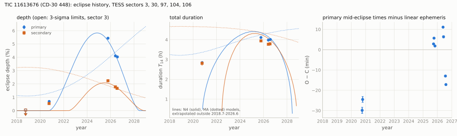</picture>

<picture><source srcset="figures/eb_profiles_11613676_dark.svg" media="(prefers-color-scheme: dark)">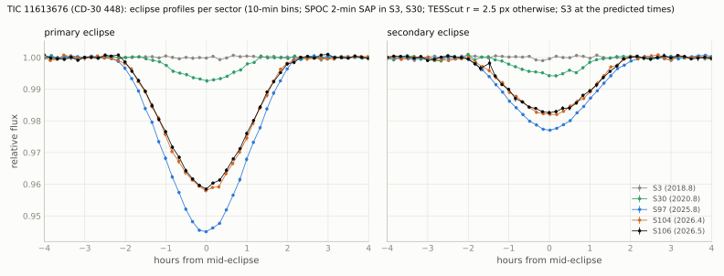</picture>

#### 5.1.5 Eclipse times

`data/eclipse_times_11613676.csv` (all fits, all light curves). Linear ephemeris of the nine complete primary eclipses
of the timing set:

$$T_\mathrm{pri} = \mathrm{BTJD}\ 3979.60209 + 12.115776\,E,$$

with formal errors 0.00008 d and 0.000004 d and $`\chi^2 = 6247`$ for 7 degrees of freedom; scaled by
$`\sqrt{\chi^2/\mathrm{dof}}`$ the errors are 0.0024 d and 0.00012 d.

| sector | eclipse | cycle | mid-time (BTJD) | error (min) | O $`-`$ C (min) | phase | depth (%) | $`T_{14}`$ (h) |
|---|---|---|---|---|---|---|---|---|
| 30 | secondary | $`-154`$ | 2120.43769 | 2.4 | | 0.5501 | 0.58 | 2.90 |
| 30 | primary | $`-153`$ | 2125.86765 | 1.5 | $`-29.9`$ | | 0.65 | 2.60 |
| 30 | secondary | $`-153`$ | 2132.54749 | 2.1 | | 0.5496 | 0.52 | 2.76 |
| 30 | primary | $`-152`$ | 2137.98714 | 1.4 | $`-24.5`$ | | 0.81 | 3.08 |
| 97 | secondary | $`-4`$ | 3937.90146 | 0.8 | | 0.5582 | 2.20 | 3.85 |
| 97 | primary | $`-3`$ | 3943.25673 | 0.25 | $`+2.8`$ | | 5.44 | 4.13 |
| 97 | secondary | $`-3`$ | 3950.02391 | 0.7 | | 0.5587 | 2.20 | 4.00 |
| 97 | primary | $`-2`$ | 3955.37448 | 0.26 | $`+5.7`$ | | 5.42 | 4.12 |
| 97 | secondary | $`-1`$ | 3974.28114 | 0.6 | | 0.5608 | 2.32 | 3.98 |
| 97 | primary | 0 | 3979.60335 | 0.29 | $`+1.8`$ | | 5.45 | 4.07 |
| 97 | secondary | 0 | 3986.40939 | 0.6 | | 0.5619 | 2.27 | 3.91 |
| 104 | secondary | 16 | 4180.25897 | 0.8 | | 0.5616 | 1.82 | 3.82 |
| 104 | primary | 17 | 4185.57798 | 0.35 | $`+11.1`$ | | 4.09 | 3.96 |
| 104 | primary | 18 | 4197.69046 | 0.5 | $`+6.4`$ | | 4.13 | 4.02 |
| 104 | secondary | 18 | 4204.48831 | 1.1 | | 0.5614 | 1.74 | 3.69 |
| 106 | secondary | 21 | 4240.83922 | 0.7 | | 0.5617 | 1.67 | 3.79 |
| 106 | primary | 22 | 4246.14015 | 0.36 | $`-13.0`$ | | 4.02 | 4.01 |
| 106 | primary | 23 | 4258.25300 | 0.35 | $`-17.2`$ | | 4.04 | 4.01 |

The primary eclipses do not follow a linear ephemeris at the minute level: the O $`-`$ C changes by 24 min between
2026.41 and 2026.58, and the intervals between consecutive primaries are 12.1195 d (sector 30), 12.1177 and 12.1144 d
(sector 97, the second over two cycles), 12.1125 d (sector 104) and 12.1129 d (sector 106). The secondary eclipse is
displaced from phase 0.5 and its phase increases: 0.5499 (sector 30), 0.5599 (97), 0.5615 (104), 0.5617 (106); a
separate linear fit gives a secondary period longer than the primary period by $`0.000852 \pm 0.000008`$ d, or
$`+0.00212 \pm 0.00002`$ in phase per year (formal errors). With $`e\cos\omega \approx (\pi/2)(\phi_\mathrm{sec} - 0.5)`$
this is $`e\cos\omega`$ = 0.078 (2020.8), 0.094 (2025.8) and 0.097 (2026.4-2026.6). The ratio of the secondary to the
primary duration (0.94-0.99) implies $`\lvert e\sin\omega \rvert \lesssim 0.03`$. Within sector 97 the secondary
phase increases from 0.5582 to 0.5619 over four cycles (about 60 min in 48 d) while the three primaries stay within
4 min of each other; the two secondaries of sector 104 (24 d apart) differ by 3 min. The within-sector-97 shift is
not described by any model of section 5.1.6.

#### 5.1.6 Checks and geometric models

- Source of the eclipses: the stacked difference images peak on the target in sectors 30-106 (free-position fit
  0.04-0.22 px from the target), and a PSF at the target fits better than at any Gaia neighbour (`data/diffimage_11613676.csv`):
  $`\chi^2`$ of no signal / target / best neighbour 1314.6 / 844.6 / 1254.5 (sector 30, primary), 26725 / 4305 / 23955
  (sector 97, primary), 25910 / 5006 / 23234 (sector 104, primary), 60974 / 9928 / 49984 (sector 106, primary), and
  similarly at the secondary. Sector 3 shows no signal at either phase ($`\chi^2`$ 784.1 / 783.6 / 781.1 at the primary).
- Dilution: the neighbours contribute 0.13-0.39 % of the aperture flux in every sector and aperture (TIC 0.0022), most of it
  from the $`G = 17.13`$ star at 32"; no neighbour can produce the eclipses or a 20-25 % change of their depth. The
  $`r`$ = 1.5 and 2.5 px apertures agree to within 7 % of the depth in every sector, and SPOC SAP, PDCSAP and the cutout
  agree in sector 30.
- Period: odd and even primaries agree within a sector (sector 97: 5.436 and 5.433 %; 104: 4.088 and 4.130 %, 0.7 $`\sigma`$;
  106: 4.043 and 4.022 %, 0.4 $`\sigma`$; sector 30: 0.65 and 0.81 %, 2.7 $`\sigma`$, one eclipse each), so $`2P`$ is
  excluded; no dip at phase 0.5 ($`-0.004 \pm 0.007`$ % in sector 97; $`\le 0.023 \pm 0.011`$ % in the other sectors)
  excludes $`P/2`$; the secondary lies at phase 0.550-0.562 (`data/checks_11613676.csv`).
- Out-of-eclipse light (no script in this repository): a Lomb-Scargle periodogram of the SPOC 2-min light curves of
  sectors 3 and 30 (0.02-20 d) shows no coherent signal above a semi-amplitude of 0.03 %.
- SPOC: the multi-sector search of sectors 1-36 (section 5.1.7) found the eclipses as two threshold-crossing events.

Geometric models (`scripts/eb_model.py`, `data/eclipse_model_11613676.csv`, `data/model_history_11613676.csv`): two
spheres with linear limb darkening (0.6 and 0.7), a Keplerian orbit and no third light, fitted to all 22 eclipse windows
($`\pm 0.3`$ d, 7027 points; SPOC 2-min SAP in sectors 3 and 30, cutout $`r = 2.5`$ px otherwise) with a linear baseline
per window. Parameters: $`r_1 = R_1/a`$, $`k = R_2/R_1`$, the surface-brightness ratio $`J`$, $`e\cos\omega`$,
$`e\sin\omega`$, $`i`$ and the secular terms of each model. A model that reproduces the data to the noise would give
$`\chi^2 \approx 7000`$.

| model | secular terms | $`\chi^2`$ | result |
|---|---|---|---|
| M0 | none | 181215 | constant depths; rejected |
| MA | apsidal motion only ($`\dot\omega`$ free, $`i`$ constant) | 49887 | needs $`k`$ at its bound (1.00) and $`\dot\omega = 0.210`$ rad/yr |
| N4 | $`e\cos\omega`$, $`e\sin\omega`$ linear in time; $`i(t) = i_L + A\cos[2\pi(t - t_\mathrm{max})/P_\mathrm{node}]`$ | 20232.5 | adopted description (below); lowest $`\chi^2`$ of the models with a slowly varying eccentricity vector (N1-N4) |
| N1, N2, MB, MC, N3 (no script in this repository) | $`e`$-vector linear in time with $`i`$ constant (N1), $`i`$ linear (N2) or quadratic (N3); $`\dot\omega`$ with $`i`$ linear (MB) or quadratic (MC) | 55963, 37352, 24770, 18956, 20273 | N1 and N2 rejected (N2 predicts depths still rising in 2026); MB and MC need $`\dot\omega = -0.69`$ rad/yr (an apsidal period of 9 yr) and miss the 2020 secondary eclipse, and are not adopted although MC has the lowest $`\chi^2`$; N3: maximum of $`i`$ near 2025.8-2026.0, $`\mathrm{d}i/\mathrm{d}t = -0.13`$ deg/yr in 2025.7 |

N4 parameters (formal errors scaled by $`\sqrt{\chi^2/\mathrm{dof}}`$): $`P_\mathrm{node} = 22.6 \pm 1.0`$ yr,
$`A = 2.50 \pm 0.07`$ deg, $`i_L = 84.44 \pm 0.05`$ deg, maximum inclination 86.95 deg at $`t_\mathrm{max} = 2025.11 \pm 0.08`$,
$`e\cos\omega = 0.0936 + 0.0060\,(t - 2025.78)`$, $`e\sin\omega = 0.029 - 0.020\,(t - 2025.78)`$ ($`t`$ in years),
$`r_1 = 0.0518`$, $`k = 0.374`$, $`J = 0.446`$. A fit of the same model in a second implementation (no script in this
repository) gave $`\chi^2 = 20219`$, $`P_\mathrm{node} = 23 \pm 8`$ yr, $`A = 2.4 \pm 1.6`$ deg and $`i_L = 84.5 \pm 1.6`$ deg:
the formal errors depend on the implementation and are not reliable. The model has $`\chi^2/N = 2.9`$; it reproduces the
2025-2026 eclipses and the sector-3 null but predicts no eclipse at the 2020.8 epoch (observed 0.69 and 0.53 %), and it does
not describe the within-sector-97 secondary shift. The geometric parameters are degenerate at this grazing geometry and
are indicative only; $`r_1 = 0.05`$ with $`P = 12.116`$ d and a total mass of about 1.1 $`M_\odot`$ ($`a = 0.107`$ au)
gives $`R_1 \approx 1.2\,R_\odot`$, larger than the 0.7-0.9 $`R_\odot`$ expected for a K1-K2 dwarf.

Interpretation (with the caveats above): apsidal motion changes the impact parameters of the two eclipses in opposite
directions ($`b_\mathrm{pri} \propto 1/(1 + e\sin\omega)`$, $`b_\mathrm{sec} \propto 1/(1 - e\sin\omega)`$) and cannot
change the inclination; both eclipses were absent in 2018, appeared together by 2020, deepened together to 2025 and
became shallower together in 2026. The data therefore require a common change of the inclination of the 12.1-d orbit
to the line of sight, passing through a maximum between 2025.8 and 2026.4, as produced by the nodal precession of the
orbit in a hierarchical triple. The changing secondary phase (apsidal motion or a perturbed eccentricity), the primary
eclipse-timing variations (O $`-`$ C from $`-30`$ to $`+11`$ min, local periods differing from the mean by up to 5 min), the Gaia DR3 RUWE of 48 and
excess noise of 6 mas (a 12-d binary alone gives a photocentre motion below 0.05 mas), and the radial-velocity scatter
(`rv_amplitude_robust` 32.7 km/s over 37 transits) are consistent with a third body; none of them is a measurement of it.
For a nodal period of about 23 yr, the quadrupole precession rate (Söderhjelm 1975; Borkovits et al. 2015),
$`P_\mathrm{node} \approx \tfrac{4}{3}\,(M_\mathrm{tot}/m_3)\,(P_\mathrm{out}^2/P_\mathrm{in})\,(1 - e_\mathrm{out}^2)^{3/2}/\cos i_\mathrm{mut}`$,
gives $`P_\mathrm{out}`$ of about 90, 140 and 170 d for $`m_3/M_\mathrm{tot}`$ = 0.1, 0.25 and 0.4 (circular outer orbit,
small mutual inclination); these are orders of magnitude, not fits.

#### 5.1.7 Catalogue and literature checks

All queries were run with a positive control where one is given.

| date (UTC) | source | control | result |
|---|---|---|---|
| 2026-10-18 | VSX (API and VizieR B/vsx, 120") | AM Her | no entry |
| 2026-10-18 | SIMBAD (5") | - | CD-30 448, type "Star", 3 references (RAVE data releases); no variability or binary entry |
| 2026-10-18 | Gaia DR3 `vari_summary`, `vari_classifier_result`, `vari_eclipsing_binary` and the four `nss_*` tables | first row of each table | no entry |
| 2026-10-18 | Prsa et al. 2022 (J/ApJS/258/16); Kostov et al. 2025 (J/ApJS/279/50, tables 2-4); IJspeert et al. 2024 (J/A+A/691/A242); Mueller-Horn et al. 2026 (J/A+A/709/A62) | first rows | not listed as an eclipsing binary |
| 2026-10-18 | J/ApJS/281/52 (table 1) | - | listed with no period and no classification |
| 2026-10-18 | Valizadegan et al. 2025 (J/AJ/170/287, table 5) | TIC 1129033 (3 rows) | four SPOC threshold-crossing events of this TIC, all labelled NTP (non-transiting phenomenon): 11613676-1-S1-36 ($`P = 12.12901`$ d), 11613676-2-S1-36 (12.13066 d), and two from the sector-30 run (8.774801 d and 6.670170 d) |
| 2026-10-18 | MAST data-validation products | - | SPOC multi-sector search of sectors 1-36 (spoc-5.0.30, report of 2021-05-27): TCE 1 of 2 (`tess2018206190142-s0001-s0036-0000000011613676-01-00471_dvs.pdf`): $`P = 12.12901 \pm 0.00007`$ d, epoch BTJD 1392.6860, depth $`2077 \pm 291`$ ppm, 4 transits, MES 26.3, fitted with a grazing planet model ($`b = 0.97`$, $`R_\mathrm{p}/R_\star = 0.058`$); TCE 2 of 2 (`...-02-00471_dvs.pdf`): $`P = 12.13066`$ d, epoch BTJD 1385.8916, depth $`6488 \pm 171`$ ppm, 3 transits |
| 2026-10-18 | ADS full text, 20 identifier strings (TIC, Gaia DR3, CD, CPD, TYC, 2MASS, RAVE, GSC, PPM, UCAC4, WISEA, GALEX, short forms) | "WD 0752-146" (1 record) | no record |
| 2026-10-18 | source files of 43 arXiv papers (2023-2026) on eclipse-depth variations, triply eclipsing and compact triple systems, changing inclinations and disappearing eclipses (identifier and coordinate strings) | 2024ApJ...974...25K contains its own target (107 matches) | not listed |
| 2026-10-18 | ESO Science Archive, ObsCore 10" cone | HD 209458 (185 rows) | no data |
| 2026-10-19 00:25 | ExoFOP TOI list (8151 rows), CTOI list (5138 rows), target page (JSON) | TOI-700 (TIC 150428135, four TOIs) | no TOI, no CTOI; no imaging, spectroscopy or time-series entries |
| 2026-10-18 | NASA Exoplanet Archive TOI table | - | not reachable (database error, three attempts) |

The epochs of TCE 1 in sector 30 (BTJD 2120.43 and 2132.56) coincide with the secondary eclipses of table 5.1.5, and its
two sector-3 epochs fall on the data without eclipse; its depth, about 40 % of the sector-30 secondary depth, is
consistent with a fit that averages two eclipsed and two non-eclipsed epochs. TCE 2 corresponds to the primary eclipse
(sector-30 epochs BTJD 2125.86 and 2137.99). Neither event became a TOI. No publication or catalogue gives a period or
an eclipsing-binary classification for the star.

Not checked: RAVE spectra beyond the catalogue values; the Gaia RVS and XP spectra; archival ground-based light curves
(ASAS-SN, ATLAS, WASP, KELT).

#### 5.1.8 Predictions and decisive tests

Predicted eclipses for the 12 months from 2026-10-19: `data/predicted_eclipses_11613676.csv` (geocentric UTC; because
of the O $`-`$ C of $`-30`$ to $`+11`$ min a window of at least $`\pm 30`$ min should be used). The next primaries:
2026-10-29 13:41, 2026-11-10 16:29, 2026-11-22 19:17 and 2026-12-04 22:05 UTC; secondaries at phase 0.562 (2026-11-05
09:02, 2026-11-17 11:50 UTC, ...). No TESS sector up to 134 (2028-08-30) covers the star.

Model eclipse depths (N4, `data/model_history_11613676.csv`; an extrapolation without error estimate):

| date | primary depth (%) | primary $`T_{14}`$ (h) | secondary depth (%) |
|---|---|---|---|
| 2026.80 | 3.35 | 3.9 | 1.54 |
| 2027.00 | 2.88 | 3.8 | 1.38 |
| 2027.50 | 1.66 | 3.3 | 0.93 |
| 2028.00 | 0.57 | 2.4 | 0.48 |
| 2028.50 | 0 | - | 0.12 |

The N3 model (no script in this repository) gives similar depths for 2026-2027 and no eclipses from about 2028.3. Tests:

- Eclipse depth: photometry of primary eclipses in 2026-2027 at a precision of about 0.1 % tests whether the depths
  continue to decrease (N4 and N3) or not; a constant or increasing depth would contradict the models above.
- Eclipse timing: mid-times of most primary and secondary eclipses over one to two years (a 4-h, several-percent eclipse
  of a $`V = 11.2`$ star; about 1-min precision with small telescopes) would show whether the timing variations follow an
  outer period of order 100-200 d.
- Radial velocities: 10-15 epochs over about a year at 1 km/s precision would separate the 12.1-d orbit from an outer
  orbit, and a spectrum would show whether a third set of lines is present.
- Gaia DR4 (scheduled for December 2026) epoch astrometry and radial velocities.

### 5.2 TOI-540 b: transits not detected in Sector 98

TOI-540 b (Ment et al. 2021) is a 0.9 $`R_\oplus`$ planet on a 1.24-d orbit around a 14-pc M4 dwarf. Its transits are
present in TESS sectors 4, 5, 6, 31 and 32 (2018-2020) and in the MEarth-South photometry of 2019 (Ment et al. 2021). In
TESS sector 98 (2025-11-09 to 2026-01-05) they are not detected in any product examined here. This section reports
that observation and the checks made; it does not establish a change of the planet's orbit.

#### 5.2.1 Target

| quantity | value | source |
|---|---|---|
| identifiers | TOI-540, TIC 200322593, Gaia DR3 (= DR2) 4785886941312921344, 2MASS J05051443-4756154, UCAC4 211-005570, WISE J050514.35-475615.3 | ExoFOP, Ment et al. (2021) |
| position (ICRS, epoch 2016.0) | RA 76.3096812, Dec $`-`$47.9375355 | Gaia DR3 |
| proper motion (mas/yr); parallax (mas) | $`-65.90`$, $`24.90`$; 71.51 (14.0 pc) | Gaia DR3 |
| $`G`$, $`G_\mathrm{RP}`$, $`T`$; RUWE | 12.874, 11.594, 11.505; 1.297 | Gaia DR3; TIC v8.2 |
| $`M_\star`$, $`R_\star`$ | $`0.159 \pm 0.014\,M_\odot`$, $`0.1895 \pm 0.0079\,R_\odot`$ | Ment et al. (2021) |
| rotation period | 17.4264 $`\pm`$ 0.0094 h | Ment et al. (2021) |
| planet (Ment et al. 2021) | $`P = 1.239149`$ d, $`R_\mathrm{p} = 0.903 \pm 0.052\,R_\oplus`$, $`b = 0.772 \pm 0.029`$, $`i = 86.80 \pm 0.28`$ deg | Ment et al. (2021) |
| TIC contamination ratio | 0.0495 | TIC v8.2 (ExoFOP) |
| nearest Gaia DR3 source | 4785886975670558336, $`G = 16.53`$, 5.9", parallax 0.71 mas (background); next: $`G = 18.33`$ at 38" | Gaia DR3 |

#### 5.2.2 Data

SPOC 2-min light curves and target pixel files of sectors 4, 5, 6, 31, 32 and 98, and the SPOC 20-s light curves of
sectors 31, 32 and 98 (MAST). tess-point 0.9.5.post1 places the star on silicon in these six sectors only, up to sector
134 (2028-08-30).

| sector | dates (UTC) | camera/CCD | SPOC version | 20-s data |
|---|---|---|---|---|
| 4 | 2018-10-19 to 2018-11-14 | 3/4 | spoc-5.0.20 | no |
| 5 | 2018-11-15 to 2018-12-11 | 3/3 | spoc-5.0.20 | no |
| 6 | 2018-12-15 to 2019-01-06 | 3/3 | spoc-5.0.20 | no |
| 31 | 2020-10-22 to 2020-11-16 | 3/4 | spoc-5.0.20 | yes |
| 32 | 2020-11-20 to 2020-12-16 | 3/3 | spoc-5.0.20 | yes |
| 98 | 2025-11-09 to 2026-01-05 | 3/3 | spoc-5.0.126 | yes |

#### 5.2.3 Method

`scripts/toi540_analysis.py`. Photometry ("own"): the target-pixel-file flux with the SPOC background added back and a
per-cadence background (median of the faint pixels more than 4 px from the target) subtracted, summed in circular
apertures of $`r`$ = 1.5-3.0 px around the proper-motion-corrected Gaia position and in the SPOC aperture. The SPOC SAP,
PDCSAP and 20-s PDCSAP fluxes are analysed in the same way. Light curves: quality 0, divided by a biweight trend (wotan;
window 0.3 d unless stated; the rotation period is 17.4 h), flares clipped at 4 $`\sigma`$. Transit model: batman, quadratic
limb darkening (0.25, 0.35), circular orbit, 2-min integration, $`a/R_\star`$ with the prior $`13.87 \pm 0.71`$ from the
stellar mass and radius. The common shape and the ephemeris come from sectors 4-32 only. Depths are peak depths of that
shape fitted at the predicted mid-transit times (template amplitude), with errors multiplied by the red-noise factor
$`\beta`$ of the residuals at 28 min.

#### 5.2.4 Ephemeris and transit depths

`data/ephemeris_200322593.csv`. Joint fit of sectors 4-32 (own photometry, $`r = 2.0`$ px): $`k = 0.0409 \pm 0.0013`$,
$`b = 0.783 \pm 0.031`$, $`a/R_\star = 13.86 \pm 0.71`$ (prior), $`T_{14} = 28.2`$ min, peak depth 1665 ppm. Linear
ephemeris of the five per-sector mid-transit times:

$$T_\mathrm{c} = \mathrm{BTJD}\ 1821.98442\,(\pm 0.00033) + 1.23914923\,(\pm 0.00000113)\,(E + 285),$$

with $`E`$ counted from the ExoFOP TOI epoch (BJD 2459175.141647); $`\chi^2 = 1.0`$ for 3 degrees of freedom. The
predicted mid-time of the central sector-98 transit ($`E = 1487`$) is BTJD 4017.75685 $`\pm`$ 2.9 min. With the PDCSAP
flux: $`P = 1.23914887 \pm 0.00000119`$ d, $`b = 0.800`$, peak depth 1790 ppm.

`data/transit_depths_200322593.csv` (peak depth at the predicted times, 0.3-d detrending):

| sector | year | transits with data | own, $`r = 2.0`$ px (ppm) | PDCSAP (ppm) | SAP (ppm) | 20-s PDCSAP (ppm) | O $`-`$ C (min) |
|---|---|---|---|---|---|---|---|
| 4 | 2018.84 | 16 | $`1836 \pm 276`$ | $`1950 \pm 276`$ | $`1863 \pm 268`$ | - | $`-0.3 \pm 1.8`$ |
| 5 | 2018.92 | 18 | $`1544 \pm 291`$ | $`1724 \pm 293`$ | $`1669 \pm 288`$ | - | $`+0.7 \pm 1.3`$ |
| 6 | 2018.99 | 17 | $`1889 \pm 251`$ | $`2282 \pm 271`$ | $`2167 \pm 259`$ | - | $`-0.3 \pm 0.9`$ |
| 31 | 2020.84 | 18 | $`1498 \pm 236`$ | $`1448 \pm 235`$ | $`1498 \pm 229`$ | $`1663 \pm 247`$ | $`-0.6 \pm 1.0`$ |
| 32 | 2020.91 | 20 | $`1586 \pm 208`$ | $`1533 \pm 199`$ | $`1474 \pm 191`$ | $`1542 \pm 211`$ | $`+0.4 \pm 0.9`$ |
| 98 | 2025.93 | 28 | $`83 \pm 268`$ | $`-14 \pm 276`$ | $`-30 \pm 268`$ | $`-26 \pm 282`$ | - |

The reference depth (weighted mean of sectors 4-32, own photometry) is 1666 ppm. The sector-98 depth is
$`83 \pm 268`$ ppm, 5.9 $`\sigma`$ below it (3 $`\sigma`$ upper limit about 800 ppm); with 0.2-d detrending
$`108 \pm 201`$ ppm (7.8 $`\sigma`$), and 8.3-8.5 $`\sigma`$ in PDCSAP and SAP.

<picture><source srcset="figures/toi540_sectors_dark.svg" media="(prefers-color-scheme: dark)">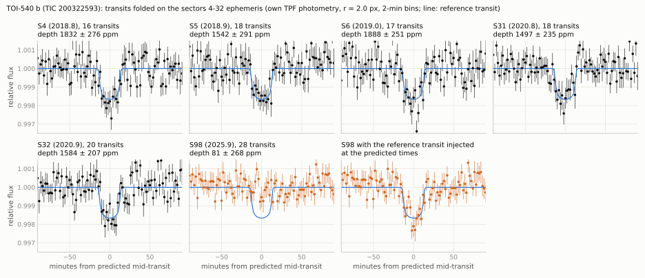</picture>

<picture><source srcset="figures/toi540_depths_dark.svg" media="(prefers-color-scheme: dark)">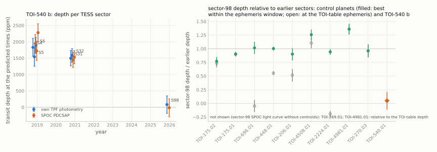</picture>

#### 5.2.5 Checks for instrumental and processing causes

`data/s98_tests_200322593.csv`, `data/injection_200322593.csv`, `data/control_planets_s98.csv`,
`data/timing_audit_200322593.csv`.

| check | result in sector 98 |
|---|---|
| products | own TPF photometry, SPOC SAP, SPOC PDCSAP (2 min) and SPOC 20-s PDCSAP: $`-87`$ to $`+108`$ ppm, 4.9-8.5 $`\sigma`$ below the reference depth |
| apertures | $`r`$ = 1.5, 2.0, 2.5, 3.0 px and the SPOC aperture: 58-111 ppm ($`\pm`$ 266-282) |
| quality flags | quality 0 (26156 cadences, 28 transits), standard mask and all finite cadences (40067-40147 cadences, 44 transits): 33-35 $`\pm`$ 211-214 ppm |
| detrending window | 0.2, 0.3, 0.4 d: 108, 83, 19 ppm (own); the earlier sectors give the transit with the same code (table 5.2.4) |
| four segments of sector 98 | $`-347`$ to $`+369`$ ppm ($`\pm`$ 524-570); no segment shows the transit |
| other phases and periods | full-phase scan at the ephemeris period: highest S/N 2.4 (262 min from the prediction); 61 periods within $`\pm 6 \times 10^{-4}`$ d (530 $`\sigma_P`$): highest S/N 3.2 |
| injection | the reference transit injected into the raw sector-98 photometry at the prediction is recovered at $`1647 \pm 269`$ ppm, and a blind phase scan finds it (S/N 6.1); at 20 random phases all 20 are found within 6 min (S/N 4.5-7.2, depths 1182-1807 ppm) |
| more grazing shapes | templates with $`b`$ = 0.85-0.95 ($`T_{14}`$ = 24.7-17.5 min) are excluded at 3.4-7.1 $`\sigma`$; transits with $`b \ge 0.98`$ ($`T_{14} \le 14`$ min, peak depth $`\le 900`$ ppm) are not excluded ($`\le 2.3\,\sigma`$) |
| time stamps | the 2-min TPF and light curve have identical spacecraft-frame times (TIME $`-`$ TIMECORR) and a regular 120.000-s cadence (20.000 s for the 20-s light curve); the TOI-270 light curve of the same camera and CCD has the same spacecraft-frame times; TIMECORR agrees with the Roemer delay computed from the JPL Horizons orbit of TESS to 0.002 s (`data/timing_audit_200322593.csv`) |
| control planets | nine control planets with 2-min data in sector 98 show their transits there with the same code (table below); one of them, TOI-270.03, is on camera 3/CCD 3 like TOI-540 |
| neighbour and dilution | the only Gaia source within 38" is 3.65 mag fainter (5.9"); the TIC contamination is 0.05; a constant extra flux in the aperture cannot remove a 1.7-ppt transit |

Control planets (`scripts/toi540_controls.py`, `data/control_planets_s98.csv`; SPOC 2-min PDCSAP, TOI-table
ephemerides of 2026-10-18, depth at the ephemeris and at the best position within $`\pm\max(60\ \mathrm{min}, 5\sigma)`$):

| TOI | camera/CCD in sector 98 | sector-98 depth at the best position (ppm) | S/N | offset from the TOI-table ephemeris (min) | earlier sectors (ppm) |
|---|---|---|---|---|---|
| 175.01 | 4/4 | 1476 | 22.1 | $`-3`$ | 1600-1681 |
| 175.02 | 4/4 | 1251 | 9.9 | $`+4`$ | 1403-1810 |
| 206.01 | 4/2 | 1075 | 7.9 | $`-15`$ | 1082-1284 |
| 270.03 | 3/3 | 869 | 8.0 | $`-1`$ | 833-938 |
| 448.01 | 2/1 | 11086 | 27.7 | $`-16`$ | 10812-11269 |
| 696.01 | 3/2 | 513 | 9.2 | $`-25`$ | 435-572 |
| 2224.01 | 4/3 | 1995 | 17.7 | $`-48`$ | 1974-2203 |
| 4508.01 | 2/1 | 4346 | 13.1 | $`+4`$ | 3310-3599 |
| 4981.01 | 3/2 | 1699 | 14.1 | $`-3`$ | (no earlier 2-min sector; TOI table 1250) |
| 540.01 (TOI-540 b, same measurement) | 3/3 | 271 (at $`+31`$ min) | 1.2 | - | 1368-2121 (S/N 6.4-8.9) |

The offsets of TOI-206.01, 448.01, 696.01 and 2224.01 reflect the drift of their TOI-table ephemerides by 2025 (the
propagated errors are 9-45 min). The SPOC sector-98 light curve of the tenth control, TOI-269.01 (also camera 3/CCD 3),
is not usable: its SAP flux is 315 e/s against 1312-1561 e/s in sectors 3, 94 and 97, it has no flux-weighted
centroids, and its 1-h CDPP is 9915 ppm against 779-893 ppm; its transits are not measurable there. The sector-98 SPOC
light curve of TOI-540 does not show these features: SAP flux 3247 e/s (3215-3406 e/s in sectors 4-32), centroids
present, 1-h CDPP 753 ppm (644-817 ppm); the own photometry from the target pixel file gives 3572 e/s in the
$`r = 2.0`$ px aperture (3309-3574 e/s in sectors 4-32).

Not reproduced by a script in this repository: per-pixel transit S/N maps of the target pixel files (sectors 4 and 31:
the transit signal peaks within one pixel of the target, S/N 4.2-4.3; sector 98: highest pixel S/N 2.3, 3 px from the
target); the QLP sector-98 light curve (DET_FLUX, $`89 \pm 159`$ ppm at the predicted times); the MEarth 2019 light curve
of Ment et al. (2021) (VizieR), which shows the transit at $`1776 \pm 147`$ ppm. The rotation signal is present in
sector 98 with the same amplitude (1.0 % between the 5th and 95th percentiles; 0.8-1.0 % in sectors
4-32); its strongest Lomb-Scargle peak is at 8.72 h, half of the rotation period, in sector 98 and at 17.40-17.45 h in
sectors 4-32.

#### 5.2.6 Impact parameter before sector 98

`data/bt_fits_200322593.csv`: joint fits of sectors 4-6 (2018.92) and 31-32 (2020.88) with a common or a per-group
impact parameter ($`a/R_\star`$ shared with the density prior).

| photometry | $`b`$ (2018.9) | $`b`$ (2020.9) | $`\mathrm{d}b/\mathrm{d}t`$ (yr$`^{-1}`$) | significance of the difference | $`b`$ extrapolated to 2025.93 |
|---|---|---|---|---|---|
| own, $`r = 2.0`$ px | $`0.759 \pm 0.048`$ | $`0.807 \pm 0.040`$ | $`+0.024 \pm 0.019`$ | 1.2 $`\sigma`$ ($`p = 0.22`$) | $`0.93 \pm 0.12`$ |
| own, $`r = 1.5`$ px | $`0.756 \pm 0.049`$ | $`0.820 \pm 0.038`$ | $`+0.033 \pm 0.019`$ | 1.8 $`\sigma`$ | $`0.99 \pm 0.11`$ |
| own, SPOC aperture | $`0.768 \pm 0.046`$ | $`0.836 \pm 0.035`$ | $`+0.035 \pm 0.018`$ | 1.9 $`\sigma`$ | $`1.01 \pm 0.10`$ |
| PDCSAP | $`0.763 \pm 0.047`$ | $`0.862 \pm 0.030`$ | $`+0.050 \pm 0.018`$ | 2.9 $`\sigma`$ ($`p = 0.004`$) | $`1.12 \pm 0.10`$ |
| SAP | $`0.763 \pm 0.047`$ | $`0.858 \pm 0.030`$ | $`+0.049 \pm 0.018`$ | 2.6 $`\sigma`$ | $`1.10 \pm 0.10`$ |

$`\Delta\chi^2`$ values are divided by $`\beta^2`$ (1.32-1.38). The 2020 transits are slightly shorter and shallower
than the 2018 transits in every photometry, at 1.2-2.9 $`\sigma`$ depending on the photometry; this is a weak trend, not
a detection. A sector-98 peak depth below the 3 $`\sigma`$ limit requires $`b \ge 0.99`$ with the same $`k`$ and
$`a/R_\star`$; transits stop for $`b > 1 + k = 1.04`$.

#### 5.2.7 Interpretation

The transits of TOI-540 b are not detected in sector 98, while the same code recovers them in sectors 4-32, recovers
injected transits in the sector-98 data, and recovers the transits of control planets in sector 98, including one on
the same camera and CCD. Possible interpretations:

1. A data or processing problem specific to this star and this sector that the checks above did not find. The
   sector-98 products have a later SPOC version (spoc-5.0.126) than those of sectors 4-32 (spoc-5.0.20), and sector 98
   is a long (57-d) sector; the own photometry from the target pixel files does not depend on the SPOC light-curve
   processing, and no check above points to a cause. Target-specific problems do occur in this sector: the SPOC
   sector-98 light curve of TOI-269, on the same camera and CCD, is defective (section 5.2.5); the TOI-540 products do
   not show its symptoms.
2. A change of the transit geometry, $`b`$ having increased from about 0.8 in 2020 to more than about 0.99 by
   2025.9, for example by nodal precession of the orbit driven by an unseen companion. This requires
   $`\lvert\mathrm{d}b/\mathrm{d}t\rvert \gtrsim 0.035`$ yr$`^{-1}`$ ($`\lvert\mathrm{d}i/\mathrm{d}t\rvert \gtrsim 0.15`$ deg/yr), of
   the order of the weak pre-sector-98 trend of section 5.2.6. Order-of-magnitude minimum companion masses for a secular
   rate of that size (`data/perturber_200322593.csv`; circular orbits, mutual inclination 45 deg): about 1 $`M_\oplus`$ at
   2.5 d, 3 $`M_\oplus`$ at 5 d, 13 $`M_\oplus`$ at 10 d, 0.16 $`M_\mathrm{J}`$ at 20 d and 1.5 $`M_\mathrm{J}`$ at 60 d, with
   stellar radial-velocity semi-amplitudes of about 1, 3, 9, 29 and 180 m/s. The stellar oblateness ($`J_2 \approx 10^{-4}`$
   for the 17.4-h rotation) gives at most $`\lvert\mathrm{d}b/\mathrm{d}t\rvert \approx 0.01`$ yr$`^{-1}`$. These numbers are
   estimates for the stated assumptions, not a model of the system; no companion is detected.

The per-sector mid-transit times of sectors 4-32 agree with a linear ephemeris to within 1 min (table 5.2.4), so a
companion would have to leave the transit times nearly unchanged over 2018-2020.

#### 5.2.8 Catalogue and literature checks

| date (UTC) | source | control | result |
|---|---|---|---|
| 2026-10-18 | ADS full text: "TOI-540", "TOI 540" (25 records each), "TIC 200322593" (3), "200322593" (5); "TOI-540" with variab*, disappear*, precess*, "transit duration variation", TTV or TDV (22); with "Sector 98" (0); citations of Ment et al. (2021) (27); full-text search 2024-2026 (12) | "WD 0752-146" (1 record) | no publication reports sector-98 data or a change of the transits; the publications since 2022 use the system in samples or as a target (flares, radio emission, atmospheres, survey planning) |
| 2026-10-18 | ExoFOP TOI table (8151 rows) | TOI-700 | TOI-540.01, disposition CP, sectors 4, 5, 6, 31, 32 |
| 2026-10-19 00:25 | ExoFOP target page (JSON) | TOI-700 | time-series observations: 12 entries, all of 2019 (MEarth-South, ExTrA, LCO-CTIO 1 m); imaging: SOAR (2019), Gemini-South speckle (2020, 2021); latest file upload 2023-07-21; nothing after 2023 |
| 2026-10-18 | TESS observation notes (MAST) | - | not reachable (HTTP 404) |

#### 5.2.9 Decisive test

Photometry of one transit from the ground decides between a data problem in sector 98 (transit present, about
1.7 ppt deep, 28 min long) and a change of the geometry (transit absent, or shorter and shallower). The transit was
observed from the ground in 2019 (MEarth-South, LCO 1 m, ExTrA). `data/ground_windows_200322593.csv` lists the predicted
transits of 2026-10-20 to 2027-01-19 that are fully observable (target above 30 deg, Sun below $`-12`$ deg over
$`T_\mathrm{c} \pm (T_{14}/2 + 3\sigma + 30\ \mathrm{min})`$) from CTIO/LCO-LSC (16 transits), SAAO/LCO-CPT (17) and
SSO/LCO-COJ (18); times are geocentric UTC with 1-$`\sigma`$ ephemeris errors of 3.3-3.5 min. The first ones:

| site | cycle | mid-transit (UTC) | BJD$`_\mathrm{TDB}`$ | error (min) | lowest altitude (deg) |
|---|---|---|---|---|---|
| CTIO / LCO-LSC | 1742 | 2026-10-20 05:42 | 2461333.73990 | 3.3 | 50 |
| SSO / LCO-COJ | 1744 | 2026-10-22 17:10 | 2461336.21820 | 3.3 | 70 |
| SAAO / LCO-CPT | 1745 | 2026-10-23 22:55 | 2461337.45735 | 3.3 | 47 |
| CTIO / LCO-LSC | 1746 | 2026-10-25 04:39 | 2461338.69650 | 3.3 | 43 |
| SSO / LCO-COJ | 1748 | 2026-10-27 16:08 | 2461341.17480 | 3.3 | 66 |
| SAAO / LCO-CPT | 1749 | 2026-10-28 21:52 | 2461342.41395 | 3.4 | 40 |
| CTIO / LCO-LSC | 1750 | 2026-10-30 03:36 | 2461343.65310 | 3.4 | 36 |
| SSO / LCO-COJ | 1752 | 2026-11-01 15:05 | 2461346.13140 | 3.4 | 60 |
| SAAO / LCO-CPT | 1758 | 2026-11-09 01:31 | 2461353.56629 | 3.4 | 63 |
| CTIO / LCO-LSC | 1759 | 2026-11-10 07:15 | 2461354.80544 | 3.4 | 64 |

No TESS sector up to 134 (2028-08-30) covers the star, so the test has to come from other telescopes.

### 5.3 Notable new eclipsing binaries

Eight stars whose eclipses are not reported in the catalogues and publications checked on 2026-10-18. Six have Gaia DR3
non-single-star (NSS) orbits that match the eclipses in period or in the predicted conjunction; one is a member of the
open cluster NGC 4609, and one is an eclipsing binary that shares the parallax and proper motion of a brighter star
13.2" away. The events were
found in TESS full-frame-image light curves, in six cases in the light curve of the star itself and in two cases in
that of a neighbour. The values are taken from the vetting record of 2026-10-18 (section 7) and are listed with the
eclipse epochs in `data/notable_ebs_2026.csv`. Errors are formal.

| TIC | Gaia DR3 | names | $`P`$ (d) | depths (%) | events found in | Gaia DR3 NSS orbit | notable for |
|---|---|---|---|---|---|---|---|
| 13957664 | 4823456527782443392 | TYC 7587-159-1 | $`245.66 \pm 0.44`$ (Gaia; one eclipse) | 2.0 (FWHM 7.8 h) | itself | AstroSpectroSB1: $`P = 245.66 \pm 0.44`$ d, $`e = 0.225 \pm 0.027`$, $`i = 91.1 \pm 0.8`$ deg | single eclipse at the conjunction predicted by the astrometric+spectroscopic orbit |
| 304936165 | 6654853225865763200 | TYC 8385-1304-1 | $`61.7000 \pm 0.0015`$ | 2.5, 2.8 (two eclipses, about 4 h); no second eclipse | itself | SB1: $`P = 61.734 \pm 0.054`$ d, $`e = 0.297 \pm 0.020`$, $`\omega = 256 \pm 8`$ deg, $`K_1 = 26.4 \pm 1.0`$ km/s | eccentric orbit, one eclipse per orbit, near periastron |
| 120522352 | 4996621435834932864 | TYC 7523-58-1 | $`8.5171346 \pm 0.0000140`$ | 6.3 / 0.46 (phase 0.508), 3.2 h | itself | SB1: $`P = 8.51557 \pm 0.00074`$ d, $`e = 0.022 \pm 0.021`$, $`K_1 = 19.40 \pm 0.39`$ km/s | eclipsing SB1 |
| 382523691 | 4922422783421253632 | UCAC4 192-000883, ASASSN-V J005242.03-513706.0 | $`4.9150491 \pm 0.0000043`$ | 2.6 / 1.17 (phase 0.500), 1.3 h | itself | SB1: $`P = 4.91490 \pm 0.00029`$ d, $`e = 0.021 \pm 0.018`$, $`K_1 = 40.24 \pm 0.63`$ km/s | eclipsing SB1, catalogued as a rotator (5.36 d) |
| 261702897 | 5824728342140218880 | UCAC4 121-127929, ASASSN-V J150933.89-655748.3 | $`6.93402 \pm 0.000004`$ | 7.5 / 0.55 (phase 0.502), 3.3 h | itself | SB1: $`P = 6.93443 \pm 0.00055`$ d, $`e = 0.042 \pm 0.024`$, $`K_1 = 22.45 \pm 0.66`$ km/s | eclipsing SB1, catalogued as a rotator (8.14 d) |
| 265436769 | 6403358774444776960 | 2MASS J21232888-6326076 | $`15.474965 \pm 0.000021`$ | 0.52, 1.2 h; no secondary ($`< 0.035`$) | itself | SB1: $`P = 15.4730 \pm 0.0022`$ d, $`e = 0.218 \pm 0.014`$, $`\omega = 14.5`$ deg, $`K_1 = 27.59 \pm 0.47`$ km/s | eclipsing SB1 listed by Mueller-Horn et al. (2026, table 2); the eclipse requires a stellar companion |
| 433642561 | 6055116332111942528 | CPD-62 2890, NGC 4609 10, TYC 8992-814-1 | $`356.182/n`$, $`n \in \{1, 2, 3, 4, 6, 7, 8, 9\}`$ | 27, 26, 17.5 (three eclipses, FWHM 3.5-3.6 h) | TIC 433633051 (CD-62 668), 47.9" away | none | eclipsing star in the open cluster NGC 4609 |
| 245068282 | 6084991059458411776 | UCAC4 207-068365, 2MASS J13110863-4843550 | $`1.7074970 \pm 0.0000004`$ | about 50 / 18 (phase 0.500), 1.7 h | TIC 245068274 (TYC 8251-917-1), 13.2" away | none (`rv_amplitude_robust` 180 km/s) | eclipsing binary bound to a G dwarf (hierarchical triple) |

Depths: primary / secondary in % of the aperture flux (QLP SAP, or TESScut aperture photometry for TIC 13957664), with
the duration $`T_{14}`$ (FWHM where stated); `depth_note` in the CSV file gives the photometry and the dilution of each
value. The periods of the five systems with more than three eclipses come from the mid-times of 13-75 primary eclipses
(QLP SAP light curves, O $`-`$ C rms 2.0-7.3 min). Where both exist, the NSS period agrees with the eclipse period
within 0.5-2.1 $`\sigma`$.

**TIC 13957664** ($`G = 11.60`$, 245 pc, RUWE 2.92). One U-shaped eclipse, 2.0 % deep and 7.8 h long (FWHM), at
BTJD 4310.16 (sector 108); the other five sectors (5, 31, 32, 98, 107) show no eclipse. Propagated by Monte Carlo over
the errors of the Gaia orbit, the conjunction with the companion in front falls at observed $`-`$ predicted
$`= +12.3 \pm 9.1`$ d (using $`\omega`$) or $`+11.5 \pm 9.3`$ d (using $`\omega`$ of the spectroscopic part); the other
conjunction lies about 113 d away. With $`M_1 \approx 1.0\,M_\odot`$ the orbit gives $`M_2 \approx 0.40\,M_\odot`$
(Mueller-Horn et al. 2026, table 2: $`0.45^{+0.19}_{-0.13}\,M_\odot`$). The duration, shorter than the about 11.6 h of
a central crossing, and the depth indicate a non-central chord. Next conjunctions: BTJD $`4310.16 + 245.66\,n`$
($`\pm 0.44\,n`$ d).

**TIC 304936165** ($`G = 11.89`$, 246 pc). Two eclipses, at BTJD 3876.837 (sector 94) and 4185.337 (sector 104),
308.500 d apart. The TESS coverage (sectors 13, 93, 94, 104) allows $`P = 308.5/k`$ d with $`k`$ = 1-5 or 9; the Gaia
period selects $`k = 5`$ ($`P = 61.7000`$ d, 0.6 $`\sigma`$ from the NSS period). The NSS orbit predicts the
conjunction near periastron (orbital separation $`0.71\,a`$) at observed $`-`$ predicted $`= -1.8 \pm 12.6`$ d for
both eclipses; the other conjunction ($`1.28\,a`$, BTJD $`3850.3 \pm 4.1`$, sector 93) shows no dip deeper than 0.5 %.
With $`M_1 = 0.96\,M_\odot`$ (TIC) and $`i \approx 90`$ deg, $`f(M) = 0.103\,M_\odot`$ gives $`M_2 \approx 0.64\,M_\odot`$.

**TIC 120522352, TIC 382523691, TIC 261702897.** Eclipsing SB1s with the secondary eclipse at phase 0.50-0.51; with
the TIC primary masses and $`i \approx 90`$ deg the mass functions give $`M_2 \approx`$ 0.20, 0.32 and 0.20 $`M_\odot`$.
The TESS rotation catalogues list TIC 120522352 with 4.16-4.26 d, about $`P/2`$; TIC 382523691 and TIC 261702897 are
listed as rotators (VSX/ASAS-SN) with 5.36 d and 8.14 d, which differ from the orbital periods. The SPOC multi-sector
searches list threshold-crossing events at the eclipse periods of TIC 120522352 and TIC 382523691 (Valizadegan et al.
2025, table 13) without an eclipsing-binary classification.

**TIC 265436769** ($`G = 12.11`$, 155 pc, RUWE 1.84). Grazing primary eclipses, 0.52 % deep (QLP, dilution-corrected)
and about 1.2 h long, in sectors 27, 67, 94, 95 and 101-104 (14 eclipses); no secondary eclipse at the phase predicted
by the NSS orbit (0.632; $`-104 \pm 175`$ ppm) or elsewhere. The NSS orbit predicts the conjunction with the companion
in front at phase $`-0.0016 \pm 0.016`$ of the TESS ephemeris. Mueller-Horn et al. (2026, table 2) list the star with a
companion mass of 0.58 $`M_\odot`$; the mass function gives $`M_2 \gtrsim 0.3\,M_\odot`$. A 0.5 % eclipse requires a
companion radius of at least about $`0.06\,R_\odot`$, larger than a white dwarf, so the companion is a star.

**CPD-62 2890 = TIC 433642561** ($`G = 10.37`$, $`BP-RP = 0.32`$, parallax $`0.730 \pm 0.024`$ mas, TIC
$`T_\mathrm{eff}`$ 8498 K). Three eclipses, 27 %, 26 % and 17.5 % deep, flat- or round-bottomed, at BTJD 2341.466
(sector 38), 3053.832 (64) and 4122.378 (101). The intervals (712.366 and 1068.546 d) give $`P = 356.182/n`$ d;
$`n`$ = 5, 10 and 11 are excluded by sectors 65 and 99 without an eclipse, $`n = 6`$ is ambiguous (predicted eclipse
at a data edge), and shorter periods are not tested because of a 1.88-d variability in sectors 11, 37 and 65. The star
is a member of NGC 4609 (membership probability 0.997, Li et al. 2025, J/AJ/170/288) and is listed as a hybrid-pulsator
candidate (Kliapets et al. 2025) and as a cluster variable without type (Hunt et al. 2025); no eclipses are reported.
The eclipses were found in the light curve of CD-62 668 (TIC 433633051, 47.9" away), where they are diluted to
1.4-5.1 %.

**TIC 245068282** ($`G = 13.08`$, $`BP-RP = 1.60`$; K dwarf). The 1.7075-d eclipses were found in the light curve of
TIC 245068274 (TYC 8251-917-1, $`G = 10.94`$, G dwarf, TIC $`T_\mathrm{eff}`$ 5871 K), where they are 8.4 % and 2.9 %
deep; on TIC 245068282 they are about 50 % and 18 % deep. The two stars have the same parallax (6.11 and 6.16 mas)
and proper motion ($`-10.7, -15.6`$ and $`-11.1, -15.5`$ mas/yr): a projected separation of about 2,150 au, i.e. a
hierarchical triple. The Gaia `rv_amplitude_robust` of TIC 245068282 is 180 km/s (9 transits). The SPOC threshold-crossing
events (Valizadegan et al. 2025, tables 5 and 13) and the TESS rotation periods of 1.69-1.70 d listed for
TIC 245068274 are this eclipsing binary.

Checks applied (2026-10-18):

- Source of the eclipses: TESScut difference images (in-eclipse minus out-of-eclipse, stacked per sector) fitted with
  a Gaussian PSF at every Gaia DR3 source within 60" and at a free position.

| TIC | sectors | best-fitting source | $`\Delta\chi^2`$ against the next source | free-fit offset |
|---|---|---|---|---|
| 13957664 | 108 | target | 10745 ($`G = 15.40`$ at 42", which would need a 7 % depth) | 1.3" |
| 304936165 | 94, 104 | target | 1814, 422 | 2.9", 5.0" |
| 120522352 | 29 | target | 94223 | 2.0" |
| 382523691 | 29 (primary, secondary) | target | 13410, 2417 | - |
| 261702897 | 38 | target | 3668 ($`G = 15.58`$ at 5.7", which would need 158 %) | 0.8" |
| 265436769 | 101, 67 | target | 158, 206 | 0.4", 2.2" |
| 433642561 | 101, 64 | TIC 433642561 | $`\chi^2`$ 19350 against 560882 at TIC 433633051 (sector 101), 62823 against 832057 (sector 64) | within about 5" |
| 245068282 | 38 | TIC 245068282 | 45923 over TIC 245068274 | 2.5" |

- Light curves: all sectors of each star in the QLP SAP light curves (MAST) and TESScut aperture photometry; for
  TIC 13957664 the QLP light curves of sectors 107 and 108 were not at MAST, and the eclipse was measured in TESScut
  photometry ($`r`$ = 1.5, 2.0 and 3.0 px give the same depth; centroid shift $`< 0.003`$ px; no solar-system object
  within 9' in SkyBoT). Eclipse mid-times, odd and even primaries, secondary eclipses at the NSS-predicted phases, and
  the covered epochs of every alias period.
- Novelty, with a positive control for each query: VSX (API, 60"; control AM Her), SIMBAD (control AM Her), the Gaia DR3
  variability and NSS tables (a known row each), the VizieR all-table 5" cone (control AM Her), Prsa et al.
  (2022), Kostov et al. (2025), Valizadegan et al. (2025), Mueller-Horn et al. (2026), ADS full text for every
  identifier (control "WD 0752-146", one record), and the ExoFOP TOI and CTOI lists of 2026-10-18 (controls pi Men, TOI-700).
  No VSX eclipsing entry, no TOI or CTOI and no ADS record of an eclipse was found for any of the eight stars. Not
  reachable on 2026-10-18: the live ExoFOP TOI/CTOI lists and target pages, and the NASA Exoplanet Archive. Not
  queried: ASAS-SN, ATLAS and ZTF light curves.

Caveats: no spectroscopy was obtained, and the companion masses assume $`i \approx 90`$ deg and the TIC primary
masses. The periods come from TESS full-frame images alone; the eclipse times of sectors 99-104 come from QLP light
curves, which carry the timing error noted in section 6. TIC 13957664 rests on a single eclipse, and its period and
its association with the Gaia conjunction (1.35 $`\sigma`$) come from the Gaia orbit. TIC 304936165 rests on two
eclipses, and its period among the allowed aliases is selected by the Gaia period. The period of CPD-62 2890 is not
determined. The depths of TIC 433642561 (its own QLP light curve, 47.9" from a star 1 mag brighter) and of
TIC 245068282 (scaled from the aperture of TIC 245068274 by its flux fraction of about 16 %) are approximate. For TIC 245068282 the physical association with TIC 245068274 rests on the Gaia DR3
parallaxes and proper motions.

## 6. Caveats

- No high-resolution imaging was obtained for this work; the only existing observation is the published SOAR speckle
  observation of TIC 455017950. For TIC 402710280 the 2.3" neighbour is unresolved by TESS and
  excluded as host only by the transit shape; a companion closer than that is unconstrained. For TIC 324429952 any
  companion within about 1" is unconstrained, and the TRICERATOPS FPP is dominated by bound-companion scenarios. For
  TIC 89247735 companions closer than the Gaia DR3 sources at 2-5" are unconstrained, and the TRICERATOPS FPP consists
  of the bound-companion (STP) scenario. For TIC 455017950 companions inside 0.15" or fainter than $`\Delta m = 2.74`$
  (0.15-1") are not excluded by the imaging.
- No radial velocities were obtained for this work. For TIC 402710280 the two public HARPS epochs sample 16 % of the
  orbital velocity amplitude and exclude only stellar and brown-dwarf companions; thirteen further epochs are proprietary until 2027.
  For TIC 324429952, TIC 89247735 and TIC 455017950 there are no archival spectra (for TIC 455017950 there are
  catalogue radial velocities of km/s precision only, section 4.6).
- QLP timing notice: MAST reports a barycentric timing error in the QLP light curves from the second half of sector 99
  to sector 104 (orbits 210-220), not yet corrected at the date of this record. No QLP time stamp enters the tables; all
  mid-transit times come from TESScut cutouts (SPOC-calibrated full-frame images) or SPOC light curves. For
  TIC 402710280 the QLP-minus-TESScut time-stamp differences measured in sectors 100 and 102 are within $`\pm 1.7`$ min
  (medians $`+0.3`$ and $`-0.3`$ min), far below the 24-29 min deviations of section 1.3.
- The 2.3" neighbour of TIC 402710280 (Gaia DR3 5828441289812582656; TIC 1208600633, without TIC stellar parameters) is
  6.4 mag fainter and lies in the background. TRICERATOPS treats it with solar parameters by default; the run with
  K-dwarf parameters gives the same FPP within the seed-to-seed scatter.
- Stellar parameters are TIC v8.2 values and were not re-derived, except for TIC 89247735 and TIC 455017950 (SED fits,
  sections 3.1 and 4.1); the planet radii scale with the adopted stellar radii.
- The per-epoch depths of TIC 324429952 scatter by about 20 % between detrending choices and sectors; the red-noise
  factors reach 2.4. TRICERATOPS uses one flux-error value per light curve and a Gaia DR3 rather than TRILEGAL background.
- The transit-timing variations of TIC 402710280 rest on four epochs with errors of 3-5 min; two further epochs
  (2027-02-19 in TESS sector 114, and any ground-based transit) would test them.
- TIC 89247735: the four transits come from three sectors (the predicted sector-13 transit falls in a data gap, and
  sector 104 starts just after a predicted transit); the period rests on two consecutive transits in sector 93 and the
  long baseline to sectors 66 and 104. One transit (epoch $`-20`$) lies 0.49 d after the start of a sector.
- TIC 89247735: a brown dwarf below about 30 $`M_\mathrm{J}`$ is not excluded; the Gaia DR3 radial-velocity scatter is
  the only constraint on the companion mass, the TESS data give no usable ellipsoidal or beaming limit, and
  TRICERATOPS does not model a brown-dwarf or low-mass-star companion on the target.
- TIC 89247735: the TIC contamination ratio is 0.274, and the raw depth depends on the aperture (0.70-0.93 %). The
  dilution correction rests on a Gaussian PSF model of the Gaia DR3 sources within 60" (sources beyond 60" are not
  included); in the joint fit the target flux fraction is set by its prior from that model, not by the light curve.
  The adopted radius ($`8.7 \pm 0.6\,R_\oplus`$) uses the SED-based stellar radius, whose error (5 %) is dominated by
  the choice of $`T_\mathrm{eff}`$ (the SED fit is formally poor and does not constrain the extinction); with the TIC
  radius it is 9.1-9.4 $`R_\oplus`$. The orbital eccentricity is not measured ($`e < 0.74`$ at 95 %). The TRICERATOPS
  FPP of three seeds spans $`4 \times 10^{-15}`$ to $`2.7 \times 10^{-3}`$.
- TIC 89247735: the search for further transiting planets (section 3.10) excludes only planets larger than about
  3-4 $`R_\oplus`$; no archival ground-based light curve constrains the transit, and the KELT-South light curves, which
  cover the star, could not be retrieved (section 3.11).
- TIC 455017950: the transit of epoch 0 (sector 99) lies at the end of an orbit, 3.6 h before the data end, and its
  depth depends on the detrending; it agrees with the ephemeris but is not an independent confirmation. The period rests
  on the other four transits, two of them (epochs 1 and 2) one cycle apart.
- TIC 455017950: the departure of the mid-transit times from a linear ephemeris rests on one epoch (epoch 2, +8.5 to
  +16 min); its significance depends on the photometry and the baseline model ($`p`$ = 0.001-0.10), and without that
  epoch all timing sets are linear. A transit-timing variation is not established; further transits (TESS sector 114 on
  2027-02-25, or from the ground) would test it.
- TIC 455017950: the star is chromospherically and coronally active ($`P_\mathrm{rot} = 8.3`$ d, spot modulation
  1.5-2.7 %, $`\log L_X/L_\mathrm{bol} \approx -4.5`$, age 0.3-0.5 Gyr). The expected radial-velocity semi-amplitude
  is about 2.1 m/s (10.3 $`M_\oplus`$ from the Chen & Kipping 2017 mass-radius relation), while the activity jitter is
  expected at 3-20 m/s (FF' method, Aigrain et al. 2012, rotational term only) up to 40-65 m/s (photometric amplitude
  times equatorial velocity); a 3 $`\sigma`$ (5 $`\sigma`$) mass of 10 $`M_\oplus`$ would need of order 18-40 (50-110)
  high-precision epochs if the activity model leaves 2-3 m/s. These are estimates, not exposure-time calculations.
- TIC 455017950: ingress and egress are not resolved, so the impact parameter and the shape are not constrained by the
  light curve alone; the adopted radius uses the stellar-density prior (section 4.2), and the eccentricity is not
  measured. A blended eclipsing binary is excluded statistically (difference images, stellar density, TRICERATOPS), not
  by the transit shape.
- TIC 455017950: bound companions of $`\lesssim 0.4\,M_\odot`$ beyond about 30 au (0.5-1") are not excluded
  (section 4.6), and a brown dwarf below about 10-17 $`M_\mathrm{J}`$ transiting the target is constrained only by the
  Gaia radial velocities. TRICERATOPS was run with the SOAR $`I`$-band contrast curve applied in the TESS band and was not
  re-run with the limits of section 4.6. The origin of the Hipparcos "suspected non-single" flag is not documented.
- TIC 455017950: the Gaia DR3 rotation period (3.39 d) does not appear in the TESS data; the search for further
  transiting planets (section 4.10) is limited by the spot modulation and excludes only planets larger than about
  2-3 $`R_\oplus`$ inside 30 d.
- TIC 11613676: the depth history rests on five TESS sectors, with no data between 2020.8 and 2025.7. No model of
  section 5.1.6 fits the light curves formally ($`\chi^2/N \ge 2.7`$); the adopted model (N4) does not reproduce the
  2020 eclipses, the geometric parameters are degenerate at this grazing geometry, the third light was fixed
  at zero, and the nodal period (about 23 yr) and the outer-period estimates (90-170 d) are orders of magnitude. A third
  body is inferred from the eclipse history, not detected; the Gaia DR3 RUWE and radial-velocity amplitude are consistent
  with one but are not measurements of it. The shift of the secondary eclipse within sector 97 is not explained. The Gaia
  DR3 parallax is not reliable (RUWE 48); the distance of about 100 pc is photometric. The eclipse times do not follow a
  linear ephemeris ($`\chi^2 = 6247`$ for 7 degrees of freedom), so predicted times need windows of at least $`\pm 30`$ min.
- TOI-540 b: the non-detection rests on one TESS sector, and a data or processing problem specific to this star and
  sector cannot be excluded by the checks of section 5.2.5; one ground-based transit would test it (section 5.2.9).
  The change of the impact parameter between 2018 and 2020 is 1.2-2.9 $`\sigma`$ depending on the photometry, and the
  companion masses of section 5.2.7 are order-of-magnitude estimates for stated assumptions; no companion is detected.
  Ground-based transit observations made after 2019 but not posted to ExoFOP or published cannot be checked.
- Eclipsing binaries of section 5.3: no spectroscopy; the periods come from TESS full-frame images, with QLP eclipse
  times in sectors 99-104 (timing notice above); TIC 13957664 rests on one eclipse and its period on the Gaia orbit,
  TIC 304936165 on two eclipses, and the period of CPD-62 2890 is not determined; the companion masses are estimates
  for $`i \approx 90`$ deg and the TIC primary masses. The values come from the vetting record and are not
  recomputed by a script in this repository.
- Nothing in this record has been checked by anyone outside the production of the record.

## 7. Data and reproduction

Public products used (all retrieved 2026-10-15 to 2026-10-19):

- TESScut 21 $`\times`$ 21-pixel cutouts of the SPOC-calibrated full-frame images (MAST), sectors listed in
  `data/sectors_<tic>.csv`, at the TIC v8.2 coordinates (TIC 89247735 and TIC 455017950: at the Gaia DR3 position).
- MAST light curves for the product-by-product checks: QLP (`hlsp_qlp_tess_ffi_s<sector>-<tic>_tess_v01_llc`), TESS-SPOC
  (`hlsp_tess-spoc_tess_phot_<tic>-s<sector>_tess_v1`), TARS (`hlsp_tars_tess_ffi_s<sector>-<tic>_tess`), GSFC-eleanor-lite
  (sector 13 of TIC 324429952 and TIC 89247735; sector 12 of TIC 455017950), the SPOC 2-min light curve of TIC 324429952 in sector 13 (`tess*-s0013-0000000324429952-*_lc.fits`)
  and those of TIC 455017950 in sectors 12 and 65.
- Gaia DR3 (`gaia_source`, `vari_*`, `nss_*`), TIC v8.2 (via ExoFOP and MAST), ExoFOP TOI/CTOI lists, NASA Exoplanet
  Archive, VSX, SIMBAD, VizieR, ADS.
- SVO Theoretical Spectra service (Castelli & Kurucz 2003 ODFNEW spectra) and SVO Filter Profile Service (transmission
  curves, zero points), for the SED fits of TIC 89247735 and TIC 455017950.
- Published SOAR speckle contrast limits of TIC 455017950 (Tokovinin et al. 2020, VizieR J/AJ/160/7, table 3), as
  `data/triceratops/cc_HIP74344_SOAR2019_I.txt`.
- ESO Science Archive: HARPS ADP products ADP.2025-08-26T01:00:42.037/.038 and ADP.2025-08-27T01:04:15.751/.752
  (checksums in `data/harps_public_rvs.csv`).

Software: Python 3.12.11 with the versions in `requirements.txt`; TRICERATOPS 1.1.0 in its own environment (versions in
`requirements.txt`). Commands, run from the repository root (work files go to `./work/`):

```
python scripts/tesscut_download.py 402710280          # cutouts (MAST)
python scripts/aperture_photometry.py 402710280       # r = 1.0-3.0 px light curves
python scripts/fit_transits.py 402710280              # common-shape fit, timing errors, ephemeris -> work/402710280/fit_r2.0_39_93_100_102.json
python scripts/fit_transits.py 402710280 --epochs 39,66,93,100,102   # the sector-66 event
python scripts/difference_images.py 402710280 --fit fit_r2.0_39_93_100_102.json
python scripts/alias_secondary_search.py 402710280
python scripts/make_tables.py 402710280 --fit fit_r2.0_39_93_100_102.json --extra-fit fit_r2.0_39_66_93_100_102.json --extra-sector 66
python scripts/predict_transits.py 402710280 --start 2026-10-18
python scripts/triceratops_prep.py 402710280 --fit fit_r2.0_39_93_100_102.json --window 1.0 --tag _J1.0
python scripts/triceratops_target.py 402710280 --sectors 39,93,100,102 --depth 0.00168     # TRICERATOPS environment
for s in 1 2 3 4 5 6 7 8 9 10; do python scripts/triceratops_run.py 402710280 $s --tag _J1.0; done
python scripts/triceratops_summary.py
```

For TIC 324429952 use `--fit fit_r2.0_13_27_66_93_94_100_102_103_fix.json` (the shape is fixed through `targets.py`),
`--window 0.6 --tag _J0.6` for the TRICERATOPS fold, `--sectors 13,27,66,93,94,100,102,103 --depth 0.00149`, and the
SPOC 2-min light curve of sector 13 downloaded into `work/324429952/dl/` (MAST `Observations.download_products`). The
figures are regenerated with `python figures/make_figures.py` from the CSV files alone. `MANIFEST.sha256` lists the
SHA-256 checksum of every file (`shasum -a 256 -c MANIFEST.sha256`).

For TIC 89247735 (epochs are labelled 66, 93a, 93b and 104 in the work files):

```
python scripts/tesscut_download.py 89247735
python scripts/aperture_photometry.py 89247735
python scripts/fit_transits.py 89247735 --window 0.8            # -> work/89247735/fit_r2.0_66_93a_93b_104_w0.8.json
python scripts/fit_transits.py 89247735 --window 0.8 --aperture 1.5   # and --aperture 3.0
python scripts/fit_transits.py 89247735 --window 0.8 --bfix 0.7 --sig-from fit_r2.0_66_93a_93b_104_w0.8.json   # b profile; --arfix 29.4
python scripts/fit_transits.py 89247735 --window 0.6 --order 1
python scripts/difference_images.py 89247735 --fit fit_r2.0_66_93a_93b_104_w0.8.json   # also queries Gaia DR3 (60")
python scripts/dilution_correction.py 89247735 --fits fit_r1.5_66_93a_93b_104_w0.8,fit_r2.0_66_93a_93b_104_w0.8,fit_r3.0_66_93a_93b_104_w0.8
python scripts/gaia_companion_limits.py 89247735 --shape fit_r2.0_66_93a_93b_104_w0.8_shape.json
python scripts/alias_secondary_search.py 89247735 --harmonics
python scripts/event_checks.py 89247735 --events 13:1682.134,66:3111.729,93:3836.585,93:3843.075,93:3849.745,104:4185.066
python scripts/make_tables.py 89247735 --fit fit_r2.0_66_93a_93b_104_w0.8.json --window 0.8
python scripts/predict_transits.py 89247735 --start 2026-10-18
python scripts/triceratops_prep.py 89247735 --fit fit_r2.0_66_93a_93b_104_w0.8.json --window 0.8 --tag _J0.8
python scripts/triceratops_target.py 89247735 --sectors 66,93,104 --depth 0.00826            # TRICERATOPS environment
for s in 1 2 3; do python scripts/triceratops_run.py 89247735 $s --tag _J0.8; done
python scripts/sed_fit.py                                       # SVO spectra and filters -> work/89247735/sed/
python scripts/fit_free_dilution.py 89247735 --fit fit_r2.0_66_93a_93b_104_w0.8.json   # emcee
```

`event_checks.py` uses the QLP light curves of the star in `work/89247735/dl/` (MAST `Observations.download_products`)
when present. Exceptions for TIC 89247735: the cutouts of sectors 66, 93 and 104 used for the tables were retrieved
from TESScut on 2026-10-18 with the same request as `tesscut_download.py` (Gaia DR3 position, 21 $`\times`$ 21
pixels); the re-download of these three sectors timed out at MAST on 2026-10-18 (sector 13 was re-downloaded and is
identical). `data/triceratops_input_89247735.csv` is the binned light curve that was given to TRICERATOPS; it was built
from the common-shape fit itself, and `triceratops_prep.py`, which refits the shape with the mid-transit times fixed,
reproduces it to within 7 ppm per bin (bin scatter 542.1 instead of 541.7 ppm). The TRICERATOPS tables
(`data/triceratops/probs_89247735_*.csv`, `gaia_background_89247735.csv`) are the outputs of those runs, copied
verbatim. The product-by-product box depths of section 3.4 (QLP, TARS) and the catalogue checks of section 3.8 have no
script in this repository. `scripts/sed_fit.py` holds the catalogue magnitudes it fits (copied from VizieR: Gaia DR3,
SkyMapper DR4, APASS DR9, 2MASS, AllWISE); it does not query them. The other $`T_\mathrm{eff}`$ and [Fe/H] values,
the Mann et al. (2015, 2019) and Kervella et al. (2004) relations, the $`M_G`$-based luminosity and the adopted stellar
parameters of section 3.1, the search for additional transiting signals and its injection-recovery test (section 3.10)
and the archival photometry of section 3.11 have no script in this repository. `scripts/fit_free_dilution.py` was run
on the same cutouts of sectors 66, 93 and 104 as the tables, after `aperture_photometry.py` and `fit_transits.py
--window 0.8`, in a Python 3.11 environment with emcee (versions in `requirements.txt`).

For TIC 455017950:

```
python scripts/tesscut_download.py 455017950
python scripts/aperture_photometry.py 455017950
python scripts/fit_transits.py 455017950 --window 0.8          # -> work/455017950/fit_r2.0_38_65_99_100_102_w0.8.json
python scripts/fit_transits.py 455017950 --window 0.8 --aperture 1.5   # and --aperture 3.0
python scripts/fit_transits.py 455017950 --window 0.8 --bfix 0.5 --sig-from fit_r2.0_38_65_99_100_102_w0.8.json   # b profile; --arfix 60.6
python scripts/fit_transits.py 455017950 --window 0.6 --order 3  # and --window 1.0 --order 3; --epochs 38,65,100,102
python scripts/difference_images.py 455017950 --fit fit_r2.0_38_65_99_100_102_w0.8.json   # also queries Gaia DR3 (60")
python scripts/dilution_correction.py 455017950 --fits fit_r1.5_38_65_99_100_102_w0.8,fit_r2.0_38_65_99_100_102_w0.8,fit_r3.0_38_65_99_100_102_w0.8
python scripts/gaia_companion_limits.py 455017950 --shape fit_r2.0_38_65_99_100_102_w0.8_shape.json
python scripts/alias_secondary_search.py 455017950
python scripts/event_checks.py 455017950 --events 38:2346.001,65:3089.995,99:4073.054,101:4119.794,102:4133.134,102:4138.374
python scripts/make_tables.py 455017950 --fit fit_r2.0_38_65_99_100_102_w0.8.json --window 0.8
python scripts/predict_transits.py 455017950 --start 2026-10-18
python scripts/triceratops_prep.py 455017950 --fit fit_r2.0_38_65_99_100_102_w0.8.json --window 0.8 --tag _J0.8
python scripts/triceratops_target.py 455017950 --sectors 38,65,99,100,102 --depth 0.001207     # TRICERATOPS environment
for s in 1 2 3 4 5; do python scripts/triceratops_run.py 455017950 $s --tag _J0.8 --label SOARcc --cc data/triceratops/cc_HIP74344_SOAR2019_I.txt --cc-measured; done
for s in 1 2; do python scripts/triceratops_run.py 455017950 $s --tag _J0.8 --label nocc; done
python scripts/sed_fit.py --tic 455017950                       # SVO spectra and filters -> work/455017950/sed/
python scripts/fit_free_dilution.py 455017950 --fit fit_r2.0_38_65_99_100_102_w0.8.json --walkers 44 --steps 6000   # emcee
python scripts/fit_free_dilution.py 455017950 --fit fit_r2.0_38_65_99_100_102_w0.8.json --walkers 44 --steps 6000 --rho-prior
```

`event_checks.py` uses the QLP light curves of the star in `work/455017950/dl/` (MAST `Observations.download_products`)
when present. Exceptions for TIC 455017950: the eight cutouts were re-downloaded from TESScut on 2026-10-18 with
`tesscut_download.py`; their pixel data, times, quality flags and WCS are identical to those of the cutouts first used
(only the request coordinates in the header differ in the 13th digit), and the tables regenerated from them are
identical. `data/triceratops_input_455017950.csv` is the binned light curve that was given to TRICERATOPS; it was built
from a common-shape fit of the same photometry ($`b = 0.16`$, $`a/R_\star = 67.3`$, $`k^2 = 1207`$ ppm), and
`triceratops_prep.py` reproduces it to within 5 ppm per bin (bin scatter 180.5 instead of 180.2 ppm). The TRICERATOPS
tables (`data/triceratops/probs_455017950_*.csv`, `gaia_background_455017950.csv`) are the outputs of those runs, copied
verbatim; their period (40.605653 d) is that of the first fit, 0.1 $`\sigma`$ from the adopted one. Without script in
this repository: the product-by-product box depths and the SPOC 2-min fit (section 4.4), the diluted-eclipse fits
(section 4.2), the robust-spline detrending, the red-noise and phase-shift tests (section 4.4), the transit-timing
analysis (section 4.3), the simulated Gaia radial-velocity and astrometric limits and the companion grid (section 4.6),
the rotation periods, gyrochronology and kinematics and the Monte Carlo SED fit with free extinction (section 4.1), the
catalogue checks (section 4.8), the ground-based observability (section 4.9), the search for additional transiting
signals and its injection-recovery test (section 4.10) and the archival photometry (section 4.11). `scripts/sed_fit.py`
holds the catalogue magnitudes it fits (copied from VizieR: Gaia DR3, Tycho-2, SkyMapper DR4, 2MASS, AllWISE).
`scripts/fit_free_dilution.py` was run in the Python 3.11 environment with emcee (versions in `requirements.txt`).

For the other TESS results (section 5), with the MAST products listed below and the work files in `./work/`:

```
python scripts/other_download.py 11613676                # TESScut cutouts of sectors 3-106, SPOC 2-min light curves of sectors 3 and 30
python scripts/eb_eclipses.py                           # photometry, eclipse fits, ephemeris, difference images, predictions
python scripts/eb_model.py                              # geometric models M0, MA, N4 (about 20 min)
python scripts/other_download.py 200322593 --controls   # SPOC 2-min TPFs and light curves, 20-s light curves; control stars
python scripts/toi540_analysis.py                       # photometry, ephemeris, sector-98 tests, injections, b(t), windows
python scripts/toi540_controls.py                       # control planets in sector 98
python scripts/toi540_timing.py                         # sector-98 time stamps; also queries JPL Horizons
python3 figures/make_figures.py other                   # the section-5 figures only
```

Tables written: `eb_eclipses.py` writes `data/eclipse_times_11613676.csv`, `depths_11613676.csv`, `sectors_11613676.csv`,
`diffimage_11613676.csv`, `checks_11613676.csv`, `profiles_11613676.csv` and `predicted_eclipses_11613676.csv`;
`eb_model.py` writes `data/eclipse_model_11613676.csv` and `model_history_11613676.csv`; `toi540_analysis.py` writes
`data/ephemeris_200322593.csv`, `transit_depths_200322593.csv`, `s98_tests_200322593.csv`, `injection_200322593.csv`,
`bt_fits_200322593.csv`, `perturber_200322593.csv`, `folded_200322593.csv` and `ground_windows_200322593.csv` (run with
`--start 2026-10-20`); `toi540_controls.py` writes `data/control_planets_s98.csv`; `toi540_timing.py` writes
`data/timing_audit_200322593.csv`. The formats are described in the comment headers of the files.

MAST products: TESScut 21 $`\times`$ 21-pixel cutouts of TIC 11613676 (Gaia DR3 position) and its SPOC 2-min light
curves `tess2018263035959-s0003-0000000011613676-0123-s_lc.fits` and `tess2020266004630-s0030-0000000011613676-0195-s_lc.fits`;
the SPOC 2-min target pixel files and light curves of TOI-540 (`tess*-s00{04,05,06,31,32,98}-0000000200322593-*-s_{tp,lc}.fits`)
and its 20-s light curves (`*-a_fast-lc.fits`, sectors 31, 32, 98); the SPOC 2-min light curves of the control stars
(`data/control_planets_s98.csv`). The SPOC data-validation summaries of TIC 11613676
(`tess2018206190142-s0001-s0036-0000000011613676-01-00471_dvs.pdf` and `-02-00471_dvs.pdf`) are quoted in section 5.1.7
and not used by the scripts. The control-planet ephemerides are the ExoFOP TOI-table values of 2026-10-18, copied into
`scripts/targets.py`; `toi540_timing.py` queries the JPL Horizons vectors of TESS (-95). The scripts were run on
2026-10-19 with the versions of `requirements.txt` (MAST downloads of 2026-10-19).

Without script in this repository, for TIC 11613676: the models N1, N2, MB, MC and N3 and the second implementation of
N4 (section 5.1.6), the out-of-eclipse periodograms, the nodal-precession estimate, the Gaia DR3, RAVE and catalogue
values of section 5.1.1 and the catalogue checks of section 5.1.7. For TOI-540 b: the per-pixel S/N maps, the QLP
sector-98 light curve, the MEarth light curve and the rotation periodogram (section 5.2.5), and the catalogue checks of
section 5.2.8. The detection-stage values of TIC 11613676 (section 5.1.4) come from 3 $`\times`$ 3-pixel box photometry
that is not part of this repository.

Section 5.3 and `data/notable_ebs_2026.csv` have no script in this repository: the values are exported from the vetting
record of 2026-10-18. Method summary: QLP SAP light curves of all available sectors (MAST, `hlsp_qlp_tess_ffi_*`) and
TESScut 21 $`\times`$ 21-pixel cutouts with circular-aperture photometry; eclipse mid-times measured in each eclipse
(half-depth crossings for TIC 304936165, TIC 13957664 and TIC 261702897) and a linear ephemeris fitted to them; secondary-eclipse and alias searches at the covered epochs; stacked difference images fitted with a Gaussian PSF
at every Gaia DR3 source within 60" and at a free position; Gaia DR3 NSS elements from VizieR (I/357), with the
conjunction times of TIC 13957664, TIC 304936165 and TIC 265436769 propagated by Monte Carlo over the NSS errors;
SkyBoT for TIC 13957664; and the catalogue queries listed in section 5.3 (2026-10-18).

## 8. How to cite

A. Zarco (2026). TESS transit candidates, two further results and notable eclipsing binaries, 2026. Zenodo. DOI: 10.5281/zenodo.XXXXXXX
(to be added after the deposit). Citation metadata: `CITATION.cff`.

## 9. Licence

Data, figures and text: CC BY 4.0. Scripts: MIT. See `LICENSE`, which also lists the third-party material not covered.

## References

- Giacalone, S., Dressing, C. D., et al. 2021, AJ 161, 24 (TRICERATOPS).
- Kreidberg, L. 2015, PASP 127, 1161 (batman).
- Hippke, M., et al. 2019, AJ 158, 143 (wotan).
- Huang, C. X., et al. 2020, RNAAS 4, 204 (QLP); Caldwell, D. A., et al. 2020, RNAAS 4, 201 (TESS-SPOC); Brasseur, C. E.,
  et al. 2019, ascl:1905.007 (TESScut); Burke, C. J., et al. 2020, ascl:2005.003 (tess-point).
- Stassun, K. G., et al. 2019, AJ 158, 138 (TIC v8); Gaia Collaboration 2023, A&A 674, A1 (Gaia DR3).
- Prsa, A., et al. 2022, ApJS 258, 16; Kostov, V. B., et al. 2025, ApJS 279, 50.
- Boyd, M. R., et al. 2011, AJ 142, 10 (SCR J1820-4533).
- Castelli, F., & Kurucz, R. L. 2003, IAU Symp. 210, A20; Cardelli, J. A., Clayton, G. C., & Mathis, J. S. 1989, ApJ 345,
  245; Schlegel, D. J., Finkbeiner, D. P., & Davis, M. 1998, ApJ 500, 525; Andrae, R., et al. 2018, A&A 616, A8.
- Mann, A. W., et al. 2015, ApJ 804, 64; Mann, A. W., et al. 2019, ApJ 871, 63; Kervella, P., et al. 2004, A&A 426, 297;
  Zhang, X., Green, G. M., & Rix, H.-W. 2023, MNRAS 524, 1855.
- Foreman-Mackey, D., et al. 2013, PASP 125, 306 (emcee); Kipping, D. M. 2013, MNRAS 435, 2152; Dawson, R. I., &
  Johnson, J. A. 2012, ApJ 756, 122.
- Kovacs, G., Zucker, S., & Mazeh, T. 2002, A&A 391, 369 (BLS); Hippke, M., & Heller, R. 2019, A&A 623, A39 (TLS).
- Kochanek, C. S., et al. 2017, PASP 129, 104502 (ASAS-SN); Tonry, J. L., et al. 2018, PASP 130, 064505 (ATLAS);
  Pojmanski, G. 2002, AcA 52, 397 (ASAS); Butters, O. W., et al. 2010, A&A 520, L10 (SuperWASP); Pepper, J., et al.
  2012, PASP 124, 230 (KELT-South); Onken, C. A., et al. 2024, PASA 41, e061 (SkyMapper DR4); Mainzer, A., et al.
  2014, ApJ 792, 30 (NEOWISE).
- Tokovinin, A., et al. 2020, AJ 160, 7 (SOAR speckle); Ziegler, C., et al. 2020, AJ 159, 19; Ziegler, C., et al. 2021,
  AJ 162, 192.
- Houk, N., & Cowley, A. P. 1975, Michigan Catalogue of Two-dimensional Spectral Types for the HD Stars, Vol. 1;
  Nordström, B., et al. 2004, A&A 418, 989; Holmberg, J., Nordström, B., & Andersen, J. 2009, A&A 501, 941;
  Casagrande, L., et al. 2011, A&A 530, A138; Masana, E., Jordi, C., & Ribas, I. 2006, A&A 450, 735.
- Perryman, M. A. C., et al. 1997, A&A 323, L49 (Hipparcos); van Leeuwen, F. 2007, A&A 474, 653; Brandt, T. D. 2021,
  ApJS 254, 42 (HGCA); Kervella, P., Arenou, F., & Thévenin, F. 2022, A&A 657, A7; Katz, D., et al. 2023, A&A 674, A5.
- Torres, G., Andersen, J., & Giménez, A. 2010, A&ARv 18, 67; Mamajek, E. E., & Hillenbrand, L. A. 2008, ApJ 687, 1264;
  Barnes, S. A. 2007, ApJ 669, 1167; Wright, N. J., et al. 2011, ApJ 743, 48; Bensby, T., Feltzing, S., & Oey, M. S.
  2014, A&A 562, A71.
- Lithwick, Y., Xie, J., & Wu, Y. 2012, ApJ 761, 122; Chen, J., & Kipping, D. 2017, ApJ 834, 17; Aigrain, S., Pont, F.,
  & Zucker, S. 2012, MNRAS 419, 3147.
- Trifonov, T., et al. 2020, A&A 636, A74; Butler, R. P., et al. 2017, AJ 153, 208; Rosenthal, L. J., et al. 2021,
  ApJS 255, 8.
- Ment, K., et al. 2021, AJ 161, 23 (TOI-540 b); Twicken, J. D., et al. 2018, PASP 130, 064502 (SPOC data validation);
  Valizadegan, H., et al. 2025, AJ 170, 287; IJspeert, L. W., et al. 2024, A&A 691, A242; Mueller-Horn et al. 2026,
  A&A 709, A62; Steinmetz, M., et al. 2020, AJ 160, 82 (RAVE DR6).
- Gaia Collaboration, Arenou, F., et al. 2023, A&A 674, A34 (Gaia DR3 non-single stars); Berthier, J., et al. 2006,
  ASP Conf. Ser. 351, 367 (SkyBoT); Li et al. 2025, AJ 170, 288 (VizieR J/AJ/170/288); Kliapets et al. 2025,
  A&A 703, A240; Hunt et al. 2025, A&A 700, L13.
- Söderhjelm, S. 1975, A&A 42, 229; Borkovits, T., et al. 2015, MNRAS 448, 946 (orbital precession in triple systems).
