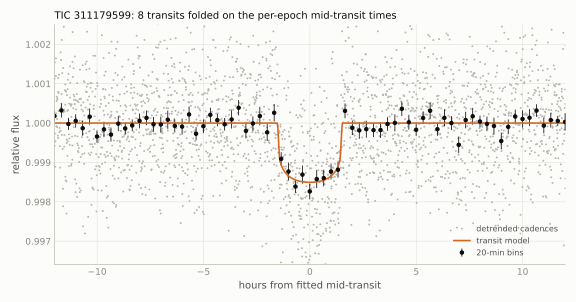
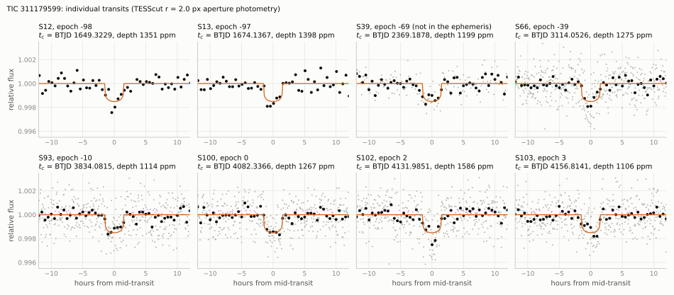
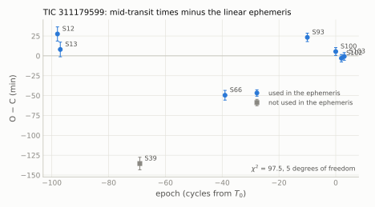
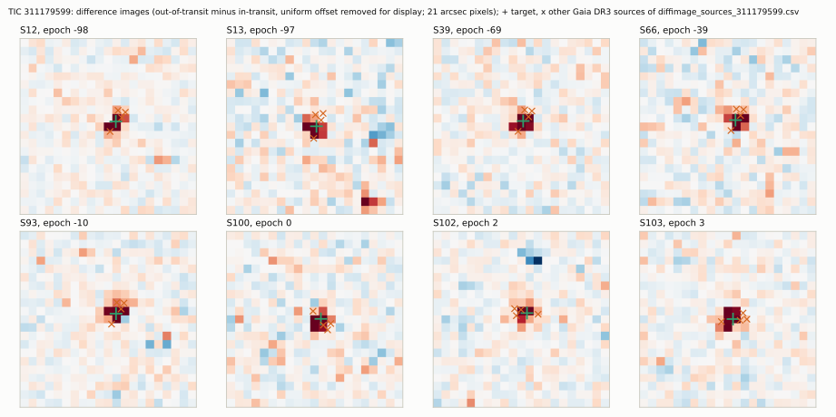
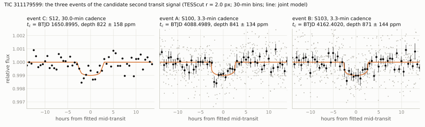

[README](../README.md) / 5. TIC 311179599

## 5. TIC 311179599

Sections [5.1](#51-host-star)-[5.9](#59-predicted-transits-2026-10-19-to-2027-10-19) describe the 24.8-d transit signal; section [5.10](#510-a-second-transit-signal-candidate-c) describes a candidate second transit signal on the same
star.

### 5.1 Host star

| quantity | value | source |
|---|---|---|
| identifiers | TIC 311179599, Gaia DR3 (= DR2) 5801882036668103680, UCAC4 072-033588, 2MASS J17103508-7540176, WISEA J171035.14-754018.3, APASS 35006397 | SIMBAD, TIC v8.2 |
| position (ICRS, epoch 2016.0) | RA 257.6466511, Dec $`-`$75.6718713 | Gaia DR3 |
| proper motion (mas/yr) | 30.842, $`-`$69.334 | Gaia DR3 |
| parallax (mas) | $`21.049 \pm 0.013`$ | Gaia DR3 |
| distance (pc) | $`47.49 \pm 0.06`$ | TIC v8.2 |
| $`G`$, $`BP-RP`$ | 11.355, 1.819 | Gaia DR3 |
| $`T`$, $`V`$, $`B`$, $`J`$, $`H`$, $`K`$ | 10.439, 11.836, 13.476, 9.281, 8.595, 8.453 | TIC v8.2 (ExoFOP) |
| $`T_\mathrm{eff}`$ (K) | $`3936 \pm 157`$ (no Gaia GSP-Phot value) | TIC v8.2 |
| $`L_\star`$ ($`L_\odot`$) | $`0.078 \pm 0.017`$ | TIC v8.2 |
| $`M_{K_s}`$; $`R_\star`$ ($`R_\odot`$); $`M_\star`$ ($`M_\odot`$); $`\rho_\star`$ (g cm$`^{-3}`$) | 5.069; $`0.599 \pm 0.018`$; $`0.587 \pm 0.012`$; $`3.85 \pm 0.35`$ (adopted) | this work: Mann et al. (2015) $`R`$-$`M_{K_s}`$ and Mann et al. (2019) $`M`$-$`M_{K_s}`$ relations; the TIC v8.2 values ($`0.599 \pm 0.018\,R_\odot`$, $`0.587 \pm 0.020\,M_\odot`$, $`\log g = 4.652`$) come from the same relations |
| RUWE; `ipd_frac_multi_peak`; `ipd_gof_harmonic_amplitude`; `non_single_star` | 0.968; 0; 0.0115; 0 | Gaia DR3 |
| `astrometric_excess_noise` (mas; significance) | 0.10; 19.7 | Gaia DR3 |
| radial velocity (km/s) | $`+12.27 \pm 0.25`$ (25 transits, 10 deblended); `rv_amplitude_robust` 3.93; `rv_chisq_pvalue` 0.49; `rv_renormalised_gof` $`-`$0.16 | Gaia DR3 |
| variability | `phot_variable_flag` VARIABLE; `vari_classifier_result` SOLAR_LIKE (score 0.22); no eclipsing-binary, planetary-transit, rotation-modulation or non-single-star entry; VSX: the automatic Gaia DR3 entry (type ROT) without period | Gaia DR3, VSX |
| rotation | no significant period below 15 d in the six 200-s sectors; slow variability of 8-16 ppt (5-95 % range) | this work (no script in this repository) |
| Hipparcos, Hipparcos-Gaia accelerations | not listed | VizieR I/239, J/ApJS/254/42 |
| TIC contamination ratio | 0.030 | TIC v8.2 |
| Gaia DR3 sources within 60" | 43 besides the target; nearest: $`G = 20.25`$ at 9.1" and $`G = 19.64`$ at 12.7" (parallaxes consistent with 0); nearest with $`G < 18`$: Gaia DR3 5801882032368601856 (TIC 311179596), $`G = 17.77`$, 16.8", parallax 0.55 mas (background) | Gaia DR3 |
| target lists | Habitable Worlds Observatory Preliminary Input Catalog (HPIC; Tuchow et al. 2024) and HWO Target Stars and Systems 2025 list (TSS25, tier 3; Tuchow et al. 2025) | VizieR J/AJ/167/139, J/PASP/137/J4402 |

The star is an early M dwarf ($`BP-RP = 1.82`$, $`M_G = 7.97`$). The adopted radius, mass and density use the 2MASS
$`K_s`$ magnitude ($`8.453 \pm 0.023`$; 0.026 mag assumed) and the Gaia DR3 parallax; the error of $`\rho_\star`$
combines those of $`R_\star`$ and $`M_\star`$. The derived quantities below use $`L_\star = 0.0775\,L_\odot`$ (TIC).

### 5.2 Transits and ephemeris

TESScut cutouts of sectors 12, 13, 39, 66, 93, 100, 101, 102 and 103 (every sector in which tess-point places the star
on silicon up to sector 103) are requested at the Gaia DR3 position, and the apertures are centred on the
proper-motion-corrected position of each sector. Cadences: 30 min (sectors 12, 13), 10 min (39) and 200 s (66-103).
Eight transits are covered (cycles $`-98`$, $`-97`$, $`-69`$, $`-39`$, $`-10`$, 0, 2 and 3); the predicted transit of
sector 101 (cycle 1, BTJD 4107.16) falls in a 5.1-h data gap (BTJD 4107.054-4107.267). Common-shape fit of the eight
transits in the $`r = 2.0`$ px circular-aperture photometry ([`scripts/fit_transits.py`](../scripts/fit_transits.py); batman model, quadratic limb
darkening $`u = (0.33, 0.27)`$, one quadratic baseline per epoch solved jointly, quality-0 cadences within
$`\pm 0.6`$ d of each transit, exposure-time supersampling for the 30-min and 10-min data):

| quantity | $`r = 2.0`$ px, $`\pm 0.6`$ d, quadratic (nominal) | $`a/R_\star`$ fixed at the adopted density (50.1) | $`r = 1.5`$ px | $`r = 3.0`$ px | $`\pm 0.4`$ d, linear | $`\pm 1.0`$ d, cubic |
|---|---|---|---|---|---|---|
| $`k = R_\mathrm{p}/R_\star`$, raw aperture flux | 0.0358 | 0.0374 | 0.0358 | 0.0362 | 0.0357 | 0.0360 |
| depth $`k^2`$ (ppm) | 1281 | 1401 | 1284 | 1312 | 1271 | 1297 |
| $`b`$ | 0.20 (not constrained) | 0.63 | 0.01 | 0.13 | 0.20 | 0.20 |
| $`a/R_\star`$ | 62.9 | 50.1 | 64.1 | 63.4 | 63.0 | 63.0 |
| $`T_{14}`$, $`T_{23}`$ (h) | 3.06, 2.84 | 3.12, 2.75 | 3.06, 2.85 | 3.08, 2.86 | 3.06, 2.84 | 3.06, 2.84 |
| $`\chi^2`$ (points) | 2876.9 (2877) | 2878.0 | 2876.9 | 2876.9 | 1918.7 (1919) | 4788.4 (4789) |
| linear-ephemeris $`\chi^2`$ without sector 39 (5 degrees of freedom) | 125.9 | 93.4 | 187.9 | 101.2 | 107.0 | 125.8 |

Detection-stage values (3 $`\times`$ 3-pixel box photometry): $`P = 24.826807 \pm 0.00016`$ d (seven epochs, without
sector 39), depths of 1299-1806 ppm per epoch (not dilution corrected), $`T_{14} \approx 3.3`$ h.

Linear ephemerides of the nominal fit ([`data/transit_times_311179599.csv`](../data/transit_times_311179599.csv)):

- adopted, through the seven epochs other than sector 39: $`P = 24.826859 \pm 0.000044`$ d,
  $`T_0 = 2461082.33414 \pm 0.00154`$ BJD$`_\mathrm{TDB}`$ (BTJD 4082.33414); $`\chi^2 = 125.9`$ for 5 degrees of freedom;
- through all eight epochs: $`P = 24.827147 \pm 0.000041`$ d, $`T_0`$ = BTJD $`4082.33370 \pm 0.00154`$; $`\chi^2 = 385.2`$
  for 6 degrees of freedom.

The depth is the same in all apertures (1271-1312 ppm), as expected for a source on the target; with limb darkening
the central depth is about $`1.2\,k^2`$. $`\chi^2`$ profile over $`b`$ (per-epoch noise fixed at the values of the
nominal fit, `--bfix`): $`\Delta\chi^2`$ = 0.1, 0.7, 0.9, 1.6, 4.3, 6.0 and 8.4 for $`b`$ = 0.3, 0.5, 0.6, 0.7, 0.8,
0.85 and 0.9 relative to the nominal fit (at $`b = 0.7`$ and 0.8 the minimum over $`a/R_\star`$ = 44-59 and 34-44 with `--arfix`); $`b`$ is not
constrained below about 0.7. The light curve alone gives circular-orbit densities of 3-8 g cm$`^{-3}`$ for
$`b \le 0.7`$, consistent with the adopted stellar density.

Dilution ([`scripts/dilution_correction.py`](../scripts/dilution_correction.py), Gaia DR3 $`G`$-band fluxes of the 44 sources within 60", per-epoch Gaussian
PSF of sigma 0.58-0.90 px and 1.5 times that):

| aperture | raw depth $`k^2`$ (ppm) | target flux fraction | corrected depth (ppm) | $`k`$ | $`R_\mathrm{p}`$ ($`R_\oplus`$) |
|---|---|---|---|---|---|
| $`r = 1.5`$ px | 1284 | 0.969 | 1326 | 0.0364 | 2.38 |
| $`r = 2.0`$ px | 1281 | 0.955 | 1342 | 0.0366 | 2.39 |
| $`r = 3.0`$ px | 1312 | 0.927 | 1416 | 0.0376 | 2.46 |

For comparison, the TIC contamination ratio of 0.030 corresponds to a fraction of 0.971, and TRICERATOPS gives
0.971 for the $`r = 2.0`$ px apertures. The radii of this table use $`R_\star = 0.599\,R_\odot`$ and the common-shape
fit ($`b = 0.20`$).

Joint fit with the stellar-density prior (`scripts/fit_free_dilution.py --rho-prior`,
[`data/fit_free_dilution_rho_311179599.csv`](../data/fit_free_dilution_rho_311179599.csv); adopted): raw $`r = 2.0`$ px flux of the eight epochs (quality 0,
$`\pm 0.6`$ d, 2878 points), $`F = f_t\,T(t) + (1 - f_t)`$ with $`f_t \sim N(0.955, 0.010)`$ (the per-epoch fractions
of the table above, 0.949-0.968), Kipping $`q_1`$, $`q_2`$ with Gaussian priors $`u_1 = 0.33 \pm 0.1`$,
$`u_2 = 0.27 \pm 0.1`$, a circular orbit, the circular-orbit density with the prior $`3.85 \pm 0.35`$ g cm$`^{-3}`$,
eight free mid-transit times, a quadratic baseline per epoch solved linearly, per-epoch noise fixed at the residual rms
of the common-shape fit (454-1236 ppm); exposure time = cadence. emcee, 44 walkers $`\times`$ 6000 steps, the first
2000 discarded. The same model without the density prior ([`data/fit_free_dilution_311179599.csv`](../data/fit_free_dilution_311179599.csv)) gives the
circular-orbit density from the light curve alone.

| quantity | with the density prior (adopted); median and 68 % interval (95 % interval) | without the density prior |
|---|---|---|
| $`k = R_\mathrm{p}/R_\star`$ (undiluted) | $`0.0378 \pm 0.0011`$ (0.0356-0.0401) | $`0.0371^{+0.0020}_{-0.0013}`$ (0.0345-0.0420) |
| depth $`k^2`$ (ppm) | $`1431^{+88}_{-83}`$ | $`1378^{+152}_{-97}`$ |
| $`f_t`$ | $`0.955 \pm 0.010`$ (equal to the prior) | $`0.955 \pm 0.010`$ |
| $`b`$ | $`0.62^{+0.04}_{-0.04}`$ (0.53-0.69) | $`0.45^{+0.27}_{-0.29}`$ (0.03-0.87) |
| $`a/R_\star`$; $`\rho_\mathrm{circ}`$ (g cm$`^{-3}`$) | $`50.2 \pm 1.5`$; $`3.89^{+0.35}_{-0.34}`$ | $`57.2^{+6.1}_{-12.8}`$; $`5.8^{+2.0}_{-3.1}`$ (0.9-8.7) |
| $`T_{14}`$, $`T_{23}`$ (h) | $`3.14^{+0.08}_{-0.07}`$, $`2.78 \pm 0.09`$ | $`3.10^{+0.12}_{-0.08}`$, $`2.80^{+0.08}_{-0.13}`$ |
| $`R_\mathrm{p}`$ ($`R_\star = 0.599 \pm 0.018\,R_\odot`$) | $`2.47^{+0.11}_{-0.10}\,R_\oplus`$ = $`0.220 \pm 0.009\,R_\mathrm{J}`$ (2.27-2.68 $`R_\oplus`$) | $`2.43^{+0.15}_{-0.12}\,R_\oplus`$ |
| best $`\chi^2`$ (2878 points); autocorrelation times (steps) | 2879.6; 130-190 | 2878.2; 211-380 |

An independent fit of the same eight epochs (Metropolis sampler on $`k`$, $`b`$, $`a/R_\star`$ with the mid-transit
times fixed, dilution applied afterwards; no script in this repository) gave $`b = 0.62 \pm 0.03`$ and
$`R_\mathrm{p} = 2.48 \pm 0.10\,R_\oplus`$ with the density prior, and $`b = 0.30^{+0.28}_{-0.20}`$ ($`b < 0.73`$ at
97.5 %) without it.

Adopted: $`R_\mathrm{p} = 2.47 \pm 0.10\,R_\oplus`$ ($`R_\star = 0.599 \pm 0.018\,R_\odot`$), true depth about 1430 ppm,
$`T_{14} = 3.14`$ h. With $`M_\star = 0.587\,M_\odot`$: $`a = 0.139`$ au, insolation 4.0 times that of the Earth
($`L_\star = 0.0775\,L_\odot`$) and equilibrium temperature 393 K (zero albedo, full redistribution).

Photoeccentric constraint (Dawson & Johnson 2012; the fit without the density prior): with
$`\rho_\star = M_\star/R_\star^3`$ drawn from $`M_\star = 0.587 \pm 0.012\,M_\odot`$ and $`R_\star = 0.599 \pm 0.018\,R_\odot`$
($`\rho_\star = 3.85^{+0.37}_{-0.33}`$ g cm$`^{-3}`$), $`\rho_\mathrm{circ}/\rho_\star = 1.48^{+0.57}_{-0.78}`$. Uniform
priors on $`e`$ in [0, 0.95) and on $`\omega`$ give $`e = 0.27^{+0.30}_{-0.17}`$, $`e < 0.39`$ (68 %) and $`e < 0.78`$
(95 %); the Savage-Dickey density ratio at $`e = 0`$ is 1.5. The light curve is consistent with a circular orbit at
$`b \approx 0.6`$; the eccentricity is not measured.

### 5.3 Transit epochs and O-C

[`data/transit_times_311179599.csv`](../data/transit_times_311179599.csv); errors as in section [1.3](1_TIC402710280.md#13-transit-epochs-and-o-c). Depths are raw $`r = 2.0`$ px depths (not dilution
corrected). O $`-`$ C against the adopted ephemeris and against the ephemeris through all eight epochs. The last
column gives the scatter of the mid-times of transits of the same shape injected at random times into the same sector
and recovered with a timing scan (robust standard deviation and 95th percentile of the offsets; 60 injections per
sector, 300 in sectors 39 and 66; no script in this repository).

| epoch | sector | camera/CCD | cadence (min) | $`t_c`$ (BTJD) | error (min) | O $`-`$ C (min) | O $`-`$ C, all epochs (min) | depth (ppm) | injected transits: $`\sigma`$ / 95 % (min) |
|---|---|---|---|---|---|---|---|---|---|
| $`-98`$ | 12 | 2/2 | 30 | 1649.322944 | 8.8 | $`+30.2`$ | $`+71.5`$ | $`1351 \pm 205`$ | 12 / 25 |
| $`-97`$ | 13 | 2/1 | 30 | 1674.136651 | 8.5 | $`+11.3`$ | $`+52.2`$ | $`1398 \pm 218`$ | 9 / 28 |
| $`-69`$ | 39 | 2/2 | 10 | 2369.187776 | 7.4 | $`-134.0`$ (not used) | $`-104.8`$ | $`1199 \pm 194`$ | 7 / 24 |
| $`-39`$ | 66 | 2/1 | 3.3 | 3114.052629 | 5.4 | $`-49.0`$ | $`-32.2`$ | $`1275 \pm 171`$ | 6 / 40 |
| $`-10`$ | 93 | 2/1 | 3.3 | 3834.081539 | 4.4 | $`+23.0`$ | $`+27.8`$ | $`1114 \pm 181`$ | 6 / 14 |
| 0 | 100 | 4/3 | 3.3 | 4082.336562 | 4.4 | $`+3.5`$ | $`+4.1`$ | $`1267 \pm 159`$ | 4 / 28 |
| 2 | 102 | 3/2 | 3.3 | 4131.985133 | 4.6 | $`-3.9`$ | $`-4.1`$ | $`1586 \pm 172`$ | 6 / 14 |
| 3 | 103 | 2/1 | 3.3 | 4156.814121 | 4.5 | $`-0.9`$ | $`-1.5`$ | $`1106 \pm 167`$ | 6 / 38 |

The per-epoch depths agree ($`\chi^2 = 5.7`$ for 7 degrees of freedom about the weighted mean of 1281 ppm). The
mid-transit times do not follow a linear ephemeris: $`\chi^2 = 125.9`$ for 5 degrees of freedom without sector 39 and
385 for 6 with it; the pattern is the same for $`r`$ = 1.5 and 3.0 px apertures and for linear, quadratic and cubic
baselines (sector-39 O $`-`$ C $`-127.2`$ to $`-138.0`$ min against the respective seven-epoch ephemerides). The MAST
light curves give the same offsets (same fixed-shape scan; no script in this repository): sector 39 $`-124`$ min
(TESS-SPOC SAP and PDCSAP) and $`-125`$ min (QLP SAP and KSPSAP); sector 66 $`-46`$ min (TESS-SPOC) and $`-67`$ min (QLP,
weak detection); sector 93 $`+23`$ min (QLP); sectors 12 and 13 $`+14`$ to $`+33`$ min (QLP, TESS-SPOC, eleanor-lite);
sectors 100-103 within $`-14`$ to $`+8`$ min (QLP; the QLP time stamps of sectors 99-104 carry the timing error of
section [7](7_caveats.md), so these values are a consistency check only).

The sector-39 offset ($`-2.2`$ h) is not established as a transit-timing variation:

- The sector-39 dip is present at the same time in every photometry examined (TESScut $`r`$ = 1.0-3.0 px apertures, PSF
  photometry with and without the 16.8" star as a free source, QLP, TESS-SPOC SAP and PDCSAP) with the common depth
  ($`k^2`$ = 1191-1464 ppm), and its difference image is centred on the target (section [5.5](#55-difference-image-localisation)). No transit is seen at the
  time predicted by the adopted ephemeris (3-h box depth $`-30`$ to $`-96`$ ppm in the TESScut photometry, $`-36`$ to
  $`-81`$ ppm in the MAST light curves, against about 1300 ppm expected); the 10-min data there are complete, with no
  flagged cadence within $`\pm 20`$ h.
- Sector 39 has strong scattered light: the annulus background in the $`r = 2.0`$ px aperture is 265-290 ppt of the
  stellar flux and varies by $`\pm 15`$ ppt within a day, and the dip lies at the end of a background plateau. The dip
  depth does not scale with the aperture area (1318 ppm at $`r = 1.5`$ px, 984 ppm at $`r = 3.0`$ px), as a background
  error would make it do, and the PSF photometry (local constant background) gives 1464 ppm.
- Red noise in sector 39 (no script in this repository): of the 3-h windows of the sector, 0.4 % ($`r = 2.0`$ px), 0.8 %
  ($`r = 1.5`$ px) and 1.0 % (PSF) lie 1200 ppm or more above the local baseline, as would be needed to hide a transit at
  the predicted time, and 0.2 %, 1.6 % and 2.4 % show a dip of 1200 ppm or more. Of the transits injected into sector 39,
  1.0 % ($`r = 2.0`$ px, 3 of 300) and 7.0 % ($`r = 1.5`$ px, 21 of 300) were recovered more than 2 h from the injected
  time (the scan locked on a deeper noise dip while the injected transit remained in place). Combined, a transit hidden
  by noise at the predicted time together with a full-depth noise dip 2.2 h earlier has a probability of order
  $`10^{-3}`$ per epoch from these distributions, or a few $`\times 10^{-3}`$ over eight epochs.
- Sector 101 (cycle 1, one cycle after sector 100): the data around the 5.1-h gap exclude mid-transit times earlier than
  $`-70`$ min or later than $`+90`$ min relative to the adopted ephemeris ($`\Delta\chi^2 > 4`$ in the $`r`$ = 1.5 and
  2.0 px apertures; no script in this repository).

The other offsets (sector 66 $`-49`$ min, sector 93 $`+23`$ min, sector 12 $`+30`$ min) lie at or near the 95th
percentiles of the offsets of the injected transits of their sectors. With errors of 95th percentile/1.96 of the
injection distributions the seven epochs of the adopted ephemeris still give $`\chi^2 \approx 26`$ for 5 degrees of
freedom, mostly from sectors 93 and 12 (timing of the vetting record; no script in this repository); these
distributions have tails (1-3 % of the injections in most sectors were recovered more than 2 h from the injected
time), so the timing errors are not Gaussian. A linear ephemeris plus a
sinusoid fits all eight epochs ($`\chi^2 = 1.1`$-1.7 for 4 degrees of freedom in three photometries) with a period at
the 4000-d edge of the grid searched, longer than the 2507-d baseline (no script in this repository); with four
parameters for eight points and non-Gaussian errors this is not a detection. If the offsets are a timing variation,
an amplitude of about 2 h at $`P = 24.8`$ d with a super-period of several years would be of the kind produced by a
companion near a first-order resonance; for an exterior perturber near 2:1 with zero free eccentricity (Lithwick, Xie
& Wu 2012) the order of magnitude is 30-140 $`M_\oplus`$ for distances of 1-5 % from resonance (radial-velocity
semi-amplitudes of about 7-35 m/s); this is a scaling, not a fit.

Ephemeris variants (for predictions): the ephemeris through the seven epochs with the injection-based errors
(the larger of the timing-profile width and the injection standard deviation; no script in this repository) is
$`P = 24.826911 \pm 0.000060`$ d, $`T_0`$ = BTJD $`4082.33492 \pm 0.00206`$, and predicts the transits of 2026-2027
2-3 min later than the adopted one; the ephemeris through sectors 93-103 alone, $`P = 24.82547 \pm 0.00035`$ d,
predicts them 18-44 min earlier than the adopted ephemeris before the correction of 2026-10-22 (about 1 min more
against the current one).

<picture><source srcset="../figures/fold_311179599_dark.svg" media="(prefers-color-scheme: dark)"></picture>

<picture><source srcset="../figures/epochs_311179599_dark.svg" media="(prefers-color-scheme: dark)"></picture>

<picture><source srcset="../figures/oc_311179599_dark.svg" media="(prefers-color-scheme: dark)"></picture>

### 5.4 Checks against false positives

- Light curves: the star was never a 2-min or 20-s target (no SPOC light curve or data-validation report). The transits
  are present in the TESScut photometry ($`r`$ = 1.0-3.0 px apertures and PSF photometry) and in the QLP (all nine
  sectors), TESS-SPOC (sectors 12, 13, 39, 66) and eleanor-lite (sectors 12, 13) light curves (no script in this
  repository); the TARS light curves (sectors 12, 13, 39, 66, 93) were not retrieved.
- Depth: the same in every aperture and baseline variant ($`k^2`$ = 1271-1312 ppm, section [5.2](#52-transits-and-ephemeris); PSF photometry 1274 ppm,
  1391 ppm with the 16.8" star free; no script in this repository) and in every epoch (section [5.3](#53-transit-epochs-and-o-c)).
- Odd and even transits agree in depth (table 5.3): $`1228 \pm 92`$ ppm (odd) and $`1330 \pm 88`$ ppm (even), 0.8 $`\sigma`$.
- Period aliases ([`scripts/alias_secondary_search.py`](../scripts/alias_secondary_search.py), 1.0-d biweight detrending, box of $`0.8\,T_{14}`$, timing slop
  $`\pm 0.04`$ d): for $`P/2 = 12.4134`$ d six covered half-period epochs show no transit ($`-234`$ to $`+170`$ ppm) and
  three show 416-516 ppm ($`\pm`$ 211-245 ppm; BTJD 1636.890, 1661.717, 4144.401), less than half the transit depth;
  $`P/3`$: 13 covered epochs without transit, 3 ambiguous and one dip (BTJD 3105.81, 904 ppm); $`P/4`$: 20 without
  transit, 5 ambiguous and one dip (BTJD 4088.54, the event below); $`P/k`$, $`k`$ = 5-12: 23-76 covered epochs without
  transit each. $`2P`$ is excluded by the consecutive cycles $`-98`$/$`-97`$ (sectors 12, 13) and 2/3 (sectors 102, 103)
  and by the equal depths of odd and even transits.
- Secondary eclipse (same script; circular orbit): the nine covered phase-0.5 epochs give a weighted mean of
  $`-53 \pm 68`$ ppm (3 $`\sigma`$ limit 204 ppm, white noise); the robust scatter of box depths over all off-transit
  phases is 130 ppm (3 $`\sigma`$ limit 389 ppm), and the deepest box at any off-transit phase is 1780 ppm (phase
  $`+0.32`$, from the scattered-light events of sectors 93 and 103 below).
- Spacecraft orbit: $`P`$ is not within 4 % of 13.7 d$`/n`$ or 27.4 d$`/n`$ ($`n`$ = 1-8).
- Other dips ([`scripts/alias_secondary_search.py`](../scripts/alias_secondary_search.py), box S/N > 5; [`scripts/event_checks.py`](../scripts/event_checks.py) on 21 of them): the events of
  2400-6000 ppm at BTJD 3841.907, 3855.227 (sector 93), 4164.801 and 4177.741 (sector 103) and 3122.768 (sector 66) grow
  with the aperture radius by factors of 2.4-3.7 between $`r`$ = 1.5 and 3.0 px (scattered light); the events at
  3111.758, 4092.877, 4119.823, 4126.103, 4158.671 and 4170.941 coincide with flagged cadences or centroid shifts; the
  events at 1654.542, 3104.798, 4086.307, 4100.147, 4138.398, 4151.308 and 4152.951 (a brightening) coincide with
  background excursions or change with the aperture radius; 4166.501 shows no dip against a local quadratic baseline.
  Two events behave like dips on the target: BTJD 4088.457 (sector 100; 1072, 1098 and 1104 ppm in the $`r`$ = 1.5,
  2.0 and 3.0 px apertures, QLP SAP $`1020 \pm 131`$ ppm) and BTJD 4162.411 (sector 103; 1027, 1110 and 1128 ppm,
  QLP SAP $`796 \pm 142`$ ppm), each without a background or centroid excursion and about 0.8 times the transit depth in a 2.5-h box. They are not at the
  24.8-d ephemeris (phases 0.247 and 0.225); with a third event in sector 12 they form the candidate second transit
  signal of section [5.10](#510-a-second-transit-signal-candidate-c), which also reports a search for further signals with an injection-recovery test.
- Localisation: the dimming is centred on the target in all eight epochs, and every Gaia DR3 source other than the
  target is disfavoured as the host (section [5.5](#55-difference-image-localisation)).
- Gaia DR3: RUWE 0.968, `ipd_frac_multi_peak` 0, no non-single-star solution; the radial-velocity scatter limits a
  companion at this period to $`M_2 \sin i < 20\,M_\mathrm{J}`$ (section [5.6](#56-companion-mass-limits-from-gaia)).

### 5.5 Difference-image localisation

[`data/diffimage_311179599.csv`](../data/diffimage_311179599.csv), [`data/diffimage_sources_311179599.csv`](../data/diffimage_sources_311179599.csv), [`data/diffimage_centroids_311179599.csv`](../data/diffimage_centroids_311179599.csv),
[`scripts/difference_images.py`](../scripts/difference_images.py) (settings `diff` in [`scripts/targets.py`](../scripts/targets.py): quadratic out-of-transit model of every pixel
over $`\pm 0.7`$ d excluding $`\pm 0.10`$ d, in-transit window $`\pm 0.05`$ d). Centroid offsets of the difference image
from the out-of-transit image, with the scatter of the same measurement over 54-71 off-transit windows:

| epoch | sector | offset (px) | scatter (px) | offset (") | PSF sigma (px) | $`\Delta\chi^2`$ of the 16.8" star | its implied eclipse depth |
|---|---|---|---|---|---|---|---|
| $`-98`$ | 12 | ($`+0.149`$, $`+0.122`$) | (0.213, 0.403) | ($`+3.0`$, $`+2.5`$) | 0.90 | +208 | 53 % |
| $`-97`$ | 13 | ($`-0.232`$, $`-0.171`$) | (0.287, 0.291) | ($`-5.2`$, $`-1.4`$) | 0.81 | +159 | 23 % |
| $`-69`$ | 39 | ($`-0.056`$, $`-0.075`$) | (0.217, 0.281) | ($`-1.3`$, $`-1.4`$) | 0.85 | +198 | 47 % |
| $`-39`$ | 66 | ($`+0.219`$, $`+0.109`$) | (0.380, 0.403) | ($`+4.8`$, $`+1.6`$) | 0.75 | +102 | 43 % |
| $`-10`$ | 93 | ($`-0.015`$, $`+0.302`$) | (0.672, 0.562) | ($`+0.5`$, $`+6.1`$) | 0.76 | +50 | 46 % |
| 0 | 100 | ($`+0.140`$, $`-0.148`$) | (0.638, 0.523) | ($`+2.4`$, $`+3.6`$) | 0.58 | +454 | 43 % |
| 2 | 102 | ($`+0.134`$, $`+0.279`$) | (0.152, 0.268) | ($`+3.9`$, $`-5.1`$) | 0.71 | +427 | 57 % |
| 3 | 103 | ($`-0.133`$, $`+0.170`$) | (0.320, 0.338) | ($`-4.4`$, $`+0.5`$) | 0.85 | +200 | 31 % |

Offsets in pixels are cutout column and row; in arcsec East and North. Every offset is within 1.1 $`\sigma`$ of zero;
the weighted mean is $`\Delta\mathrm{E} = +1.1 \pm 1.8`$", $`\Delta\mathrm{N} = -0.7 \pm 2.5`$" ($`\chi^2 = 5.4`$ for 16
degrees of freedom against zero). The Gaia PSF-position test fits each difference image with the out-of-transit PSF
placed at every Gaia DR3 source with $`G < 19`$ within 60" (19 sources). The target is preferred in every epoch; summed
over the eight epochs, it is preferred over the 16.8" star (Gaia DR3 5801882032368601856, TIC 311179596, $`G = 17.77`$,
parallax 0.55 mas) by $`\Delta\chi^2 = 1798`$, over the 27.9" star ($`G = 15.99`$) by 3064, over the 26.5" star
($`G = 17.43`$) by 3080 and over every other source by more than 3300. The 16.8" star would need a 23-57 % eclipse (PSF
fit) or a 70 % eclipse (TRICERATOPS flux ratio); the sources at 9.1" ($`G = 20.25`$) and 12.7" ($`G = 19.64`$) would
need eclipses of about 560 % and 375 % (TESS-band flux ratios from Gaia $`G`$ and $`BP-RP`$; no script in this
repository) and cannot host the signal. The seven neighbours that TRICERATOPS lists as possible hosts (section [5.7](#57-triceratops))
are all among the sources tested here.

<picture><source srcset="../figures/diffimage_311179599_dark.svg" media="(prefers-color-scheme: dark)"></picture>

### 5.6 Companion-mass limits from Gaia

[`scripts/gaia_companion_limits.py`](../scripts/gaia_companion_limits.py).

- Radial velocity: 25 Gaia transits, `rv_chisq_pvalue` 0.49 (no significant variability), `rv_amplitude_robust`
  3.93 km/s. Taken as an upper bound on $`2K`$: $`K < 1.97`$ km/s and, for $`M_\star = 0.587\,M_\odot`$ and
  $`P = 24.83`$ d ($`K = 99.4`$ m/s per $`M_\mathrm{J}`$), $`M_2 \sin i < 20\,M_\mathrm{J}`$. Stellar companions at this
  period are excluded; brown dwarfs below about 20 $`M_\mathrm{J}`$ and planets are not.
- Astrometry: the semi-amplitude of the star's orbit is 0.14 mas for a 30 $`M_\mathrm{J}`$ companion and 1.14 mas for
  0.3 $`M_\odot`$ (companion light neglected); RUWE 0.968 and `ipd_frac_multi_peak` 0 do not indicate a companion but are
  not a formal limit. No proper-motion anomaly is available (the star is not in Hipparcos).
- Imaging: no high-resolution image of the star exists in ExoFOP or in the literature found (section [5.8](#58-catalogue-and-literature-checks)); no Gaia DR3
  source lies within 9".

### 5.7 TRICERATOPS

TRICERATOPS 1.1.0, set-up as in section [1.6](1_TIC402710280.md#16-triceratops): the six epochs of sectors 39, 66, 93, 100, 102 and 103 (the 30-min
sectors 12 and 13 are left out because the model takes a single exposure time; per-sector $`r < 2.0`$ px apertures of
11-13 pixels), each divided by its jointly fitted quadratic baseline ($`\pm 0.6`$ d), 144 bins of 10 min, out-of-transit
bin scatter 285 ppm ([`data/triceratops_input_311179599.csv`](../data/triceratops_input_311179599.csv)), transit depth $`k^2 = 0.001279`$ (raw aperture flux,
`dilution_corrected=False`; TRICERATOPS target flux ratio 0.971), Gaia DR3 background (3408 stars), $`N = 10^6`$,
`nsamples=20`, 10-min exposure time. No contrast curve (none exists).

| configuration | seeds | FPP mean $`\pm`$ std | FPP median (range) | NFPP |
|---|---|---|---|---|
| no contrast curve | 5 | $`0.028 \pm 0.002`$ | 0.027 (0.025 to 0.031) | $`(6.5`$-$`7.7) \times 10^{-7}`$ |

Mean scenario probabilities: TP 0.833, PTP 0.130, STP 0.028 (the whole FPP), DTP 0.0097; every eclipsing-binary
scenario on the target and every scenario on a neighbouring star is below $`10^{-6}`$; best-fit planet radius of the TP
scenario 2.30-2.36 $`R_\oplus`$ (TIC radius, raw aperture depth). The FPP is in the range Giacalone et al. (2021) call
"likely planet" (FPP $`< 0.5`$, NFPP $`< 0.001`$) and above their threshold for statistical validation (0.015). The STP
scenario (a planet transiting an unresolved bound companion), which carries the FPP, is not constrained by any imaging.
TRICERATOPS lists eight stars that could produce the signal with an eclipse of at most 100 %: the target,
TIC 311179596 (16.8"; 70 %), TIC 1309807027 (25.5"; 62 %), TIC 311179608 (28.5"; 20 %), TIC 311179581 (31.8"; 45 %),
TIC 311179588 (40.4"; 48 %), TIC 311179626 (41.0"; 39 %) and TIC 311179611 (46.0"; 66 %); all seven neighbours lie
within 60" and are disfavoured by the difference images (section [5.5](#55-difference-image-localisation)). Runs on the photometry of the vetting record
(same six sectors and set-up, out-of-transit bin scatter 273 ppm, $`k^2`$ = 1268 ppm, 5 seeds; no script in this
repository) gave FPP 0.020-0.028 and NFPP about $`5 \times 10^{-8}`$; the detection-stage runs ($`r < 1.5`$ px apertures
of three sectors, 5 seeds) gave 0.036-0.049.

### 5.8 Catalogue and literature checks

All queries were run with a positive control.

| date (UTC) | source | control | result |
|---|---|---|---|
| 2026-10-19 14:04-14:05 | ExoFOP target page (JSON) and the TOI (8151 rows) and CTOI (5138 rows) lists, live | TOI-700 (TIC 150428135): four TOIs on its target page and four rows in the TOI list | no TOI, no CTOI; no imaging, spectroscopy, time-series or file uploads on the target page (two stellar-parameter rows) |
| 2026-10-19 | ExoFOP TOI and CTOI lists (earlier download; TOI list last modified 2026-10-15 12:04 UTC, last alert 2026-10-08) | TOI-700 (4 TOI rows); the TIC of the last CTOI row | nothing within 2' |
| 2026-10-19 | MAST holdings of the TIC; SPOC threshold-crossing-event bulk files of sectors 1-13, 1-39, 12, 13, 39, 66, 93, 100, 102 and 103 | TOI-125 (50 TESS observations; in 7 of the files), TOI-700 (3 files) | never a 2-min or 20-s target (no SPOC light curve, target pixel file or data-validation report); full-frame-image products only (QLP, TESS-SPOC, eleanor-lite, TARS); not in the threshold-crossing-event files |
| 2026-10-19 | NASA Exoplanet Archive: `toi` by TIC; 72" box queries of `ps`, `pscomppars` and `toi` | TOI-700 (4, 19, 4 and 4 rows) | no entry (the cone-query syntax returned HTTP 403) |
| 2026-10-19 | VSX (API, 2'; VizieR B/vsx) | AM Her | the automatic Gaia DR3 entry (type ROT, no period) only |
| 2026-10-19 | SIMBAD | AM Her | UCAC4 072-033588, high-proper-motion star, 3 references (Gaia Catalogue of Nearby Stars, HPIC, TSS25 list) |
| 2026-10-19 | Gaia DR3 `vari_*` and `nss_*` tables (10 tables) | a row of the NSS table | `vari_summary` and `vari_classifier_result` (SOLAR_LIKE) only |
| 2026-10-19 | ADS full text: TIC 311179599 (also without space, and the bare number), Gaia DR3/DR2 5801882036668103680 (and the bare number), UCAC4 072-033588 (and without prefix), UCAC3 29-369070, 2MASS J17103508-7540176 and WISEA J171035.14-754018.3 (both also without prefix), APASS 35006397, J1710-7540 | "WD 0752-146" (1 record) | no record (the string "TIC-311179599" matches 21 unrelated Astrographic Catalogue records, as for the other targets) |
| 2026-10-19 | VizieR, all tables within 5" (82 tables) | AM Her | astrometry, photometry, stellar parameters, TIC, HWO target lists, Gaia variability summaries; no transit, eclipse, planet or radial-velocity-variability table |
| 2026-10-19 | Kostov et al. 2025 (J/ApJS/279/50), Valizadegan et al. 2025 (J/AJ/170/287), Prsa et al. 2022 (J/ApJS/258/16), Olmschenk et al. 2021 (J/AJ/161/273), Montalto et al. 2020 (DIAmante, J/MNRAS/498/1726), Mueller-Horn et al. 2026 (J/A+A/709/A62) | first row of each table | not listed (TIC and 30" cone; Gaia id for Mueller-Horn et al.) |
| 2026-10-19 | RAVEN candidate tables (Lafarga et al. 2026, Zenodo record 19661443): vetting (2170 rows), validation (143 and 207) and NSFP (14815) | TIC column present | not listed (the RAVEN sample consists of FGK stars) |
| 2026-10-19 | source files of 16 arXiv papers on duo-transit, single-transit and M-dwarf transit candidates (among them Hawthorn et al. 2024, Eschen et al. 2024, Feliz et al. 2021 and Lafarga et al. 2026) | the sources contain 7-3271 numeric identifiers each | not listed (TIC, Gaia, UCAC4 and 2MASS identifiers, coordinates) |
| 2026-10-19 | ESO Science Archive: ObsCore 10" cone, raw frames of all instruments and categories in a $`\pm 72`$" box, object-name queries | TIC 402710280 (5 HARPS ObsCore rows, 41 raw frames) | no data |
| 2026-10-19 | HPIC (J/AJ/167/139) and TSS25 (J/PASP/137/J4402) rows | - | listed (TSS25 tier 3); no planet or companion annotation |

Not checked or not reachable: the TARS light curves (not retrieved), the NEMESIS II candidate list (no public table),
proprietary data of facilities without a public archive and observations scheduled but not yet executed. A TOI or
CTOI issued after 2026-10-19 14:05 UTC cannot be excluded.

### 5.9 Predicted transits (2026-10-19 to 2027-10-19)

[`data/predicted_transits_311179599.csv`](../data/predicted_transits_311179599.csv) (geocentric UTC; [`scripts/predict_transits.py`](../scripts/predict_transits.py)). Errors are the propagated
linear-ephemeris errors. Because the mid-transit times deviate from the ephemeris by $`-49`$ to $`+30`$ min in the epochs
used and by $`-2.2`$ h in sector 39 (section [5.3](#53-transit-epochs-and-o-c)), a timing window of at least $`\pm 1`$ h should be used.
$`T_{14} = 3.14`$ h.

| epoch | mid-transit (UTC) | BJD$`_\mathrm{TDB}`$ | ephemeris error (min) | TESS |
|---|---|---|---|---|
| 11 | 2026-11-10 22:21 | 2461355.4296 | 2.3 |  |
| 12 | 2026-12-05 18:12 | 2461380.2564 | 2.3 |  |
| 13 | 2026-12-30 14:03 | 2461405.0833 | 2.4 |  |
| 14 | 2027-01-24 09:53 | 2461429.9102 | 2.4 | sector 113 |
| 15 | 2027-02-18 05:42 | 2461454.7370 | 2.4 | sector 114 |
| 16 | 2027-03-15 01:30 | 2461479.5639 | 2.4 |  |
| 17 | 2027-04-08 21:19 | 2461504.3907 | 2.5 |  |
| 18 | 2027-05-03 17:08 | 2461529.2176 | 2.5 |  |
| 19 | 2027-05-28 12:57 | 2461554.0445 | 2.5 |  |
| 20 | 2027-06-22 08:48 | 2461578.8713 | 2.6 |  |
| 21 | 2027-07-17 04:39 | 2461603.6982 | 2.6 |  |
| 22 | 2027-08-11 00:31 | 2461628.5250 | 2.6 |  |
| 23 | 2027-09-04 20:24 | 2461653.3519 | 2.7 |  |
| 24 | 2027-09-29 16:17 | 2461678.1788 | 2.7 |  |

TESS (tess-point 0.9.5.post1): the star was on silicon in sectors 12, 13, 39, 66, 93, 100, 101, 102 and 103 and will be in
sectors 113 (camera 4, CCD 3) and 114 (camera 4, CCD 2) ([`data/tess_sectors_311179599.csv`](../data/tess_sectors_311179599.csv)). The nominal sector-113
window (2027-01-16 to 2027-02-13) contains epoch 14 (2027-01-24 09:53 UTC) and the sector-114 window (2027-02-13 to
2027-03-13) contains epoch 15 (2027-02-18 05:42 UTC), two consecutive transits in full-frame images of 200-s cadence;
the published TESS orbit-time table ends at sector 111, so the positions of these transits relative to the orbit gaps
are not known. Mid-transit times of these two transits would test the timing variations of section [5.3](#53-transit-epochs-and-o-c).

### 5.10 A second transit signal (candidate c)

Three transit-shaped events of about 880 ppm and 5.4 h fall in sectors 12, 100 and 103 (BTJD 1650.899, 4088.499 and
4162.402). They are not at the 24.8-d ephemeris of sections [5.2](#52-transits-and-ephemeris)-[5.9](#59-predicted-transits-2026-10-19-to-2027-10-19) (called b in this section), and they are
consistent with one candidate second transit signal on the same star with $`P = 73.8672`$ d or half of it,
$`P = 36.9336`$ d (cycles $`-33`$, 0, 1 or $`-66`$, 0, 2); every other period $`P = (t_B - t_A)/n`$ with $`n \ge 3`$ is
excluded by covered epochs without a dip. With $`R_\star = 0.599\,R_\odot`$ and the dilution of section [5.2](#52-transits-and-ephemeris) the radius is
$`R_\mathrm{p} \approx 2.0\,R_\oplus`$. The signal rests on three events; it is a candidate, not a detected planet.

#### 5.10.1 Events and joint fit

[`data/transit_times_311179599c.csv`](../data/transit_times_311179599c.csv), [`data/fit_311179599c.csv`](../data/fit_311179599c.csv), [`data/folded_311179599c.csv`](../data/folded_311179599c.csv), [`data/model_311179599c.csv`](../data/model_311179599c.csv),
[`scripts/fit_second_signal.py`](../scripts/fit_second_signal.py): joint fit of the three events in the TESScut $`r = 2.0`$ px photometry (batman, circular
orbit at the reference period 73.87 d, $`u = (0.33, 0.27)`$, common $`k`$, $`a/R_\star`$ and $`b`$, one mid-time and one
quadratic baseline per event over $`\pm 0.6`$ d, quality-0 cadences, the 24.8-d transits masked, exposure-time
supersampling; Metropolis sampler, 600000 steps). The events were first found as single dips (A, sector 100; B,
sector 103; section [5.4](#54-checks-against-false-positives)); C (sector 12) was found in the window predicted by A and B for $`n = 1`$ and $`n = 2`$.

| event | sector | camera/CCD | cadence (min) | $`t_c`$ (BTJD) | error (min) | O $`-`$ C (min) | depth (ppm) |
|---|---|---|---|---|---|---|---|
| C | 12 | 2/2 | 30 | 1650.89961 | 19.7 | $`+1.6`$ | $`824 \pm 159`$ |
| A | 100 | 4/3 | 3.3 | 4088.49893 | 13.5 | $`-25.7`$ | $`844 \pm 134`$ |
| B | 103 | 2/1 | 3.3 | 4162.40191 | 13.8 | $`+25.8`$ | $`873 \pm 145`$ |

Errors: half the 16-84 % interval of the posterior; depths: the best common shape scaled per event (raw aperture flux).
Linear ephemerides through the three mid-times ($`\chi^2 = 7.1`$ for 1 degree of freedom, the same for both periods):

- $`n = 1`$: $`P = 73.86722 \pm 0.00046`$ d, $`T_0`$ = BTJD $`4088.5168 \pm 0.0066`$ (cycles $`-33`$, 0, 1);
- $`n = 2`$: $`P = 36.93361 \pm 0.00023`$ d, same $`T_0`$ (cycles $`-66`$, 0, 2).

The $`r = 1.5`$ px photometry gives $`P = 73.86718 \pm 0.00046`$ d and O $`-`$ C of $`+1.5`$, $`-14.5`$ and $`+27.0`$ min
(C, A, B).

| quantity (median, 68 % interval) | $`r = 2.0`$ px (adopted) | $`r = 1.5`$ px | PSF photometry (vetting record) |
|---|---|---|---|
| depth $`k^2`$ (ppm), raw aperture flux | $`874^{+138}_{-104}`$ | $`821^{+123}_{-102}`$ | $`893^{+120}_{-101}`$ |
| $`b`$ | $`0.41^{+0.34}_{-0.28}`$ (not constrained) | $`0.40^{+0.32}_{-0.28}`$ | $`0.34^{+0.33}_{-0.24}`$ |
| $`T_{14}`$ (h) | $`5.37^{+0.39}_{-0.40}`$ | $`5.30^{+0.37}_{-0.36}`$ | $`5.38^{+0.29}_{-0.30}`$ |
| circular-orbit density at 73.87 d (g cm$`^{-3}`$) | $`3.4^{+1.4}_{-2.1}`$ | $`3.5^{+1.4}_{-2.0}`$ | $`3.6^{+1.0}_{-1.8}`$ |

The light-curve density at $`P = 73.87`$ d agrees with the stellar density ($`3.85 \pm 0.35`$ g cm$`^{-3}`$, section [5.1](#51-host-star)).
At $`P = 36.93`$ d the same shape gives a density four times higher, $`14^{+6}_{-8}`$ g cm$`^{-3}`$; the stellar density
lies below the 16th percentile of that distribution, which a higher impact parameter or an eccentric orbit would
accommodate. Dilution-corrected depth (target flux fraction 0.955, section [5.2](#52-transits-and-ephemeris)) about 920 ppm, $`k \approx 0.030`$ and
$`R_\mathrm{p} = 2.0 \pm 0.15\,R_\oplus`$ (TRICERATOPS best-fit planet radius 1.88-1.97 $`R_\oplus`$). With
$`M_\star = 0.587\,M_\odot`$ and $`L_\star = 0.0775\,L_\odot`$: $`a = 0.289`$ au, insolation 0.93 times that of the
Earth and equilibrium temperature 274 K for $`P = 73.87`$ d; $`a = 0.182`$ au, 2.35 times and 345 K for $`P = 36.93`$ d
(zero albedo, full redistribution). The O $`-`$ C of A and B ($`-26`$ and $`+26`$ min, 1.9 $`\sigma`$ each) are not
established as timing variations.

<picture><source srcset="../figures/epochs_311179599c_dark.svg" media="(prefers-color-scheme: dark)"></picture>

#### 5.10.2 Period

[`data/period_tests_311179599c.csv`](../data/period_tests_311179599c.csv), [`data/epoch_tests_311179599c.csv`](../data/epoch_tests_311179599c.csv) (vetting record; no script in this repository).
For $`P = (t_B - t_A)/n`$, $`n`$ = 1-12, a grid of trial periods over $`\pm 4\,\sigma_P`$ was compared with the depth of
the A+B template at every predicted epoch inside a TESS sector (timing allowance $`\pm 0.05`$ d); a trial period is
excluded when an epoch shows no dip (depth below the A+B depth minus 3 $`\sigma`$). In the $`r = 2.0`$ px, $`r = 1.5`$ px
and PSF photometry, every trial period with $`n \ge 3`$ ($`P \le 24.63`$ d) is excluded, mostly by epochs in sectors 93
and 100-103. For $`n = 1`$ and $`n = 2`$, 4-32 % of the trial periods survive, in narrow intervals; the sector-12 epoch
excludes most of the others, and event C lies in one of the surviving intervals, 1.06 d (1.6 $`\sigma`$) after the time
predicted from A and B alone.

Every predicted epoch of the three-event ephemerides that falls inside a sector (depths in ppm; expected 870-880 ppm):

| period | sector | cycle | predicted BTJD | $`r = 1.5`$ / 2.0 / 3.0 px, PSF | status |
|---|---|---|---|---|---|
| both | 12 | $`-33`$ / $`-66`$ | 1650.90 | 951 / 985 / 888, 943 | event C |
| both | 39 | $`-23`$ / $`-46`$ | 2389.57 | 3357 / 1995 / 1321, 3826 (TESS-SPOC SAP 1231, PDCSAP 765) | not testable: last 0.15 d of the sector, flux drop that depends on the aperture |
| 36.93 d | 93 | $`-7`$ | 3829.98 | $`-1181`$ / $`-910`$ / $`-493`$, $`-445`$ | not testable: 0.02-0.12 d after the first cadence of the sector |
| both | 100 | 0 | 4088.51 | 1014 / 1039 / 973, 1160 | event A |
| 36.93 d | 101 | 1 | 4125.45 | $`-107`$ / $`-106`$ / $`-28`$, $`+36`$ ($`\pm 172`$) | not counted: scattered-light excursion |
| both | 103 | 1 / 2 | 4162.38 | 877 / 988 / 813, 937 | event B |

The predicted epochs of sectors 13, 66 and 102 fall outside the data. At the sector-101 epoch the one-sided estimate is
$`-106 \pm 172`$ ppm, 5.7 $`\sigma`$ below the expected depth; if it were reliable it would exclude $`P = 36.93`$ d. The
annulus background changes by $`-28`$ ppt of the stellar flux within the window (185 times the scatter of the same
measurement elsewhere in the sector), so the epoch is not counted, and $`P = 36.93`$ d is not excluded. The transit
predicted for 2026-11-02 (section [5.10.7](#5107-predicted-transits-2026-10-19-to-2027-10-19)) occurs only for $`P = 36.93`$ d.

#### 5.10.3 Checks

Values from the vetting record of 2026-10-19 (no script in this repository).

- Light curves: the three events are present in every photometry examined, with the template depth (mid-time free):
  A 966-1080 ppm in TESScut $`r`$ = 1.0-3.0 px apertures, 1160 ppm in PSF photometry (1218 ppm with the 16.8" star
  free), QLP SAP $`1039 \pm 127`$ ppm; B 813-988 ppm, PSF 937 ppm, QLP SAP $`902 \pm 147`$ ppm; C 882-985 ppm, PSF 943 ppm,
  eleanor-lite 975-1063 ppm, TESS-SPOC SAP $`946 \pm 136`$ and PDCSAP $`995 \pm 145`$ ppm, QLP SAP $`741 \pm 135`$ ppm. The
  QLP detrended fluxes, whose detrending suppresses 5-h events, give 711-972 ppm (A) and 173-1040 ppm (B).
- Background and systematics: a background error would scale with the aperture area (a factor of 9 between $`r`$ = 1.0
  and 3.0 px), while the depths agree to about 10 %; no flagged cadence lies within $`\pm 0.3`$ d of any event; the nearest
  data edges are 1.0 d (A), 2.8 d (B) and 2.0 d (C) away; the flux-weighted and PSF centroids and the flux of the 16.8"
  star show no shift beyond 1.4 times the scatter of the same measurement at other times.
- Pixels: in the difference images of A and B the free-fit position lies ($`-3.4`$", $`+3.2`$") and ($`-4.7`$",
  $`-1.6`$") from the target, with a scatter of 7-13" for the same measurement at other times; summed over A and B, a PSF
  at the target fits better than at every Gaia DR3 source with $`G < 19`$ within 60" ($`\Delta\chi^2 = 393`$ for the
  16.8" star, 428 for the 27.9" star, 519 for the 26.5" star, $`\ge 530`$ for the others). Sector 12 has 30-min cadence;
  no difference image of C was made.
- Solar-system objects: SkyBoT cones of 5 deg at the times of A and B, with positions from JPL Horizons for TESS as
  observer (positive control: Ceres), list no known body within 2.9 deg (A) and 3.3 deg (B) of the target. C was not
  checked.
- Comparison stars: in the QLP SAP light curves of 543 (A) and 132 (B) stars on the same camera and CCD, the median
  depth significance at the event time is 0.06 and 0.08 $`\sigma`$, at ranks 0.35 and 0.34 of the same statistic at
  other times of the sector, and 0.7 % and 0.8 % of the stars show a dip above 3 $`\sigma`$ (95th percentile at other
  times 17 % and 11 %); the target shows A at 5.3 $`\sigma`$ in the same QLP data.
- Event statistics: on the template-depth grids of all nine sectors (223 d of data), the events that pass the same
  criteria as A, B and C (S/N $`> 4`$ in $`r = 2.0`$ px; same sign and S/N $`> 3`$ in $`r`$ = 1.5, 3.0 px and PSF; depth
  ratio $`r = 3.0`$ to 1.5 px of 0.6-1.6; more than 0.5 d from a data edge; no flagged cadence; small background change)
  are A and C (B has S/N 3.1 on this grid) and no other dip; the same test on the inverted flux finds one brightening
  (BTJD 4092.37). With about one such event per 220 d, the probability that an unrelated event falls within 1.06 d of
  the predicted time is about 1 % (2.1 d / 223 d); this is an order of magnitude, as it rests on zero or one event.

#### 5.10.4 TRICERATOPS and the multiplicity of candidates

TRICERATOPS 1.1.0 with the target object of section [5.7](#57-triceratops) and `calc_depths` redone for the depth of this signal
($`k^2`$ = 957 ppm, the best fit of the vetting record; raw aperture flux). Input ([`data/triceratops_input_311179599c.csv`](../data/triceratops_input_311179599c.csv)):
A and B at 200-s cadence (C left out: the model takes a single exposure time), each divided by its quadratic baseline and
folded on its own mid-time, 144 bins of 10 min within $`\pm 0.5`$ d, out-of-transit bin scatter 469 ppm; $`N = 10^6`$,
5 seeds per period; tables `data/triceratops/probs_311179599c_n*_seed*.csv`, rows `c_P73.87` and `c_P36.93` of
[`data/triceratops/runs.csv`](../data/triceratops/runs.csv) and `summary.csv`. No contrast curve.

| period | FPP mean $`\pm`$ std (range) | NFPP (range) | mean scenario probabilities |
|---|---|---|---|
| 73.867 d | $`0.047 \pm 0.011`$ (0.035-0.063) | 0.0014-0.0016 | TP 0.81, PTP 0.13, STP 0.045, DTP 0.010 |
| 36.934 d | $`0.038 \pm 0.007`$ (0.031-0.048) | 0.0070-0.0086 | TP 0.80, PTP 0.15, STP 0.030, DTP 0.011, NEB on TIC 311179608 (28.5") 0.005 |

The FPP is below the "likely planet" limit of Giacalone et al. (2021) (0.5) and above their validation threshold (0.015);
the NFPP exceeds their limit of 0.001 for both periods.

Guerrero et al. (2021) estimate a multiplicity boost (the factor by which the prior probability of being a planet is
higher for a candidate in a system with more than one candidate) of about 20, and about 54 for candidates smaller than
6 $`R_\oplus`$, from SPOC 2-min-cadence TOIs of the TESS prime mission. They note that the boost was derived for
SPOC-detected 2-min targets, does not apply to candidates detected only in full-frame images, for which it is likely
much weaker, and is lower in crowded fields. Both signals of TIC 311179599 come from full-frame images. Dividing the FPP
values by 20 (54) gives about 0.002 (0.0007-0.0009) for candidate c at either period and 0.0014 (0.0005) for
candidate b;
these numbers are indicative only and are not used for any classification here.

#### 5.10.5 Transit timing of candidate b and the second signal

Vetting record (no script in this repository): mid-times of candidate b within 1 min of table 5.3, with errors that
include the injection-based timing scatter of section [5.3](#53-transit-epochs-and-o-c), and periods of c that differ from those above by
0.2 $`\sigma`$. For $`P = 73.867`$ d the period ratio to b is 2.9753,
0.8 % inside the 3:1 resonance (second order), with a super-period of 2989 d. A sinusoid at that super-period fits the
eight mid-times of b ($`\chi^2 = 2.9`$ instead of 268 for a linear ephemeris) only with an amplitude of 116 min (PSF
photometry: 122 min); fitted to the seven epochs other than sector 39 it predicts the sector-39 O $`-`$ C at $`-105`$ min, against the observed $`-2.2`$ h (residual $`-26`$ min). For $`P = 36.934`$ d the ratio is 1.4876, 0.8 % inside the 3:2 resonance
(first order), super-period 1494 d: a sinusoid at that super-period does not fit the eight epochs ($`\chi^2 = 212`$;
PSF: 203), the zero-free-eccentricity model of Lithwick, Xie & Wu (2012), whose phase is fixed by the two ephemerides,
gives $`\chi^2 = 253`$ (implied mass of c 3.1 $`M_\oplus`$), and the amplitude expected for 3-10 $`M_\oplus`$ is
16-55 min; fitted without sector 39 the sinusoid predicts the sector-39 O $`-`$ C at $`+93`$ min (residual $`-3.7`$ h). The 3:1 sinusoid fitted without sector 39 thus predicts most of the sector-39 offset (with an amplitude of 97 min; PSF: 104 min); the 3:2 sinusoid does not. With eight epochs and non-Gaussian timing errors this comparison is indicative only. (Corrected 2026-10-22: an earlier version of this paragraph quoted the residuals, observed minus predicted, as the predicted values.)

#### 5.10.6 Search for further signals and completeness

[`data/completeness_311179599c.csv`](../data/completeness_311179599c.csv) (vetting record; no script in this repository). Box-least-squares searches
(astropy; durations 1-8 h, 20-min bins; TESScut $`r = 2.0`$ px photometry, quality 0, the 24.8-d transits removed,
systematics near data edges and scattered-light cadences masked, wotan biweight 1.0 d): over sectors 100-103
(104 d, $`P`$ = 0.5-52 d) the highest peak with A, B and C masked has SDE 4.4 (26.15 d), below the highest peak of the
same search on the inverted flux (4.5). Over all nine sectors ($`P`$ = 0.5-100 d) the highest peak with A, B and C masked
(52.26 d, SDE 4.5, an 8-h box) exceeds the inverted-flux maximum (4.0); it rests on one dip in sector 13 (BTJD 1669.02,
about 1000 ppm in an 8-h box at 30-min cadence) while its epochs in sectors 101 and 103 show about 180 ppm or fall in
scattered light at the end of the sector (no script in this repository), so it is not a periodic signal. Transits
injected into the sectors 100-103 light curve ($`b`$ = 0-0.8, circular orbits at the stellar density) and recovered when a
top-3 peak lies within 1 % of $`P`$, $`P/2`$ or $`2P`$ with SDE above the inverted-flux maximum:

| $`R_\mathrm{p}`$ ($`R_\oplus`$) | $`P`$ = 0.5-5 d | 5-20 d | 20-52 d |
|---|---|---|---|
| 1.0-1.5 | 6/18 | 0/13 | 0/6 |
| 1.5-2.0 | 18/19 | 2/9 | 0/7 |
| 2.0-2.5 | 20/20 | 6/9 | 1/4 |
| 2.5-3.0 | 20/20 | 16/16 | 5/9 |

Beyond 5 d, planets of 1.5-2.5 $`R_\oplus`$ were recovered in 9 of 29 injections; the search does not exclude further
planets of the size of b or c at periods of weeks.

#### 5.10.7 Predicted transits (2026-10-19 to 2027-10-19)

[`data/predicted_transits_311179599c.csv`](../data/predicted_transits_311179599c.csv) (geocentric UTC; `scripts/predict_transits.py --signal c`). Errors are the
propagated linear-ephemeris errors; because A and B deviate from the ephemeris by $`\pm 25`$ min, a timing window of at
least $`\pm 40`$ min should be used. $`T_{14} = 5.38`$ h.

| mid-transit (UTC) | BJD$`_\mathrm{TDB}`$ | ephemeris error (min) | transit for | TESS |
|---|---|---|---|---|
| 2026-11-02 13:16 | 2461347.0517 | 9.8 | 36.93 d only | |
| 2026-12-09 11:42 | 2461383.9853 | 9.9 | both periods | |
| 2027-01-15 10:06 | 2461420.9189 | 10.0 | 36.93 d only | (0.6 d before the nominal sector-113 window) |
| 2027-02-21 08:28 | 2461457.8525 | 10.1 | both periods | sector 114 |
| 2027-03-30 06:49 | 2461494.7861 | 10.2 | 36.93 d only | |
| 2027-05-06 05:11 | 2461531.7197 | 10.3 | both periods | |
| 2027-06-12 03:34 | 2461568.6533 | 10.5 | 36.93 d only | |
| 2027-07-19 01:59 | 2461605.5869 | 10.6 | both periods | |
| 2027-08-25 00:26 | 2461642.5205 | 10.8 | 36.93 d only | |
| 2027-09-30 22:53 | 2461679.4541 | 10.9 | both periods | |

The transit of 2026-11-02 13:16 UTC (ingress 10:35, egress 15:58) tests $`P = 36.93`$ d: a transit then confirms that
period, its absence leaves $`P = 73.87`$ d. The transit of 2027-02-21 08:28 UTC falls in the nominal window of TESS
sector 114 (camera 4, CCD 2), which also contains the transit of candidate b of 2027-02-18; the published TESS orbit
table ends at sector 111, so its position relative to the orbit gaps is not known.
