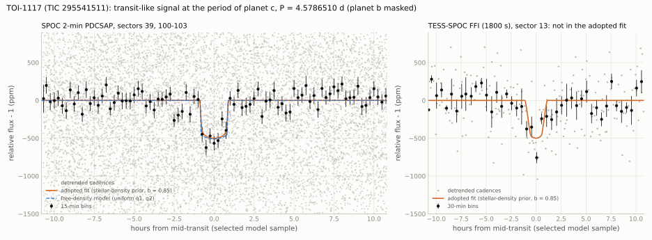

[README](../README.md) / [6. Other TESS results](6_other_results.md) / 6.10 TOI-1117 c: transit-like signal at the period and phase of a radial-velocity planet

### 6.10 TOI-1117 c: transit-like signal at the period and phase of a radial-velocity planet

TOI-1117 (TIC 295541511) is a G5 V star with three sub-Neptune planets (Lockley et al. 2025). Planet b transits
($`P = 2.228`$ d). Planets c ($`P = 4.579 \pm 0.004`$ d) and d ($`P = 8.665 \pm 0.011`$ d) were found in HARPS radial
velocities and are described in that paper as non-transiting. The TESS light curves of sectors 13, 39 and 100-103 show a
transit-like signal at $`P = 4.5786510`$ d, about 490 ppm deep and 1.85 h long (BLS S/N 12.4 in a search of the period
window allowed by the radial velocities). Its mid-transit times lie 0.03-0.25 $`\sigma`$ from the conjunctions of c predicted
by a refit of the published velocities at the TESS epochs, and 1.0 $`\sigma`$ from the best-constrained RV prediction; its
period is 0.16 $`\sigma`$ from the RV period. The signal is consistent with a transit of planet c. It is not confirmed:
a Gaia DR3 star of $`G = 19.6`$ at 34" is disfavoured as its source only at $`\Delta\chi^2 = 7.5`$ in the pixel data; with
the stellar-density prior the transit needs a high impact parameter ($`b = 0.85`$), while the fit without that prior (with
uniform limb-darkening parameters) favours a boxier shape, with $`\chi^2`$ lower by 3.5 (not calibrated as a statistical
significance); and no ground-based photometry was used.

The signal was found in a search for additional transiting planets around 150 TESS planet hosts. The search
pipeline is not part of this repository. The scripts in
[`scripts/toi1117/`](../scripts/toi1117/) generate the analysis tables from TESS data, Gaia DR3, the TIC and published
inputs. The original search, literature and catalogue checks, and manually supplied inputs are excluded from reproduction
as listed below. Light curves and observations of other observers on ExoFOP were not used.

#### 6.10.1 Target

| quantity | value | source |
|---|---|---|
| identifiers | TOI-1117, TIC 295541511, Gaia DR3 6436995652638923392, 2MASS J18142452-6625113, UCAC4 118-144923, WISE J181424.50-662511.6, DTARPS-S 328 | SIMBAD, Gaia DR3 |
| position (ICRS, epoch 2016.0) | RA 273.6020552, Dec $`-`$66.4199796 | Gaia DR3 |
| proper motion (mas/yr); parallax (mas) | $`-15.491`$, $`-38.741`$; $`5.995 \pm 0.015`$ (about 167 pc) | Gaia DR3 |
| $`G`$, $`BP-RP`$, $`T`$, $`V`$ | 10.862, 0.861, $`10.406 \pm 0.006`$, $`11.016 \pm 0.023`$ | Gaia DR3; TIC v8.2 |
| Gaia DR3 astrometry and radial velocity | RUWE 1.001, non_single_star 0, ipd_frac_multi_peak 0; $`-24.73 \pm 0.24`$ km/s; phot_variable_flag NOT_AVAILABLE | Gaia DR3 |
| star | $`T_\mathrm{eff} = 5635 \pm 62`$ K, $`\log g = 4.35 \pm 0.11`$ (spectroscopic), [Fe/H] $`= 0.136 \pm 0.044`$, G5 V, $`M_\star = 0.97 \pm 0.02\,M_\odot`$, $`R_\star = 1.05 \pm 0.03\,R_\odot`$ (joint-fit posterior $`1.06 \pm 0.03\,R_\odot`$), age $`4.4 \pm 1.5`$ Gyr, $`\log R'_\mathrm{HK} = -5.03`$ | Lockley et al. (2025) |
| planet b | $`P = 2.22816 \pm 0.00001`$ d, $`T_0`$ = BTJD $`2386.964 \pm 0.004`$, $`R_\mathrm{p} = 2.46^{+0.13}_{-0.12}\,R_\oplus`$, $`M_\mathrm{p} = 8.90^{+0.95}_{-0.96}\,M_\oplus`$, $`i = 1.54 \pm 0.02`$ rad, $`b = 0.17`$ | Lockley et al. (2025) |
| planet c (radial velocities) | $`P = 4.579 \pm 0.004`$ d, $`K = 3.45 \pm 0.47`$ m/s, $`M \sin i = 8.78^{+1.19}_{-1.21}\,M_\oplus`$ (table; the abstract gives $`7.46^{+1.43}_{-1.62}\,M_\oplus`$), circular orbit, $`e < 0.29`$, $`T_\mathrm{eq} = 1210`$ K; dynamical stability requires $`1.14 < i_c < 2.06`$ rad | Lockley et al. (2025) |
| planet d (radial velocities) | $`P = 8.665 \pm 0.011`$ d, $`K = 3.40 \pm 0.50`$ m/s, $`M \sin i = 10.71^{+1.59}_{-1.58}\,M_\oplus`$ | Lockley et al. (2025) |
| TOI-table entry | TOI-1117.01 only (planet b) | NASA Exoplanet Archive TOI table (2026-10-22) |

The stellar values are those of Lockley et al. (2025) and were not re-derived. The transit fits use the joint-fit
posterior mass and radius (stellar density $`1.15 \pm 0.10`$ g/cm$`^3`$); the spectroscopic table of the same paper gives
$`1.28 \pm 0.18`$ g/cm$`^3`$.

#### 6.10.2 Data and method

TESS products (MAST; [`data/depths_295541511.csv`](../data/depths_295541511.csv) lists them): SPOC 2-min light curves
and target pixel files of sectors 39 (2021), 100, 101, 102 and 103 (2026); the SPOC 20-s light curve of sector 39;
TESS-SPOC full-frame-image light curves and target pixel files of sectors 13 (2019, 1800 s) and 39 (600 s); QLP light
curves of sectors 13, 39 and 100-103; the eleanor-lite light curve of sector 13; TARS light curves of sectors 13 and 39.
Cadences with quality flag 0. tess-point 0.9.5.post1 places the star on silicon in these six sectors and in sector 114;
it does not place it on silicon in sectors 66 and 93.

- Planet b is masked ($`\pm`$(T14/2 + 1 h) around its transits, T14 = 2.0 h; $`P = 2.2281823`$ d, $`T_0`$ = BTJD 2917.27774, from a
  refit of its transits in the search that selected the signal). Gaps longer than 0.15 d are trimmed by 0.25 d on each
  side. Detrending: wotan biweight, 1.0-d window, with the windows of c masked during the trend fit unless stated.
- Box measurements (depth per product, sector and transit; odd and even transits; systematics tests) use the starting
  ephemeris of the search ($`P = 4.57866`$ d, $`T_0`$ = BTJD 1670.1655) and a box of 1.625 h, the best duration of a scan
  on the SPOC 2-min data. White errors come from the robust out-of-transit scatter; empirical errors from the scatter of
  the box depth at 300 random phase shifts of the same light curve.
- Transit fits: batman, circular orbit, quadratic limb darkening, averaged over each exposure at the centres of 3 (120 s)
  or 45 (1800 s) equal parts; emcee, 32 walkers, 8000 steps, first third discarded. Parameters: $`T_\mathrm{ref}`$, $`P`$,
  $`R_\mathrm{p}/R_\star`$, $`b`$, $`\rho_\star`$ and two limb-darkening parameters. Adopted fit: SPOC 2-min PDCSAP (sectors
  39, 100-103), with a Gaussian prior on $`\rho_\star`$ (above) and Gaussian priors $`u_1 = 0.40 \pm 0.10`$,
  $`u_2 = 0.21 \pm 0.10`$. Variants: no density prior and uniform $`q_1, q_2`$ (Kipping 2013); sector 13 added; SAP flux.
- Search and false-alarm tests: BLS (astropy, objective S/N) on TESS-SPOC sector 13 and the SPOC 2-min sectors binned to
  10 min, detrended without masking c, over the RV period window $`4.579 \pm 0.0114`$ d (3 $`\sigma`$ of the RV period)
  and all phases.
- Radial velocities: the 135 HARPS velocities of the appendix table of Lockley et al. (2025), transcribed from the arXiv
  source ([`data/rv_harps_295541511.csv`](../data/rv_harps_295541511.csv)), without the two rows the authors removed (133
  used). Model: offset, jitter and three circular Keplerians, with planet b's period and transit time constrained by
  its transits; emcee. Fitted once with the orbit of c free and once with the period and transit time of c fixed by the
  transit ephemeris.
- Pixel data: per-transit linear baselines per pixel give a mean in-transit deficit image per sector; a pixel-integrated
  double-Gaussian PSF (fitted to the out-of-transit image, with the Gaia DR3 stars at their catalogue positions) is placed
  on the target and on every Gaia DR3 source within 2' with $`G < 20.5`$, and the $`\chi^2`$ of each hypothesis is summed
  over the six independent pixel sets (TESS-SPOC sector 13, SPOC sectors 39 and 100-103).

#### 6.10.3 Results

Ephemeris and transit parameters ([`data/fit_295541511.csv`](../data/fit_295541511.csv),
[`data/ephemeris_295541511.csv`](../data/ephemeris_295541511.csv); medians and 16th-84th percentiles):

| quantity | adopted fit: 2-min sectors, stellar-density prior | no density prior (2-min sectors) | density prior, with sector 13 |
|---|---|---|---|
| $`P`$ (d) | $`4.5786510^{+0.0000087}_{-0.0000085}`$ | $`4.5786521 \pm 0.0000088`$ | $`4.5786591^{+0.0000139}_{-0.0000092}`$ |
| $`T_\mathrm{ref}`$ (BTJD) | $`3345.95453^{+0.00160}_{-0.00183}`$ | $`3345.95448^{+0.00150}_{-0.00182}`$ | $`3345.95328^{+0.00181}_{-0.00272}`$ |
| $`R_\mathrm{p}/R_\star`$ | $`0.0236 \pm 0.0012`$ | $`0.0217^{+0.0018}_{-0.0014}`$ | $`0.0236 \pm 0.0011`$ |
| $`b`$ | $`0.849^{+0.017}_{-0.019}`$ | $`0.46 \pm 0.32`$ | $`0.844^{+0.018}_{-0.024}`$ |
| $`\rho_\star`$ (g/cm$`^3`$) | $`1.15 \pm 0.10`$ (prior) | $`5.1^{+2.3}_{-3.3}`$ | $`1.15 \pm 0.10`$ (prior) |
| $`a/R_\star`$; $`i`$ (deg) | $`10.83^{+0.31}_{-0.33}`$; $`85.51 \pm 0.21`$ | $`17.8^{+2.4}_{-5.3}`$; $`88.5^{+1.1}_{-2.2}`$ | $`10.85 \pm 0.31`$; $`85.55 \pm 0.21`$ |
| $`T_{14}`$ (h) | $`1.854^{+0.070}_{-0.065}`$ | $`1.776^{+0.137}_{-0.068}`$ | $`1.872^{+0.095}_{-0.070}`$ |
| $`(R_\mathrm{p}/R_\star)^2`$ (ppm) | $`556^{+55}_{-53}`$ | $`469^{+82}_{-58}`$ | $`556^{+54}_{-52}`$ |
| $`R_\mathrm{p}`$ ($`R_\oplus`$) | $`2.73^{+0.16}_{-0.15}`$ | $`2.51^{+0.23}_{-0.18}`$ | $`2.73 \pm 0.15`$ |
| $`\chi^2`$ (no transit) $`-`$ $`\chi^2`$ (selected sample) | 155.1 (13494 points) | 158.6 | 186.4 (13698 points) |

The selected model sample of a fit is its maximum-likelihood sample among the 400 highest-posterior samples
(`chi2_maxlike` in `fit_295541511.csv`); the figure, the per-sector mid-times and the ingress and egress times of the
predictions use the selected sample of the adopted fit.

With the reference epoch at the centre of the data, $`T_\mathrm{ref}`$ and $`P`$ have a correlation of $`-0.55`$
($`\mathrm{cov} = -1.15 \times 10^{-8}`$ d$`^2`$; posterior standard deviations 0.00200 d and 0.0000104 d). The transit
near BTJD 4115.17 (sector 101) is at BTJD $`4115.16798 \pm 0.00179`$. The observed box depth is $`485 \pm 40`$ ppm (SPOC 2-min), and the weighted mean of the 27 per-transit depths is $`495 \pm 36`$ ppm. The posterior-median squared radius ratio is $`(R_\mathrm{p}/R_\star)^2 = 556`$ ppm; the selected adopted model curve at 2-min cadence has a maximum flux decrement of 501 ppm; the difference from the squared radius ratio comes from the limb darkening at $`b = 0.85`$. The radius uses
$`R_\star = 1.06 \pm 0.03\,R_\odot`$. The longest emcee autocorrelation times are 87-103 steps for the fits with the density
prior and 351 steps without it (5333 steps kept per walker: about 15 autocorrelation times for the latter).

Signal per sector and product ([`data/depths_295541511.csv`](../data/depths_295541511.csv),
[`data/pertransit_295541511.csv`](../data/pertransit_295541511.csv),
[`data/depth_tests_295541511.csv`](../data/depth_tests_295541511.csv); box depth in ppm with the white error, c masked during
detrending):

| product | 13 (2019) | 39 (2021) | 100 (2026) | 101 | 102 | 103 |
|---|---|---|---|---|---|---|
| SPOC 2-min PDCSAP | - | $`456 \pm 84`$ | $`431 \pm 93`$ | $`590 \pm 78`$ | $`443 \pm 92`$ | $`484 \pm 101`$ |
| SPOC 2-min SAP | - | $`461 \pm 89`$ | $`313 \pm 92`$ | $`680 \pm 78`$ | $`398 \pm 89`$ | $`344 \pm 98`$ |
| SPOC 20-s PDCSAP / SAP | - | $`488 \pm 80`$ / $`501 \pm 86`$ | - | - | - | - |
| TESS-SPOC PDCSAP / SAP | $`465 \pm 86`$ / $`503 \pm 92`$ | $`437 \pm 88`$ / $`413 \pm 89`$ | - | - | - | - |
| QLP detrended / SAP | $`516 \pm 99`$ / $`561 \pm 101`$ | $`375 \pm 107`$ / $`357 \pm 108`$ | $`305 \pm 81`$ / $`330 \pm 82`$ | $`489 \pm 72`$ / $`578 \pm 73`$ | $`376 \pm 93`$ / $`386 \pm 96`$ | $`177 \pm 85`$ / $`200 \pm 87`$ |
| eleanor-lite CORR / PCA | $`692 \pm 113`$ / $`747 \pm 118`$ | - | - | - | - | - |
| TARS | $`595 \pm 167`$ | $`336 \pm 183`$ | - | - | - | - |
| per-transit depths, weighted mean (S/N) | 461 $`\pm`$ 87 (5.3; TESS-SPOC) | 459 $`\pm`$ 81 (5.7) | 440 $`\pm`$ 93 (4.7) | 610 $`\pm`$ 77 (7.9) | 463 $`\pm`$ 89 (5.2) | 505 $`\pm`$ 102 (4.9) |

- The signal has a positive depth in every product and sector; the lowest values are QLP sector 103 (2.1 $`\sigma`$) and
  TARS sector 39 (1.8 $`\sigma`$). Without masking c during detrending the depths are 2-15 % lower.
- The 27 transits with data (local linear baselines; 5 in sector 13, 22 in the 2-min sectors) all have positive depths;
  $`\chi^2 = 22.5`$ for 26 degrees of freedom about the weighted mean $`495 \pm 36`$ ppm (S/N 13.9); the largest single
  transit contributes 15 % of the summed S/N$`^2`$. Leaving out one sector gives S/N 11.6 (without sector 101) to 13.1.
- Detrending windows of 0.5-2.5 d give stacked box depths of 468-494 ppm (empirical S/N 11.4-12.2).

Comparison with the radial velocities ([`data/rvfit_295541511.csv`](../data/rvfit_295541511.csv),
[`data/rv_ephemeris_295541511.csv`](../data/rv_ephemeris_295541511.csv)). The refit with the orbit of c free gives
$`P_c = 4.5793^{+0.0039}_{-0.0037}`$ d, $`T_c`$ = BTJD $`2498.94 \pm 0.48`$, $`K_c = 3.46 \pm 0.47`$ m/s and
$`M \sin i = 8.81 \pm 1.19\,M_\oplus`$, and for b and d $`K_b = 4.43 \pm 0.47`$ m/s and $`K_d = 3.42 \pm 0.49`$ m/s, within
0.03 m/s of the published values (the fitted jitter, 2.1 m/s, is smaller than the 4.5 m/s of the paper's joint fit).
Transit ephemeris against the RV-predicted conjunction of c at the same epoch (full $`P`$-$`T_c`$ covariance of the RV
posterior):

| epoch | transit ephemeris (BTJD) | RV-predicted conjunction (BTJD) | difference / RV standard deviation |
|---|---|---|---|
| sector 13 (2019) | 1670.168 | $`1670.13 \pm 1.07`$ | $`+0.03`$ |
| sector 39 (2021) | 2379.859 | $`2379.88 \pm 0.59`$ | $`-0.03`$ |
| BTJD 3062 (the epoch of the smallest RV uncertainty, within the HARPS observations) | 3062.078 | $`3062.19 \pm 0.11`$ | $`-1.01`$ |
| sector 101 (2026) | 4115.168 | $`4115.39 \pm 0.88`$ | $`-0.25`$ |
| period (d) | $`4.5786510 \pm 0.0000104`$ | $`4.5793 \pm 0.0039`$ | $`-0.16`$ |

The transit ephemeris and the RV orbit agree within 1.0 $`\sigma`$ at every epoch. The test is limited: the RV conjunction
is uncertain by $`\pm 0.11`$ d at best (2.3 % of the orbit). The period agreement is not an independent test of the
search of this section, which is restricted to the RV window; the search that selected the signal (not in this
repository) covered periods from 0.5 d to half the time baseline.

With the period and transit time of c fixed by the transit ephemeris, $`K_c = 3.47 \pm 0.45`$ m/s (7.7 $`\sigma`$) and
$`M \sin i = 8.84^{+1.15}_{-1.14}\,M_\oplus`$. If the signal is the transit of c, the inclination of the adopted fit
($`85.51 \pm 0.21`$ deg) gives $`M_c = 8.9 \pm 1.2\,M_\oplus`$, $`R_c = 2.73^{+0.16}_{-0.15}\,R_\oplus`$ and a density of
$`2.4^{+0.6}_{-0.5}`$ g/cm$`^3`$ (planet b: $`3.30 \pm 0.60`$ g/cm$`^3`$, Lockley et al. 2025). The fit without the density
prior gives $`R_c = 2.51^{+0.23}_{-0.18}\,R_\oplus`$ and $`3.1^{+0.9}_{-0.8}`$ g/cm$`^3`$. These values are conditional on
the transit interpretation and on the circular orbits assumed in both fits. The inclinations of b
($`88.2 \pm 1.1`$ deg) and c (85.5 deg) differ by $`2.7 \pm 1.2`$ deg on the sky; at the inclination of b, c would
transit with $`b \approx 0.3`$ and $`T_{14} \approx 3.1`$ h.

<picture><source srcset="../figures/fold_295541511_dark.svg" media="(prefers-color-scheme: dark)"></picture>

#### 6.10.4 Checks

[`data/checks_295541511.csv`](../data/checks_295541511.csv), [`data/falsealarm_295541511.csv`](../data/falsealarm_295541511.csv),
[`data/epochs_295541511.csv`](../data/epochs_295541511.csv), [`data/timing_295541511.csv`](../data/timing_295541511.csv),
[`data/pixels_295541511.csv`](../data/pixels_295541511.csv), [`data/sources_295541511.csv`](../data/sources_295541511.csv),
[`data/apertures_295541511.csv`](../data/apertures_295541511.csv), [`data/triceratops_295541511.csv`](../data/triceratops_295541511.csv):

| check | result |
|---|---|
| search in the RV window | BLS S/N 12.42 at $`P = 4.578662`$ d (duration 1.60 h, depth 455 ppm); the same search on inverted flux ($`2 - f`$): 5.37 |
| false alarms on this star | 1000 windows of the same relative width centred at random periods of 2.5-12 d (avoiding the aliases of b, c and d), with c's transits removed: largest S/N 6.39 (99th percentile 6.07), none above 8; the same on inverted flux: 6.09 (5.94); 500 runs with each sector shifted by a random time (c kept): largest S/N 8.78 (99th percentile 8.24); none of the 2500 trials reaches 12.42 |
| momentum dumps and gaps | dumps every 3.4 d (sector 13) and 6.3-6.7 d (sectors 39, 100-103), at least 6.8 h (median 47 h) from every transit with data; four predicted transits fall in a gap (BTJD 2375.28) or on flagged cadences (4087.70 and 4101.43, bit 4096; 4165.54, bit 16384) and give no data; the transits lie 0.3-6.1 d from the nearest gap and 0.7-13.2 d after the preceding one; 3P = 13.736 d is close to the 13.7-d spacecraft orbit, but the transits are not concentrated at one phase of it |
| background and centroids | flux-weighted centroid in transit minus baseline, stacked over 28 transits: $`0.08 \pm 0.06`$ mpx (column), $`0.09 \pm 0.07`$ mpx (row); six transits are flagged (background excursion, gap edge or centroid excursion; one of them, BTJD 4119.75, has the largest depth, 1004 $`\pm`$ 178 ppm, and a flagged in-transit cadence); without them the stacked depth is $`471 \pm 44`$ ppm (empirical S/N 11.3) |
| pixel-level location | in the summed $`\chi^2`$ of the six pixel sets the target is preferred over every Gaia DR3 source within 2'. Next: $`G = 19.59`$ at 34.3" ($`\Delta\chi^2 = +7.5`$; it would need a $`35 \pm 8`$ % eclipse), $`G = 19.59`$ at 22.1" (+10.8; 58 %), $`G = 17.53`$ at 29.6" (+15.7; 5.0 %), $`G = 18.76`$ at 39.6" (+21.1), $`G = 17.43`$ at 37.1" (+27.9; 2.5 %); TIC 295541505 ($`G = 12.57`$, 57.1"): +64.9, with an implied depth of $`0.013 \pm 0.010`$ % against the about 3 % it would need (it contributes 1.6 % of the SPOC aperture flux; Lockley et al. 2025). In sectors 102 and 103 alone, the two $`G = 19.59`$ stars fit better than the target ($`\Delta\chi^2 = -13`$ to $`-21`$). Target PSF depth $`530 \pm 70`$ ppm. Free-position PSF fits lie 0.08-1.55 px from the target, 0.2-2.6 $`\sigma`$ with jackknife errors (sector 101, the strongest: 0.08 px); the single-sector deficit images have S/N 0.6-4.2. PSF model: Gaussian mixture, not the TESS PRF |
| aperture dependence | contamination-corrected depth in circular apertures (six pixel sets combined): $`442 \pm 100`$, $`401 \pm 86`$, $`460 \pm 77`$, $`460 \pm 74`$, $`475 \pm 75`$, $`504 \pm 77`$ ppm for radii of 1, 1.5, 2, 2.5, 3 and 4 px; no trend with radius, as expected for a signal on the target (the 34" star lies 1.6 px away) |
| odd and even transits | $`567 \pm 56`$ (odd) and $`402 \pm 54`$ ppm (even), 2.1 $`\sigma`$; per group 0.1 $`\sigma`$ (sector 13), 0.6 $`\sigma`$ (39), 1.95 $`\sigma`$ (100-101), 1.1 $`\sigma`$ (102-103) |
| secondary eclipse | phase 0.5: $`-35 \pm 40`$ ppm; largest S/N over phases 0.30-0.70: 2.1 |
| shape | for a central transit the stellar density gives $`T_{14} \approx 3.3`$ h; the observed 1.85 h needs $`b = 0.85`$ on a circular orbit. The fit without the stellar-density prior, also using uniform limb-darkening parameters $`q_1`$ and $`q_2`$, favours a boxier shape ($`b = 0.46 \pm 0.32`$, $`\rho_\mathrm{circ} = 5.1^{+2.3}_{-3.3}`$ g/cm$`^3`$; 10 % of the posterior below 1.15 g/cm$`^3`$). Its selected sample has $`\chi^2`$ lower by 3.5; this comparison has not been calibrated as a statistical significance. A V shape, as for a grazing blended eclipse, is not preferred |
| SAP flux | density-prior fit to SAP (all sectors): $`b = 0.85`$, $`T_{14} = 1.86`$ h, $`R_\mathrm{p}/R_\star = 0.0233`$, consistent with PDCSAP |
| data-validation reports | SPOC sector 39, TESS-SPOC sector 39 and SPOC sector 103: one TCE each, at 2.226-2.227 d (planet b); none at 4.58 d |
| TRICERATOPS (1.1.0) | inputs: the binned PDCSAP light curve of the 2-min sectors as dilution-corrected flux, the depth of the adopted model curve (501 ppm), the SPOC optimal apertures of sectors 39 and 100-103, TIC stellar parameters. Without a contrast curve FPP 0.0571 / 0.0576, NFPP 0.0106 / 0.0108 (two seeds); with the approximate contrast curve (below) FPP 0.0146 / 0.0149, NFPP 0.0132 / 0.0134; a repeat of the four runs with the same seeds gave the same FPP and NFPP to four decimals. The NFPP comes from scenarios on TIC 295541505 (NTP, 0.0057-0.0071), 295541517 and 295541519 (NEB, 0.0018-0.0023 and 0.0015-0.0018), which the pixel fit disfavours at $`\Delta\chi^2`$ = 64.9, 68.0 and 27.9 |

The contrast curve given to TRICERATOPS ([`data/triceratops/cc_295541511_approx_Zorro832.txt`](../data/triceratops/cc_295541511_approx_Zorro832.txt))
is not a measured curve. It was written from the text of Lockley et al. (2025): no companion within 5-8 mag from
0.02" to 1.2" in Gemini South/Zorro speckle imaging, and 4.2 mag at 1" from SOAR. The measured curves (on ExoFOP) were
not used. With the approximate contrast curve the FPP (0.0146-0.0149) is just below the threshold FPP < 0.015 of Giacalone et
al. (2021), but the NFPP (0.013) is above the threshold NFPP < 0.001; without a contrast curve neither threshold is met.
The TRICERATOPS values therefore do not reach the validation thresholds on their own.

Timing ([`data/transit_times_295541511.csv`](../data/transit_times_295541511.csv), [`data/timing_295541511.csv`](../data/timing_295541511.csv)):
the tabulated O-C values use the selected model sample ($`T_\mathrm{ref}`$ = BTJD 3345.95426, $`P = 4.5786537`$ d).
Relative to this reference, the 2-min sectors lie within 1.6 min and sector 13 (not in the adopted fit) is 19.9 min early,
with formal errors of +7.0 / $`-6.5`$ min. Relative to the displayed posterior-median ephemeris, sector 13 is 21.7 min
early, and the exposure-integrated trapezoid offsets are $`-22.3`$ min for TESS-SPOC and $`-13.0`$ min for QLP. Injected
transits in the same light curves give a timing scatter of 8.1 min (TESS-SPOC sector 13) and 6.6-7.8 min (SPOC 2-min
sectors), 2.3-2.7 times the formal errors of the 2-min sectors; with the ephemeris uncertainty at sector 13 (7.5 min),
the sector-13 offset is 1.2-2.0 $`\sigma`$. Planet b is on time in sector 13 ($`+2.2 \pm 3.2`$ min, TESS-SPOC), so the
sector-13 time stamps are not in question; the trapezoid mid-times of b differ by up to 20 min between products of the same
sector (sector 39: $`+5.0`$ min in the 2-min and $`-15.1`$ min in the 20-s light curve), so the formal trapezoid errors are
not reliable and are not interpreted.

#### 6.10.5 Signal strength in the earlier TESS sectors

- Sectors 13 and 39 alone, the TESS data available to Lockley et al. (2025): stacked depth $`457 \pm 76`$ ppm (S/N 6.0);
  S/N 7.15 in the RV-window search. In a blind BLS search of 1-15 d the 4.58-d family gives the highest peaks (4.596 d,
  S/N 6.92; 4.5786 d, 6.74), but the largest peak on inverted flux is 6.21. The single-sector S/N is 5.3-5.7.
- The SPOC and TESS-SPOC data-validation reports of sectors 39 and 103 contain only planet b.
- Lockley et al. (2025) describe c and d as non-transiting. Their photometric model contains planet b only, and their text
  describes no search of the TESS light curves at the periods of c and d.
- Sectors 100-103 (2026) give S/N 10.9 by themselves; they were not available to that paper.

#### 6.10.6 Weaknesses and limitations

- Source of the signal: the pixel data prefer the target, but the $`G = 19.59`$ star at 34" is disfavoured only at
  $`\Delta\chi^2 = 7.5`$ summed over six pixel sets, and it is preferred in two of them. Its eclipse would have to be
  about 35 % deep. The PSF model is approximate. The ground-based photometry of Lockley et al. (2025) concerns planet b,
  not a 4.58-d signal.
- Shape: the adopted fit needs $`b = 0.85`$ (a circular orbit and the stellar density of Lockley et al.); the fit
  without the stellar-density prior, also using uniform limb-darkening parameters $`q_1`$ and $`q_2`$, favours a boxier
  shape. Its selected sample has $`\chi^2`$ lower by 3.5; this comparison has not been calibrated as a statistical
  significance. Eccentricity was fixed at zero; Lockley et al. give $`e_c < 0.29`$ and find circular orbits in their
  stability analysis.
- Odd and even depths differ by 2.1 $`\sigma`$, mostly from sectors 100-101 (1.95 $`\sigma`$).
- The sector-13 transits are 13-22 min early relative to the 2-min ephemeris, 1.2-2.0 $`\sigma`$ with empirical timing
  errors. A timing variation near the 2:1 commensurability with b ($`P_c/P_b = 2.0549`$, super-period about 83 d) is
  possible but not established; no timing model was fitted.
- The RV comparison tests the phase of the signal only to $`\pm 0.11`$ d at best.
- TRICERATOPS uses an approximate contrast curve, a Gaia DR3 background population, TIC stellar parameters and one flux
  error for all bins; its FPP and NFPP alone do not validate the signal (the NFPP, 0.013, is above 0.001).
- The RV refit uses the published table with circular orbits and no activity model, as in the paper.
- Holes: ExoFOP (target page, TOI and community-TOI lists) was unreachable during all checks (HTTP 503, 2026-10-22 23:22
  UTC to 2026-10-23 00:48 UTC); the last local copies of the TOI and community-TOI lists (2026-10-21 21:22-21:27 UTC) list
  only TOI-1117.01 and no community TOI for this star; ExoFOP notes and uploaded files of other observers are unchecked.
  The arXiv API returned no records for any alias, including "TOI-1117", which appears in the abstract of Lockley et al.
  (2025), so that check is not informative (ADS covers arXiv).

#### 6.10.7 Catalogue and literature checks

| date (UTC) | source | result |
|---|---|---|
| 2026-10-22 | NASA Exoplanet Archive, planetary-systems composite table | TOI-1117 b (transiting), c and d (tran_flag 0, published 2025-08) |
| 2026-10-22 | NASA Exoplanet Archive TOI table (8151 rows, last update 2026-10-09) | TOI-1117.01 only (2.2281625 d, PC) |
| 2026-10-22, 2026-10-23 | ExoFOP target page, TOI and community-TOI downloads | HTTP 503 ("temporary maintenance") at 23:22, 23:46 and 00:19 UTC and again at 00:48 UTC; not checked |
| 2026-10-22 | MAST | no community-TOI product; data-validation reports of sectors 39 (SPOC and TESS-SPOC) and 103 (SPOC) with one TCE each (planet b) |
| 2026-10-22 | ADS full text: TOI-1117, TOI 1117, TOI-1117 c, TOI-1117c, TOI-1117.02, TIC 295541511, 2MASS, Gaia DR2 and DR3, UCAC4, WISE identifiers, DTARPS-S 328 | five papers mention TOI-1117: Lockley et al. (2025); Melton et al. (2024, DTARPS II, which lists only b); two arXiv preprints of 2026 (stellar abundances and ages; sources read: TOI-1117 appears only in their stellar tables); a 2026 A&A paper on a water equation of state (abstract read only). "TOI-1117 c": Lockley et al. (2025) only; the TIC and DTARPS identifiers: DTARPS II only; the 2MASS, Gaia, UCAC4 and WISE identifiers: no records |
| 2026-10-22 | arXiv API | 0 records for every alias (control failed: see section 6.10.6) |
| 2026-10-22 | Zenodo; GitHub code search | 0 records; copies of catalogue tables listing c as non-transiting and the TOI list, no transit analysis of c (controls returned records) |
| 2026-10-22 | Planet Hunters TESS Talk; PHT eclipsing-binary candidate list | one comment (2021-08-07) on the sector-39 TCE of planet b; not listed |

No earlier report of transits of TOI-1117 c was found in the sources that could be reached. Not checked: ExoFOP (above),
non-indexed group pages and conference material.

#### 6.10.8 Predicted transits

[`data/predicted_transits_295541511.csv`](../data/predicted_transits_295541511.csv) lists 93 predicted transits from
2026-11-01 to 2027-12-31 in geocentric UTC. Ingress and egress use $`T_{14} = 1.81`$ h from the selected model sample; the
posterior-median duration is 1.85 h. Formal mid-time uncertainties grow from 2.9 to 3.9 min. An approximate
$`\pm 10`$ min planning allowance is suggested, but its statistical coverage has not been calibrated and timing variations
remain unconstrained. Six events have `b_overlap = 1`.

| mid-transit (UTC) | ingress-egress (UTC) | | mid-transit (UTC) | ingress-egress (UTC) |
|---|---|---|---|---|
| 2026-11-04 04:20 | 03:26-05:15 | | 2026-11-27 01:48 | 00:54-02:42 |
| 2026-11-08 18:14 | 17:19-19:08 | | 2026-12-01 15:41 | 14:47-16:36 |
| 2026-11-13 08:07 | 07:13-09:02 | | 2026-12-06 05:35 | 04:41-06:29 |
| 2026-11-17 22:01 | 21:07-22:55 | | 2026-12-10 19:28 | 18:34-20:23 |
| 2026-11-22 11:54 | 11:00-12:49 | | 2026-12-15 09:22 | 08:27-10:16 |

tess-point places the star on silicon in sector 114 (camera 4, CCD 4, row 1974 of 2048); the dates and the coverage of
that sector are not checked.

#### 6.10.9 Interpretation and decisive tests

The signal is consistent with a transit of TOI-1117 c, but its origin remains uncertain. The combined pixel fits prefer
the target; the $`G = 19.59`$ star at 34" is disfavoured only by $`\Delta\chi^2 = 7.5`$ and is preferred in sectors 102 and
103 separately. None of the 2500 specified false-alarm trials reaches the observed S/N. At the best-constrained RV epoch,
the ephemerides differ by about 1.0 $`\sigma`$, with an RV conjunction uncertainty of 0.11 d; this is a weak phase test. If
the signal is a transit of c, the system would have two transiting sub-Neptunes near the 2:1 commensurability. Tests:

- Ground-based photometry of a predicted transit (about 0.4-0.5 ppt over 1.9 h; $`V = 11.0`$, Dec $`-66`$ deg) with
  apertures that separate the target from the $`G = 19.6`$ stars at 22" and 34", which would also test the shape.
- Further TESS sectors: timing (the sector-13 offset), odd and even depths, and the shape.
- The measured speckle contrast curves (ExoFOP) in place of the approximate curve.

Reproduction, from the repository root (two environments; `requirements.txt`):

```
python scripts/toi1117/download_toi1117.py      # MAST light curves, target pixel files, DV reports; Gaia DR3 and TIC cones; arXiv source of Lockley et al. (2025)
python scripts/toi1117/fit_toi1117.py           # -> data/{depths,pertransit,depth_tests}_295541511.csv; detrended windows in work/295541511/
python scripts/toi1117/mcmc_toi1117.py          # emcee environment -> data/fit_295541511.csv (about 30 min)
python scripts/toi1117/ephemeris_toi1117.py     # emcee environment -> data/{ephemeris,transit_times,predicted_transits,folded,model}_295541511.csv
python scripts/toi1117/rv_toi1117.py            # emcee environment -> data/{rv_harps,rvfit,rv_ephemeris}_295541511.csv
python scripts/toi1117/checks_toi1117.py        # -> data/{falsealarm,epochs,checks,timing}_295541511.csv (about 25 min)
python scripts/toi1117/pixels_toi1117.py        # -> data/{pixels,sources,apertures}_295541511.csv
python scripts/toi1117/triceratops_toi1117.py   # TRICERATOPS environment -> data/triceratops_295541511.csv, data/triceratops_input_295541511.csv, data/triceratops/probs_295541511_*.csv
python figures/make_figures.py toi1117
```

Without script in this repository: the search that selected the signal, the planet-b ephemeris used for masking (from
that search), the Gaia DR3 parameters of the target table other than those in `work/295541511/dl/gaia_150as.csv`, the
values quoted from Lockley et al. (2025), the approximate contrast curve, and the catalogue and literature checks of
section [6.10.7](#6107-catalogue-and-literature-checks). The values quoted from Lockley et al. (2025) and the HARPS table come from
the arXiv version (2506.05521); the journal version was not compared. References of this section: Lockley, I. S., et al.
2025, MNRAS 541, 919 (doi:10.1093/mnras/staf939; arXiv:2506.05521); Melton, E. J., et al. 2024, AJ 167, 203 (DTARPS II);
Kipping, D. M. 2013, MNRAS 435, 2152; Foreman-Mackey, D., et al. 2013, PASP 125, 306; Giacalone, S., et al. 2021, AJ 161,
24; Scott, N. J., et al. 2021, Front. Astron. Space Sci. 8, 138; and those of section [8](8_data_and_reproduction.md).
