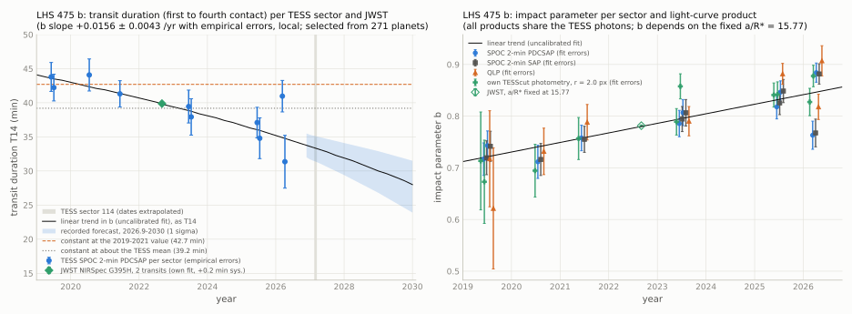

[README](../README.md) / [6. Other TESS results](6_other_results.md) / 6.11 LHS 475 b: candidate decrease of the transit duration, 2019-2026

### 6.11 LHS 475 b: candidate decrease of the transit duration, 2019-2026

LHS 475 b (TIC 369327947, GJ 4102, TOI-910.01) is an Earth-sized planet on a 2.03-d orbit around an M dwarf at 12.5 pc
whose transmission spectrum was measured with JWST (Lustig-Yaeger et al. 2023). In ten TESS sectors (2019-2026) its
transit duration $`T_{14}`$ (first to fourth contact) decreases from $`42.6 \pm 0.9`$ min in 2019-2021 to
$`35.4 \pm 0.9`$ min in 2025-2026 (weighted epoch-group means of per-sector fits with the transit shape fixed to
Ment et al. 2024; fit errors). With $`a/R_\star = 15.77`$ fixed, the impact parameter rises at
$`\mathrm{d}b/\mathrm{d}t = +0.0156 \pm 0.0043`$ yr$`^{-1}`$ (3.7 $`\sigma`$) when the per-sector errors are calibrated by
injection-recovery; the calibration choices give 3.0-4.4 $`\sigma`$. This significance is local: the planet was selected
from a screen of 271 known planets, and after that selection the significance is about 2-3 $`\sigma`$ (section
[6.11.4](#6114-calibration-selection-and-dependence-on-ar)). The change appears in the SPOC PDCSAP and SAP fluxes, in QLP
and in own photometry of the full-frame images, but all of these use the same TESS photons; the per-transit
signal-to-noise ratio is about 4. An own fit of the two public JWST transits of 2022 gives $`T_{14} = 39.85 \pm 0.10`$
(stat) $`\pm 0.2`$ (sys) min, the value of the linear trend at that epoch, but JWST alone does not confirm the change. This
section reports a candidate change of the transit; a change of the orbit is not established, and no independent
confirmation exists.

The planet was selected in a screen of TESS data of 271 known transiting planets (261 science targets and 10 control
planets) for changes of the impact parameter; the screening pipeline is not part of this repository. In that screen
LHS 475 b had the largest change of any science target that was neither a known case (KELT-9 b, whose orbit precesses;
Stephan et al. 2022) nor a fit at a parameter bound (two planets). The values of this section come from a separate
vetting analysis of the light curves, described below; except where stated in section [6.11.10](#61110-reproduction),
they have no script in this repository.

#### 6.11.1 Target

| quantity | value | source |
|---|---|---|
| identifiers | LHS 475, GJ 4102, L 22-69, TOI-910, TIC 369327947, Gaia DR3 6347643496607835520, 2MASS J19205439-8233170 | ExoFOP |
| position (ICRS, epoch 2016.0) | RA 290.2383, Dec $`-`$82.5600 | Gaia DR3 |
| parallax (mas); proper motion | $`80.113 \pm 0.021`$ (12.5 pc), RUWE 0.96; 1.28"/yr, about 9" over 2019-2026 | Gaia DR3 |
| $`G`$, $`G_\mathrm{RP}`$, $`K_s`$ | 11.41, 10.21, $`7.686 \pm 0.042`$ | Gaia DR3; 2MASS |
| star | $`M_K = 7.204 \pm 0.042`$; $`M_\star = 0.2625 \pm 0.0074\,M_\odot`$ (Mann et al. 2019), $`R_\star = 0.2875 \pm 0.0094\,R_\odot`$ (Mann et al. 2015); $`\rho_\star = 15.6 \pm 1.4`$ g cm$`^{-3}`$, hence $`a/R_\star = 15.02 \pm 0.46`$ at the orbital period; rotation period 79.3 d | this work from Gaia DR3 and 2MASS (TIC v8.2: 0.2624 $`M_\odot`$, 0.2875 $`R_\odot`$); Ment et al. (2024) |
| planet, TESS 2019-2021 and MEarth-South 2019 | $`P = 2.0291025`$ d, $`k = R_\mathrm{p}/R_\star = 0.03124 \pm 0.00065`$, $`a/R_\star = 15.77 \pm 0.77`$, $`b = 0.705 \pm 0.037`$ (TESS only: $`0.731 \pm 0.035`$; MEarth only: $`0.753 \pm 0.064`$); quadratic limb darkening (0.1529, 0.4604) fixed | Ment et al. (2024), arXiv version; the NASA Exoplanet Archive row of the same paper lists $`k = 0.03171`$, $`a/R_\star = 15.32`$, $`b = 0.701 \pm 0.040`$ (the journal version was not read) |
| planet, JWST 2022 | two NIRSpec G395H transits (GO 1981); $`a/R_\star`$ and $`i`$ free in each of three reductions; $`b`$ computed from the tabulated $`a/R_\star`$ and $`i`$: 0.777 (FIREFLy), 0.799 (Eureka!), 0.56 (Tiberius, $`a/R_\star = 18.2 \pm 1.8`$); quoted $`T_{14} = 39.98 \pm 4.04`$ min | Lustig-Yaeger et al. (2023) |
| TOI-table entry | TOI-910.01, disposition CP; duration $`0.627 \pm 0.108`$ h, depth $`766 \pm 47`$ ppm (row updated 2026-08-13) | ExoFOP (retrieved 2026-10-28) |
| neighbours | Gaia DR3 sources within 42": $`G = 18.10`$ at 9.8" (0.2 % of the flux), $`G = 18.04`$ at 36", $`G = 15.08`$ at 39.2" (about 2 % in $`G_\mathrm{RP}`$); all others $`G > 19.4`$; CROWDSAP 0.969-0.989 | Gaia DR3; SPOC |

The published impact parameters differ between these fits (0.705 with a stellar-density prior, 0.78-0.80 in two of the
three JWST reductions without one, 0.56 in the third). The fits use different priors and data, and these differences
are not interpreted here as a detection of a change.

#### 6.11.2 Data and method

TESS SPOC 2-min light curves (all 120-s cadence) of sectors 12 and 13 (2019), 27 (2020), 39 (2021), 66 and 67 (2023), 93 and 94
(2025) and 101 and 102 (2026); camera 3 in all sectors except 101 (camera 4); SPOC versions spoc-5.0.9 to 5.0.126
([`data/sectors_369327947.csv`](../data/sectors_369327947.csv)). Sectors 36, 69 and 96 appear in the coverage list, but
TESScut returns no pixels and no 2-min or QLP product exists. 106 complete transit windows.

- Model: batman, circular orbit, $`k = 0.03124`$, $`a/R_\star = 15.77`$ and quadratic limb darkening (0.1529, 0.4604) fixed
  at the values of Ment et al. (2024); $`b`$ free per sector; one mid-time shift per sector on the linear ephemeris of
  ExoFOP TOI-910.01 ($`P = 2.029107654`$ d, $`T_0`$ = BTJD 3854.162728); a quadratic baseline per $`\pm 0.2`$ d window; an
  upward 4-$`\sigma`$ clip per window (flares); errors from the Jacobian scaled by $`\sqrt{\chi^2_\mathrm{red}}`$. The
  exposure average uses batman's `supersample_factor` (7 samples over 120 s; the same in every sector).
- $`T_{14}`$ is computed from the fitted $`b`$ at the fixed template,
  $`T_{14} = (P/\pi)\,\arcsin\!\left(\sqrt{(1+k)^2 - b^2}\,/\sqrt{(a/R_\star)^2 - b^2}\right)`$; near $`b = 0.78`$,
  $`\mathrm{d}T_{14}/\mathrm{d}b \approx -68`$ min. Per-transit free mid-times were not used, because each transit has a
  signal-to-noise ratio of about 4.
- The same fit was applied to the SPOC SAP fluxes, to QLP light curves (eight sectors) and to own aperture photometry of
  TESScut cutouts (radii 2.0, 2.5 and 3.0 px; 1800-s, 600-s and 200-s cadences), and with $`a/R_\star`$ or $`k`$ free per
  sector.
- Injection-recovery: a transit with constant $`b`$ (0.736, 0.78 and 0.84) was added to the PDCSAP flux of each sector at
  24-48 orbital-phase offsets away from the real transits and fitted in the same way
  ([`data/injection_369327947.csv`](../data/injection_369327947.csv)).

#### 6.11.3 Results

Per sector ([`data/sectors_369327947.csv`](../data/sectors_369327947.csv); SPOC 2-min PDCSAP; "empirical" = errors from the
injection-recovery, section [6.11.4](#6114-calibration-selection-and-dependence-on-ar)):

| sector | year | camera/CCD | transits | $`b`$ | error (fit / empirical) | $`T_{14}`$ (min) | error (fit / empirical, min) |
|---|---|---|---|---|---|---|---|
| 12 | 2019.43 | 3/1 | 10 | 0.717 | 0.031 / 0.037 | 43.8 | 1.8 / 2.1 |
| 13 | 2019.51 | 3/2 | 12 | 0.743 | 0.028 / 0.032 | 42.2 | 1.8 / 2.0 |
| 27 | 2020.54 | 3/2 | 10 | 0.712 | 0.032 / 0.042 | 44.1 | 1.8 / 2.4 |
| 39 | 2021.44 | 3/1 | 13 | 0.758 | 0.025 / 0.030 | 41.3 | 1.6 / 1.9 |
| 66 | 2023.45 | 3/1 | 11 | 0.786 | 0.026 / 0.035 | 39.5 | 1.8 / 2.4 |
| 67 | 2023.53 | 3/2 | 9 | 0.807 | 0.025 / 0.036 | 37.9 | 1.9 / 2.7 |
| 93 | 2025.45 | 3/1 | 10 | 0.818 | 0.023 / 0.029 | 37.1 | 1.8 / 2.2 |
| 94 | 2025.53 | 3/2 | 10 | 0.846 | 0.022 / 0.035 | 34.8 | 1.9 / 3.0 |
| 101 | 2026.19 | 4/2 | 10 | 0.763 | 0.027 / 0.035 | 41.0 | 1.8 / 2.3 |
| 102 | 2026.27 | 3/3 | 11 | 0.884 | 0.019 / 0.039 | 31.4 | 1.8 / 3.9 |

Trends and epoch groups ([`data/trend_369327947.csv`](../data/trend_369327947.csv), written by
[`scripts/lhs475/trend_lhs475.py`](../scripts/lhs475/trend_lhs475.py); slopes against year, $`a/R_\star = 15.77`$):

| quantity | value |
|---|---|
| $`\mathrm{d}b/\mathrm{d}t`$, SPOC PDCSAP, empirical errors (adopted) | $`+0.0156 \pm 0.0043`$ yr$`^{-1}`$ (3.7 $`\sigma`$; $`\chi^2 = 7.1`$ for 8 degrees of freedom) |
| $`\mathrm{d}b/\mathrm{d}t`$, SPOC PDCSAP, fit errors | $`+0.0185 \pm 0.0045`$ yr$`^{-1}`$ (4.2 $`\sigma`$; $`\chi^2 = 15.6`$ for 8, error scaled by 1.40) |
| same, other products (fit errors) | SAP $`+0.0184 \pm 0.0042`$; QLP (8 sectors) $`+0.0227 \pm 0.0071`$; own photometry $`+0.0216 \pm 0.0054`$, $`+0.0207 \pm 0.0067`$, $`+0.0201 \pm 0.0066`$ ($`r`$ = 2.0, 2.5, 3.0 px) |
| leaving out one sector (PDCSAP, empirical errors) | $`+0.0133 \pm 0.0046`$ (without sector 102, 2.9 $`\sigma`$) to $`+0.0195 \pm 0.0046`$ (without sector 101, 4.2 $`\sigma`$) |
| $`b`$, epoch groups (fit errors) | $`0.736 \pm 0.014`$ (2019-2021, 4 sectors), $`0.796 \pm 0.018`$ (2023, 2), $`0.840 \pm 0.011`$ (2025-2026, 4); difference late minus early $`0.103 \pm 0.018`$ ($`\pm 0.024`$ with empirical errors) |
| $`T_{14}`$, epoch groups | $`42.6 \pm 0.9`$, $`38.7 \pm 1.3`$ and $`35.4 \pm 0.9`$ min (empirical errors: $`\pm 1.0`$, $`\pm 1.8`$, $`\pm 1.4`$ min) |
| $`b`$, epoch groups, at the stellar-density $`a/R_\star = 15.02 \pm 0.46`$ | 0.769, 0.821 and 0.859 (the group $`T_{14}`$ converted at fixed $`k`$; 0.787-0.749 and 0.871-0.847 over the $`\pm 1\sigma`$ range of $`a/R_\star`$) |

<picture><source srcset="../figures/tdur_369327947_dark.svg" media="(prefers-color-scheme: dark)"></picture>

The observable that depends least on the adopted template is the duration change: about 7 min between 2019-2021 and
2025-2026. The size of the change in $`b`$ depends on the fixed $`a/R_\star`$ (section
[6.11.4](#6114-calibration-selection-and-dependence-on-ar)).

#### 6.11.4 Calibration, selection and dependence on a/R*

[`data/injection_369327947.csv`](../data/injection_369327947.csv), [`data/checks_369327947.csv`](../data/checks_369327947.csv):

- Error calibration. With a constant injected $`b = 0.78`$, the recovered $`b`$ scatters 1.10-1.59 times more than the fit
  errors state (mean 1.32), because the per-sector likelihood in $`b`$ is non-Gaussian and in places bimodal at this
  signal-to-noise ratio; the red-noise factor of the out-of-transit residuals is 0.94-0.99. The estimator has no bias that
  changes with time: the slope of the per-sector bias is $`-0.0001 \pm 0.0006`$ yr$`^{-1}`$ ($`b = 0.78`$), $`-0.0003 \pm 0.0010`$
  (0.736) and $`-0.0000 \pm 0.0008`$ (0.84), and the largest per-sector bias is 0.009.
- Significance of the slope (local): 3.7 $`\sigma`$ with the empirical per-sector errors (adopted); 4.4 $`\sigma`$ against
  the scatter of the slope in the 48 constant-$`b`$ realisations ($`\pm 0.0042`$ yr$`^{-1}`$; largest $`z`$ in them 1.69, one
  of 48 with $`|z| \ge 3`$); 3.6 and 3.9 $`\sigma`$ with the empirical errors of the $`b = 0.84`$ and 0.736 injections;
  3.0 $`\sigma`$ from a likelihood-ratio test on the full per-sector $`\chi^2(b)`$ profiles with errors inflated by 1.32
  (4.0 $`\sigma`$ without). The 48 realisations share baseline data, so tails beyond about 2.5 $`\sigma`$ are not sampled.
- Selection. The planet was chosen because it stood out among 271 screened planets, and every test above reuses the same
  photons. A trials factor of 271 applied to a two-sided local 3.7 $`\sigma`$ ($`p = 2.2 \times 10^{-4}`$) gives about
  1.9 $`\sigma`$, and to the most favourable 4.4 $`\sigma`$ ($`p = 1.1 \times 10^{-5}`$) about 3.0 $`\sigma`$. This assumes
  independent trials and Gaussian tails; in the screen, the injected constant-$`b`$ copies of the 271 planets gave 5 values
  above 3 $`\sigma`$ against 0.7 expected, so the screen statistic has heavier tails than Gaussian.
- Dependence on the fixed $`a/R_\star`$. The rate in $`b`$ scales with the adopted $`a/R_\star`$ because $`b`$ and
  $`T_{14}`$ are related non-linearly: $`+0.0080 \pm 0.0034`$ yr$`^{-1}`$ at 14.0 (local fit, with sector 102 in its
  secondary solution), $`+0.0145`$ (profile, 1-$`\sigma`$ range 0.0120-0.0170) at 14.4, $`+0.0170 \pm 0.0040`$ for the
  archive values ($`k = 0.03171`$, $`a/R_\star = 15.32`$), $`+0.0185 \pm 0.0045`$ at 15.77 and $`+0.0262 \pm 0.0042`$ at 17.5
  (fit errors). The TESS data do not determine $`a/R_\star`$ (the summed $`\chi^2`$ minima at 14.4 and 15.77 differ by 1.9).
  The stellar density gives $`a/R_\star = 15.02 \pm 0.46`$, between the 14.4 and 15.32 cases. The limb darkening and $`k`$
  move all epochs together (slopes $`+0.0184`$ to $`+0.0186`$ for two limb-darkening pairs, $`+0.0171`$ for $`k = 0.0300`$).
- Sector 102, the most leveraged late point ($`b = 0.884`$), has a secondary solution at $`b = 0.76`$
  ($`\Delta\chi^2 = 6.7`$, mid-time shift $`-7.1`$ min); sectors 27 and 101 have shallow secondary minima. Sector 101
  (camera 4) is the low late point; sectors 101 and 102 differ by 3.6 $`\sigma`$ with fit errors and by 2.3 $`\sigma`$ with
  empirical errors.

#### 6.11.5 Checks

[`data/checks_369327947.csv`](../data/checks_369327947.csv):

| check | result |
|---|---|
| light-curve products | the rise is present in SPOC PDCSAP and SAP, QLP and own TESScut photometry at three radii (early-to-late groups 0.72-0.76 to 0.84-0.87); these share the photons and test the extraction, not the statistics; $`k`$-free fits on the full-frame-image data are weaker (the 1800-s cadence of 2019 does not separate $`b`$ and $`k`$) |
| within one CCD | camera 3 CCD 1 (sectors 12, 39, 66, 93): $`+0.0162 \pm 0.0060`$ yr$`^{-1}`$; CCD 2 (13, 27, 67, 94): $`+0.0202 \pm 0.0054`$ yr$`^{-1}`$ |
| free parameters | $`k`$ free per sector: $`b`$ slope $`+0.0198 \pm 0.0052`$, $`k`$ slope $`-0.00024 \pm 0.00025`$ yr$`^{-1}`$ (no depth change); $`a/R_\star`$ free per sector: uninformative ($`b`$ and $`a/R_\star`$ correlated at $`-0.96`$ to $`-0.99`$ within a sector) |
| transit shape, all 106 transits | one shared shape for 2019-2021 and for 2023-2026 is worse than a change of $`b`$ by $`\Delta\chi^2 = 18.7`$ and worse than a change of $`a/R_\star`$ (crossing speed) by 15.1; the shape alone prefers the chord change only by 3.6; a 20 % change of the crossing speed in 6 yr is not expected for a circular 2-d orbit |
| model-free fold | depth in the shoulders (16-21 min from mid-transit) over depth in the core ($`< 10`$ min): $`0.55 \pm 0.08`$ (2019-2021), $`0.24 \pm 0.14`$ (2023), $`0.20 \pm 0.09`$ (2025-2026); early minus late $`0.35 \pm 0.12`$ (2.9 $`\sigma`$); SAP 0.55 to 0.24; a ratio is independent of dilution |
| dilution and neighbours | dilution scales the depth, not the contact times; the neighbours contribute 0.2-2 % of the flux; CROWDSAP 0.969-0.989 without trend |
| flares and red noise | no flare event in ten sectors; the clip removes no point within $`\pm 25`$ min of a transit; without the clip $`b`$ changes by $`< 0.001`$, with windows of $`\pm 0.12`$ or $`\pm 0.30`$ d by $`< 0.008`$ |
| timing | sector mid-time shifts $`-1.4`$ to $`+3.3`$ min ($`\pm 1.0`$) with $`b`$ free; the O-C statistics agree with injected transits without timing variations (sector-mean $`\chi^2 = 27.8`$ for 9 degrees of freedom; injected 14.6-34.4); timing jitter would lengthen a stacked transit and bias the late $`b`$ downward |
| screen copy | the screen's injected constant-$`b`$ copy (same sectors, phase $`+0.3`$) gives $`b`$ = 0.680, 0.691 and 0.707 in 2019.9, 2023.2 and 2025.9 ($`z = +0.6`$) |

#### 6.11.6 Independent epochs: JWST and ground-based photometry

JWST ([`data/jwst_369327947.csv`](../data/jwst_369327947.csv)). The two public NIRSpec/BOTS G395H transits of GO 1981
(visit 041 on 2022-08-31 and visit 043 on 2022-09-04), published by Lustig-Yaeger et al. (2023), were refitted here from
own white-light curves of the `x1dints` products (CAL_VER 3.0.0; 2.88-3.72 and 3.82-5.17 $`\mu`$m; 111-132 ppm per 10.5-s
integration). A third visit (045, 2023-06-21) has only target-acquisition exposures, flagged unsuccessful; no other
JWST observation of LHS 475 exists in MAST. With $`a/R_\star`$ fixed at 15.77 and limb darkening fitted per detector,
$`b = 0.7816 \pm 0.0015`$ and $`T_{14} = 39.88 \pm 0.10`$ min; with $`a/R_\star`$ free, $`b = 0.771^{+0.019}_{-0.021}`$,
$`a/R_\star = 16.09 \pm 0.58`$, $`T_{14} = 39.78 \pm 0.21`$ min; with the stellar-density prior, $`b = 0.791 \pm 0.011`$,
$`T_{14} = 39.98 \pm 0.17`$ min. The two visits give 39.98 $`\pm`$ 0.33 and 39.63 $`\pm`$ 0.26 min, and fixed limb-darkening
pairs 39.69 and 40.08 min. Adopted: $`T_{14}`$(2022.67) $`= 39.85 \pm 0.10`$ (stat) $`\pm 0.2`$ (sys) min.

The linear trend fitted to the TESS sectors alone gives $`b = 0.780 \pm 0.012`$ and $`T_{14} = 39.8 \pm 0.8`$ min at
2022.67; the JWST value agrees with it (0.1 $`\sigma`$). A constant $`b`$ at the 2019-2021 value ($`0.736 \pm 0.014`$,
42.6 min) differs from the JWST $`b`$ by 3.1 $`\sigma`$; with an inter-instrument allowance of 0.005 or 0.010 in $`b`$, 3.0 or
2.6 $`\sigma`$, and with the empirical error of the 2019-2021 group, 2.6 $`\sigma`$. A constant at the 2025-2026 value
differs by 5.2 $`\sigma`$ (3.9 $`\sigma`$ with the 0.010 allowance). A constant $`b`$ near the TESS mean (about 0.79, 39.2 min)
is consistent with JWST. Because 2022.67 lies near the middle of the TESS baseline, the JWST epoch does not separate a
linear change from a constant equal to the TESS mean, and by itself it does not confirm the change. The JWST and TESS
values also rest on different bands and limb darkening; the JWST $`k`$ (0.0328) is 5 % above the TESS template value,
which changes $`T_{14}`$ at fixed $`b`$ by $`+0.13`$ min.

Ground-based photometry ([`data/ground_369327947.csv`](../data/ground_369327947.csv)). Public TFOP light curves (ExoFOP; LCO 1-m 2019
and 2021, MEarth-South 2019) and the MEarth DR11 survey photometry (2016-2018) were fitted with the same template. Single
1-m transits give $`T_{14}`$ to 6-10 min. The joint 2019 fit gives $`47.8 \pm 1.4`$ min with all nights, but one
MEarth-South night (2019-08-28; seven telescopes) shows a 3.1 ppt, 62-min dip, about three times the TESS and JWST depth;
without that night, $`T_{14} = 40.3^{+3.5}_{-2.0}`$ min ($`k = 0.0318 \pm 0.0020`$). The trend predicts 43.4 min at 2019.65. The
ground data are consistent with the trend and with TESS 2019-2021 but do not discriminate; the MEarth DR11 survey cadence
detects the transit only at $`\Delta\chi^2 = 5`$-6.

#### 6.11.7 Interpretation (order of magnitude)

At $`a/R_\star = 15.77`$, $`\mathrm{d}b/\mathrm{d}t = +0.0185`$ yr$`^{-1}`$ corresponds to $`\mathrm{d}i/\mathrm{d}t \approx -0.067`$
deg/yr ($`-0.057`$ deg/yr for the calibrated slope). One mechanism is nodal precession driven by an outer planet on an
orbit inclined to that of b. With the Laplace-Lagrange nodal rate (Laplace coefficient $`b^{(1)}_{3/2}`$; Murray & Dermott
1999) and $`M_\star = 0.27\,M_\odot`$, the required companion mass is about $`0.6\,M_\oplus/\sin i_\mathrm{mut}`$ at an
orbital period of 5.7 d, $`3.3\,M_\oplus/\sin i_\mathrm{mut}`$ at 11.5 d and $`7\,M_\oplus/\sin i_\mathrm{mut}`$ at 16 d
([`data/perturber_369327947.csv`](../data/perturber_369327947.csv)). Such a companion is not detected and not excluded:
- the seven published CHIRON velocities (Ment et al. 2024; rms 22 m/s) exclude only semi-amplitudes above about
  40-60 m/s; the ESO archive holds two ESPRESSO spectra;
- for a companion of 1-7 $`M_\oplus`$ outside a period ratio of about 2, the expected transit-timing variations are well
  below one minute, below the timing limits here;
- a coplanar companion at 5.7 or 16 d transits only within 1.8 or 0.9 deg of edge-on, so the absence of a second
  TESS transit signal excludes only part of the node angles.

The oblateness of the slowly rotating star ($`P_\mathrm{rot} = 79.3`$ d; $`J_2 \sim 10^{-8}`$) gives a rate about four orders
of magnitude too small, and a change of the crossing speed would need an eccentric orbit that tides should have
circularised. If the change were linear in $`b`$, the transit would become grazing ($`b > 1 - k`$) around 2033 and end
($`b > 1 + k`$) around 2036 for $`a/R_\star = 15.77`$; these dates scale with $`a/R_\star`$ and are an extrapolation, not a
prediction of a model.

#### 6.11.8 Forecast and decisive tests

[`data/forecast_369327947.csv`](../data/forecast_369327947.csv). Forecast of the linear trend as recorded on 2026-10-28 from the
TESS fits alone ($`b = 0.780 + 0.0185\,(t - 2022.67)`$; fit errors; $`a/R_\star = 15.77`$, $`k = 0.03124`$):

| epoch | trend: $`b`$ | trend: $`T_{14}`$ (min) | constant at the 2019-2021 value | constant at the TESS mean |
|---|---|---|---|---|
| 2026.9 | $`0.858 \pm 0.020`$ | 33.8 (32.0-35.5) | 42.7 min ($`b = 0.736`$) | 39.2 min ($`b = 0.79`$) |
| 2027.0 | $`0.860 \pm 0.020`$ | 33.6 (31.7-35.3) | 42.7 | 39.2 |
| 2027.5 | $`0.869 \pm 0.022`$ | 32.8 (30.6-34.7) | 42.7 | 39.2 |
| 2028.0 | $`0.879 \pm 0.025`$ | 31.9 (29.4-34.1) | 42.7 | 39.2 |

This forecast combines an error of 0.005 at 2022.67 with the slope error; the covariance of the fit gives 0.012 at that
epoch, so the ranges above are somewhat narrow. With the calibrated slope and the full covariance (columns `cal_` of the
table) the trend gives $`T_{14} = 35.1`$ (33.5-36.7) min at 2026.9.

- A precise $`T_{14}`$ now decides between the alternatives. A value near 34 min ($`\pm 2`$ min) agrees with a continued
  trend; 39-43 min contradicts it. With $`a/R_\star`$ fixed from the stellar density or fitted jointly with the JWST
  transits, one JWST transit reaches this precision, and one transit with a telescope of 2-4 m would approach it (an
  estimate). With 1-m telescopes at the precision of the archival light curves it needs about 10-20 transits, because
  one transit gives $`T_{14}`$ to 6-10 min.
- TESS: tess-point 0.9.5 places the star on silicon again only in sector 114 (camera 4, CCD 2) up to sector 134. The
  sector-114 dates, about 2027-02-16 to 2027-03-15, are extrapolated from the TESS orbit table, which ends at sector
  111. At 2027.15 the trend gives $`b \approx 0.86`$ and $`T_{14} \approx 33`$ min. One sector measures $`b`$ to
  0.019-0.032 (fit errors; about 1.3 times more with the calibration). It would separate the trend from the 2019-2021
  value at about 4-6 $`\sigma`$, but from a constant at the TESS mean at only 2.5-3.5 $`\sigma`$, and it is the same
  instrument.
- Ground: at Dec $`-82.6`$ deg the star culminates at 32-40 deg altitude at the Chilean, South African and Australian
  observatories and at 51 deg at Mt John (New Zealand); complete transits in
  darkness above 25 deg altitude between 2026-11 and 2027-06 number 33 at SAAO (first 2026-11-08), 17 at
  CTIO/Cerro Pachón (from 2026-11-27), 26 at Mt John (from 2026-12-25) and 18 at Siding Spring (from 2027-03-12).

#### 6.11.9 Catalogue and literature checks

| date (UTC) | source | result |
|---|---|---|
| 2026-10-28 | ADS full text (about 80 queries: LHS 475, LHS 475 b, TOI-910, TOI-910.01, TIC 369327947, GJ 4102, Gaia DR3 6347643496607835520, 2MASS J19205439-8233170 and short forms), plain and with words of a duration, impact-parameter, inclination or precession change; abstracts of the 167 papers citing Lustig-Yaeger et al. (2023) and of the 4 citing Ment et al. (2024) | no report of a change of the transit duration, depth, impact parameter or inclination; parameter values only |
| 2026-10-28 | arXiv API; Zenodo (all versions) | Ment et al. (2024) and an occurrence-rate paper; Zenodo: data products of Lustig-Yaeger et al. (2023) and of occurrence-rate work; no report of a change |
| 2026-10-28 | GitHub code, repository, issue and commit search | catalogue and target-list files; one repository comparing models of the published JWST spectrum; one issue that lists the TIC number among reproduction targets; no analysis of the transit shape |
| 2026-10-28 | Planet Hunters TESS Talk (control query returned records) | two comments of 2023-01-12 (confirmed-planet note); no report of a change |
| 2026-10-28 | ExoFOP target page and TOI table | TOI-910.01, CP; last file upload 2023-12-14; two observing notes of 2019-2020; no note on a change |
| 2026-10-29 | repeated: ADS, Zenodo, GitHub, ExoFOP for TIC 369327947, LHS 475, GJ 4102, TOI-910 and L 22-69 | no record reporting a change (new hits: catalogue files, a 2026 paper on host-star spectral energy distributions, a 2023 X-ray proposal); the Planet Hunters TESS Talk control query failed on this date |

Not checked or not done: SIMBAD (TAP timed out); the journal version of Ment et al. (2024); JWST and other proposals not
indexed by ADS; anything posted after about 2026-10-23 that was not yet indexed; the ExTrA 2021 transits listed on ExoFOP
(no files); the 20-s TESS light curves (they share the photons); the SPOC aperture masks per sector; tabulated JWST-band
limb-darkening coefficients (VizieR unreachable on 2026-10-29; limb darkening fitted and bracketed instead); a joint fit of
TESS and JWST with a common $`a/R_\star`$.

#### 6.11.10 Reproduction

From the repository root, with the versions of `requirements.txt` (numpy only):

```
python scripts/lhs475/trend_lhs475.py      # -> data/trend_369327947.csv, data/forecast_369327947.csv (from data/sectors_ and data/jwst_369327947.csv)
python figures/make_figures.py lhs475
```

Without script in this repository (vetting record, section [8](8_data_and_reproduction.md)): the per-sector fits of
[`data/sectors_369327947.csv`](../data/sectors_369327947.csv), the injection-recovery of
[`data/injection_369327947.csv`](../data/injection_369327947.csv), the tests of
[`data/checks_369327947.csv`](../data/checks_369327947.csv), the JWST and ground-based fits of
[`data/jwst_369327947.csv`](../data/jwst_369327947.csv) and [`data/ground_369327947.csv`](../data/ground_369327947.csv), the
companion estimates of [`data/perturber_369327947.csv`](../data/perturber_369327947.csv), the stellar density, the screen that
selected the planet, the ground-based observing windows and the catalogue and literature checks. References of this
section: Lustig-Yaeger, J., et al. 2023, Nat. Astron. 7, 1317; Ment, K., et al. 2024, AJ 167, 197; Mann, A. W., et al.
2015, ApJ 804, 64; Mann, A. W., et al. 2019, ApJ 871, 63; Kipping, D. M. 2013, MNRAS 435, 2152; Murray, C. D., & Dermott,
S. F. 1999, Solar System Dynamics (Cambridge University Press); Stephan, A. P., et al. 2022, ApJ 931, 111; and those of
section [8](8_data_and_reproduction.md).
