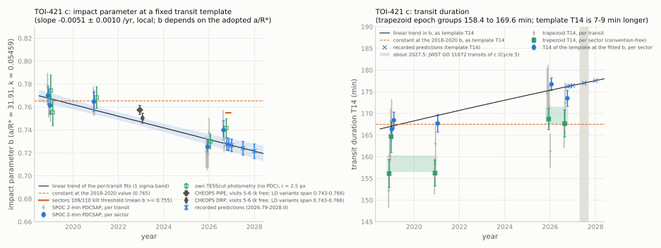
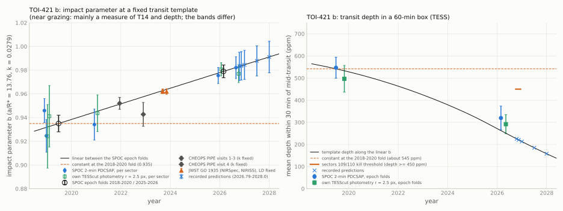

[README](../README.md) / [6. Other TESS results](6_other_results.md) / 6.12 TOI-421 c and b: candidate change of the transit chords, 2018-2026

### 6.12 TOI-421 c and b: candidate change of the transit chords, 2018-2026

TOI-421 (TIC 94986319, BD-14 1137) is a G9 dwarf with two transiting planets: b, a sub-Neptune on a 5.20-d orbit, and
c, a Neptune-sized planet on a 16.07-d orbit (Carleo et al. 2020; Krenn et al. 2024). In five TESS sectors
(2018-2026), the impact parameter of TOI-421 c fitted at a fixed transit template decreases from
$`0.765 \pm 0.005`$ (2018-2020) to $`0.729 \pm 0.005`$ (2025-2026), $`\mathrm{d}b/\mathrm{d}t = -0.0051 \pm 0.0010`$
yr$`^{-1}`$, and the transit duration measured with a trapezoid, which needs no template, increases from
$`158.4 \pm 1.9`$ to $`169.6 \pm 2.0`$ min (4.1 $`\sigma`$). The formal significance of the slope in $`b`$ is
5.1 $`\sigma`$; over most analysis variants (section [6.12.4](#6124-significance-selection-and-dependence-on-ar)) it is
4.0-5.3 $`\sigma`$, and about 4.5 $`\sigma`$ is adopted as the local value. In the same TESS data the inner planet b
moves the other way: at its fixed template $`b`$ rises from $`0.935 \pm 0.007`$ to $`0.979 \pm 0.005`$ and the transit
depth within 30 min of mid-transit falls from $`547 \pm 47`$ to $`320 \pm 54`$ ppm (3.2 $`\sigma`$). A nodal precession
of the two orbits with a mutual inclination of about 10 deg would produce changes of this size and of opposite sign
(section [6.12.8](#6128-interpretation-order-of-magnitude)). This section reports a candidate change of the transits;
a change of the orbits is not established, and no independent check exists.

Caveats, in order of weight:

- The TESS data are effectively two epochs (2018-2020 and 2025-2026). They cannot separate a steady trend from a
  one-time step or from a systematic effect specific to 2025-2026; within the late epoch, $`b`$ goes from sector 98 to
  sector 107 by $`+0.015 \pm 0.010`$.
- Sector 98 carries most of the weight of the late epoch: without it, the slope is $`-0.0036 \pm 0.0013`$ yr$`^{-1}`$
  (2.8 $`\sigma`$).
- TOI-421 c was selected in a screen of 271 known transiting planets. A look-elsewhere correction over these 271
  planets (independent trials, Gaussian tails) turns the local 4.5 $`\sigma`$ into about 3.1 $`\sigma`$.
- The size of the change in $`b`$ depends on the adopted $`a/R_\star`$ (from $`-0.0031`$ to $`-0.0074`$ yr$`^{-1}`$ for
  $`a/R_\star`$ = 27-36). The change of the trapezoid duration, $`+11.1 \pm 2.7`$ min (4.1 $`\sigma`$), does not depend on
  that convention.
- The public CHEOPS transits of c (December 2022) do not discriminate between the trend and a constant: the spread of
  their analysis variants (0.743-0.766) covers both.
- The rates imply a mutual inclination of about 9-11 deg for the published masses (about 7-13 deg within the error of
  the rate). The Rossiter-McLaughlin
  analysis of Bourrier et al. (2025) gives $`i_{bc} = 35^{+14}_{-23}`$ deg, so the implied value lies at its
  $`-1\sigma`$ edge; this is a mild tension.

The values of this section come from public TESS SPOC light curves, own photometry of TESS full-frame images, the
public CHEOPS visits of programme CH_PR100024, the public JWST GO 1935 transits of planet b, and values published by
others. Every value has a script in this repository (section [6.12.11](#61211-reproduction)).

#### 6.12.1 Target

| quantity | value | source |
|---|---|---|
| identifiers | TOI-421, TIC 94986319, BD-14 1137, Gaia DR3 2984582227215748864 | ExoFOP; Krenn et al. (2024), Table 1 |
| TESS magnitude; neighbours | $`T = 9.27`$; CROWDSAP 0.972-0.981 in all five sectors; a bound M dwarf at 29.4" (about 2200 au) | SPOC headers; Carleo et al. (2020) |
| star | G9 V; $`T_\mathrm{eff} = 5291 \pm 64`$ K, $`\log g = 4.48 \pm 0.03`$, [Fe/H] $`= -0.044 \pm 0.04`$, $`R_\star = 0.866 \pm 0.006\,R_\odot`$, $`M_\star = 0.833^{+0.048}_{-0.054}\,M_\odot`$, age $`10.9^{+2.9}_{-5.2}`$ Gyr, rotation period $`39.6 \pm 1.6`$ d; $`M_\star = 0.852\,M_\odot`$, $`R_\star = 0.871\,R_\odot`$ (used in the N-body runs of section 6.12.8); limb-darkening inputs here: 5291 K, 4.48, $`-0.02`$ | Krenn et al. (2024); Carleo et al. (2020) |
| planet b | $`P = 5.1976`$ d; $`b = 0.933^{+0.016}_{-0.024}`$, $`T_{14} = 1.107^{+0.065}_{-0.063}`$ h | Carleo et al. (2020) |
| planet b | $`b = 0.942 \pm 0.011`$, $`T_{14} = 0.0454 \pm 0.0014`$ d, $`e = 0.13 \pm 0.05`$ (TESS 2018-2020, CHEOPS 2021-2022, RVs) | Krenn et al. (2024) |
| planet b, JWST 2023 | NIRSpec G395M and NIRISS SOSS transmission spectra (GO 1935); white-light fits with $`i`$ and $`a/R_\star`$ free, quoted as $`i`$ = 85-86 deg and $`a/R_\star`$ = 13.9-14.0 | Davenport et al. (2025); products on Zenodo (10.5281/zenodo.15176438) |
| planet c | $`P = 16.0675`$ d; $`b = 0.738^{+0.029}_{-0.032}`$, $`T_{14} = 2.71^{+0.043}_{-0.038}`$ h | Carleo et al. (2020) |
| planet c | $`b = 0.70 \pm 0.03`$, $`T_{14} = 0.1148 \pm 0.0009`$ d (165.3 min), $`e = 0.19 \pm 0.04`$ (joint fit of TESS 2018-2020 and CHEOPS 2022 with one constant shape) | Krenn et al. (2024) |
| spin-orbit angles | $`\lambda_c = 14.0 \pm 1.8`$ deg; $`\lambda_b = -35^{+26}_{-23}`$ deg (one of two modes; the other, near $`-150`$ deg, was judged dynamically unlikely); $`\Psi_b = 57^{+11}_{-15}`$ deg, $`\Psi_c = 44.9^{+4.4}_{-4.1}`$ deg; mutual inclination $`i_{bc} = 35^{+14}_{-23}`$ deg | Bourrier et al. (2025), ESPRESSO |

The published impact parameters come from fits with different priors, eccentricities and data sets, and are not
interpreted here as evidence for or against a change.

#### 6.12.2 Data and method

TESS SPOC light curves of sectors 5 and 6 (2018), 32 (2020), 98 (2025) and 107 (2026): 120-s cadence in all five
sectors and 20-s cadence in sectors 98 and 107 ([`data/sectors_94986319.csv`](../data/sectors_94986319.csv)). Camera/CCD:
2/3, 2/4, 2/3, 2/3 and 4/1. The products of sectors 5, 6 and 32 are SPOC version 5.0.20, those of sectors 98 and 107
version 5.0.126. Twelve transits of c are completely covered (two each in sectors 5, 6, 32 and 107, four in sector 98).

- Model for c: batman, circular orbit, a fixed template $`k = R_\mathrm{p}/R_\star = 0.05459`$, $`a/R_\star = 31.91`$,
  quadratic limb darkening (0.401, 0.222), integrated over the exposure. Free per transit: $`b`$, the mid-time and a
  quadratic baseline over $`\pm 0.20`$ d. Points within 0.035 d of a transit of planet b are masked. Errors come from the
  Jacobian, scaled by $`\sqrt{\chi^2_\mathrm{red}}`$ when it exceeds 1; slopes are weighted linear fits against time.
- The template $`T_{14}`$ (contact 1 to contact 4) follows from the fitted $`b`$:
  $`T_{14} = (P/\pi)\,\arcsin\!\left(\sqrt{(1+k)^2 - b^2}\,/\sqrt{(a/R_\star)^2 - b^2}\right)`$.
- Duration without a template: a trapezoid (depth, $`T_{14}`$, $`T_{12}`$; $`T_{23} = T_{14} - 2T_{12}`$), integrated over
  the exposure, fitted per transit, per sector and jointly per epoch group.
- Planet b: early (sectors 5, 6, 32) and late (98, 107) folds on $`P = 5.19759807`$ d, $`T_0`$ = BTJD 1441.283952, with one
  mid-time offset per group, a quadratic baseline per window and the transits of c masked. Models: the batman template
  $`k = 0.0279`$, $`a/R_\star = 13.76`$ (Krenn et al. 2024) with $`b`$ free; a box (mean depth within $`\pm 30`$ min of
  mid-transit); a trapezoid.
- Own photometry: TESScut cutouts of the full-frame images, one code path for all sectors and no SPOC PDC (1800-s cadence
  in sectors 5 and 6, 600 s in 32, 200 s in 98 and 107; apertures of radius 2.0, 2.5 and 3.0 px).

#### 6.12.3 Results for planet c

Per sector ([`data/sectors_94986319.csv`](../data/sectors_94986319.csv); SPOC 2-min PDCSAP):

| sector | year | camera/CCD | transits | $`b`$ (template) | $`T_{14}`$, template (min) | $`T_{14}`$, trapezoid (min) | $`k`$ ($`b`$ and $`k`$ free) |
|---|---|---|---|---|---|---|---|
| 5 | 2018.90 | 2/3 | 2 | $`0.770 \pm 0.008`$ | 166.4 | $`156.1 \pm 3.2`$ | $`0.0553 \pm 0.0009`$ |
| 6 | 2018.99 | 2/4 | 2 | $`0.762 \pm 0.008`$ | 168.4 | $`164.7 \pm 3.6`$ | $`0.0553 \pm 0.0009`$ |
| 32 | 2020.92 | 2/3 | 2 | $`0.765 \pm 0.008`$ | 167.7 | $`156.2 \pm 3.0`$ | $`0.0540 \pm 0.0010`$ |
| 98 | 2025.94 | 2/3 | 4 | $`0.725 \pm 0.006`$ | 176.7 | $`168.7 \pm 2.4`$ | $`0.0544 \pm 0.0007`$ |
| 107 | 2026.64 | 4/1 | 2 | $`0.740 \pm 0.008`$ | 173.5 | $`167.6 \pm 3.1`$ | $`0.0566 \pm 0.0009`$ |

Rates and epoch groups ([`data/trend_94986319.csv`](../data/trend_94986319.csv); per-transit values in
[`data/pertransit_94986319.csv`](../data/pertransit_94986319.csv)):

| quantity | value |
|---|---|
| $`\mathrm{d}b/\mathrm{d}t`$, per transit (adopted) | $`-0.0051 \pm 0.0010`$ yr$`^{-1}`$ ($`z = -5.1`$; $`\chi^2 = 8.7`$ for 10 degrees of freedom) |
| $`b`$, epoch groups (per-transit fits) | $`0.7654 \pm 0.0046`$ (2018-2020, 6 transits), $`0.7295 \pm 0.0050`$ (2025-2026, 6 transits); difference $`-0.036 \pm 0.007`$ (5.3 $`\sigma`$) |
| $`\mathrm{d}b/\mathrm{d}t`$, per sector | $`-0.0049 \pm 0.0012`$ yr$`^{-1}`$ (4.0 $`\sigma`$); with $`k`$ free per sector $`-0.0047 \pm 0.0013`$ (3.7 $`\sigma`$), and $`k`$ without trend ($`+0.00004 \pm 0.00015`$ yr$`^{-1}`$) |
| trapezoid, epoch groups | $`T_{14}`$: $`158.4 \pm 1.9`$ to $`169.6 \pm 2.0`$ min ($`+11.1 \pm 2.7`$, 4.1 $`\sigma`$); $`T_{23}`$: $`+5.2 \pm 2.7`$ min (1.9 $`\sigma`$); $`T_{12}`$: $`+3.0 \pm 2.4`$ min (1.3 $`\sigma`$); depth $`+121 \pm 78`$ ppm (1.6 $`\sigma`$) |
| trapezoid, per transit | $`\mathrm{d}T_{14}/\mathrm{d}t = +1.41 \pm 0.54`$ min/yr (2.6 $`\sigma`$; $`\chi^2 = 17.6`$ for 10); SAP flux $`+1.23 \pm 0.50`$ min/yr |

<picture><source srcset="../figures/bt14_94986319_dark.svg" media="(prefers-color-scheme: dark)"></picture>

The template $`T_{14}`$ and the trapezoid $`T_{14}`$ are different definitions and differ by 7-9 min; each is compared only
with itself. The light-curve shape at TESS precision does not separate a change of the chord (impact parameter) from a
change of the crossing speed: $`T_{23}`$ and $`T_{12}`$ change by 1.9 and 1.3 $`\sigma`$.

#### 6.12.4 Significance, selection and dependence on a/R*

[`data/trend_94986319.csv`](../data/trend_94986319.csv), [`data/injection_94986319.csv`](../data/injection_94986319.csv):

- Two epochs. All six early transits lie in 2018-2020 and all six late ones in 2025-2026. Within each epoch the slopes are
  uninformative; from sector 98 to sector 107, $`b`$ changes by $`+0.015 \pm 0.010`$, against the trend.
- Leave one sector out: $`-0.0048 \pm 0.0012`$ (without sector 5, 4.1 $`\sigma`$), $`-0.0057 \pm 0.0012`$ (6; 4.9),
  $`-0.0049 \pm 0.0010`$ (32; 4.8), $`-0.0036 \pm 0.0013`$ (98; 2.8 $`\sigma`$) and $`-0.0062 \pm 0.0012`$ (107; 5.2)
  yr$`^{-1}`$. The 1-d binned PDCSAP flux of sector 98 has an rms of 835 ppm, against 65-126 ppm in the other sectors; with the
  20-s light curves of sectors 98 and 107 or with the SAP flux the late value is the same (0.729-0.731).
- Error calibration. Transits of c with constant $`b = 0.748`$ injected at 34 orbital-phase offsets into the real 2-min
  data and fitted in the same way give slope $`z`$ values with mean $`-0.38`$, standard deviation 0.75 and largest
  $`\lvert z\rvert`$ 2.1; the fit errors are therefore not underestimated. An injected trend of $`-0.0051`$ yr$`^{-1}`$ is
  recovered as $`-0.0054 \pm 0.0011`$ yr$`^{-1}`$ (mean $`z = -4.2`$, 18 offsets).
- Local significance. The per-transit slope has $`z = -5.1`$. The template, limb-darkening, dilution, 20-s cadence,
  activity and timing variants of section [6.12.5](#6125-checks) give 4.0-5.3 $`\sigma`$ (the per-sector fit 4.0 $`\sigma`$).
  Lower values: the epoch-group difference is 3.4 $`\sigma`$ for $`a/R_\star = 24`$ (below the stellar-density value) and
  for all data binned to 30 min; own photometry of the full-frame images, at 30-min cadence in 2018, gives 2.9-3.6 $`\sigma`$;
  with $`a/R_\star`$ free in every sector, $`b`$ is not constrained. About 4.5 $`\sigma`$ is adopted.
- Selection. TOI-421 c was selected in a screen of TESS data of 271 known transiting planets for changes of the impact
  parameter (the screen of section [6.11](6.11_LHS475b.md); the screening pipeline is not part of this repository). A
  two-sided local 4.5 $`\sigma`$ ($`p = 6.8 \times 10^{-6}`$) with 271 independent trials gives $`p = 1.8 \times 10^{-3}`$,
  about 3.1 $`\sigma`$. This assumes Gaussian tails; in the screen, the statistic had heavier tails than Gaussian
  (section [6.11.4](6.11_LHS475b.md#6114-calibration-selection-and-dependence-on-ar)).
- Dependence on $`a/R_\star`$. With $`a/R_\star`$ fixed at 27, 29.2 (stellar density, circular orbit), 31.91, 34 and 36
  the slope is $`-0.0031`$ (3.9 $`\sigma`$), $`-0.0039`$ (4.4), $`-0.0051`$ (5.1), $`-0.0062`$ (5.6) and $`-0.0074`$
  (6.0 $`\sigma`$) yr$`^{-1}`$. One $`a/R_\star`$ fitted to all twelve transits gives $`33.3 \pm 0.9`$, above the circular
  stellar-density value, as expected for the published eccentricity of c. A profile over $`a/R_\star`$ = 24-40 with $`b`$
  per epoch group gives 3.4-6.9 $`\sigma`$ for the difference. Within one sector $`b`$ and $`a/R_\star`$ are not separable
  (correlation $`-0.98`$); $`a/R_\star`$ fitted per sector shows no trend ($`+0.03 \pm 0.27`$ yr$`^{-1}`$). The rate in
  $`b`$ is therefore tied to the template; the trapezoid duration is not.

#### 6.12.5 Checks

[`data/trend_94986319.csv`](../data/trend_94986319.csv):

| check | result |
|---|---|
| limb darkening | five fixed pairs including a linear law: 5.0-5.3 $`\sigma`$; coefficients fitted jointly: 5.3 $`\sigma`$; fitted separately in each epoch group: difference in $`b`$ 3.6 $`\sigma`$ |
| dilution | SAP flux with the SPOC crowding correction 4.8 $`\sigma`$, without it 4.9 $`\sigma`$; PDCSAP with the crowding shifted by $`\pm 0.01`$-0.02 in opposite directions for the two epochs 5.0-5.3 $`\sigma`$; $`k`$ free per transit: $`b`$ 5.0 $`\sigma`$, $`k`$ without trend; dilution scales the depth, not the contact times |
| pipeline version | own photometry of the full-frame images (no SPOC PDC, one code path): $`-0.0039 \pm 0.0014`$ (2.9 $`\sigma`$), $`-0.0046 \pm 0.0013`$ (3.6 $`\sigma`$) and $`-0.0048 \pm 0.0014`$ (3.5 $`\sigma`$) yr$`^{-1}`$ for radii 2.0, 2.5 and 3.0 px; the same early (about 0.77) and late (about 0.73) values; the lower significance follows from the 30-min cadence of 2018; these fits share the photons with the SPOC fits |
| cadence | 20-s light curves in sectors 98 and 107: 5.3 $`\sigma`$; all data binned to 10 min: 4.4 $`\sigma`$; to 30 min: slope 1.9 $`\sigma`$, epoch-group difference 3.4 $`\sigma`$; only the late or only the early data binned to 30 min: 4.4 $`\sigma`$ and 1.9 $`\sigma`$ (difference 4.5 and 3.4 $`\sigma`$) |
| detector | sector 98 (late) uses camera 2, CCD 3 like sectors 5 and 32 (early); sector 107 uses camera 4 |
| stellar activity | 4-$`\sigma`$ clipping: 5.2 $`\sigma`$; leaving out one transit: 4.4-5.4 $`\sigma`$; residuals in 10-min bins inside the transits: largest positive bin $`z = 2.7`$, in-transit and out-of-transit scatter alike; no spot crossing seen |
| timing | mid-times deviate from a linear ephemeris by $`-3.6`$ to $`+4.6`$ min ($`\chi^2 = 48.5`$ for 10); mid-times are free per transit; one mid-time per sector on the linear ephemeris instead: 4.8 $`\sigma`$ |

#### 6.12.6 Planet b in the TESS data

[`data/planetb_94986319.csv`](../data/planetb_94986319.csv), [`data/sectors_94986319.csv`](../data/sectors_94986319.csv). Early fold:
11 transits (2019.5); late fold: 10 transits (2026.2).

| quantity | 2018-2020 | 2025-2026 | difference |
|---|---|---|---|
| $`b`$, template $`k = 0.0279`$, $`a/R_\star = 13.76`$ (SPOC 2-min) | $`0.935 \pm 0.007`$ | $`0.979 \pm 0.005`$ | $`+0.0066 \pm 0.0013`$ yr$`^{-1}`$ |
| depth within $`\pm 30`$ min of mid-transit (SPOC 2-min) | $`547 \pm 47`$ ppm | $`320 \pm 54`$ ppm | $`-227 \pm 72`$ ppm (3.2 $`\sigma`$) |
| same, own full-frame-image photometry ($`r = 2.5`$ px) | $`497 \pm 60`$ ppm; $`b = 0.940 \pm 0.012`$ | $`292 \pm 43`$ ppm; $`b = 0.978 \pm 0.004`$ | |

Per sector (SPOC 2-min): $`b`$ = 0.946, 0.925, 0.934, 0.976 and 0.982 (errors 0.007-0.014). The depth of c in the same
sectors does not change ($`k`$ above), so a change of dilution does not explain the shallower transits of b. Near grazing,
$`b`$ at a fixed template is mainly a measure of $`T_{14}`$ and depth, and its error is optimistic; the trapezoid
$`T_{14}`$ of b is not constrained at TESS precision ($`68 \pm 5`$ and $`75 \pm 14`$ min). At a fixed $`k`$, a shallower
and shorter transit means a larger $`b`$; the change of b has the opposite sign to that of c.

<picture><source srcset="../figures/planetb_94986319_dark.svg" media="(prefers-color-scheme: dark)"></picture>

#### 6.12.7 CHEOPS and JWST epochs

CHEOPS ([`data/cheops_94986319.csv`](../data/cheops_94986319.csv)). The six public visits of programme CH_PR100024 (planet b on
2021-11-19, 2021-12-10, 2022-01-10 and 2022-11-28; planet c on 2022-12-04 and 2022-12-20; Krenn et al. 2024) were
refitted with the TESS templates: the PIPE PSF photometry published by Krenn et al. (2024) and, as a cross-check, the
DRP 14.1.2 light curves from DACE. Detrending against roll angle, centroid, background and time was chosen per visit by
BIC and marginalised; emcee posteriors. Comparison values for these epochs were recorded on 2026-10-28, before the fits
([`data/predictions_cheops_jwst_94986319.json`](../data/predictions_cheops_jwst_94986319.json); sha256
`0ae9e6e94f0b533cc96ba9b55c0ab927d3330f5e1c20bcde2286ca5a327a2fff`, file time 2026-10-28 14:10:47 UTC). Their planet-b
trend came from an earlier per-sector fit of own full-frame-image photometry (not in this repository), which agrees within
its errors with the values of `ffi_toi421.py`.

- Planet c, visits 5 and 6 (2022.95): $`b = 0.757 \pm 0.004`$ (PIPE) and $`0.750 \pm 0.004`$ (DRP) with $`k`$ free and
  theoretical limb darkening; the trend gives $`0.749 \pm 0.005`$, the 2018-2020 constant 0.765. With limb darkening
  free the PIPE value is 0.766, with $`k`$ fixed at the TESS template 0.749; the variants span 0.743-0.766. CHEOPS does not
  discriminate between the trend and a constant. The CHEOPS $`k`$ is 2-3 % above the TESS template value.
- Planet b, PIPE with $`k`$ fixed: $`0.952 \pm 0.005`$ (visits 1-3, 2021.95; recorded trend value $`0.955 \pm 0.008`$) and
  $`0.943 \pm 0.010`$ (visit 4, 2022.91; $`0.959 \pm 0.006`$); the 2018-2020 SPOC fold gives $`0.935 \pm 0.007`$. The
  CHEOPS values lie between the two alternatives and do not decide between them. The estimated systematic uncertainty of
  a CHEOPS-to-TESS comparison is about $`\pm 0.005`$ (b) and $`\pm 0.008`$ (c), from limb darkening, $`k`$ and the
  photometry product.

JWST ([`data/jwst_94986319.csv`](../data/jwst_94986319.csv)). The two public GO 1935 transits of planet b (2023-09-10,
NIRSpec G395M NRS1; 2023-11-06, NIRISS SOSS order 1; Davenport et al. 2025) were refitted with the TESS template: the
NIRSpec white-light curve of Davenport et al. (2025) from Zenodo and own sums of the MAST `x1dints` products, with a
quadratic baseline, an exponential ramp and a jitter term. With $`a/R_\star = 13.76`$ fixed and theoretical limb
darkening, $`b = 0.9619 \pm 0.0015`$ (NIRSpec) and $`0.9620 \pm 0.0023`$ (NIRISS) (half-widths of the 68 % intervals
times the red-noise factor 1.6-1.7), with a systematic spread of $`\pm 0.0015`$ over limb darkening, baseline and
reduction; template $`T_{14}`$ 63.0 and 63.4 min. The recorded trend value for 2023.7 was $`0.963 \pm 0.005`$; the
2018-2020 SPOC fold is $`0.935 \pm 0.007`$. The comparison crosses bands (TESS, 0.85-5.2 $`\mu`$m) and rests on the
same fixed $`a/R_\star`$: with $`a/R_\star`$ free, the NIRSpec transit prefers $`a/R_\star = 17.7 \pm 0.9`$ and
$`b = 0.934`$ (correlation $`-0.96`$), so the $`b`$ values at $`a/R_\star = 13.76`$ are proxies for $`T_{14}`$ and are
not geometric impact parameters. The NIRISS mid-time is $`-9.3 \pm 0.4`$ min from the linear ephemeris, the NIRSpec one
$`+0.2 \pm 0.2`$ min; this was not investigated further.

#### 6.12.8 Interpretation (order of magnitude)

[`data/nbody_94986319.csv`](../data/nbody_94986319.csv). One mechanism is the nodal precession of the two orbits about their
total angular momentum. N-body runs (REBOUND, WHFast; masses 7.17 and 16.42 $`M_\oplus`$ of Carleo et al. 2020, scanned
over 6.4-7.8 and 14.0-17.5 $`M_\oplus`$; sky inclinations from the 2018-2020 TESS values) give:

| $`i_{bc}`$ (deg) | 5 | 8 | 10 | 12 | 15 | 20 | 35 |
|---|---|---|---|---|---|---|---|
| node period (yr) | 1420 | 1450 | 1470 | 1500 | 1550 | 1670 | 2270 |
| $`\lvert\mathrm{d}b_c/\mathrm{d}t\rvert`$ (yr$`^{-1}`$; $`a/R_\star = 31.91`$) | 0.0025 | 0.0043 | 0.0054 | 0.0064 | 0.0077 | 0.0093 | 0.011 |
| $`\lvert\mathrm{d}b_b/\mathrm{d}t\rvert`$ (yr$`^{-1}`$; $`a/R_\star = 13.76`$) | 0.0036 | 0.0062 | 0.0077 | 0.0092 | 0.011 | 0.014 | 0.016 |

- The two orbits are close to edge-on and most of the mutual inclination lies in the sky-plane node difference, so the
  rates depend mainly on $`i_{bc}`$. The ratio $`-\mathrm{d}(\cos i_b)/\mathrm{d}(\cos i_c)`$ equals $`L_c/L_b`$ = 3.19-3.34
  in every run (conservation of angular momentum).
- The measured rate of c, $`-0.0051 \pm 0.0010`$ yr$`^{-1}`$, corresponds to $`i_{bc} \approx`$ 9-11 deg over the mass range
  (about 7-13 deg within the error of the rate). At the matching $`i_{bc}`$ the runs give $`+0.0070`$ to $`+0.0077`$
  yr$`^{-1}`$ for b; the TESS value is $`+0.0066 \pm 0.0013`$ yr$`^{-1}`$. Opposite signs require both transit chords on the same side of the stellar centre;
  chords on opposite sides give changes of the same sign. This geometry can be tested with a chord model of the
  Rossiter-McLaughlin data.
- At the central $`i_{bc} = 35`$ deg of Bourrier et al. (2025) both rates would be about twice as fast (0.011 and 0.016
  yr$`^{-1}`$), which the TESS data do not allow; the value implied here lies at the $`-1\sigma`$ edge of their result.
  Their $`\lambda_b`$ comes from a grazing planet and has a second mode near $`-150`$ deg.
- If the change of b were linear, its transit would reach $`b = 1 + k`$ and stop around 2033-2034 (an extrapolation, not
  the prediction of a model).

#### 6.12.9 Recorded predictions and kill criteria

The predictions below were written on 2026-10-29 at 22:54:17 UTC, before light curves of TESS sectors 109 and 110 were
available from MAST (as stated in the file), and are reproduced byte for byte in
[`data/predictions_94986319.json`](../data/predictions_94986319.json) (sha256
`92e05d9dae40c7ccda80f307d6dce7bb8cd4b5ded4d974cd4484f2e7da69350a`). `scripts/toi421/predict_toi421.py` recomputes them from
the fits above and reports the largest difference from the recorded file (zero in the run for this record). The trend
for c is the linear fit of the twelve per-transit values with its covariance; for b, a linear change between the two
SPOC epoch folds. The constant alternatives are the 2018-2020 values.

| epoch | c: $`b`$ (trend) | c: template $`T_{14}`$ (min) | c: constant | b: $`b`$ (trend) | b: depth in 60-min box (ppm) | b: constant |
|---|---|---|---|---|---|---|
| 2026.79 (TESS sector 109, camera 2) | $`0.728 \pm 0.005`$ | 176.2 | $`b = 0.765`$, 167.5 min | $`0.983 \pm 0.012`$ | 225 | 542 ppm |
| 2026.87 (TESS sector 110, camera 1) | $`0.727 \pm 0.005`$ | 176.3 | as above | $`0.984 \pm 0.012`$ | 221 | 542 ppm |
| 2027.0 | $`0.727 \pm 0.006`$ | 176.5 | as above | $`0.985 \pm 0.012`$ | 213 | 542 ppm |
| 2027.5 | $`0.724 \pm 0.006`$ | 177.0 | as above | $`0.988 \pm 0.013`$; template $`T_{14}`$ 49.3 min | 185 | 542 ppm |
| 2028.0 | $`0.722 \pm 0.006`$ | 177.6 | as above | $`0.991 \pm 0.013`$ | 158 | 542 ppm |

Kill criteria, fixed with the predictions:

- The mean $`b`$ of c in TESS sectors 109 and 110 at the template of section 6.12.2 is $`\ge 0.755`$: the trend is
  rejected.
- The depth of b within $`\pm 30`$ min of mid-transit in the same data is $`\ge 450`$ ppm: the trend is rejected.

The 2027.5 row covers the two transits of c in JWST program GO 11672 (Cycle 5; NIRISS SOSS and NIRSpec G395H). On the
trend, the template $`T_{14}`$ of c is about 177 min in 2027, against 167.5 min for the constant; the trapezoid
$`T_{14}`$, extrapolated linearly from the per-transit trapezoid fits, is about 170 min, against about 158 min. A single JWST transit measures $`b`$ to about 0.003 and
$`T_{14}`$ to about 0.5 min at a fixed template (an estimate from the planet-b fits of section 6.12.7).

Next transits of c on the linear ephemeris of the twelve TESS mid-times (BTJD 2195.30653 + 16.0675031 $`n`$; the
observed mid-times scatter by $`\pm 5`$ min): BTJD 4396.555 (2026-12-22), 4412.622 (2027-01-07), 4428.690 (2027-01-23),
4444.757 (2027-02-08), 4460.825 (2027-02-24), 4476.892 (2027-03-12), 4492.960 (2027-03-28), 4509.027 (2027-04-13),
4525.095 (2027-04-29), 4541.162 (2027-05-15) and 4557.230 (2027-05-31).

#### 6.12.10 Catalogue and literature checks

| date (UTC) | source | result |
|---|---|---|
| 2026-10-29 | ADS full text for TOI-421, TOI 421, TIC 94986319, BD-14 1137 and Gaia DR3 2984582227215748864, alone and with words of a precession, impact-parameter, duration or mutual-inclination change; source texts of Carleo et al. (2020), Krenn et al. (2024), Davenport et al. (2025), Bourrier et al. (2025) and Thomas et al. (2026) | no report of a change of the impact parameter, duration or inclination of either planet; Carleo et al. (2020) give a forecast of transit-timing variations; Krenn et al. (2024) fit one constant shape to TESS 2018-2020 and CHEOPS 2022 and find no timing variation; Davenport et al. (2025) fit $`i`$ and $`a/R_\star`$ of b without a comparison in time; Bourrier et al. (2025) give the spin-orbit angles and $`i_{bc}`$ |
| 2026-10-29 23:07-23:10 | Zenodo (all versions), GitHub code, repository and issue search, ExoFOP, Planet Hunters TESS Talk, ADS full text, for TOI-421, TOI 421, TIC 94986319, BD-14 1137 and 2984582227215748864 | Zenodo: the data products of Davenport et al. (2025) only; GitHub: catalogue, visualisation and target-list files; ExoFOP: TOI 421.01 and 421.02; ADS: the papers above and catalogue or population studies; no record reporting a change. The Planet Hunters TESS Talk control query failed |

Not checked: SIMBAD; JWST and other proposals beyond the public abstract of GO 11672; anything posted after the dates
above. Ground-based light curves on ExoFOP and other unpublished photometry are not used in this section.

#### 6.12.11 Reproduction

From the repository root (environments in `requirements.txt`):

```
python scripts/toi421/download_toi421.py            # SPOC light curves (MAST), sha256 check -> work/toi421/data/
for t in baseline aR ld dilution duration cadence spots ttv loso inject inject_trend; do
  python scripts/toi421/fit_toi421.py $t             # -> work/toi421/out/<t>.json
done
python scripts/toi421/planet_b_toi421.py            # -> work/toi421/out/planet_b.json
python scripts/toi421/ffi_toi421.py                 # TESScut cutouts and own photometry -> work/toi421/out/ffi.json
python scripts/toi421/nbody_toi421.py               # REBOUND -> work/toi421/out/nodal_nbody.json
python scripts/toi421/predict_toi421.py             # recomputes data/predictions_94986319.json and compares
python scripts/toi421/cheops/download_cheops.py     # VizieR J/A+A/686/A301 and DACE
python scripts/toi421/cheops/run_all.py work/toi421/cheops/runs 2 '' 10000 3000
python scripts/toi421/cheops/summarize.py
bash scripts/toi421/jwst/run_jwst.sh                # Zenodo 10.5281/zenodo.15176438 and MAST x1dints of GO 1935
python scripts/toi421/make_tables_toi421.py         # -> data/*_94986319.csv
python figures/make_figures.py toi421
```

For this record the TESS, full-frame-image, N-body and prediction steps were run from fresh downloads (the light-curve
checksums match the files of the vetting analysis, and the outputs agree with it to $`10^{-6}`$). The CHEOPS and JWST
Markov-chain fits (about 100 CHEOPS runs of 20-40 min each; twelve JWST runs) were run on 2026-10-28 with these scripts;
their summaries were re-tabulated by `cheops/summarize.py` and `make_tables_toi421.py` but the chains were not re-run.
References of this section: Carleo, I., et al. 2020, AJ 160, 114; Krenn, A. F., et al. 2024, A&A 686, A301 (and VizieR
J/A+A/686/A301); Davenport, B., et al. 2025, ApJL 984, L44 (and Zenodo 10.5281/zenodo.15176438); Bourrier, V., et al.
2025, A&A 701, A190; Thomas, L., et al. 2026, arXiv:2607.09451; Claret, A. 2021, RNAAS 5, 13; Grant, D., & Wakeford,
H. R. 2024, JOSS 9, 6816 (ExoTiC-LD); Kreidberg, L. 2015, PASP 127, 1161 (batman); Foreman-Mackey, D., et al. 2013, PASP
125, 306 (emcee); Rein, H., & Liu, S.-F. 2012, A&A 537, A128 and Rein, H., & Tamayo, D. 2015, MNRAS 452, 376 (REBOUND,
WHFast); Kipping, D. M. 2013, MNRAS 435, 2152; Benz, W., et al. 2021, Exp. Astron. 51, 109 (CHEOPS); and those of section
[8](8_data_and_reproduction.md).
