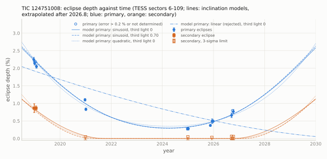

[README](../README.md) / [6. Other TESS results](6_other_results.md) / 6.4 TIC 124751008: eclipses whose depth decreased and then increased

### 6.4 TIC 124751008: eclipses whose depth decreased and then increased

TIC 124751008 (2MASS J06162084-3509125) is an M-dwarf multiple at 57 pc that contains a 12.61-d eclipsing binary. In the
same aperture its primary eclipses were 2.25 % deep in 2018, 0.28 % deep in sector 87 (2024-2025) and 0.77 % deep in
sector 109 (2026); the secondary eclipse, 0.86 % deep in 2019, has not been detected since 2021. The eclipse times
deviate from a linear ephemeris by up to 68 min and change by up to 43 min between consecutive cycles. Sections [6.1](6.1_TIC11613676.md) and
[6.4](#64-tic-124751008-eclipses-whose-depth-decreased-and-then-increased) describe the same kind of behaviour: the eclipse depths of a short-period binary change over a few years together
with eclipse-timing variations, which the geometric models describe as a change of the orbital inclination.

#### 6.4.1 Target

| quantity | value | source |
|---|---|---|
| identifiers | TIC 124751008, Gaia DR3 (= DR2) 2885572716963709952, 2MASS J06162084-3509125, UCAC4 275-009543, WISEA J061620.84-350911.6, APASS 17635247 | SIMBAD, TIC v8.2 |
| position (ICRS, epoch 2016.0) | RA 94.0868614, Dec $`-`$35.1531384 | Gaia DR3 |
| proper motion (mas/yr) | $`-3.143`$, 83.570 (DR2: $`-3.86`$, 83.25) | Gaia DR3, DR2 |
| parallax (mas) | $`17.571 \pm 0.057`$ (56.9 pc) | Gaia DR3 |
| $`G`$, $`BP-RP`$ | 11.191, 2.111 | Gaia DR3 |
| $`T`$, $`V`$, $`J`$, $`H`$, $`K_s`$ | 10.232, 12.01, 8.827, 8.169, 7.970 | TIC v8.2, APASS, 2MASS |
| $`T_\mathrm{eff}`$ (K) | 3773 (TIC); 3733 and 3580 (Gaia XP, J/ApJ/984/58 and J/MNRAS/524/1855; [Fe/H] $`-0.08`$ and $`-0.25`$); no GSP-Phot value | TIC v8.2; VizieR |
| RUWE; `astrometric_excess_noise` (mas; significance); `ipd_frac_multi_peak`; `non_single_star` | 4.219; 0.634 (710); 4; 0 (no row in the four `nss_*` tables) | Gaia DR3 |
| radial velocity | none (`has_rvs` false) | Gaia DR3 |
| variability | `phot_variable_flag` NOT_AVAILABLE; no `vari_*` entry | Gaia DR3 |
| astrometric acceleration | listed in J/AJ/165/193 (Gaia DR2-DR3 accelerations, $`\chi^2 = 178.9`$) | VizieR |
| TIC contamination ratio | 0.016 | TIC v8.2 |
| Gaia DR3 sources within 60" | $`G = 17.96`$ at 16.9", 16.21 at 18.0", 19.72 at 20.9", 15.30 at 40.0", 16.70 at 55.7", and four fainter than $`G = 19`$ | Gaia DR3 |
| bright neighbour | $`\kappa`$ Col (HD 43785, HIP 29807, NSV 2897; G9 IIIb, $`G = 4.1`$, 2.8 $`M_\odot`$) at 157.9" (8830 au projected), parallax $`17.38 \pm 0.08`$ mas, radial velocity 23.2 km/s; a common-proper-motion candidate companion of TIC 124751008 in Kervella et al. (2022, table A2: tangential-velocity difference 1.58 km/s, escape velocity 0.74 km/s, bound flag 0) | Gaia DR3, VizieR J/A+A/657/A7 |
| X-ray | 3eRASS J061621.5-350913 at 8.2" (1eRASS J061621.4-350919, coronal-source probability 0.79 in J/A+A/684/A121); $`L_X = 1.8 \times 10^{28}`$ erg/s, $`L_X/L_\mathrm{bol} = 3 \times 10^{-5}`$ | eROSITA |
| young-star probability | 0.17 (SPYGLASS, Kerr et al. 2021) | VizieR |

The colours ($`V-K_s = 4.05`$, $`J-H = 0.66`$, $`H-K_s = 0.20`$; WISE $`W1-W4 = 0.34`$, no infrared excess) are those of an
M1-M1.5 dwarf, but $`M_G = 7.42`$ and $`M_{K_s} = 4.19`$ are 1.49 and 1.51 mag brighter than the main sequence at this colour
($`M_G = 8.90`$, $`M_{K_s} = 5.70`$; Pecaut & Mamajek 2013, version 2022.04): the system emits about four times the light
of one such dwarf. With the 2019 ratio of secondary to primary eclipse depth (0.4), the eclipsing pair supplies roughly
30 % of the light, so third light of about 0.7 is plausible; the models below were run with third light 0 and 0.70.
The photocentre orbit of the 12.6-d pair is at most 0.46 mas; a dark third body with an orbital period of 100-200 d
would move the photocentre by 1.5-6.7 mas, far above the excess noise of 0.63 mas, so a third body would have to be
luminous ($`\lvert m_C/M - L_C/L \rvert \lesssim 0.1`$). A 2.8-$`M_\odot`$ giant implies an age of order 0.5 Gyr if
$`\kappa`$ Col and TIC 124751008 are coeval.

#### 6.4.2 Data

TESScut 21 $`\times`$ 21-pixel cutouts of the SPOC-calibrated full-frame images at the Gaia DR3 position
([`data/sectors_124751008.csv`](../data/sectors_124751008.csv)); the star has no 2-min data. tess-point 0.9.5.post1 places it on silicon in these seven
sectors only, up to sector 134 (2028-08-30). The saturated $`\kappa`$ Col bleeds along detector columns 1.5-5.7 px from
the target.

| sector | dates (UTC) | camera/CCD | cadence | quality-0 cadences | nearest bleed column (px) | masked pixels in $`r = 2.0`$ px | aperture flux (e-/s) | contamination |
|---|---|---|---|---|---|---|---|---|
| 6 | 2018-12-15 to 2019-01-06 | 3/1 | 30 min | 981 | 5.6 | 0 | 12180 | 1.8 % |
| 7 | 2019-01-08 to 2019-02-01 | 3/2 | 30 min | 1086 | 5.1 | 0 | 11502 | 1.2 % |
| 33 | 2020-12-18 to 2021-01-13 | 3/2 | 10 min | 3485 | 5.4 | 0 | 11695 | 1.7 % |
| 87 | 2024-12-18 to 2025-01-14 | 3/2 | 200 s | 11168 | 5.7 | 0 | 11712 | 1.8 % |
| 98 | 2025-11-08 to 2026-01-05 | 3/1 | 200 s | 24069 | 5.4 | 0 | 12665 | 1.5 % |
| 108 | 2026-09-07 to 2026-10-04 | 4/2 | 200 s | 10933 | 1.6 | 4 | 10525 | 2.0 % |
| 109 | 2026-10-05 to 2026-10-11 (6.9 d) | 3/2 | 200 s | 2974 | 3.7 | 0 | 12543 | 1.8 % |

Contamination: Gaia DR3 sources within 60" in the masked $`r = 2.0`$ px aperture (Gaussian PSF); $`\kappa`$ Col is not
included. The flux expected for $`T = 10.23`$ is about 12100 e-/s.

#### 6.4.3 Method

[`scripts/eb_124751008.py`](../scripts/eb_124751008.py). Pixels of the median image above 20000 e-/s (the bleed column) and their horizontal
neighbours are removed from the aperture and from the background; background = a plane fitted per cadence to the faint
unmasked pixels more than 5 px from the proper-motion-corrected Gaia position; circular apertures of $`r`$ = 2.0 px
(adopted) and 2.5 px without the masked pixels, and an unmasked $`r = 2.0`$ px aperture as a check; quality-0 cadences;
in the 200-s sectors, cadences more than 5 robust $`\sigma`$ from a 7-cadence running median are removed. Each primary
eclipse with ingress and egress coverage is fitted with a trapezoid (mid-time, depth, $`T_{14}`$, $`T_{12}`$) times a
linear baseline over $`\pm 0.35`$ d, with exposure-time supersampling; errors are the larger of the residual-scaled
covariance and a cyclic-shift bootstrap (60 draws). Secondary eclipses: the same fit in sectors 6 and 7, and a fixed
trapezoid ($`T_{14} = 1.9`$ h) at the 2019 secondary phase (0.4986) relative to each sector's primaries elsewhere.
Difference images, geometric models and the inclination fits come from the vetting record (no script in this
repository; section [8](8_data_and_reproduction.md)).

#### 6.4.4 Eclipse depths and durations

[`data/depths_124751008.csv`](../data/depths_124751008.csv) (per sector), [`data/eclipse_times_124751008.csv`](../data/eclipse_times_124751008.csv) (per eclipse); depths in % of the masked
$`r = 2.0`$ px aperture flux.

| sector | year | primary depth (%) | primary $`T_{14}`$ (h) | secondary depth (%) |
|---|---|---|---|---|
| 6 | 2018.99 | 2.247 and 2.145 (mean $`2.186 \pm 0.040`$) | 2.13 | $`0.865 \pm 0.126`$ (one eclipse; the second fit has no determined error); fixed shape $`0.783 \pm 0.022`$ |
| 7 | 2019.06 | 2.185 and 2.051 (mean $`2.052 \pm 0.050`$) | 2.15 | $`0.864 \pm 0.064`$; fixed shape $`0.794 \pm 0.018`$ |
| 33 | 2020.99 | 1.102 and 0.832 | 1.68 | $`< 0.046`$ (3 $`\sigma`$) |
| 87 | 2025.00 | 0.276 and 0.281 | 1.27 | $`< 0.048`$ |
| 98 | 2025.94 | 0.373, 0.493, 0.493 | 1.55 | $`< 0.032`$ |
| 108 | 2026.71 | 0.661 and 0.797 (error not determined) | 1.56, 1.69 | $`< 0.063`$ |
| 109 | 2026.78 | $`0.770 \pm 0.059`$ | 1.76 | $`< 0.058`$ |

The primary eclipse became shallower by a factor of 8 from 2019 to 2025 and deeper again from 2025 to 2026, by a factor
of 2.8 in 1.8 yr; the duration followed the depth (2.1-2.2 h in 2019, 1.0-1.5 h in 2024-2025, 1.6-1.8 h in 2026). The
eclipses are V-shaped ($`T_{12}`$ = 0.2-0.45 $`T_{14}`$) and grazing at every epoch. The secondary eclipse was present in
2019 at phase 0.4977-0.4993 relative to each sector's primaries ($`e\cos\omega \approx -0.002`$) and is absent in every
later sector at that phase; no dip deeper than about 0.07 % is seen at any phase between 0.05 and 0.95 after 2019
(vetting record). The masked $`r = 2.5`$ px aperture gives the same depths to within 15 %; the unmasked aperture agrees in
every sector except sector 108, where the bleed column passes 1.6 px from the target and corrupts it. In the vetting
record the same eclipses measured in eight light-curve sources (apertures of 1.5-3.0 px, masked apertures, template
photometry, TESS-SPOC SAP and PDCSAP, QLP) agree to within 20 % (sector 108: 0.63-1.16 %).

<picture><source srcset="../figures/eb_depths_124751008_dark.svg" media="(prefers-color-scheme: dark)"></picture>

#### 6.4.5 Eclipse times

[`data/eclipse_times_124751008.csv`](../data/eclipse_times_124751008.csv). Linear ephemeris of the twelve primaries with determined errors (sector 7 cycle
$`-198`$, on an orbit-start ramp, and sector 108 cycle 25 left out):

$$T_\mathrm{pri} = \mathrm{BTJD}\ 3997.30899 + 12.6117599\,E,$$

with formal errors 0.00040 d and 0.0000024 d and $`\chi^2 = 3930`$ for 10 degrees of freedom.

| sector | cycle | mid-time (BTJD) | error (min) | O $`-`$ C (min) | depth (%) | $`T_{14}`$ (h) |
|---|---|---|---|---|---|---|
| 6 | $`-200`$ | 1474.95568 | 0.6 | $`-1.9`$ | $`2.247 \pm 0.063`$ | 2.16 |
| 6 | $`-199`$ | 1487.57258 | 0.8 | $`+5.5`$ | $`2.145 \pm 0.051`$ | 2.10 |
| 7 | $`-198`$ | 1500.18349 | 3.6 | $`+4.3`$ | $`2.185 \pm 0.566`$ | 2.25 |
| 7 | $`-197`$ | 1512.79249 | 0.4 | $`+0.3`$ | $`2.051 \pm 0.050`$ | 2.06 |
| 33 | $`-142`$ | 2206.42521 | 0.7 | $`-20.0`$ | $`1.102 \pm 0.035`$ | 1.77 |
| 33 | $`-141`$ | 2219.06699 | 0.9 | $`+23.2`$ | $`0.832 \pm 0.036`$ | 1.59 |
| 87 | $`-26`$ | 3669.45063 | 2.0 | $`+68.3`$ | $`0.276 \pm 0.037`$ | 1.04 |
| 87 | $`-25`$ | 3682.05634 | 2.8 | $`+59.5`$ | $`0.281 \pm 0.041`$ | 1.50 |
| 98 | 0 | 3997.31589 | 1.5 | $`+9.9`$ | $`0.373 \pm 0.030`$ | 1.50 |
| 98 | 2 | 4022.52181 | 1.7 | $`-15.4`$ | $`0.493 \pm 0.067`$ | 1.62 |
| 98 | 3 | 4035.13028 | 1.4 | $`-20.1`$ | $`0.493 \pm 0.039`$ | 1.53 |
| 108 | 24 | 4299.97581 | 1.4 | $`-22.2`$ | $`0.661 \pm 0.065`$ | 1.56 |
| 108 | 25 | 4312.59215 | 1.4 | $`-15.6`$ | 0.797 | 1.69 |
| 109 | 26 | 4325.22386 | 1.6 | $`+13.1`$ | $`0.770 \pm 0.059`$ | 1.76 |

The O $`-`$ C changes by $`+43.2`$ min between the two primaries of sector 33 (one cycle), by $`-25.3`$ min over two cycles
in sector 98 and by $`+28.7`$ min between the last primary of sector 108 and that of sector 109; the overlays of the
sector-33 and sector-98 eclipses show whole profiles shifted, not a changed shape (vetting record). In the vetting
record no quadratic plus a single sinusoid describes the O $`-`$ C (best outer period 266 d, semi-amplitude 64 min,
$`\chi^2 = 379`$ for 8 degrees of freedom, with timing errors of at least 1 min). The light-travel time across an outer
orbit of 100-200 d is 0.7-3 min, much less than these changes.

#### 6.4.6 Checks and geometric models

- Source of the eclipses (vetting record): matched-filter difference images at the measured mid-times, fitted with a
  Gaussian PSF at the target, at every Gaia DR3 source within 60" brighter than $`G = 20.5`$ and at a free position.

| sector, eclipse | eclipses | $`\chi^2`$ no signal / target / free position | free position from the target | best neighbour: $`\Delta\chi^2`$ against the target |
|---|---|---|---|---|
| 6 primary | 2 | 8143 / 1920 / 1694 | 3.2" | $`+3957`$ ($`G = 16.21`$ at 18") |
| 6 secondary | 2 | 775 / 247 / 239 | 2.2" | $`+311`$ |
| 7 primary | 2 | 11187 / 1362 / 1324 | 1.2" | $`+5825`$ |
| 7 secondary | 2 | 1536 / 272 / 252 | 2.5" | $`+646`$ |
| 33 primary | 2 | 2222 / 353 / 294 | 3.0" | $`+1235`$ |
| 87 primary | 2 | 237 / 170 / 87 | 17.2" | $`+28`$ ($`G = 16.70`$ at 56"); no Gaia source at the free position |
| 98 primary | 3 | 475 / 163 / 141 | 4.4" | $`+215`$ |
| 108 primary | 1 | 334 / 63 / 56 | 2.9" | $`+135`$ |
| 109 primary | 1 | 1027 / 707 / 700 | 3.0" | $`+124`$ |

  The eclipses are on the target in sectors 6, 7, 33, 98, 108 and 109. In sector 87, the shallowest, the target fits
  better than every Gaia neighbour but the free position lies 0.8 px away, where no catalogued star is; the two
  neighbours that could add flux to the aperture ($`G = 16.21`$ at 18", $`G = 15.30`$ at 40") would need eclipses of
  8.5 % and 1.1 % and fit worse by $`\Delta\chi^2`$ = 51 and 60. Two 0.3-0.4 % dips in sector 108 at phase 0.4715
  (BTJD 4293.310 and 4305.922) are not on the target (the amplitude map peaks 2.8 px away, toward the bleed column).
- Dilution: the masked $`r = 2.5`$ px aperture flux is 12750-14460 e-/s in the six sectors without masked aperture
  pixels ([`data/sectors_124751008.csv`](../data/sectors_124751008.csv); 11700 e-/s in sector 108), and the Gaia neighbours contribute 1.2-2.0 %; turning the 2019 depth into the 2025 depth by dilution would need seven times the target flux to enter the
  aperture.
- Period: $`P/2 = 6.306`$ d is excluded (nothing at phase 0.5 after 2019 at limits 10-20 times below the primary depth;
  in 2019 the phase-0.5 eclipse is 0.4 times the primary and has a different shape); $`2P`$ is excluded because depth
  and O $`-`$ C differences are not tied to the parity of the cycle; 12.61 d is not a multiple or fraction of the TESS
  orbit (13.7 or 27.4 d).
- Spots: the duration changes with the depth, the secondary disappeared and the change is smooth over eight years;
  out-of-eclipse variability is 0.2-0.7 % per sector (semi-amplitude) and dominated by scattered light of
  $`\kappa`$ Col. Spots may add to single-eclipse scatter (sector 33), not to the trend.

Geometric models (vetting record; no script in this repository): two spheres with linear limb darkening (0.45), a
Keplerian orbit and the per-eclipse O $`-`$ C removed by shifting each window, fitted to 31 windows (14 primary, 17
secondary; 7070 points). Reference $`\chi^2`$: no eclipse 58131; a free trapezoid in every window 8524 (1720 of it from
the sector-7 orbit-start ramp, present in every model).

| model | free parameters | $`\chi^2`$ | note |
|---|---|---|---|
| M0 static | 7 | 29524 | |
| MA apsidal motion only ($`\dot\omega`$ free, $`i`$ fixed) | 8 | 13357 | needs a surface-brightness ratio at its bound (0.02), which removes the secondary eclipse; misses the 2019 secondaries by $`\Delta\chi^2 \approx 5000`$ |
| N1 eccentricity vector linear in time, $`i`$ fixed | 9 | 13308 | same failure |
| MG eccentricity vector free in every sector, one $`i`$ | 19 | 13258 | most general model without a change of $`i`$ |
| ME one inclination per sector, common eccentricity vector | 13 | 9380 | adopted geometry: $`k = R_2/R_1 = 0.57`$, $`J = 0.94`$, $`r_1 = R_1/a = 0.031`$, $`e\cos\omega = -0.0025`$, $`e\sin\omega = 0.034 \pm 0.002`$ |
| ME2 inclination and $`e\sin\omega`$ per sector | 19 | 9352 | changes of $`e\sin\omega`$ not required ($`\Delta\chi^2 = 28`$ for 6 parameters) |
| ME with third light 0.70 | 13 | 9332 | $`r_1 = 0.024`$, $`e\sin\omega = 0.089`$ |

Global models with a smooth $`i(t)`$ (linear, quadratic, sinusoidal) did not converge from their starting points and
are not used. A change of $`e`$ or $`\omega`$ alone moves the impact parameters of the two eclipses in opposite
directions ($`b_\mathrm{pri} \propto 1/(1 + e\sin\omega)`$, $`b_\mathrm{sec} \propto 1/(1 - e\sin\omega)`$) and cannot
change the inclination; here both eclipses became shallower from 2019 to 2021-2025, the secondary disappeared and the
primary then deepened again. The models without a change of $`i`$ are worse than ME by $`\Delta\chi^2`$ = 3877-3977
despite up to six more parameters, so a common change of the impact parameter, i.e. of the inclination of the 12.61-d
orbit to the line of sight, is required by these models.

Per-eclipse inclination with the ME geometry fixed ([`data/inclinations_124751008.csv`](../data/inclinations_124751008.csv)): for third light 0, 87.45-87.47 deg
(2019.0), 87.29-87.32 (2021.0), 87.18 (2025.0), 87.21-87.22 (2025.9) and 87.24-87.27 deg (2026.7-2026.8); the primary
eclipse disappears below 87.08 deg and the secondary below 87.27 deg. For third light 0.70: 88.32-88.34, 88.02-88.08,
87.84, 87.89-87.91 and 87.95-87.99 deg (limits 87.66 and 88.04 deg). Fits of $`i(t)`$ to these values, with a jitter term
added until $`\chi^2/\mathrm{dof} = 1`$:

| $`i(t)`$ | third light 0: $`\chi^2`$ (statistical errors only) / jitter | third light 0.70 |
|---|---|---|
| linear | 2437 (12 degrees of freedom) / 0.052 deg | 3009 / 0.060 deg |
| quadratic | 126 (11) / 0.012 deg; minimum 2024.27 | 139 / 0.020 deg; minimum 2024.26 |
| sinusoid, free period | 89 (10) / 0.010 deg; $`P_\mathrm{node} = 19.5 \pm 4.3`$ yr, amplitude $`0.25 \pm 0.08`$ deg, minimum $`2024.25 \pm 0.09`$ | 104 / 0.016 deg; $`P_\mathrm{node} = 20.2 \pm 4.5`$ yr, amplitude $`0.47 \pm 0.15`$ deg, minimum $`2024.24 \pm 0.08`$ |

On a grid of fixed periods the sinusoid excludes $`P_\mathrm{node} \le 12`$ yr ($`\Delta\chi^2 \ge 184`$ and $`\ge 240`$);
longer periods are only weakly constrained ($`\Delta\chi^2 \approx 22`$ at 40 yr). The inclination passed a minimum
near 2024.25, 0.10 deg (third light 0) or 0.18 deg (0.70) above the value at which the primary eclipse would have
disappeared, and is now increasing. The jitter (0.010-0.020 deg per eclipse) includes a change of 0.034 deg between the
two sector-33 eclipses, one cycle apart, about 14 times the mean rate.

Interpretation (with the caveats of section [7](7_caveats.md)): the depth history, the vanished secondary, the timing changes of tens of
minutes from cycle to cycle, the over-luminosity and the Gaia DR3 RUWE of 4.2 are consistent with a 12.61-d eclipsing
pair in a compact hierarchical triple whose third body precesses the inner orbit; none of them is a measurement of the
third body. For a nodal period of about 20 yr the quadrupole relations (Söderhjelm 1975; Borkovits et al. 2015) give an
outer period of 110-185 d for $`m_C/M_\mathrm{tot}`$ = 0.2-0.5 and mutual inclinations of 10-30 deg (circular outer orbit,
inner masses 0.50 and 0.25 $`M_\odot`$ assumed); the dynamical timing amplitude
$`(3/8\pi)(m_C/M_\mathrm{tot})(P_\mathrm{in}^2/P_\mathrm{out})`$ is then 55-140 min for $`P_\mathrm{out} = 100`$ d and 27-68 min
for 200 d, the size of the observed changes. Dynamical stability needs $`P_\mathrm{out} \gtrsim 55`$ d, and timing changes
of 45 min then need $`m_C/M_\mathrm{tot} \gtrsim 0.09`$: the third body would be a star. These are orders of magnitude, not
fits; the outer orbit was not fitted.

Alternatives considered and rejected in the vetting record: a blend or a change of dilution (difference images on the
target in six of seven sectors, aperture flux constant to 13 %, a factor of 8 needed); spot occultations (above); apsidal
motion or another change of the eccentricity vector alone (models MA, N1, MG); $`P/2`$ and $`2P`$ (above); a TESS
systematic (the eclipses are present in all seven sectors on one ephemeris).

#### 6.4.7 Catalogue and literature checks

All queries were run with a positive control where one is given.

| date (UTC) | source | control | result |
|---|---|---|---|
| 2026-10-19 | VSX (API and VizieR B/vsx, 120") | AM Her | no entry; $`\kappa`$ Col (NSV 2897) at 158" and SSS_J061608.1-350920 at 2.8' |
| 2026-10-19 | SIMBAD | AM Her | high-proper-motion star, 4 references (Frith et al. 2013, Gaia Catalogue of Nearby Stars, SPYGLASS, Bioverse), none on variability |
| 2026-10-19 | Gaia DR3 `vari_summary`, `vari_classifier_result`, `vari_eclipsing_binary` and the four `nss_*` tables | first row of each table | no entry |
| 2026-10-19 | VizieR, all tables within 10" (79 tables) | AM Her (234 tables, VSX among them) | no variability or eclipsing-binary table |
| 2026-10-19 | Kostov et al. 2025 (J/ApJS/279/50) | first rows | in table 2 (TIC, position, $`T`$) only; not in tables 3-4 |
| 2026-10-19 | Prsa et al. 2022; Valizadegan et al. 2025 (tables 5, 13, 14, 16); IJspeert et al. 2024; J/ApJS/281/52 (tables 1-2); Mueller-Horn et al. 2026 (30"); ASAS-SN variables (II/366) | first rows | not listed |
| 2026-10-19 | Rowan et al. 2021 (ellipsoidal-variable candidates) | - | nothing within 10' |
| 2026-10-19 | radio, X-ray, UV and variability catalogues with coverage checks | - | eRASS1 and eRASS:3 sources only |
| 2026-10-19 | MAST holdings | - | full-frame-image products only (no 2-min data, so no SPOC threshold-crossing event) |
| 2026-10-19 | ADS full text: TIC 124751008 (also without space and the bare number), Gaia DR3/DR2 2885572716963709952 (and the bare number), 2MASS J06162084-3509125 and three short forms, UCAC4 275-009543 (and bare), the WISEA, CWISE, SMSS and 1SWASP designations (and bare), UCAC2 110-014426, J0616-3509, J061620-350912, J061620.8-350912, APASS 17635247 | "WD 0752-146" (1 record) | no record; "J0616-35" returns Rowan et al. (2021), which has no object within 10' |
| 2026-10-19 | the 71 SIMBAD references of $`\kappa`$ Col (titles read) | - | none on an eclipsing companion |
| 2026-10-19 | source files of 53 arXiv papers (2023-2026) on triple systems, eclipse-depth variations and compact triples (identifier and coordinate strings, $`\kappa`$ Col designations) | 2024ApJ...974...25K contains its own target (107 matches) | not listed |
| 2026-10-19 | ESO Science Archive, 10" cone | HD 209458 (185 rows) | no data |
| 2026-10-19 | ExoFOP TOI and CTOI lists (live) and target page | pi Men, first rows | no TOI, no CTOI; empty target page |

Not checked or not usable: ASAS-SN Sky Patrol, ATLAS, KELT and ASAS-3 light curves (not queried); SuperWASP DR1
(1SWASP J061620.89-350912.5, 729 points 2006-2007) is dominated by the light of $`\kappa`$ Col (median 10.84 mag against
$`V = 12.0`$, robust rms 3.6 %) and gives no eclipse depth; the ADS object query for $`\kappa`$ Col did not respond, so its
literature was checked through the SIMBAD references only. No eclipse depth before 2018 is known.

#### 6.4.8 Predictions and decisive tests

Predicted eclipses for the 12 months from 2026-10-19: [`data/predicted_eclipses_124751008.csv`](../data/predicted_eclipses_124751008.csv) (geocentric UTC; because of
the O $`-`$ C of $`-22`$ to $`+68`$ min a window of at least $`\pm 70`$ min should be used). The next primaries:
2026-10-24 07:47, 2026-11-05 22:27, 2026-11-18 13:07, 2026-12-01 03:48, 2026-12-13 18:28, 2026-12-26 09:09 and
2027-01-07 23:50 UTC; secondaries at phase 0.4986 (2026-10-30 14:41, 2026-11-12 05:22 UTC, ...). No TESS sector from
110 to 134 (2028-08-30) covers the star.

Model eclipse depths ([`data/model_history_124751008.csv`](../data/model_history_124751008.csv); quadratic and sinusoidal $`i(t)`$, third light 0 and 0.70; an
extrapolation without error estimate):

| date | primary depth (%) | primary $`T_{14}`$ (h) | secondary depth (%) |
|---|---|---|---|
| 2027.0 | 0.73-0.78 | 1.6-1.7 | $`< 0.01`$ |
| 2027.5 | 0.92-1.00 | 1.8 | 0.00-0.07 |
| 2028.0 | 1.15-1.26 | 1.9-2.0 | 0.07-0.20 |
| 2028.5 | 1.43-1.56 | 2.0-2.1 | 0.23-0.37 |
| 2029.0 | 1.79-1.89 | 2.2 | 0.47-0.58 |

The secondary eclipse returns above 0.05 % between about 2027.5 and 2028.0 at phase 0.4986. In the sinusoidal models the
depths are greatest near 2034 and the next inclination minimum falls near 2044; the rejected linear model would predict
continued fading. Tests:

- Eclipse depth: photometry of primary eclipses in 2026-2027 at a precision of about 0.1 % tests whether the depth
  continues to increase (0.7-1.0 % in 2027); a constant or decreasing depth would contradict the models above.
- Secondary eclipse: its reappearance in 2027.5-2028.0 at phase about 0.4986, together with primary depths near 1 %, is
  predicted by the inclination models and not by the models without a change of $`i`$.
- Eclipse timing: mid-times of every primary over one season (a 1.5-2-h, 0.7-1 % eclipse of a $`G = 11.2`$ star; 1-2 min
  with a 0.3-0.5-m telescope) would map the timing variations and give the outer period and eccentricity directly.
- Spectroscopy: multi-epoch high-resolution spectra would measure the inner orbit (expected $`K_1`$ of about 28 km/s), an
  outer orbit (10-30 km/s for $`P_\mathrm{out}`$ = 100-200 d), a third set of lines and the systemic velocity for the
  comparison with $`\kappa`$ Col (23.2 km/s).
- Gaia DR4 (scheduled for December 2026) epoch astrometry, and speckle or adaptive-optics imaging for companions beyond
  about 0.1".
