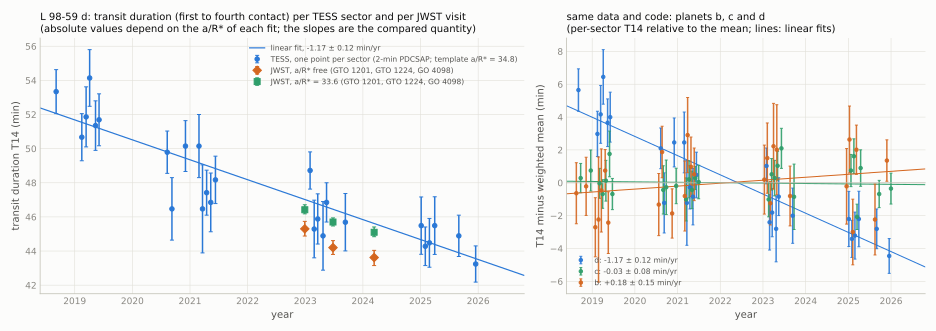
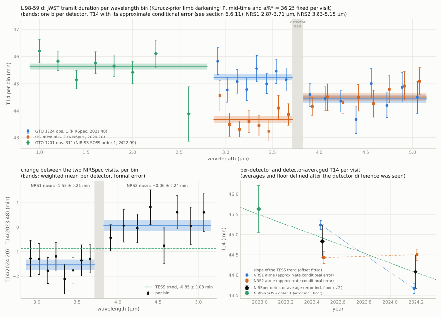

[README](../README.md) / [6. Other TESS results](6_other_results.md) / 6.6 L 98-59 d: decreasing transit duration, 2019-2025

### 6.6 L 98-59 d: decreasing transit duration, 2019-2025

L 98-59 d (Kostov et al. 2019) is a 1.6 $`R_\oplus`$ planet on a 7.45-d orbit around an M3 dwarf at 10.6 pc, with a
high impact parameter ($`b \approx 0.92`$). In per-sector fits of the TESS 2-min light curves, its transit duration
decreases from about 52 min in 2018-2019 to about 44 min in 2025 ($`-1.17 \pm 0.12`$ min/yr), while the durations of
planets b and c, measured in the same data with the same code, are constant. In preliminary fits of the pipeline
white-light curves, three public JWST transits (2022.99-2024.20) gave durations that decrease at a rate consistent with
the TESS trend; the own extractions of sections [6.6.10](#6610-joint-analysis-2026-10-21) and [6.6.11](#6611-jwst-durations-per-detector-and-wavelength-2026-10-21) supersede that assessment: the two NIRSpec detectors
give durations that differ by about 0.8 min in each visit, with opposite signs. With the post-hoc detector averaging
and empirical systematic floor, the NIRSpec pair differs from no change by 1.3 $`\sigma`$. Adding NIRISS gives a slope
2.2 $`\sigma`$ from zero. Both are consistent with the TESS trend; JWST does not independently confirm it. This section
reports a candidate decrease of the transit duration that survived the checks listed below; a change of the orbit is not established. Bessho et al. (2025, arXiv:2512.08530) searched earlier for
transit-duration variations of this planet (section [6.6.6](#666-comparison-with-published-fits)). A joint inference over all TESS transits with
injection and look-elsewhere diagnostics of its significance, and own JWST extractions (section [6.6.10](#6610-joint-analysis-2026-10-21)), gives
evidence for a secular decrease of the transit duration, $`-1.185 \pm 0.112`$ min/yr (nominal local $`z`$ = 6.7-7.4; an
illustrative Gaussian trials adjustment gives $`z`$ = 5.4-6.4, subject to the assumptions in section 6.6.10); the
evidence rests on four TESS campaigns, and JWST does not independently confirm it.

The planet was selected in a search of 802 known TESS planets for changes of transit depth or duration between
epoch groups (2018-2026). Of 96 pipeline flags, six remained after artefact classification and a bootstrap over
transits: three published cases (TOI-1355 b, TOI-1518 b and TOI-216 b), the unexplained TOI-540 b sector-98
non-detection (section [6.2](6.2_TOI-540b.md)), and the duration-change candidates L 98-59 d and TOI-620 b (section [6.7](6.7_TOI-620b.md)). The significances of sections 6.6.4-6.6.5 are not
corrected for that search; section [6.6.10](#6610-joint-analysis-2026-10-21) gives an illustrative trials adjustment. The values of this section come from the scripts in [`scripts/transit_duration/`](../scripts/transit_duration/) (section
[6.6.3](#663-method)), not from the search pipeline.

#### 6.6.1 Target

| quantity | value | source |
|---|---|---|
| identifiers | L 98-59, TOI-175, TIC 307210830, Gaia DR3 5271055243163629056, 2MASS J08180763-6818468, TYC 9193-2365-1, UCAC4 109-016513 | ExoFOP, TIC v8.2 |
| position (ICRS, epoch 2016.0) | RA 124.5328961, Dec $`-`$68.3145130 | Gaia DR3 |
| proper motion (mas/yr); parallax (mas) | 94.794, $`-340.084`$; $`94.266 \pm 0.016`$ (10.61 pc) | Gaia DR3 |
| $`G`$, $`BP-RP`$, $`T`$; RUWE | 10.606, 2.504, 9.412; 1.272 | Gaia DR3; TIC v8.2 |
| star | M3 dwarf; $`M_\star = 0.2923 \pm 0.0067\,M_\odot`$, $`R_\star = 0.3155 \pm 0.0062\,R_\odot`$ | Kostov et al. (2019); Cadieux et al. (2025) |
| TIC contamination ratio | 0.003 | TIC v8.2 |
| planets | b, c, d transiting ($`P`$ = 2.2531140, 3.6906764, 7.450729 d); e and f non-transiting (12.83 and 23.06 d) | Cadieux et al. (2025) |
| planet d (one geometry for TESS sectors 2-90) | $`R_\mathrm{p} = 1.627 \pm 0.041\,R_\oplus`$, $`b = 0.921 \pm 0.007`$, $`i = 88.44 \pm 0.05`$ deg, $`t_{14} = 0.84 \pm 0.04`$ h, transit-timing variations $`< 3`$ min with $`P_\mathrm{TTV} = 396`$ d | Cadieux et al. (2025) |
| nearby eclipsing binaries | TIC 307210817 (80", $`\Delta T = 4.2`$, 10.43 d; Kostov et al. 2019); TIC 307210845 (54", $`\Delta T = 6.6`$, 1.0492 d; about 200 ppm eclipses in the SPOC light curves of L 98-59, removed by Cadieux et al. 2025) | Kostov et al. (2019); Cadieux et al. (2025) |

#### 6.6.2 Data

TESS: SPOC 2-min light curves of 27 sectors (sectors 2-98; MAST) and SPOC 20-s light curves of 20 sectors (28-98),
quality flag 0, PDCSAP and SAP fluxes. Sector 5 contains no transit of d with the coverage required below. tess-point
0.9.5.post1 places the star on silicon in these 27 sectors only, up to sector 134 (2028-08-30).

| epoch group | sectors (camera/CCD) | SPOC versions | transits of d used, 2 min | 20 s |
|---|---|---|---|---|
| 2018.7-2019.4 | 2 (4/3), 5 (4/4), 8 (4/1), 9 (4/1), 10 (3/4), 11 (3/3), 12 (4/2) | spoc-5.0.11 to 5.0.23 | 18 | - |
| 2020.6-2021.4 | 28, 29 (4/3), 32 (4/4), 35 (4/1), 36 (3/4), 37 (3/3), 38, 39 (4/2) | spoc-5.0.9 to 5.0.35 | 22 | 23 |
| 2023.1-2023.7 | 61, 62 (4/1), 63 (3/4), 64, 65 (3/3), 69 (4/3) | spoc-5.0.86 to 5.0.100 | 17 | 16 |
| 2025.0-2025.96 | 87 (4/4), 88, 89 (4/1), 90 (3/4), 96 (4/3), 98 (4/4) | spoc-5.0.115 to 5.0.126 | 20 | 23 |

JWST: the MAST stage-3 white-light products (`*_whtlt.ecsv`, public) of three of the four public visits that cover a transit of d (the fourth, GO 4098 observation 1, is listed below and not used), refitted here; and, as controls, those of six visits of b and c.

| planet | programme (PI as in MAST) | observation, date (UTC) | instrument | product column used |
|---|---|---|---|---|
| d | GTO 1201 (D. Lafreniere) | 311, 2022-12-28 | NIRISS SOSS | `whitelight_flux_order_1` |
| d | GTO 1224 (S. Birkmann) | 1, 2023-06-25 | NIRSpec G395H | `whitelight_flux_NRS2` |
| d | GO 4098 (B. Benneke) | 2, 2024-03-12 | NIRSpec G395H | `whitelight_flux_NRS2` |
| d | GO 4098 (B. Benneke) | 1, 2023-12-28 | NIRISS SOSS | not used (point-to-point scatter of the white light about 8500 ppm) |
| d | GO 10498 (M. M. Murphy) | 4, 2026-08-01 | NIRSpec G395H | exclusive access (MAST release date 2027-08-01) |
| c | GTO 1201 (D. Lafreniere) | 302, 2025-03-02 | NIRISS SOSS | `whitelight_flux_order_1` |
| c | GO 2512 (N. Batalha) | 16, 2023-07-09; 15, 2023-07-13 | NIRSpec G395H | `whitelight_flux_NRS2` |
| b | GO 3942 (M. Damiano) | 1, 2, 3; 2024-01-30 to 2024-02-06 | NIRSpec G395H | `whitelight_flux_NRS2` |

The `whitelight_flux_NRS1` columns of the NIRSpec products used are about half negative and were not used; the
published analyses of these visits (Gressier et al. 2024; Banerjee et al. 2024; Bessho et al. 2025) used their own reductions, including
NRS1.

#### 6.6.3 Method

[`scripts/transit_duration/`](../scripts/transit_duration/) (usage in `run_l9859.sh`).

- Windows: $`\pm 0.16`$ d around each predicted transit (ephemerides of Cadieux et al. 2025); points within
  $`\pm(T_{14}/2 + 36\ \mathrm{min})`$ of transits of the other two planets are removed; a transit is used if at least 80 % of
  its predicted in-transit cadences remain and at least 0.04 d (58 min) of data remain on each side.
- Model: batman, circular orbit, quadratic limb darkening, 2-min exposure integration; a quadratic polynomial in time
  per transit is profiled analytically; points more than 4 $`\sigma`$ above (flares) or 6 $`\sigma`$ below the model are
  removed with one cadence on each side; per-transit errors from the residual scatter.
- Timing: mid-time of each transit from a $`\chi^2`$ scan of the template over $`\pm 20`$ min
  ([`data/transit_times_307210830.csv`](../data/transit_times_307210830.csv)); O $`-`$ C rms 2.5 min. A sinusoid of period 404 d and semi-amplitude
  1.7 min (Cadieux et al. 2025: 396 d) lowers $`\chi^2`$ from 150 to 108 for 77 transits; transits are stacked on this
  model unless stated.
- Common shape (template): one fit of $`k`$, $`a/R_\star`$, $`b`$ and the limb darkening (Gaussian prior
  $`(0.17, 0.44) \pm 0.1`$, Claret 2017, TESS band, 3500 K, $`\log g = 5`$) to all 77 transits: $`k = 0.0453`$,
  $`a/R_\star = 34.80`$, $`b = 0.9257`$, $`u = (0.190, 0.460)`$.
- Per sector: (i) $`b`$ alone fitted with $`k`$, $`a/R_\star`$ and the limb darkening fixed at the template, giving
  $`T_{14}`$ (first to fourth contact); error interval where $`\chi^2 - \chi^2_\mathrm{min} \le s^2`$,
  $`s^2 = \max(1, \chi^2_\mathrm{min}/\mathrm{dof})`$. (ii) A time-stretch factor $`w`$ of the template with free amplitude
  (a width measure that does not use the $`b`$-$`T_{14}`$ relation, but uses the template shape).
- Slopes: weighted linear fits of the per-sector values against time, errors scaled by $`\sqrt{\chi^2/\mathrm{dof}}`$
  when that exceeds 1, and an unweighted fit with a bootstrap over sectors ([`data/duration_slopes_307210830.csv`](../data/duration_slopes_307210830.csv)).
- Group fits: the transits of the four epoch groups fitted jointly with common $`k`$, $`a/R_\star`$ and limb darkening and
  one $`b`$ per group, with $`a/R_\star`$ free or fixed at 33.6 (the value implied by the stellar density of Cadieux et al.
  2025), and with $`k`$ and $`b`$ free per group ([`data/groupfit_307210830.csv`](../data/groupfit_307210830.csv)).
- JWST: the white-light curve normalised, the first 3 min removed, 5 $`\sigma`$ outliers about a 31-point running
  median removed; model batman times a quadratic polynomial in time and an exponential ramp, limb darkening free;
  errors = residual scatter times the red-noise factor $`\beta`$ (1.4-1.65 for the d visits); emcee, 40 walkers, 3000
  steps. Single-visit fits with $`a/R_\star`$ free or fixed at 33.6, and a joint fit of the two NIRSpec visits with
  common $`k`$, $`a/R_\star`$ and limb darkening.

#### 6.6.4 Results

TESS, per epoch group ([`data/durations_307210830.csv`](../data/durations_307210830.csv), [`data/groupfit_307210830.csv`](../data/groupfit_307210830.csv); the per-sector values are in the
figure):

| epoch group | sectors | transits | $`T_{14}`$, per-sector mean (min) | $`w`$, per-sector mean | group fit, common $`a/R_\star = 38.9`$: $`b`$; $`T_{14}`$ (min) | group fit, $`a/R_\star = 33.6`$: $`b`$; $`k`$; $`T_{14}`$ (min) |
|---|---|---|---|---|---|---|
| 2019.14 | 2, 8-12 | 18 | $`52.2 \pm 0.6`$ | $`1.139 \pm 0.022`$ | 0.872; 50.5 | 0.908; 0.0439; 52.4 |
| 2021.08 | 28-39 | 22 | $`48.4 \pm 0.6`$ | $`1.021 \pm 0.021`$ | 0.900; 46.5 | 0.931; 0.0446; 48.3 |
| 2023.28 | 61-69 | 17 | $`46.7 \pm 0.6`$ | $`0.951 \pm 0.022`$ | 0.910; 45.0 | 0.940; 0.0455; 46.5 |
| 2025.45 | 87-98 | 20 | $`44.4 \pm 0.5`$ | $`0.881 \pm 0.020`$ | 0.925; 42.5 | 0.949; 0.0445; 44.4 |

Per-sector mean: weighted mean of the per-sector fits with the template ($`a/R_\star = 34.8`$). Absolute $`T_{14}`$
values depend on the adopted $`a/R_\star`$ by 1-2 min; the changes do not. In the group fits a $`b`$ per group improves
$`\chi^2`$ by 87 (3 parameters) over one geometry, and $`b`$ linear in time by 82 (1 parameter); with $`a/R_\star = 33.6`$,
82 and 77. With $`k`$ also free per group, $`k`$ = 0.0439-0.0455 shows no trend while $`b`$ increases.

Trend of the 26 per-sector values (2-min PDCSAP, baseline):

$$\mathrm{d}T_{14}/\mathrm{d}t = -1.17 \pm 0.12\ \mathrm{min\,yr^{-1}},\quad \mathrm{d}b/\mathrm{d}t = +0.0061 \pm 0.0006\ \mathrm{yr^{-1}},\quad \mathrm{d}w/\mathrm{d}t = -0.038 \pm 0.004\ \mathrm{yr^{-1}},$$

with $`\chi^2 = 18.4`$ for 24 degrees of freedom about the line and 115 about a constant; the unweighted fit with a
bootstrap over sectors gives $`-1.17 \pm 0.11`$ min/yr. These errors are conditional on the fixed $`k`$, $`a/R_\star`$ and
limb darkening of the template; propagating the uncertainty of the common geometry gives about 0.13 min/yr (independent
check of the fit outputs, no script in this repository). The quotient of slope and error is not a false-alarm
significance: most of the leverage comes from the four observing campaigns, and with a free offset per campaign the
variation within campaigns alone gives about 2 $`\sigma`$ (same check).

JWST, per visit ([`data/jwst_fits_307210830.csv`](../data/jwst_fits_307210830.csv), [`data/jwst_differences_307210830.csv`](../data/jwst_differences_307210830.csv)):

| visit | year | $`T_{14}`$, $`a/R_\star`$ free (min) | $`b`$, $`a/R_\star`$ free | $`a/R_\star`$ | $`T_{14}`$, $`a/R_\star = 33.6`$ (min) | $`b`$, $`a/R_\star = 33.6`$ | $`k`$, $`a/R_\star = 33.6`$ |
|---|---|---|---|---|---|---|---|
| GTO 1201 obs. 311, NIRISS SOSS | 2022.992 | $`45.30^{+0.44}_{-0.42}`$ | $`0.925^{+0.005}_{-0.008}`$ | $`36.6^{+1.5}_{-1.0}`$ | $`46.42^{+0.29}_{-0.24}`$ | $`0.9379 \pm 0.0010`$ | 0.0431 |
| GTO 1224 obs. 1, NIRSpec G395H | 2023.481 | $`44.20^{+0.41}_{-0.40}`$ | $`0.920^{+0.007}_{-0.009}`$ | $`38.7^{+1.5}_{-1.3}`$ | $`45.70^{+0.24}_{-0.23}`$ | $`0.9427 \pm 0.0009`$ | 0.0443 |
| GO 4098 obs. 2, NIRSpec G395H | 2024.195 | $`43.62^{+0.42}_{-0.47}`$ | $`0.925^{+0.008}_{-0.011}`$ | $`38.5^{+1.9}_{-1.5}`$ | $`45.10^{+0.31}_{-0.26}`$ | $`0.9455 \pm 0.0011`$ | 0.0444 |

Linear fits across the three visits: $`T_{14}`$ $`-1.36 \pm 0.51`$ min/yr ($`a/R_\star`$ free; 2.6 $`\sigma`$) and
$`-1.08 \pm 0.32`$ min/yr ($`a/R_\star = 33.6`$); $`b`$ $`+0.0062 \pm 0.0012`$ yr$`^{-1}`$ ($`a/R_\star = 33.6`$). The TESS
values over the same years are $`-1.17`$ min/yr and $`+0.006`$ yr$`^{-1}`$, and the JWST $`b`$ at $`a/R_\star = 33.6`$
(0.938, 0.943, 0.946) lie on the TESS group values at the same $`a/R_\star`$ (0.940 in 2023.3, 0.949 in 2025.5). Joint fit
of the two NIRSpec visits (same instrument and band): $`\Delta T_{14}`$ (2024.20 minus 2023.48) $`= -0.69 \pm 0.24`$ min
(2.9 $`\sigma`$, before any uncertainty of the systematics model) and $`\Delta b = +0.0041 \pm 0.0015`$; TESS gives
$`-0.84`$ min for this interval. Removing the first 10 min of both visits gives $`-0.65 \pm 0.24`$ min; cutting the
GO 4098 visit to the 38.7 min of data before mid-transit of the GTO 1224 visit gives $`-0.84 \pm 0.26`$ min (the
GTO 1224 light curve starts about 17 min before ingress, the GO 4098 light curve about 107 min); $`a/R_\star = 33.6`$
gives $`-0.60 \pm 0.28`$ min. Fixing $`a/R_\star`$ at 33.6 instead of fitting it shifts the single-visit durations by
1.1-1.5 min, comparable to the whole decline across the three visits. These preliminary stage-3 white-light fits
suggested a decrease consistent with TESS. The extraction and detector comparisons in sections [6.6.10](#6610-joint-analysis-2026-10-21) and [6.6.11](#6611-jwst-durations-per-detector-and-wavelength-2026-10-21)
supersede that assessment: JWST does not independently confirm the TESS trend.

<picture><source srcset="../figures/tdv_307210830_dark.svg" media="(prefers-color-scheme: dark)"></picture>

#### 6.6.5 Checks

| check | result |
|---|---|
| time stacking ([`data/duration_slopes_307210830.csv`](../data/duration_slopes_307210830.csv)) | per-transit mid-times $`-1.13 \pm 0.12`$; linear ephemeris $`-1.14 \pm 0.12`$; linear ephemeris plus one offset per sector $`-1.15 \pm 0.11`$ min/yr; a 1.7-min timing variation cannot produce a 7-min change of $`T_{14}`$ |
| flux | SAP $`-1.22 \pm 0.12`$ min/yr |
| cadence | 20-s PDCSAP (20 sectors, 2020-2025; same photons as the 2-min data) $`-1.13 \pm 0.15`$ min/yr; $`w`$ $`-0.029 \pm 0.006`$ yr$`^{-1}`$ |
| overlapping transits | only the 58 transits without points of b or c in the window (25 sectors): $`-1.17 \pm 0.14`$ min/yr |
| control planets, same data and code | c: $`-0.03 \pm 0.08`$ min/yr (27 sectors, $`b`$ = 0.41 template); b: $`+0.18 \pm 0.15`$ min/yr (26 sectors; sector 35 at the grid edge left out) |
| constant-geometry injections | a copy of d with $`b = 0.915`$ injected into the PDCSAP flux at phases 0.30 and 0.62 of d, full chain re-run: $`-0.29 \pm 0.15`$ and $`+0.12 \pm 0.14`$ min/yr |
| radius ratio | group fits with $`k`$ free per group: 0.0439, 0.0446, 0.0455, 0.0445 ($`a/R_\star = 33.6`$), no trend |
| dilution | CROWDSAP 0.992-0.998 in all sectors; TIC contamination ratio 0.003; a constant extra flux in the aperture changes the depth, not the contact times |
| JWST controls, same code | c: two NIRSpec transits 3.7 d apart differ by $`+0.63^{+0.37}_{-0.35}`$ min; c in NIRISS (2025.17) 74.98 min against 73.9-74.6 min (NIRSpec, 2023.5) and 74-75 min (TESS); b: three NIRSpec transits within 7 d give 59.9, 58.3 and 59.4 min (errors 0.4-0.6 min). The b and c pairs suggest single-visit JWST errors 1.5-2 times larger than quoted |
| independent check of the fit outputs (no script in this repository) | camera/CCD offsets added: $`-1.22 \pm 0.13`$ min/yr; CROWDSAP and FLFRCSAP as covariates: $`-1.23 \pm 0.14`$; each epoch group left out in turn: $`-0.95`$ to $`-1.31`$; other baseline orders, shorter windows, no flare clipping, free common limb darkening: $`-1.08`$ to $`-1.19`$; eclipses of the 1.0492-d binary (recovered at $`P = 1.049183`$ d, about 195 ppm) masked: $`-1.17`$ to $`-1.19`$ min/yr, and $`\Delta\chi^2 \approx 75`$ for a changing $`b`$; $`k`$ and limb darkening free per group: $`\Delta\chi^2`$ for a changing $`b`$ reduced from 82 to about 44; NIRSpec pair with other polynomial orders and with or without the ramp: $`-0.70`$ to $`-0.81`$ min |

Limits of these checks: SAP and PDCSAP, and the 2-min and 20-s data, share photons and upstream processing; the
injections enter the extracted light curves and do not test the extraction or the PDC correction; two injection phases
do not calibrate a false-alarm rate; changing surface brightness along the chord of d near the stellar limb (spots,
faculae) is not modelled, and the stability of b and c, which cross other chords, does not exclude it.

#### 6.6.6 Comparison with published fits

| publication | data (epoch) | $`b`$ | $`a/R_\star`$ | $`T_{14}`$ |
|---|---|---|---|---|
| Kostov et al. (2019) | TESS sectors 2, 5, 8 (2018.6-2019.1) | 0.89 (0.75-0.93) | 37.4 (36.2-38.5) | 0.91 (0.74-1.68) h = 55 min, eccentricity free; 50.3 min for the median $`b`$, $`a/R_\star`$, $`k`$ and a circular orbit |
| Demangeon et al. (2021) | TESS sectors 2, 5, 8-12, 28, 29 (2018.6-2020.7), with ESPRESSO and HARPS | $`0.922 \pm 0.059`$ | $`33.7^{+1.9}_{-1.7}`$ | $`0.84^{+0.15}_{-0.20}`$ h = 50.4 min |
| Gressier et al. (2024) | JWST GTO 1224, NIRSpec NRS1 (2023.48) | $`0.9230^{+0.0032}_{-0.0034}`$ | $`37.10 \pm 0.45`$ (prior $`37.1 \pm 0.5`$) | not given; 45.5 min for their $`b`$, $`a/R_\star`$, $`k`$ |
| Cadieux et al. (2025) | TESS sectors 2-90, 25 sectors (2018.6-2025.3), one geometry for all | $`0.921 \pm 0.007`$ | 33.8 (from $`i = 88.44`$ deg) | $`0.84 \pm 0.04`$ h = 50.4 min |
| Bessho et al. (2025) | JWST GO 4098 obs. 2, NIRSpec NRS1 (2024.20) | free (not tabulated) | free | $`0.7225 \pm 0.0077`$ h = $`43.35 \pm 0.46`$ min |
| this section | TESS per sector, 2018.7-2025.96 | 0.893 (2018.7) to 0.948 (2025.96) | 34.8 (template) | 53.3 (2018.7) to 43.2 min (2025.96); group means 52.2, 48.4, 46.7, 44.4 min |
| this section, preliminary pipeline white-light fits (section 6.6.4, superseded) | JWST, three visits (2022.99-2024.20) | 0.920-0.925 (free) | 36.6-38.7 | 45.30, 44.20, 43.62 min ($`a/R_\star`$ free) |
| this section, own extractions (sections 6.6.10-6.6.11) | JWST, three visits (2022.99-2024.20) | 0.925-0.933 (shared $`a/R_\star`$) | $`36.5 \pm 0.5`$ (density prior) | 45.52, 44.83, 44.15 min (joint fit); detector averages with the systematic floor $`44.84 \pm 0.41`$ (2023.48) and $`44.09 \pm 0.41`$ min (2024.20) |

Zhou et al. (2023) fitted HST WFC3 transits of d with the inclination and $`a/R_\star`$ fixed at the values of Demangeon et
al. (2021). Cadieux et al. (2025) fitted one geometry to all sectors; this is not a test of a change. Bessho et al. (2025) compared their 2024 JWST duration with published TESS durations from Kostov et al. (2019;
three sectors) and Demangeon et al. (2021; nine sectors through 2020-09), finding $`\Delta\tau = -0.14 \pm 0.18`$ h
($`0.77\,\sigma`$), consistent with no change. Their uncertainty reflects the published earlier-duration constraints.
The per-sector analysis here uses additional epochs and different geometry constraints, giving $`-6.1 \pm 0.6`$ min
from 2019.0 to 2024.2 conditional on the template; the significance measures are not directly comparable. Their JWST transit is the GO 4098 visit fitted here (an independent reduction of the
same transit, not another epoch); their $`43.35 \pm 0.46`$ min (NRS1) agrees with $`43.62^{+0.42}_{-0.47}`$ min (NRS2,
$`a/R_\star`$ free) here. The mid-times fitted here agree with the JWST mid-times listed by Cadieux et al. (2025) to 1.4 s
(GO 4098, d) and 1.6 s (GTO 1201 obs. 302, c); for GTO 1201 obs. 311 (d) the listed BJD 2459941.79320 differs from
the fit here (BJD 2459942.29308) by 0.4999 d, i.e. the fitted time is later by half a day minus about 10 s.

#### 6.6.7 Catalogue and literature checks

| date (UTC) | source | result |
|---|---|---|
| 2026-10-20 to 21 | ADS: 56 records with L 98-59 in the abstract; full text with "transit duration variation", TDV, "nodal precession", "impact parameter variation", CHEOPS (all aliases) | Bessho et al. (2025) is the only publication that tests the duration of d for a change; Cadieux et al. (2025) state that the JWST transits of GTO 1201 and GO 4098 will be presented by Benneke et al. (in preparation), not found on 2026-10-21 |
| 2026-10-20 | arXiv API (all aliases) | 28 records returned; the original negative conclusion is superseded by the earlier TDV search of Bessho et al. (2025, arXiv:2512.08530), discussed in section [6.6.6](#666-comparison-with-published-fits) |
| 2026-10-20 | Zenodo; GitHub code search | 17 Zenodo records (atmospheres, tidal heating, spectra); GitHub: catalogues and visualisations; no record of a duration change |
| 2026-10-20 | Planet Hunters TESS Talk; ExoFOP target page (240 files) | discovery-era tags and comments; latest TFOP time-series uploads of 2019; no note on a duration change |
| 2026-10-20 | general web search | nothing found |

#### 6.6.8 Interpretation

A narrowing transit with a nearly constant freely fitted radius ratio (group fits above) is what a slow change of the orbital inclination to the line of sight
would produce: at $`a/R_\star = 33.6`$ the measured $`\mathrm{d}b/\mathrm{d}t \approx +0.006`$ yr$`^{-1}`$ corresponds to
$`\mathrm{d}i/\mathrm{d}t \approx -0.010`$ deg/yr. Nodal precession of the orbit of d driven by the other planets of the
system (c, e and f lie within a factor of four in period) is one mechanism that could produce such a rate for a
mutual inclination of order 1 deg; this is an order-of-magnitude statement, not a model of the system. The data do not
establish a change of the orbit: the evidence rests on four observing campaigns of one instrument, without
independent confirmation from JWST (sections [6.6.10](#6610-joint-analysis-2026-10-21) and [6.6.11](#6611-jwst-durations-per-detector-and-wavelength-2026-10-21)), and the checks of section [6.6.5](#665-checks) leave campaign-dependent systematics and stellar
surface features along the chord as open alternatives. No interpretation is established. If a linear trend continued,
$`b`$ would reach $`1 + k`$ (no transit) after about 2040; this is an extrapolation, not a prediction.

#### 6.6.9 Predictions and decisive tests

- JWST GO 10498 (PI M. M. Murphy), NIRSpec G395H, observation 4 on 2026-08-01 (BTJD 4253.62 predicted mid-transit),
  exclusive access until 2027-08-01. If the TESS trend continued linearly, its $`T_{14}`$ is $`2.8 \pm 0.3`$ min shorter
  than that of the GO 4098 transit of 2024-03-12 in the same kind of fit: about 40.8 min with $`a/R_\star`$ free
  (43.6 min in 2024.20) and about 42.3 min with $`a/R_\star = 33.6`$ (45.1 min in 2024.20), on this preliminary
  pipeline-fit scale, with
  $`b \approx 0.960 \pm 0.004`$ at $`a/R_\star = 33.6`$; an unchanged duration would give values near those of 2024.20.
  A joint fit of the 2023, 2024 and 2026 NIRSpec transits with one reduction is the most direct test.
  These values depend on the reduction and fit; the prediction on the scale of the joint NIRSpec reduction of
  section 6.6.10 is $`41.5 \pm 0.3`$ min (44.3 min for no change).
- TESS: no additional sector after sector 98 through sector 134 (midpoint 2028-08-30, scheduled end 2028-09-13) covers the star according to
  tess-point 0.9.5.post1; sectors beyond 134 were not checked.

The following work list records the preliminary analysis stage. Section [6.6.10](#6610-joint-analysis-2026-10-21) subsequently performed the NRS1
and NIRISS re-extractions, joint TESS inference, eclipse masking/modelling, additional injections and nominal trials
adjustments. A single inference combining TESS and JWST remains undone.

- Archival data that would add epochs: an own extraction of the NIRISS GO 4098 observation 1 (2023-12-28) from the
  rate files; NRS1 white light of the GTO 1224 and GO 4098 visits; the HST WFC3 transits of d (programme 15856 visit 7,
  2021-01-19/20; programme 16448 visit 1, 2023-03-28; partial orbital coverage); CHEOPS visits, if any; ground-based light curves
  (ExoFOP, 2019).
- Analysis: one joint inference over TESS and JWST with the stellar density, band-dependent limb darkening, depth and
  dilution free, the 1.0492-d binary modelled, and constant against changing geometry compared; injections before
  extraction and over many phases to calibrate a false-alarm rate; a significance corrected for the 802-planet
  search.

Not checked in the preliminary analysis; the current outstanding items are listed at the end of section [6.6.10](#6610-joint-analysis-2026-10-21):
HST WFC3 transits of d (not refitted); CHEOPS (the archive at `cheops.esac.esa.int` did not resolve and the
Geneva archive timed out on 2026-10-21, so whether CHEOPS observed d is not known); ground-based light curves on
ExoFOP and of ExTrA; the NIRISS GO 4098 observation 1 (2023-12-28; the pipeline white light has a point-to-point scatter
of about 8500 ppm, and a robust rebuild from the `x1dints` file about 2000 ppm, too noisy to use); NIRSpec NRS1; the
eclipses of the 1.0492-d binary in the fits of the scripts here (they enter only the independent check above); spot
crossings; the Reddit and non-English web.

Reproduction: `sh scripts/transit_duration/run_l9859.sh` and `sh scripts/transit_duration/run_toi620.sh` (the table script needs the outputs of both), then `python scripts/transit_duration/make_tables_td.py`, from
the repository root, in an environment with numpy, scipy, astropy, astroquery, batman-package and emcee (the values here
were computed with Python 3.11.15, numpy 1.26.4, scipy 1.13.1, astropy 7.2.3, astroquery 0.4.11, batman-package 2.5.3,
emcee 3.1.6); `python3 figures/make_figures.py tdv` for the figures. The SPOC light curves were retrieved on 2026-10-21,
the JWST products on 2026-10-21. A complete re-run of the scripts reproduces the slopes of all TESS variants to within
0.02 min/yr (SAP, 20 s, b and c identically), the group fits to 0.1 min in $`T_{14}`$ and the JWST durations and their
differences to 0.1 min (the emcee chains are not seeded); the per-transit mid-times depend slightly on the starting
values of the common-shape fit (rms 0.3 min). The JWST light curves were refitted here from the public MAST products; they
are not the reductions of the programme teams.

#### 6.6.10 Joint analysis (2026-10-21)

This subsection reports a joint inference over all usable TESS transits of d, injection and trials diagnostics of its significance, and
own extractions of the JWST NIRSpec and NIRISS data. The code is separate from that of sections 6.6.3-6.6.5 and from
the search pipeline: [`scripts/transit_duration/joint/`](../scripts/transit_duration/joint/) (usage in `run_joint.sh`). Tables:
[`data/jointfit_307210830.csv`](../data/jointfit_307210830.csv) (posteriors), [`data/significance_307210830.csv`](../data/significance_307210830.csv) (model comparison, bootstraps, injections,
look-elsewhere factors, audits) and [`data/jwst_joint_307210830.csv`](../data/jwst_joint_307210830.csv) (JWST). The result is evidence for a secular decrease of
the TESS transit duration of d. JWST does not confirm it at present, because its two NIRSpec detectors disagree
(section [6.6.11](#6611-jwst-durations-per-detector-and-wavelength-2026-10-21) examines the disagreement).

##### Data and model

- Data: SPOC 2-min PDCSAP, quality flag 0, sectors 2-98. A transit is used if at least 80 % of its in-transit cadences
  and at least 58 min of data on each side remain after masking. 77 transits pass; 5 of them overlap the masked
  eclipses below, leaving 72 transits in 26 sectors (2018.65-2026.01; campaign mean epochs 2019.13, 2021.09, 2023.28,
  2025.44).
- Masks: transits of b and c within $`\pm(T_{14}/2 + 36\ \mathrm{min})`$ (ephemerides of Cadieux et al. 2025). The
  eclipses of the 1.0492-d binary, recovered with a box search in the same light curves ($`P = 1.049183`$ d, depth 200 ppm,
  box duration 1.18 h, S/N 35; per-sector depth 64-382 ppm), within $`\pm 0.95`$ h of each eclipse. Flares, detected on
  the whole sector against a 2-h running median (two consecutive points above 3 $`\sigma`$ or one above 5 $`\sigma`$), from
  two cadences before to 20 min after each detection (42 flare groups).
- Model: batman's quadratic limb-darkening routine evaluated on the sky separation of a circular orbit (eccentric
  variant: local approximation near conjunction), 5-fold supersampling of the 2-min exposures; a quadratic polynomial
  in time per transit, profiled analytically. After a first fit, points more than 4 $`\sigma`$ above or 6 $`\sigma`$ below
  the model are removed with one cadence on each side (15 points). Noise: per-transit white scatter of the residuals times a per-sector red-noise factor $`\beta`$ from
  10-30 min bins; $`\beta`$ = 1.00-1.05 in all sectors.
- Mid-times: linear ephemeris plus a sinusoid at the 396.32-d c-d super-period (Cadieux et al. 2025), fitted jointly.

| parameter | prior | source |
|---|---|---|
| $`k = R_\mathrm{p}/R_\star`$ | uniform (0.01, 0.1), common; variant: one $`k`$ per campaign | |
| stellar density | $`\ln \rho_\star\,[\mathrm{kg\,m^{-3}}] \sim N(9.50, 0.09)`$, i.e. $`a/R_\star = 34.0 \pm 1.0`$; variant: uniform prior on $`\ln \rho_\star`$: U(8, 11) | Cadieux et al. (2025), from the mass and radius relations of Mann et al. (2015, 2019) |
| limb darkening | Kipping (2013) $`q_1, q_2`$ uniform (0, 1) with Gaussian priors $`u_1 = 0.162 \pm 0.1`$, $`u_2 = 0.441 \pm 0.1`$; variant: no Gaussian prior | Claret (2017), TESS band, quadratic law, 3415 K, $`\log g = 4.91`$ |
| geometry | constant $`b`$; $`b`$ linear in time (reference epoch 2022.0, $`\mathrm{d}b/\mathrm{d}t`$ uniform within $`\pm 0.05`$ yr$`^{-1}`$); $`i`$ linear in time; one $`b`$ per campaign; one $`b`$ per campaign plus a common slope within campaigns | |
| eccentricity | $`e = 0`$; variant: $`\sqrt{e}\cos\omega \sim N(0.05, 0.04)`$, $`\sqrt{e}\sin\omega \sim N(-0.03, 0.055)`$ | Cadieux et al. (2025) |
| timing | ephemeris offsets and the two sinusoid amplitudes uniform; variant: per-transit mid-times fitted first and held fixed | |

Sampler: emcee (Foreman-Mackey et al. 2013) with differential-evolution and snooker moves. The main pair (constant $`b`$
and $`b`$ linear in time) ran as 4 independent ensembles of 32 walkers and 2500 steps, the first third discarded:
autocorrelation time at most 32 steps (at least 51.8 autocorrelation times per ensemble), rank-normalised split
$`\hat{R} \le 1.003`$ across the ensembles (Vehtari et al. 2021). Variants: 2 ensembles of 24-28 walkers and 1200 steps,
19-38 autocorrelation times, $`\hat{R} \le 1.024`$. Evidence by importance sampling from a multivariate-$`t`$ fit to the
posterior (effective sample size 600-4000), within 2.3 of a Laplace approximation in $`\ln Z`$. Importance sampling
integrates the profiled likelihood times the implemented prior weights. Baseline coefficients are not marginalised, and
differing prior normalisations are not completely accounted for (the width of the uniform prior of
$`\mathrm{d}b/\mathrm{d}t`$ is included), including the inclination-intercept prior in the linear-inclination comparison.
The reported contrasts are therefore profile-evidence diagnostics, not fully normalised Bayes factors, and are listed
as "profile-evidence log contrast". The `fit:lnZ` rows of `data/jointfit_307210830.csv` are the raw importance-sampling values; the contrasts add $`\ln 10 = 2.30`$ for the width of the uniform prior of $`\mathrm{d}b/\mathrm{d}t`$ (not for $`\mathrm{d}i/\mathrm{d}t`$). $`\Delta\chi^2`$ and $`\Delta\mathrm{BIC}`$ use separate
maximum-a-posteriori fits. Their likelihood-ratio interpretations are nominal approximations, not calibrated
frequentist tests.

##### Results

Main model (common $`k`$, density and limb-darkening priors, TTV sinusoid, $`e = 0`$, $`b`$ linear in time); medians and
16th-84th percentile half-widths:

| parameter | posterior |
|---|---|
| $`k`$ | $`0.0442 \pm 0.0009`$ |
| $`a/R_\star`$ ($`\ln \rho_\star`$) | $`34.7 \pm 0.8`$ ($`9.567 \pm 0.069`$) |
| $`q_1`$, $`q_2`$ | $`0.31 \pm 0.10`$, $`0.13 \pm 0.05`$ |
| $`b`$ at 2022.0 | $`0.9233 \pm 0.0050`$ |
| TTV sinusoid | offset $`-0.40 \pm 0.31`$ min; amplitudes $`-0.82 \pm 0.26`$ and $`+1.52 \pm 0.24`$ min (semi-amplitude 1.7 min) |
| $`T_{14}`$ at 2019.13, 2021.09, 2023.28, 2025.44 | 51.2, 49.0, 46.4, 43.6 min ($`\pm 0.6`$-0.8) |

$$\mathrm{d}T_{14}/\mathrm{d}t = -1.185 \pm 0.112\ \mathrm{min\,yr^{-1}},\quad \mathrm{d}b/\mathrm{d}t = +0.0064 \pm 0.0007\ \mathrm{yr^{-1}},\quad \mathrm{d}i/\mathrm{d}t = -0.0105 \pm 0.0010\ \mathrm{deg\,yr^{-1}}$$

($`\mathrm{d}i/\mathrm{d}t`$ from the model with $`i`$ linear in time). None of the 21338 posterior samples has
$`\mathrm{d}T_{14}/\mathrm{d}t \ge 0`$. Against constant geometry with the same data and noise model:
$`\Delta\chi^2 = 77.6`$ for one parameter, $`\Delta\mathrm{BIC} = 68.0`$, profile-evidence log contrast 33.9. The campaign fits are consistent with a constant radius ratio: with one
$`k`$ per campaign and $`b`$ linear in time, $`k`$ = 0.0443, 0.0442, 0.0452, 0.0460 ($`\pm 0.0009`$ to $`\pm 0.0019`$), and the
three extra parameters lower $`\chi^2`$ by 0.95. The best constant-geometry model with one $`k`$ per campaign needs $`k`$ to fall
from 0.0471 to 0.0422 and remains worse than changing geometry by $`\Delta\chi^2 = 58.2`$. Per-transit fits of $`b`$ and the
mid-time with the shape held at the posterior median give $`-1.34 \pm 0.15`$ min/yr with $`\chi^2 = 80.6`$ for 70 degrees of
freedom; weighted campaign means 52.1, 48.2, 46.0, 43.6 min ($`\pm 0.6`$-0.7).

Variants (emcee; each with its constant-geometry partner):

| variant | parameters | $`\mathrm{d}T_{14}/\mathrm{d}t`$ (min/yr) | $`\mathrm{d}b/\mathrm{d}t`$ (yr$`^{-1}`$) | $`\Delta\chi^2`$ | profile-evidence log contrast |
|---|---|---|---|---|---|
| main ($`b`$ linear) | 10 | $`-1.185 \pm 0.112`$ | $`+0.0064 \pm 0.0007`$ | 77.6 | 33.9 |
| $`i`$ linear in time | 10 | $`-1.19 \pm 0.11`$ | $`\mathrm{d}i/\mathrm{d}t = -0.0105 \pm 0.0010`$ deg/yr | 77.6 | 32.7 |
| one $`k`$ per campaign | 13 | $`-1.32 \pm 0.15`$ | $`+0.0070 \pm 0.0008`$ | 58.2 | 24.8 |
| limb darkening without Gaussian prior | 10 | $`-1.19 \pm 0.11`$ | $`+0.0063 \pm 0.0007`$ | 77.5 | 33.7 |
| $`e`$, $`\omega`$ with priors | 12 | $`-1.20 \pm 0.11`$ | $`+0.0064 \pm 0.0007`$ | 77.6 | 33.9 |
| per-transit mid-times held fixed | 6 | $`-1.24 \pm 0.11`$ | $`+0.0067 \pm 0.0007`$ | 91.7 | 40.9 |
| uniform prior on $`\ln \rho_\star`$: U(8, 11) | 10 | $`-1.18 \pm 0.11`$ | $`+0.0077 \pm 0.0011`$ | not run | |

With the uniform prior on $`\ln \rho_\star`$ the transits give $`a/R_\star = 38.2^{+2.3}_{-2.0}`$ ($`\ln\rho_\star = 9.86 \pm 0.17`$, 1.9 $`\sigma`$
from the prior); $`\mathrm{d}b/\mathrm{d}t`$ changes because $`b`$ and $`a/R_\star`$ are correlated, the duration slope does not.
The absolute $`T_{14}`$ depends on the density prior by about 1 min.

Other light curves (least squares, same chain):

| data | transits | $`\mathrm{d}T_{14}/\mathrm{d}t`$ (min/yr) | $`\Delta\chi^2`$ |
|---|---|---|---|
| PDCSAP 2 min (reference) | 72 | $`-1.19 \pm 0.13`$ | 77.6 |
| SAP 2 min | 72 | $`-1.25 \pm 0.14`$ | 75.4 |
| PDCSAP, eclipses modelled (trapezoid scaled to the per-sector depth) instead of masked | 77 | $`-1.17 \pm 0.13`$ | 84.3 |
| PDCSAP, pointing and background regressors in the baseline | 72 | $`-1.11 \pm 0.13`$ | 78.0 |
| PDCSAP 20 s (sectors 28-98) | 56 | $`-1.07 \pm 0.16`$ | 39.5 |
| SAP 20 s (sectors 28-98) | 56 | $`-1.09 \pm 0.17`$ | 38.6 |
| own photometry of the target pixel files, SPOC aperture; with regressors | 72 | $`-1.26 \pm 0.16`$; $`-1.14 \pm 0.14`$ | 62.4; 72.3 |
| own photometry, circular aperture $`r = 1.5`$ px; with regressors | 72 | $`-1.15 \pm 0.18`$; $`-1.06 \pm 0.16`$ | 39.6; 41.6 |
| own photometry, $`r = 2.5`$ px; with regressors | 72 | $`-1.26 \pm 0.16`$; $`-1.17 \pm 0.13`$ | 61.2; 74.4 |

The own photometry uses its own background (faint background pixels) and no SPOC photometry. The 20-s data share
photons with the 2-min data and have no 2019 campaign.

##### Significance diagnostics

- Campaign structure. With one constant impact parameter per campaign, $`\chi^2`$ is 0.81 lower than for the global
  linear model, despite two additional parameters. These models are not nested: the campaign model removes
  within-campaign variation. This difference therefore has no $`\chi^2_2`$ likelihood-ratio calibration and does not
  establish that the campaign means lie on a line. A common slope of $`b`$ within the campaigns
  improves the campaign model by $`\Delta\chi^2 = 3.1`$, i.e. 1.8 $`\sigma`$, with $`\mathrm{d}b/\mathrm{d}t = +0.0108 \pm 0.0049`$ yr$`^{-1}`$
  (0.9 $`\sigma`$ from the global value). The significance therefore comes almost entirely from the comparison of four
  observing campaigns, and a bias of the measured duration that changes from campaign to campaign would not be seen
  within a campaign. This is the main structural weakness of the result. The tests below (injections, telemetry) address
  it only for causes that would also affect injected transits at other phases.
- Block bootstraps (least-squares refits, clipping and noise model held fixed): whole transits, 500 replicates:
  $`-1.205 \pm 0.107`$ min/yr; whole sectors, 300 replicates: $`-1.205 \pm 0.118`$ min/yr; no replicate has
  $`\mathrm{d}T_{14}/\mathrm{d}t \ge 0`$. Leaving out one campaign gives $`-0.97`$, $`-1.27`$, $`-1.18`$, $`-1.43`$ min/yr (2019,
  2021, 2023, 2025 left out); one sector, $`-1.14`$ to $`-1.26`$ min/yr.
- Null injections: a constant-geometry copy of d ($`b = 0.923`$; $`k`$, $`a/R_\star`$, limb darkening at the posterior
  median) inserted into quality-selected, normalised PDCSAP flux, or into calibrated pixels after the own background
  subtraction and before aperture summation, at a random phase drawn from U(0.08, 0.92), with the real transits of d
  masked; the subsequent transit-processing and fitting steps are rerun (windows, masks, flare and outlier clipping,
  noise model, constant and linear-$`b`$ fits). The pixel injection multiplies the entire background-subtracted image,
  including contaminating sources. It does not test upstream calibration, PDC, background estimation, or a target-only
  spatial injection.

| injection | n | mean $`\mathrm{d}T_{14}/\mathrm{d}t`$ (min/yr) | scatter (min/yr) | slope/error: mean, sd | largest $`\Delta\chi^2`$ | reaching the observed slope or $`\Delta\chi^2`$ |
|---|---|---|---|---|---|---|
| into the PDCSAP flux | 200 | $`-0.003 \pm 0.011`$ | 0.160 | $`-0.02`$, 1.08 | 10.8 | 0 |
| into the target pixels, own photometry | 40 | $`+0.002 \pm 0.028`$ | 0.177 | 0.00, 1.00 | 4.8 | 0 |

  The light-curve-level $`\Delta\chi^2`$ distribution differs from $`\chi^2_1`$ (Kolmogorov-Smirnov $`p = 0.0014`$). Two of 200
  injections (1 %) exceed 9. The KS rejection is not specifically a test of tail behaviour, and these injections do not
  calibrate the extreme tail.
  The pixel-level injections pass through the own extraction and not through the PDC correction.
- Local diagnostics: the observed slope, after subtracting the injection mean, is 7.39 and 6.71 injection standard
  deviations from zero for the light-curve and pixel injections, respectively. Interpreting these distances as Gaussian
  significances requires extrapolating untested tails from only 200 and 40 injections. Zero exceedances do not
  establish a 7 $`\sigma`$ false-alarm probability. Other ratios are larger: likelihood ratio 8.8 (nominal), posterior
  slope-to-width 10.6 (9.3-9.7 after scaling by the injection scatter of slope/error), bootstraps 10.0-11.1. The
  posterior and bootstrap slope-to-width ratios are precision diagnostics, not independently calibrated false-alarm
  significances.
- Look-elsewhere adjustment for the search that selected the planet (section [6.6](#66-l-98-59-d-decreasing-transit-duration-2019-2025)): 801 of the 802 planets had a screening
  statistic; L 98-59 d's (duration change, epoch group against the rest) was 5.06, reached or exceeded by 19 of the 801
  planets (mostly artefacts and published cases) and by 1 of 197 stable reference planets. For illustration, each
  diagnostic $`z`$ is converted to a two-sided Gaussian probability and $`p_\mathrm{global} = 1 - (1 - p_\mathrm{local})^N`$ is
  applied, assuming $`N`$ independent, correctly calibrated trials: $`N = 801`$ planets or 3204 planet-statistic
  combinations (the four statistics of the search). Independence and the effective trial count have not been
  established; the complete screening and follow-up procedure has not been calibrated under the null.

| local statistic | $`z_\mathrm{local}`$ | $`z_\mathrm{global}`$, $`N = 801`$ | $`z_\mathrm{global}`$, $`N = 3204`$ |
|---|---|---|---|
| likelihood ratio ($`\Delta\chi^2 = 77.6`$) | 8.8 | 8.0 | 7.9 |
| posterior, scaled by the injection scatter of slope/error | 9.3-9.7 | 8.5-9.0 | 8.4-8.9 |
| slope / injection scatter, light-curve level | 7.4 | 6.4 | 6.2 |
| slope / injection scatter, pixel level | 6.7 | 5.7 | 5.4 |

  Under these assumptions, the injection-scatter diagnostics give nominal global $`z`$ values of 5.4-6.4 (5.4-5.7 at the
  pixel level, 6.2-6.4 at the light-curve level). This range compares injection procedures and trial counts; it is not
  a confidence interval and does not propagate uncertainty in the estimated scatters. It also assumes that no
  systematic affects the real transits while sparing injected copies at other phases; none was found, but these tests
  cannot exclude one.

##### Telemetry and activity audits

Per-transit $`T_{14}`$ residuals about the linear trend (72 transits) against telemetry (Pearson correlation with duration residuals divided by their
individual uncertainties, 4000-permutation $`p`$):

| covariate | $`r`$ | $`p`$ |
|---|---|---|
| background level; in-transit minus out-of-transit background; background slope | $`-0.00`$; $`+0.05`$; $`+0.01`$ | 0.99; 0.68; 0.94 |
| POS_CORR rms; centroid rms; in-transit centroid shift | $`-0.06`$; $`-0.07`$; $`-0.09`$ | 0.63; 0.58; 0.45 |
| momentum dumps in the window; time to the nearest dump | $`-0.01`$; $`+0.04`$ | 0.90; 0.73 |
| time to the nearest scattered-light flag; to the nearest data gap | $`-0.15`$; $`+0.04`$ | 0.22; 0.72 |
| in-transit coverage; points of b or c in the window | $`-0.03`$; $`-0.03`$ | 0.80; 0.79 |
| CROWDSAP; FLFRCSAP; aperture size | $`+0.11`$; $`-0.15`$; $`-0.08`$ | 0.35; 0.22; 0.47 |
| point-to-point scatter; per-transit noise; mid-time offset | $`-0.08`$; $`-0.22`$; $`+0.12`$ | 0.51; 0.06; 0.35 |
| SPOC data release | $`+0.05`$ | 0.68 |

- Each of the six camera/CCD combinations with enough transits gives a negative slope ($`-1.24`$ to $`-1.95`$ min/yr); with
  camera/CCD offsets, $`-1.43 \pm 0.16`$ min/yr (per-transit scale). A regression on all covariates except the data
  release gives $`-1.30 \pm 0.26`$ min/yr. The data release rises with time ($`r = 0.97`$) and cannot be separated from a
  trend by regression (with it, $`-2.9 \pm 0.7`$ min/yr); within campaigns its coefficient is $`-0.28 \pm 0.35`$ min per
  standard deviation. The SAP flux and the own photometry (table above) give the same trend.
- Spot crossings: 1 of 72 transits (1.4 %) has an in-transit positive residual above 3 $`\sigma`$ in a 10-min box, against
  2.4 % of out-of-transit control stretches (Kolmogorov-Smirnov $`p = 0.63`$).
- Rotation (77.3 d, Cadieux et al. 2025): a sinusoid in the residuals has an amplitude of 1.3 min, $`\Delta\chi^2 = 8.5`$ for 2
  parameters ($`p = 0.014`$ as a single test; phase coherence over seven years is not assured); the slope with the sinusoid
  is $`-1.38 \pm 0.14`$ min/yr (per-transit scale). A 30-150 d periodogram of the residuals peaks at 33.0 d, permutation
  false-alarm probability 0.045.
- Activity per sector: flare rate against the mean residual $`r = -0.23`$ ($`p = 0.27`$); 6-h SAP variability against the
  mean residual $`r = -0.18`$ ($`p = 0.37`$).
- Changing surface brightness along the near-limb chord of d at the level of about 1 min in $`T_{14}`$ is not excluded by
  photometry.

##### JWST re-extraction

Own white-light curves from the public `calints` products (SCI, WAVELENGTH and INT_TIMES extensions, retrieved by HTTP
range requests): masking of static bad pixels and replacement of temporal outliers, per-column 1/f background from rows at least 5 px from
the trace, trace centre as a cubic polynomial, box aperture of $`\pm 3`$ px ($`\pm 5`$ px as a variant), and per-integration
regressors (trace $`y`$ shift, trace width, dispersion shift). The same wavelength bounds are applied independently to each visit; the selected detector columns
are not identical: NRS1 2.870-3.710
$`\mu`$m (1242 columns), NRS2 3.830-5.150 $`\mu`$m (1989-1990 columns); point-to-point scatter 124-145 ppm (NRS1) and
163-167 ppm (NRS2) per integration (6.3-s cadence). Coverage before ingress and after egress: 9 and 160 min (GTO 1224,
after removing the first 10 min), 100 and 69 min (GO 4098 obs. 2). Joint fit: $`a/R_\star`$ shared through the density
prior, $`k`$ and quadratic limb darkening free per detector and shared between visits, $`b`$ and mid-time per visit; a quadratic in time and the three
regressors, profiled; white noise times $`\beta`$, or a celerite Matern-3/2 Gaussian process; emcee, 15-66
autocorrelation times, $`\hat{R} \le 1.025`$. ExoTiC-LD was not available and offline stellar intensities end at 2.6
$`\mu`$m, so the limb darkening was treated empirically (free, fixed at the value of Gressier et al. 2024, square-root
and power-2 laws). $`\Delta\chi^2`$: increase when the two $`b`$ are tied (same noise model).

| fit | $`\Delta T_{14}`$, 2024.20 minus 2023.48 (min) | $`\Delta\chi^2`$ |
|---|---|---|
| NRS1 and NRS2 jointly | $`-0.61 \pm 0.15`$ | 13.8 |
| jointly, Gaussian-process noise | $`-0.62 \pm 0.16`$ | 10.9 |
| jointly, matched coverage (GO 4098 cut to 9 min before ingress, GTO 1224 to 69 min after egress) | $`-0.51 \pm 0.14`$ | 9.3 |
| jointly, other $`a/R_\star`$ priors, limb-darkening laws, polynomial orders, ramp, no regressors (10 variants) | $`-0.54`$ to $`-0.67`$ | 13.0-17.4 (8 variants) |
| NRS1 | $`-1.30 \pm 0.20`$ | 33.5 |
| NRS1, Gaussian process; $`\pm 5`$ px; matched coverage | $`-1.26 \pm 0.23`$; $`-1.37 \pm 0.28`$; $`-1.10 \pm 0.21`$ | 22.0; 21.7; 22.9 |
| NRS2 | $`-0.01 \pm 0.18`$ | 0.0 |
| NRS2, Gaussian process; $`\pm 5`$ px; matched coverage | $`-0.02 \pm 0.22`$; $`+0.14 \pm 0.21`$; $`+0.01 \pm 0.19`$ | 0.0; 0.1; 0.0 |
| NRS2, 3.83-4.45 $`\mu`$m; 4.45-5.15 $`\mu`$m | $`-0.15 \pm 0.23`$; $`+0.06 \pm 0.26`$ | 0.5; 0.0 |
| NRS2, pipeline white light (stage 3), same fit; with exponential ramp | $`-0.73 \pm 0.21`$; $`-0.65 \pm 0.20`$ | 9.3; 8.5 |
| planet c control: GO 2512 obs. 15 and 16 (3.7 d apart), NRS1 | $`-0.08 \pm 0.13`$ | 0.2 |

An additional stress test removing the first 30 min of each visit (`ns_trim30`) gives $`\Delta T_{14} = -2.45 \pm 0.83`$ min
and $`\Delta\chi^2 = 11.7`$. This removes the pre-ingress baseline and part of the GTO 1224 transit, so it has compromised
coverage and is excluded from the full-transit comparisons above.

- TESS predicts $`\Delta T_{14} = -0.85 \pm 0.08`$ min for the 0.714 yr between the two NIRSpec visits. The joint value,
  $`-0.61 \pm 0.15`$ min, is consistent with it.
- The detectors disagree: NRS1 against NRS2 differ by 3.8-4.8 $`\sigma`$ in $`\Delta T_{14}`$ (Gaussian-process and white-noise
  fits). A geometric change of the duration is achromatic, so a single geometric change cannot explain the
  discrepancy; its origin is not established. The GTO
  1224 transit begins about 20 min after the start of the exposure, where Gressier et al. (2024) report a step-like NRS1
  trend over the first 0.04 d. Section [6.6.11](#6611-jwst-durations-per-detector-and-wavelength-2026-10-21) finds no statistically significant wavelength dependence of the fitted
  durations within either detector, and an NRS1 $`-`$ NRS2 difference of opposite sign in the two visits
  ($`+0.81 \pm 0.18`$ and $`-0.83 \pm 0.18`$ min); its origin remains unidentified.
- The own and pipeline NRS2 extractions of the same photons, fitted with the same code, differ by about 0.7 min in
  $`\Delta T_{14}`$. Section 6.6.11 places this difference in the GO 4098 visit: there the own NRS2 white light gives a
  duration 0.9 min longer than the pipeline white light (0.7 min with the same systematics model for both), while in the
  GTO 1224 visit the two agree to 0.1 min.
- The method-to-method spread of $`\Delta T_{14}`$ (about 0.6 min) exceeds the formal errors (0.15-0.2 min) and is comparable
  to the predicted signal. The planet-c control passes, but c transits at $`b \approx 0.37`$, where $`T_{14}`$ is much less
  sensitive to ingress and egress systematics than at $`b \approx 0.93`$.

JWST-only slope (weighted line through the visits for each posterior sample): NIRSpec pair jointly $`-0.86 \pm 0.20`$ min/yr
(1.4 $`\sigma`$ from TESS); NRS1 $`-1.82 \pm 0.28`$; NRS2 $`-0.01 \pm 0.26`$ (4.2 $`\sigma`$ from TESS); pipeline NRS2 $`-1.01 \pm 0.29`$;
with the GTO 1201 NIRISS visit (2022.99, own white light from the stage-2 `x1dints`; $`T_{14}`$ = 45.52, 44.83, 44.15 min
at 2022.99, 2023.48, 2024.20) $`-1.08 \pm 0.22`$ min/yr. The pair slope varies from $`-0.75`$ to $`-0.89`$ min/yr with the
$`a/R_\star`$ prior and from $`-0.83`$ to $`-0.88`$ with the limb-darkening law. The detector-specific slopes span
approximately $`-1.82`$ to $`-0.01`$ min/yr. Their midpoint and half-range are approximately $`-0.9`$ and 0.9 min/yr,
respectively; this is a descriptive measure of method dependence, not a calibrated uncertainty or significance. The
single-detector slopes are superseded by section [6.6.11](#6611-jwst-durations-per-detector-and-wavelength-2026-10-21): the NRS2 duration of the GO 4098 visit depends on the extraction
by 0.7-0.9 min, and with an empirical detector floor the single-detector slopes of the fits there are $`-2.19 \pm 1.14`$
(NRS1) and $`+0.10 \pm 1.15`$ min/yr (NRS2), so the 4.2 $`\sigma`$ difference of the NRS2 slope from TESS does not test the
trend. JWST does not independently confirm the TESS trend. The NIRISS GO 4098 observation 1 (2023-12-28) gives no
usable duration in either reduction (pipeline `x1dints` 1926 ppm per integration; own box extraction from `calints`
about 420-440 ppm with strongly correlated noise): its $`T_{14}`$ error is 1.3-1.8 min in the all-visit fits, and the
NIRISS-only pair with the own extraction gives $`-3.7 \pm 0.6`$ min/yr, three times the TESS slope, which its white-noise
error does not describe. This visit remains included in the all-visit light-curve fits and can influence their
shared parameters. It is excluded only from the subsequent duration-versus-time regression, which drops visits with a
duration uncertainty above 1 min. The quoted three-visit slope is conditional on that joint fit.

##### Prediction for the transit of 2026-08-01

JWST GO 10498 (PI M. M. Murphy), NIRSpec G395H, observation 4, 2026-08-01 (2026.58; data under exclusive access until
2027-08-01). In the joint NIRSpec reduction and fit used here, $`T_{14} = 44.29 \pm 0.21`$ min at 2024.20. If the TESS trend
continues linearly, $`T_{14} = 41.5 \pm 0.3`$ min at 2026.58 (a change of $`-2.83 \pm 0.27`$ min), plus the reduction-dependent
spread of about 0.6 min found above (section [6.6.11](#6611-jwst-durations-per-detector-and-wavelength-2026-10-21): an empirical floor of about 0.6 min per detector and visit, 0.4 min
for a detector average; predictions on each reduction scale there); with no change, about 44.3 min. A clean full transit with symmetric baselines from
CHEOPS or a ground-based telescope, and JWST reductions in which NRS1 and NRS2 agree, would also test the trend; TESS
does not observe the star again through sector 134 (section [6.6.9](#669-predictions-and-decisive-tests)).

Of the analyses listed in section [6.6.9](#669-predictions-and-decisive-tests), this subsection adds the joint TESS inference with the stellar density, limb
darkening and radius ratio per campaign free or constrained, the 1.0492-d eclipses masked or modelled, null injections
at 240 random phases (40 of them into the target pixels, before aperture summation), and a nominal trials adjustment for the
search; a single inference over TESS and JWST together was not made.

Not checked: HST WFC3 transits of d; CHEOPS; ground-based light curves; a JWST control at grazing geometry (the three
GO 3942 transits of b were not re-extracted with the own code); calibration of the JWST errors for $`b \approx 0.93`$
beyond the two-visit floor of section [6.6.11](#6611-jwst-durations-per-detector-and-wavelength-2026-10-21); band-integrated limb darkening for NIRSpec from a model grid that covers 3415 K
(section 6.6.11 uses a Kurucz grid extrapolated from 3500 K); systematics upstream of the SPOC target pixels (the pixel-level injections
start from the calibrated pixels).

Reproduction: `sh scripts/transit_duration/joint/run_joint.sh` after steps 1 and 7 of `run_l9859.sh`, then
`python scripts/transit_duration/joint/make_tables_joint.py`, from the repository root; additionally h5py, arviz and
celerite (values computed with Python 3.11.15, numpy 1.26.4, scipy 1.13.1, astropy 7.2.3, astroquery 0.4.11,
batman-package 2.5.3 (batman.__version__ reports 2.5.1), emcee 3.1.6, h5py 3.16.0, arviz 0.23.4, celerite 0.4.3). The SPOC target pixel files and the
JWST `calints` and `x1dints` products were retrieved on 2026-10-21. The summary steps (`t20_summary.py`,
`t21_jwst_slope.py`, `t22_significance.py`) reproduce the published values exactly from the saved fit outputs, and
`t3_windows.py` and `t12_ownphot.py` reproduce the 72 windows and the reference least-squares fit; a complete re-run of
`run_joint.sh` has not been made. The survey rank in `t22_significance.py` needs the per-planet table of the 802-planet
search, which is not part of this repository; the trial numbers 801 and 3204 are fixed in the script.

#### 6.6.11 JWST durations per detector and wavelength (2026-10-21)

This subsection fits the own NIRSpec and NIRISS extractions of section [6.6.10](#6610-joint-analysis-2026-10-21) in wavelength bins, to locate the
difference between the NRS1 and NRS2 durations. Code: [`scripts/transit_duration/jwst_chromatic/`](../scripts/transit_duration/jwst_chromatic/) (usage in
`run_chromatic.sh`). Tables: [`data/jwst_chromatic_307210830.csv`](../data/jwst_chromatic_307210830.csv) (fits per wavelength bin and per detector),
[`data/jwst_chromatic_summary_307210830.csv`](../data/jwst_chromatic_summary_307210830.csv) (derived quantities, predictions) and
[`data/jwst_inventory_307210830.csv`](../data/jwst_inventory_307210830.csv) (MAST inventory). Within each detector no dependence of the transit duration on
wavelength is detected. The NRS1 $`-`$ NRS2 difference is about $`+0.8`$ min in the GTO 1224 visit and $`-0.8`$ min in the GO 4098 visit;
its origin is not identified. With the post-hoc detector averaging and empirical systematic floor, the NIRSpec pair
differs from no change by 1.3 $`\sigma`$. Adding NIRISS gives a slope 2.2 $`\sigma`$ from zero. Both are consistent with
the TESS trend; JWST does not independently confirm it. The averaging and the floor were chosen after the detector
discrepancy had been seen.

##### Data and method

- Light curves: the per-column aperture fluxes of the own extractions of section 6.6.10 for GTO 1224 obs. 1 and GO 4098
  obs. 2 (NRS1 and NRS2) and, as a control, for the two GO 2512 transits of c (NRS1 only). `c1_extract_cols.py` is
  `j1_extract.py` with the column fluxes saved; its white light is identical. For GTO 1201 obs. 311 (NIRISS SOSS):
  wavelength bins of the stage-2 `x1dints` spectra with the cleaning of `j1b_soss.py` (`c4_soss_bins.py`).
- Bins, with identical edges for every visit: NRS1, eight bins of 0.105 $`\mu`$m (2.87-3.71 $`\mu`$m); NRS2, eight bins of 0.165
  $`\mu`$m (3.83-5.15 $`\mu`$m); SOSS order 1, eight bins (0.9-2.8 $`\mu`$m). The two SOSS order-2 bins are unconstrained ($`T_{14}`$
  errors of 6-10 min) and not used. G395H has no coverage between 3.71 and 3.83 $`\mu`$m (detector gap).
- Fit per bin (`c3_binfit.py`): preparation as in `j2_fit.py` (first 10 min removed, 5-integration bins, 5 $`\sigma`$
  clipping; quadratic in time plus trace $`x`$ and $`y`$ shift and trace width, for SOSS background and order-1 tilt,
  profiled); white noise times $`\beta`$ (1.00-1.22 in the NIRSpec bins). Period, mid-time and $`a/R_\star = 36.25`$ (c:
  22.14) fixed per visit at the maximum-a-posteriori values of the joint white-light fit of section 6.6.10; $`k`$, $`b`$ and
  quadratic limb darkening free per bin. emcee, 20 walkers, 1500 steps (3000 in one configuration), at least 43
  autocorrelation times per bin. A profile $`\chi^2(b)`$ per bin, with $`k`$ and the limb darkening re-optimised at each $`b`$,
  gives one $`b`$ per detector (or per visit) and its $`T_{14}`$. The per-bin objective includes the Gaussian
  limb-darkening penalty when that prior is used. Summed profiles and a local quadratic approximation give a shared
  impact parameter and its approximate uncertainty. The reported shared-$`b`$ duration uses the mean of the individual-bin
  maximum-a-posteriori radius ratios; its error transforms the $`b`$ uncertainty while holding that mean radius ratio
  fixed. It therefore does not propagate the full $`k`$-$`b`$ covariance. Period, mid-time and $`a/R_\star`$ are also held
  fixed; cancellation of their uncertainties in wavelength or epoch differences has not been demonstrated. The
  profile-based $`p`$-values are nominal, conditional diagnostics. Absolute durations use a different geometry scale from
  section 6.6.10.
- Limb darkening: (a) Gaussian prior, $`\sigma = 0.1`$, about quadratic coefficients per bin from the ATLAS9 specific
  intensities of Castelli & Kurucz (2003) ([M/H] = $`-0.5`$, plane-parallel, extrapolated linearly from 3500 and 3750 K to
  3415 K at $`\log g = 5.0`$; `c2_ld.py`). These give $`u_1 \approx 0`$ and $`u_2`$ = 0.19-0.22 in both detectors, i.e. almost no
  difference between the detectors. (b) Free. (c) As (a), with an exponential ramp ($`\tau`$ = 15 min) from the start
  of the exposure; GTO 1224 only.

##### Results per detector and wavelength

One $`b`$ per detector, approximate conditional errors (see "Fit per bin" above; free limb darkening in brackets):

| visit | NRS1 $`T_{14}`$ (min) | NRS2 $`T_{14}`$ (min) | NRS1 $`-`$ NRS2 (min) | slope within NRS1; NRS2 (min/$`\mu`$m) | one $`b`$ against one $`b`$ per bin: $`p`$, NRS1; NRS2 |
|---|---|---|---|---|---|
| GTO 1224 obs. 1 (2023.48) | $`45.24 \pm 0.12`$ [$`45.50 \pm 0.20`$] | $`44.43 \pm 0.14`$ [$`44.38 \pm 0.23`$] | $`+0.81 \pm 0.18`$ [$`+1.12 \pm 0.31`$] | $`-0.05 \pm 0.66`$; $`+0.09 \pm 0.46`$ | 0.84; 0.41 |
| GTO 1224 obs. 1, with ramp | $`45.46 \pm 0.12`$ | $`44.43 \pm 0.14`$ | $`+1.03 \pm 0.19`$ | $`-0.35 \pm 0.69`$; $`+0.51 \pm 0.47`$ | 0.67; 0.35 |
| GO 4098 obs. 2 (2024.20) | $`43.67 \pm 0.12`$ [$`43.59 \pm 0.15`$] | $`44.50 \pm 0.14`$ [$`44.64 \pm 0.23`$] | $`-0.83 \pm 0.18`$ [$`-1.05 \pm 0.28`$] | $`+0.14 \pm 0.63`$; $`+0.71 \pm 0.41`$ | 0.80; 0.76 |
| GTO 1201 obs. 311, SOSS order 1, 0.9-2.8 $`\mu`$m (2022.99) | $`45.63 \pm 0.12`$ [$`45.48 \pm 0.17`$] | | | $`-0.36 \pm 0.37`$ | 0.45 [0.97] |

<picture><source srcset="../figures/jwst_chromatic_307210830_dark.svg" media="(prefers-color-scheme: dark)"></picture>

- Within each detector, no dependence of $`T_{14}`$ on wavelength is detected in either NIRSpec visit: the slopes are at
  most 1.7 $`\sigma`$ from zero, and one $`b`$ per detector is not rejected against one $`b`$ per bin ($`p`$ = 0.41-0.84;
  free limb darkening 0.83-0.92). The bluest NRS1 bin (2.870-2.975 $`\mu`$m) is longer than the other NRS1 bins by 0.7 and
  1.0 min (1.4 and 1.8 $`\sigma`$) in the two visits; a feature that is the same in both visits cancels in the
  differences between them.
- The NRS1 $`-`$ NRS2 difference changes sign between the visits; the change is $`-1.63 \pm 0.25`$ min with formal errors
  (free limb darkening $`-2.17 \pm 0.41`$ min). A time-independent additive offset between the detector durations would cancel between visits and cannot explain this change. This does not exclude limb-darkening or other modelling biases whose effects on fitted durations depend on transit geometry, visit coverage or noise.
- Bin by bin, the change of $`T_{14}`$ from 2023.48 to 2024.20 is $`-1.53 \pm 0.21`$ min in NRS1 (weighted mean of eight bins,
  $`\chi^2 = 2.1`$ for 7 degrees of freedom; free limb darkening $`-1.73 \pm 0.27`$ min) and $`+0.06 \pm 0.24`$ min in NRS2
  ($`\chi^2 = 4.3`$; free $`+0.12 \pm 0.32`$ min). For all 16 bins, a constant gives $`\chi^2 = 31.8`$ for 15 degrees of freedom
  ($`p = 0.007`$); a step between the detectors gives $`\chi^2 = 6.4`$ (NRS2 $`-`$ NRS1 $`= 1.59 \pm 0.32`$ min) and a line in
  wavelength $`\chi^2 = 8.9`$ ($`1.20 \pm 0.25`$ min/$`\mu`$m), a slope that neither detector shows internally (NRS1 $`-0.06 \pm 0.92`$,
  NRS2 $`+0.62 \pm 0.62`$ min/$`\mu`$m). TESS predicts $`-0.85 \pm 0.08`$ min for this interval.
- Across the detector gap: the adjacent bins (3.605-3.710 and 3.830-3.995 $`\mu`$m) differ by $`+0.56 \pm 0.60`$ min (GTO 1224) and
  $`-0.30 \pm 0.52`$ min (GO 4098), and the within-detector lines extrapolated to 3.77 $`\mu`$m by $`+0.77 \pm 0.48`$ and
  $`-0.39 \pm 0.45`$ min: the same signs as the detector differences, not significant on their own. The approximate
  shared-$`b`$ profiles give objective decreases of 14.9 and 6.3 when separate detector values replace one common $`b`$.
  Comparisons involving $`b`$ linear in wavelength are withheld because the calculation uses inconsistent profile
  approximations.

##### Systematics and white-light diagnostics

- Systematics models (`c9_sysvariants.py`; white light of each detector, least squares, prior limb darkening): quadratic
  in time only; with each regressor alone; with all three; linear or cubic with all three; with the ramp; restricted to
  30 min before the first and after the last contact (9 variants). NRS1 $`-`$ NRS2 stays at $`+0.95`$ to $`+1.28`$ min
  (GTO 1224) and $`-0.53`$ to $`-0.96`$ min (GO 4098); the change between the visits is $`-1.40`$ to $`-1.98`$ min in NRS1 and
  $`+0.03`$ to $`+0.39`$ min in NRS2.
- Residuals in 5-min bins of each detector and of their difference against the trace $`y`$ shift, width, dispersion
  shift and background of each detector (24 tests per visit, 2000 permutations each): 2 of 48 tests give $`p < 0.05`$
  (both with the NRS1 dispersion shift, GTO 1224), about the number expected by chance.
- Spot crossings: the largest 10-min in-transit residual excess is $`+4`$ and $`+17`$ ppm (GTO 1224, NRS1 and NRS2) and $`+7`$ and
  $`+40`$ ppm (GO 4098), against an expected scatter of 15-18 ppm. The contrast of a spot is larger at the shorter
  wavelengths of NRS1; the only excess above 2 $`\sigma`$ (GO 4098, 2.2 $`\sigma`$) is in NRS2, the detector with the lower expected spot contrast.
- Contact times after the start of the exposure: 19, 32, 52 and 64 min (GTO 1224); 110, 122, 141 and 154 min (GO 4098).
  For the GTO 1224 visit, Gressier et al. (2024) report in one of their reductions a step-like NRS1 trend over the first
  0.04 d (58 min) of the exposure.
- NRS1/NRS2 ratio light curve (same integrations; the transit nearly cancels): in GTO 1224 the ratio supports
  $`0.93 \pm 0.40`$ min of the 1.01-min difference between the per-detector white-light fits ($`\Delta\chi^2 = 6.6`$ for
  per-detector against common geometry); its mean departure from the common-geometry model is $`-37 \pm 21`$ ppm at ingress,
  against $`-15 \pm 17`$ ppm in the flat bottom and $`+12 \pm 21`$ ppm at egress. In GO 4098 the ratio supports
  $`-0.46 \pm 0.69`$ min of $`-0.92`$ min ($`\Delta\chi^2 = 0.02`$) and does not by itself establish the detector difference. The quoted duration-equivalent amplitudes come from a linear template decomposition and are conditional on templates estimated from the same detector light curves. The ratio-curve $`\Delta\chi^2`$ values compare fixed common-geometry and separate-geometry model ratios after out-of-transit detrending; they are not likelihood-ratio improvements from re-optimising nested models on the ratio data.
- Own against pipeline NRS2 white light (stage 3, same fit and limb darkening; the pipeline product has no regressors,
  so its fit uses the quadratic in time only): own minus pipeline is $`-0.06`$ min (GTO 1224) and $`+0.89`$ min (GO 4098), or
  $`-0.10`$ and $`+0.71`$ min with the quadratic only for both. The pipeline NRS1 white light is not usable in either visit
  (section [6.6.2](#662-data)).

In each NIRSpec visit, one channel is flagged by a diagnostic: in GTO 1224, NRS1, whose ingress falls in the
early-exposure window of the reported trend and where the ratio light curve shows an ingress residual of $`-37 \pm 21`$ ppm relative to the common-geometry model, insufficient to establish where within the transit the discrepancy originates (an
exponential ramp does not remove it); in GO 4098, NRS2, whose duration depends on the extraction by 0.7-0.9 min. These
are observations, not established causes, and no channel is excluded on this basis.

##### Controls

- Planet c ($`b \approx 0.37`$), GO 2512 obs. 15 and 16, NRS1: no dependence on wavelength (slopes $`-0.02 \pm 0.30`$ and
  $`+0.08 \pm 0.34`$ min/$`\mu`$m); weighted-mean $`T_{14}`$ $`74.13 \pm 0.07`$ and $`74.10 \pm 0.08`$ min, a difference of
  $`-0.03 \pm 0.11`$ min (free limb darkening $`+0.21 \pm 0.12`$ min). The ingress of c lasts about 3.4 min against about
  12 min for d, so this control is much less sensitive to systematics at the contacts. The one-$`b`$ values of c are not
  used: the $`b`$ grid (step 0.015) is coarse against the per-bin $`\sigma_b \approx 0.007`$.
- NIRISS (d, GTO 1201 obs. 311): no dependence on wavelength from 0.9 to 2.8 $`\mu`$m (slope $`-0.36 \pm 0.37`$ min/$`\mu`$m; $`p`$ = 0.45,
  free limb darkening 0.97); the 2.4-2.8 $`\mu`$m bin is noisier ($`\beta = 2.1`$).

##### Systematic floor and detector-averaged durations

If the two detectors of a visit carry independent systematic errors of equal size $`\sigma_\mathrm{sys}`$, the variance of
NRS1 $`-`$ NRS2 is $`2\sigma_\mathrm{sys}^2`$ plus the formal variance $`s_v^2`$. The two visits give
$`\sigma_\mathrm{sys} = \sqrt{\langle d_v^2 - s_v^2 \rangle / 2} = 0.56`$ min per detector and visit (0.74 min with free limb
darkening), against formal errors of 0.12-0.14 min (`c11_summary.py`). This plug-in estimate rests on only two
differences. The quoted approximately $`\pm 50`$ % describes its rough uncertainty, not a calibrated confidence interval.
The calculation assumes zero-mean systematic offsets independent between detectors and visits, with a common variance;
applying that variance to NIRISS is an additional assumption. The tabulated errors and sigma ratios hold the estimated
floor fixed and do not propagate its uncertainty. Systematic errors common to both detectors of a visit do not enter the difference and are
not included. The detector average of a visit is assigned the error
$`\sqrt{s_\mathrm{avg}^2 + \sigma_\mathrm{sys}^2/2}`$; the NIRISS visit (one channel) is assigned $`\sqrt{s^2 + \sigma_\mathrm{sys}^2}`$.
The averaging and the floor were chosen after the detector discrepancy had been seen.

| quantity | prior limb darkening | free limb darkening |
|---|---|---|
| detector-averaged $`T_{14}`$, 2023.48 (min) | $`44.84 \pm 0.41`$ | $`44.94 \pm 0.54`$ |
| detector-averaged $`T_{14}`$, 2024.20 (min) | $`44.09 \pm 0.41`$ | $`44.12 \pm 0.54`$ |
| change, 2024.20 minus 2023.48 (min); TESS predicts $`-0.85 \pm 0.08`$ | $`-0.75 \pm 0.58`$ | $`-0.82 \pm 0.77`$ |
| JWST-only slope, NIRSpec pair, detector average (min/yr) | $`-1.05 \pm 0.81`$ | $`-1.15 \pm 1.07`$ |
| JWST-only slope, with NIRISS 2022.99 (min/yr) | $`-1.22 \pm 0.55`$ | $`-1.13 \pm 0.73`$ |
| NRS1 only, NIRSpec pair, with the floor (formal error) (min/yr) | $`-2.19 \pm 1.14`$ ($`\pm 0.23`$) | $`-2.66 \pm 1.50`$ ($`\pm 0.35`$) |
| NRS2 only, NIRSpec pair, with the floor (formal error) (min/yr) | $`+0.10 \pm 1.15`$ ($`\pm 0.27`$) | $`+0.37 \pm 1.53`$ ($`\pm 0.46`$) |

- The detector-averaged change, $`-0.75 \pm 0.58`$ min, agrees with the TESS prediction and differs from no change by
  1.3 $`\sigma`$. With the NIRISS visit, the JWST-only slope is $`-1.22 \pm 0.55`$ min/yr, 0.1 $`\sigma`$ from the TESS slope
  ($`-1.185 \pm 0.112`$ min/yr) and 2.2 $`\sigma`$ from zero; this assumes that the NIRISS (0.9-2.8 $`\mu`$m) and NIRSpec
  (2.9-5.2 $`\mu`$m) durations share one scale apart from the floor. These durations are consistent with the TESS trend;
  JWST does not independently confirm it.
- Single-detector durations are not robust at the level of the trend: the NRS2 duration of GO 4098 depends on the
  extraction by 0.7-0.9 min, so the NRS2-only result does not test the trend.

##### JWST inventory (MAST, 2026-10-21)

MAST (CAOM) was queried on 2026-10-21 about 16:50 UTC within 3' of the star, by 12 target-name variants and by 6
proposal identifiers (`m1_mast_inventory.py`, with positive controls), and product rights were checked with HTTP HEAD
requests to the public S3 mirror (`m2_products.py`); the GO 10498 programme and visit-status pages of STScI were read
on the same day (not archived here).

- Public transits of d: the four public visits listed in section [6.6.2](#662-data) (GTO 1201 obs. 311, GTO 1224 obs. 1, GO 4098 obs. 1 and 2). The most
  recent public visit, GTO 1201 obs. 302 (2025-03-02, public since 2026-03-03), covers a transit of c (section [6.6.4](#664-results)).
- GO 10498 (PI M. M. Murphy; "A Search for Volcanism on L 98-59 d with JWST/NIRSPEC", Cycle 5, 48.8 h, 12-month
  exclusive access): observation 4 was executed on 2026-08-01 (exposure 00:03-04:27 UTC) and covers a transit of d
  (predicted mid-transit about 02:56 UTC, BTJD 4253.623). Its 93 products are listed as exclusive access until
  2027-08-01 17:55 UTC; the public S3 mirror returns 404 for its `calints`, `rateints` and `x1dints` files. Eight further
  visits (observations 1-3 and 5-9, status Flight Ready) have plan windows between 2027-03-19 and 2027-08-01, each at a
  predicted transit of d.
- Other JWST observations of the system: GO 2512 obs. 15 and 16 (transits of c), GO 3942 obs. 1-4 (transits of b,
  2024-01-30 to 2024-02-19), GO 3730 obs. 8 (MIRI F1500W, secondary eclipse of c), GTO 1201 obs. 301 (four short
  exposures), and GO 11481 (MIRI coronagraphy, plan window 2027-03-28 to 2027-04-25); none covers a transit of d.

Predicted $`T_{14}`$ for GO 10498 observation 4 (2026.58; `m5_predictions.py`), on each reduction scale, from the value at
GO 4098 obs. 2 (2024.20) and the TESS slope ($`-1.185 \pm 0.112`$ min/yr), and for no change:

| scale | $`T_{14}`$ at 2024.20 (min) | 2026.58, TESS trend continued (min) | 2026.58, no change (min) |
|---|---|---|---|
| joint NRS1 + NRS2 fit (section 6.6.10) | $`44.29 \pm 0.21`$ | $`41.46 \pm 0.34`$ | $`44.29 \pm 0.21`$ |
| NRS1 only (section 6.6.10) | $`44.09 \pm 0.28`$ | $`41.26 \pm 0.38`$ | $`44.09 \pm 0.28`$ |
| NRS2 only, own extraction (section 6.6.10) | $`44.51 \pm 0.24`$ | $`41.69 \pm 0.36`$ | $`44.51 \pm 0.24`$ |
| NRS2 only, pipeline white light (section 6.6.10) | $`43.69 \pm 0.26`$ | $`40.86 \pm 0.37`$ | $`43.69 \pm 0.26`$ |
| detector average with the floor (this subsection) | $`44.09 \pm 0.41`$ | $`41.26 \pm 0.49`$ | $`44.09 \pm 0.41`$ |

The predicted change from 2024.20 is $`-2.83 \pm 0.27`$ min; for the 2027 visits (2027.21-2027.58) it is $`-3.58`$ to
$`-4.01`$ min. The first four rows exclude detector-level systematics. The final row includes the estimated floor for
the 2024.20 detector average. The trend predictions of all rows include the TESS slope uncertainty. None includes
uncertainty in the estimated floor or the measurement error of the future visit. A comparison of the GO 10498 transits with
GO 4098 obs. 2 in one reduction, per detector and as a detector average, would test the trend: with the floor estimated
here applied to both visits, the detector-averaged difference has an error of about 0.6 min; together with the 0.27-min
error of the prediction, a continued trend and no change differ by about 4 $`\sigma`$ for observation 4 (about 3 $`\sigma`$ if
the floor is 50 % larger), assuming systematics of the same size in the new visit.

##### Not checked

- The per-bin comparison with the pipeline NRS2 `x1dints` spectra: the download of the four public files (about 300 MB
  each) stalled on 2026-10-21. Whether the own-minus-pipeline NRS2 difference of GO 4098 is uniform in wavelength is not
  known; no pipeline check of NRS1 exists.
- Limb darkening from a plane-parallel grid extrapolated below its 3500 K edge; the free-limb-darkening variant gives the
  same conclusions.
- Mid-time and $`a/R_\star`$ fixed per visit; no Gaussian-process noise in the bin fits.
- Planet c in NIRSpec NRS2; the four GO 3942 transits of b (NRS1 and NRS2, public) were not re-extracted, and their
  NRS1 $`-`$ NRS2 differences would give an independent estimate of the floor; there is no control at grazing geometry.
- The floor rests on two visits. The NIRISS GO 4098 obs. 1 visit was not binned; SOSS order 2 is unconstrained.

Reproduction: `sh scripts/transit_duration/jwst_chromatic/run_chromatic.sh` after steps 8-10 of `run_joint.sh`, then
`python scripts/transit_duration/jwst_chromatic/make_tables_chromatic.py` and `python3 figures/make_figures.py jwstchrom`,
from the repository root, in the environment of section 6.6.10 (values computed with Python 3.11.15, numpy 1.26.4, scipy
1.13.1, astropy 7.2.3, astroquery 0.4.11, batman-package 2.5.3 (batman.__version__ reports 2.5.1), emcee 3.1.6; the figure with matplotlib 3.11.2). The
per-column light curves (about 90 MB) are not part of this repository; step 1 of `run_chromatic.sh` rebuilds them from
the public `calints` subsets and `x1dints` files that `run_joint.sh` retrieves from MAST, and step 2 downloads the Kurucz
grid (`http://kurucz.harvard.edu/grids/gridm05/im05k2new.pck`, 31659975 bytes, retrieved 2026-10-21). Checks of the
scripts in this repository against the original run, from the same inputs: the column extraction of GO 4098 NRS2 and
the SOSS bins are bit-identical; the limb-darkening table, the fit configurations and the outputs of `c6_analyze.py`,
`c7_white_diag.py`, `c9_sysvariants.py` and `c11_summary.py` are identical; a re-run of the GO 4098 NRS2 bin fits (prior
limb darkening) gives identical maximum-a-posteriori values and profiles, hence identical one-$`b`$ durations, and
posterior medians within 0.06 min (the emcee moves are not seeded). A complete re-run of `run_chromatic.sh` has not been
made. The MAST inventory changes with time; the table is the query of 2026-10-21.

References of this section: Kostov, V. B., et al. 2019, AJ 158, 32; Demangeon, O. D. S., et al. 2021, A&A 653, A41;
Zhou, L., et al. 2023, RAA 23, 025011; Gressier, A., et al. 2024, ApJL 975, L10; Banerjee, A., et al. 2024, ApJL 975,
L11; Cadieux, C., et al. 2025, AJ 170, 154; Bessho, K., Ballard, S., & Guerrero, N. 2025, arXiv:2512.08530; Claret,
A. 2017, A&A 600, A30; Foreman-Mackey, D., et al. 2013, PASP 125, 306 (emcee); Kreidberg, L. 2015, PASP 127, 1161
(batman); Mann, A. W., et al. 2015, ApJ 804, 64; Mann, A. W., et al. 2019, ApJ 871, 63; Kipping, D. M. 2013, MNRAS 435,
2152; Vehtari, A., et al. 2021, Bayesian Analysis 16, 667; Foreman-Mackey, D., et al. 2017, AJ 154, 220 (celerite);
Castelli, F., & Kurucz, R. L. 2003, IAU Symp. 210, A20.
