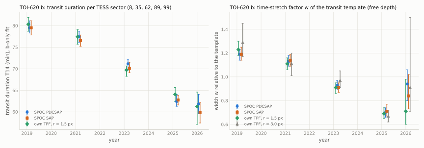

[README](../README.md) / [6. Other TESS results](6_other_results.md) / 6.7 TOI-620 b: decreasing transit duration

### 6.7 TOI-620 b: decreasing transit duration

TOI-620 b (Reefe et al. 2022) is a 3.8 $`R_\oplus`$ planet on a 5.10-d orbit around an M2.5 dwarf at 33 pc, with a
high impact parameter ($`b = 0.887`$). In the five TESS sectors that observed it (2019-2026), its transit duration
decreases from about 80 min in 2019 to about 62 min in 2025-2026, in the SPOC PDCSAP and SAP fluxes and in own
photometry of the target pixel files. The evidence is weaker than for L 98-59 d (section [6.6](6.6_L98-59d.md)): five epochs of 2-4
transits each, one instrument, and a duration slope that depends on the aperture. This section reports a weaker
candidate; a change of the orbit is not established. The planet was selected in the same search as L 98-59 d (section
[6.6](6.6_L98-59d.md)), and the significances below are not corrected for that search.

#### 6.7.1 Target

| quantity | value | source |
|---|---|---|
| identifiers | TOI-620, G 161-32, TIC 296739893, Gaia DR3 5738284016370287616, 2MASS J09284158-1209551, UCAC4 390-050511 | ExoFOP, TIC v8.2 |
| position (ICRS, epoch 2016.0) | RA 142.1734509, Dec $`-`$12.1672192 | Gaia DR3 |
| proper motion (mas/yr); parallax (mas) | 35.858, $`-389.785`$; $`30.290 \pm 0.030`$ (33.0 pc) | Gaia DR3 |
| $`G`$, $`BP-RP`$, $`T`$; RUWE | 11.308, 2.241, 10.214; 1.395 | Gaia DR3; TIC v8.2 |
| star | M2.5 dwarf; $`M_\star = 0.577^{+0.024}_{-0.023}\,M_\odot`$, $`R_\star = 0.550 \pm 0.017\,R_\odot`$, $`T_\mathrm{eff} = 3708^{+57}_{-56}`$ K | Reefe et al. (2022) |
| planet (TESS sectors 8 and 35 and ground photometry 2019-2021, one geometry) | $`P = 5.0988`$ d, $`R_\mathrm{p} = 3.76 \pm 0.15\,R_\oplus`$, $`k = 0.0627 \pm 0.0017`$, $`b = 0.887^{+0.014}_{-0.017}`$, $`a/R_\star = 18.87^{+0.52}_{-0.51}`$, $`T_{14} = 0.0565^{+0.0013}_{-0.0015}`$ d (81.4 min); a 17.7-d radial-velocity signal, not confirmed | Reefe et al. (2022) |
| neighbour | TIC 296739875 at about 55" (2.55-2.65 pixels in the median-image PSF fits), 1.12-1.17 times the flux of TOI-620 in two-PSF fits of the median images, Gaia DR3 parallax 1.09 mas (background); TIC contamination ratio of TOI-620 0.120; CROWDSAP 0.910-0.948 | Gaia DR3; TIC v8.2; SPOC |

#### 6.7.2 Data and method

SPOC 2-min light curves and target pixel files of sectors 8 (2019.12, camera/CCD 1/2), 35 (2021.14, 1/1), 62 (2023.15,
1/1), 89 (2025.15, 1/1) and 99 (2026.06, 1/2) (MAST; SPOC versions spoc-5.0.19 to 5.0.126); 18 transits (4, 4, 4, 4, 2).
tess-point 0.9.5.post1 places the star on silicon in these sectors and in sector 113 (2027-01-16 to 2027-02-13, camera/CCD
1/4), up to sector 134. Method as in section [6.6.3](6.6_L98-59d.md#663-method) ([`scripts/transit_duration/run_toi620.sh`](../scripts/transit_duration/run_toi620.sh)), with the ExoFOP TOI-table
ephemeris ($`P = 5.098784`$ d, $`T_0`$ = BTJD 1518.004514) for windows of $`\pm 0.2`$ d, and the limb-darkening prior centred on
(0.30, 0.33). Template (common fit of the PDCSAP transits): $`k = 0.0602`$, $`a/R_\star = 16.64`$, $`b = 0.9326`$,
$`u = (0.294, 0.324)`$. Own photometry: circular apertures of $`r`$ = 1.0-3.0 px around the target position of the
target pixel file, background = 20th percentile of the pixels of each cadence. Difference images: mean out-of-transit minus
in-transit image per sector, decomposed onto two Gaussian PSFs (target and neighbour) fitted to the median image,
and fitted with one PSF at a free position.

#### 6.7.3 Results

[`data/durations_296739893.csv`](../data/durations_296739893.csv), [`data/duration_slopes_296739893.csv`](../data/duration_slopes_296739893.csv), [`data/transit_times_296739893.csv`](../data/transit_times_296739893.csv):

| sector | year | transits | $`T_{14}`$, PDCSAP (min) | $`b`$, PDCSAP | $`w`$, PDCSAP | $`w`$, own $`r = 1.5`$ px | $`w`$, own $`r = 3.0`$ px | $`T_{14}`$, SAP (min) | $`T_{14}`$, own $`r = 1.5`$ px (min) |
|---|---|---|---|---|---|---|---|---|---|
| 8 | 2019.12 | 4 | 79.5 (78.3-81.1) | 0.897 | 1.19 (1.14-1.23) | 1.23 | 1.29 | 79.5 | 80.3 |
| 35 | 2021.14 | 4 | 77.4 (76.1-78.7) | 0.906 | 1.13 (1.09-1.18) | 1.11 | 1.11 | 76.5 | 77.4 |
| 62 | 2023.15 | 4 | 71.2 (69.7-72.1) | 0.932 | 0.93 (0.89-0.97) | 0.91 | 0.97 | 70.1 | 69.7 |
| 89 | 2025.15 | 4 | 62.4 (61.3-64.1) | 0.963 | 0.70 (0.66-0.74) | 0.69 | 0.67 | 62.7 | 64.0 |
| 99 | 2026.06 | 2 | 61.8 (59.5-64.1) | 0.965 | 0.94 (0.80-1.06) | 0.71 | 0.91 | 59.9 | 61.3 |

Slopes (5 sectors, 3 degrees of freedom):

| photometry | $`\mathrm{d}T_{14}/\mathrm{d}t`$ (min/yr) | $`\mathrm{d}w/\mathrm{d}t`$ (yr$`^{-1}`$) | $`\mathrm{d}b/\mathrm{d}t`$ (yr$`^{-1}`$) |
|---|---|---|---|
| PDCSAP (transits stacked on one offset per sector) | $`-2.86 \pm 0.41`$ ($`\chi^2 = 6.5`$; 114 about a constant) | $`-0.079 \pm 0.015`$ | $`+0.0113 \pm 0.0013`$ |
| PDCSAP (per-transit mid-times) | $`-2.68 \pm 0.39`$ | $`-0.065 \pm 0.015`$ | $`+0.0107 \pm 0.0013`$ |
| SAP | $`-2.99 \pm 0.28`$ | $`-0.081 \pm 0.013`$ | $`+0.0115 \pm 0.0011`$ |
| own, $`r = 1.5`$ px | $`-2.82 \pm 0.34`$ | $`-0.092 \pm 0.011`$ | $`+0.0112 \pm 0.0013`$ |
| own, $`r = 3.0`$ px | $`-1.58 \pm 0.47`$ | $`-0.107 \pm 0.019`$ | $`+0.0053 \pm 0.0016`$ |

The PDCSAP slope has $`t \approx 7.0`$ with 3 degrees of freedom; under a common unknown noise scale for the five points
this corresponds to a two-sided $`p \approx 0.006`$, not to a 7 $`\sigma`$ false-alarm probability. The $`b`$-only
$`T_{14}`$ slope depends on the aperture ($`-1.58`$ against $`-2.82`$ min/yr for 3.0 and 1.5 px): the larger aperture
includes more flux of the neighbour, which the fixed-$`k`$ template converts into a higher $`b`$ at every epoch; the
width $`w`$, fitted with free depth, declines in all photometries. Per transit, the four 2019 transits have
$`w`$ = 1.13-1.26 and the four 2025 transits $`w`$ = 0.64-0.78; the 2025 $`T_{14}`$ values are 60-65 min, and three of the
four 2019 values 80-82 min (the first, epoch 0, gives 58 min with a wide interval, 50-63 min, and $`w = 1.26`$).

<picture><source srcset="../figures/tdv_296739893_dark.svg" media="(prefers-color-scheme: dark)"></picture>

Transit times: the per-transit mid-times scatter about a linear ephemeris with $`\chi^2/\mathrm{dof}`$ = 7.2 (PDCSAP;
6.8 SAP, 5.4 own 1.5 px; 18 transits); the mean offsets per sector are $`-3.3 \pm 1.2`$, $`+7.4 \pm 1.1`$,
$`-5.9 \pm 1.0`$, $`+3.8 \pm 1.2`$ and $`-3.7 \pm 2.2`$ min (sectors 8, 35, 62, 89, 99), i.e. timing variations of up to about
$`\pm 7`$ min between sectors, consistent in amplitude with the earlier TTV report by Naponiello (2026). The duration slope is the same whether
the transits are stacked on per-transit times or on per-sector offsets.

#### 6.7.4 Checks

| check | result |
|---|---|
| source of the transit ([`data/diffimage_296739893.csv`](../data/diffimage_296739893.csv)) | fraction of the difference-image signal on the neighbour PSF: 0.05, $`-0.12`$, 0.06, 0.03, 0.17 ($`\pm`$ 0.02-0.07; sectors 8, 35, 62, 89, 99); a single PSF at a free position lands 0.07-0.40 px from the target in every sector; the transit is on TOI-620 at every epoch |
| dilution | CROWDSAP 0.910-0.948 with no trend; SAP and PDCSAP agree; the decline of $`w`$ is present in the 1.5-px aperture, which contains least neighbour flux; a constant extra flux changes the depth, not the contact times; the proper motion of TOI-620 (0.39"/yr) changes its separation from the neighbour by less than 3" (0.14 px) over 2019-2026 |
| timing | stacking on per-transit times and on per-sector offsets gives the same slope (table above) |
| individual transits | every 2025 transit is narrower than every 2019 transit in $`w`$ (above) |

#### 6.7.5 Comparison with published fits; catalogue and literature checks

Reefe et al. (2022) fitted TESS sectors 8 and 35 and ground-based photometry of 2019-2021 (NGTS, LCO, MuSCAT2, KeplerCam,
LCRO, ExTrA) with one geometry: $`T_{14}`$ = 81.4 min, $`b = 0.887`$, $`a/R_\star = 18.87`$. The sector-8 and sector-35 values
here (79.5 and 77.4 min with the template $`a/R_\star = 16.64`$) are consistent with that value. Naponiello (2026) subsequently reported TTVs of
TOI-620 b with a semi-amplitude of about 7 min on a timescale of about 500 d; that analysis did not fit per-transit
durations.

| date (UTC) | source | result |
|---|---|---|
| 2026-10-20 | ADS full text: "TOI-620", "TOI 620" | 8 records; the discovery paper (2022AJ....163..269R) and later sample papers; none reports a change of the depth or duration |
| 2026-10-20 | arXiv API; Zenodo; GitHub code search | 1 record; 0 records; catalogue and visualisation files only |
| 2026-10-20 | Planet Hunters TESS Talk; ExoFOP target page | discovery tags (2019-2023); ground-based time series of 2019-2021 (LCO, NGTS, TCS, FLWO, ExTrA 2021-03), spectra of 2024-2025; no note on a change |
| 2026-10-20 | Exoplanet Transit Database (var.astro.cz); general web search | no observed transits; nothing found |
| 2026-10-21 | Targeted literature follow-up: Naponiello (2026), A&A 705, A5; arXiv:2511.16504 | Earlier TOI-620 b TTV report (semi-amplitude ~7 min, timescale ~500 d); no per-transit duration fits |

#### 6.7.6 Interpretation and decisive tests

A transit that narrows is what a slow change of the orbital inclination would produce (the per-sector fits hold
the radius ratio fixed, so its constancy is not measured here; the free-amplitude width also decreases) ($`\mathrm{d}b/\mathrm{d}t \approx +0.011`$ yr$`^{-1}`$ at $`a/R_\star = 16.6`$, i.e.
$`\mathrm{d}i/\mathrm{d}t \approx -0.04`$ deg/yr), and the timing variations and the unconfirmed 17.7-d radial-velocity
signal of Reefe et al. (2022) would be consistent with a perturbing companion; none of this is established, and with
five epochs a sector-dependent systematic is not excluded. Tests:

- Ground-based or space photometry of complete transits now: if the trend continued linearly, $`T_{14}`$ is about
  $`59.5 \pm 2`$ min in late 2026 on the PDCSAP scale here (about 80 min in 2019), with a shallower, V-shaped profile.
- A joint refit of the ExoFOP ground-based light curves of 2019-2021, which would add early epochs and other bands.
- TESS sector 113 (2027-01-16 to 2027-02-13; about five transits): the linear trend gives about 58.7 min; alone it does
  not separate a continued decline from a duration that stays near the 2025-2026 value.

Not checked: the ground-based light curves of 2019-2021 (not refitted); the 20-s light curve of sector 99; spot
crossings; any second instrument after 2021. The S99 point rests on two transits.

Reproduction: `sh scripts/transit_duration/run_toi620.sh` and `sh scripts/transit_duration/run_l9859.sh` (the table script needs the outputs of both), then `python scripts/transit_duration/make_tables_td.py`
(environment as in section [6.6.9](6.6_L98-59d.md#669-predictions-and-decisive-tests)); a complete re-run reproduces the slopes and per-sector values of all five
analysis variants across four photometries identically. References of this section: Reefe, M. A., et al. 2022, AJ 163, 269; Naponiello, L. 2026, A&A 705, A5; and those of
section [6.6](6.6_L98-59d.md).
