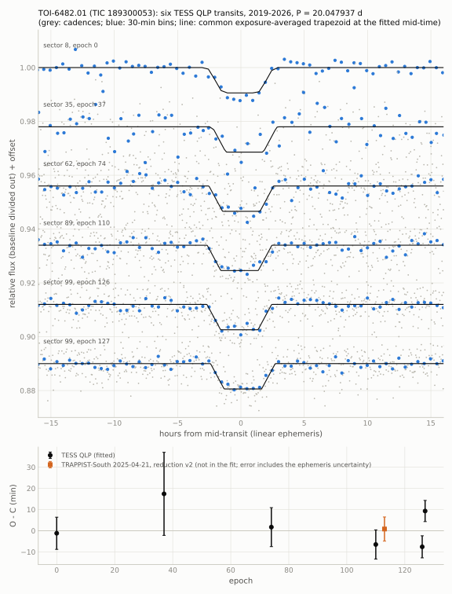

[README](../README.md) / [6. Other TESS results](6_other_results.md) / 6.8 TOI-6482.01: ephemeris from six TESS transits

### 6.8 TOI-6482.01: ephemeris from six TESS transits

TOI-6482.01 (TIC 189300053) is a TESS planet candidate (TESS and TFOP disposition PC) from the QLP faint-star search
(Kunimoto et al. 2022). The TOI table (last modified 2025-07-31) lists $`P = 1483.5175`$ d from two transits, with the
comment "period likely shorter"; TFOP comments on the ExoFOP target page give an AstroImageJ solution from sectors 8,
35, 62 and 89 with $`P = 20.04753386`$ d. This section adds the two transits of sector 99 (2026) and gives
$`P = 20.047937 \pm 0.000060`$ d from six TESS transits. It is an ephemeris update of a known TOI, not a new
candidate; the nature of the transiting object is not established. An earlier version of this ephemeris was uploaded to
ExoFOP on 2026-10-20 (data tag 481950; section [6.8.5](#685-earlier-version-and-ground-based-observations-on-exofop)).

#### 6.8.1 Target

| quantity | value | source |
|---|---|---|
| identifiers | TOI-6482, TIC 189300053, Gaia DR3 5662277217084277888, AllWISE J092743.11-245754.0 | ExoFOP, Gaia DR3, AllWISE |
| position (ICRS, epoch 2016.0) | RA 141.9296383, Dec $`-`$24.9650282 | Gaia DR3 |
| proper motion (mas/yr); parallax (mas) | $`-0.988`$, 3.412; $`1.078 \pm 0.016`$ (about 930 pc) | Gaia DR3 |
| $`G`$, $`BP-RP`$, $`T`$ | 13.585, 0.865, $`13.139 \pm 0.007`$ | Gaia DR3; TOI table |
| star | $`T_\mathrm{eff} = 5782 \pm 122`$ K, $`\log g = 4.06`$, $`R_\star = 1.58\,R_\odot`$, $`M_\star = 1.04\,M_\odot`$, distance $`910 \pm 20`$ pc (no radius or mass errors listed); Gaia GSP-Phot $`T_\mathrm{eff} = 5877`$ K, $`\log g = 4.13`$ | TOI table (TIC); Gaia DR3 |
| TOI-table entry | $`P = 1483.517506`$ d, epoch BJD 2458522.214136, duration 5.42 h, depth $`11.72 \pm 0.21`$ ppt, $`R_\mathrm{p} = 17.5\,R_\oplus`$, sectors 8, 35, 62; source qlp-s62-faintsearch; alerted 2023-06-15 | ExoFOP TOI table (2026-10-18) |

#### 6.8.2 Data and method

QLP light curves (MAST HLSP, `hlsp_qlp_tess_ffi_s00NN-0000000189300053_tess_v01_llc.fits`, NN = 08, 35, 62, 89, 99;
retrieved 2026-10-20 and again 2026-10-21, identical files), SAP_FLUX with QUALITY = 0, cadences 1800 s (sector 8),
600 s (sector 35) and 200 s (sectors 62, 89, 99). Model: a trapezoid with depth, total duration $`T_{14}`$ and ingress
duration shared by the six transits, averaged over each exposure, times a quadratic baseline per transit, fitted in
$`\pm 0.7`$-d windows. The mid-times are refitted per transit with the shape fixed; the timing error is the larger of
the formal error times the red-noise factor $`\beta`$ (residuals binned by 3, 5 and 10 cadences) and the prayer-bead
scatter (50 cyclic shifts of the residuals). The shape uncertainty is not propagated into the individual timing
errors. The linear ephemeris is a weighted fit, with its errors scaled by $`\sqrt{\chi^2/\mathrm{dof}}`$. No dilution
correction is applied beyond that of the QLP SAP flux.

Sector-99 time stamps: MAST reports a barycentric-correction error in the QLP light curves from orbit 210, which
contains the second sector-99 transit (section [7](7_caveats.md)). The QLP time stamps were compared with SPOC
full-frame-image time stamps referred to the target position (TESScut TIME minus TIMECORR plus the target-direction correction computed from Earth's barycentric position; the spacecraft-position term, up to about 2 s, is neglected): for QUALITY = 0 cadences, QLP minus recomputed time is $`+1.71`$ to $`+2.04`$ s in orbit 209 and
$`+1.71`$ to $`+2.01`$ s in orbit 210, and $`+1.73`$ to $`+1.78`$ s across the epoch-127 window, negligible against
the 5-min timing errors. The QLP times are used as delivered.

#### 6.8.3 Results

[`data/transit_times_189300053.csv`](../data/transit_times_189300053.csv), [`data/ephemeris_189300053.csv`](../data/ephemeris_189300053.csv):

| sector | epoch | cadence (s) | $`t_c`$ (BTJD) | error (min) | formal error (min) | $`\beta`$ | prayer bead (min) | O $`-`$ C (min) | depth (ppt) |
|---|---|---|---|---|---|---|---|---|---|
| 8 | 0 | 1800 | 1522.18398 | 7.6 | 7.0 | 1.08 | 6.1 | $`-1.2`$ | $`11.29 \pm 0.79`$ |
| 35 | 37 | 600 | 2263.97052 | 19.6 | 17.9 | 1.03 | 19.6 | $`+17.4`$ | $`11.90 \pm 2.30`$ |
| 62 | 74 | 200 | 3005.73335 | 9.2 | 7.9 | 1.03 | 9.2 | $`+1.7`$ | $`10.15 \pm 1.05`$ |
| 89 | 110 | 200 | 3727.45339 | 6.9 | 6.9 | 1.00 | 6.7 | $`-6.5`$ | $`9.01 \pm 0.90`$ |
| 99 | 126 | 200 | 4048.21961 | 5.2 | 5.1 | 1.00 | 5.2 | $`-7.6`$ | $`9.16 \pm 0.67`$ |
| 99 | 127 | 200 | 4068.27927 | 5.0 | 5.0 | 1.00 | 4.0 | $`+9.3`$ | $`8.46 \pm 0.66`$ |

Linear ephemeris (BTJD = BJD$`_\mathrm{TDB}`$ $`-`$ 2457000):

$$T_0 = 1522.18479 \pm 0.00653, \quad P = 20.047937 \pm 0.000060\ \mathrm{d}, \quad \mathrm{cov}(T_0, P) = -3.57 \times 10^{-7}\ \mathrm{d}^2$$

(correlation $`-0.92`$); equivalently $`T_\mathrm{ref}`$ = $`T_c`$(epoch 100) = BTJD $`3526.97850 \pm 0.00260`$, with
$`\mathrm{cov}(T_\mathrm{ref}, P) = -1.18 \times 10^{-9}`$ d$`^2`$ (correlation $`-0.008`$). Predictions are best propagated
from epoch 100, $`\sigma^2(n) = \sigma^2_{T_\mathrm{ref}} + (n - 100)^2 \sigma_P^2 + 2 (n - 100)\, \mathrm{cov}(T_\mathrm{ref}, P)`$;
the CSV gives the values and both covariances to more digits (propagating the rounded $`T_0`$ values above to epochs
141-146 overestimates the errors by about 0.2 min). With the timing errors above, $`\chi^2 = 7.3`$ for 4 degrees of
freedom; the ephemeris errors are scaled by 1.35. The O $`-`$ C values ($`-7.6`$ to $`+17.4`$ min) are not interpreted
as timing variations. Common shape: depth $`9.42 \pm 0.44`$ ppt,
$`T_{14} = 5.11 \pm 0.22`$ h, ingress $`1.07 \pm 0.19`$ h. With $`R_\star = 1.58\,R_\odot`$ (TIC; no error listed),
$`R_\mathrm{p} \approx \sqrt{\delta}\,R_\star \approx 16.7\,R_\oplus`$ (no limb darkening; TOI table: 17.5 $`R_\oplus`$, with a depth of
11.7 ppt).

The TOI-table period is 73.9985 times this period. The TFOP value of 20.04753386 d equals the TOI-table period divided
by 74 and is $`0.00040`$ d shorter than the period here (6.8 times its error; the TFOP value carries no error on the
ExoFOP page).

<picture><source srcset="../figures/transits_189300053_dark.svg" media="(prefers-color-scheme: dark)"></picture>

Predicted mid-transits, epochs 141-146 (statistical $`1\sigma`$ 5.1-5.4 min): BTJD 4348.944 (2026-11-04), 4368.992 (2026-11-24),
4389.040 (2026-12-14), 4409.088 (2027-01-03), 4429.136 (2027-01-23) and 4449.184 (2027-02-12). tess-point 0.9.5.post1
places the star on silicon in sectors 110-113 (cameras 4, 3, 2, 1); the coverage of these dates by the sectors and
their gaps is not checked.

#### 6.8.4 Checks

[`data/phase_windows_189300053.csv`](../data/phase_windows_189300053.csv), [`data/depth_tests_189300053.csv`](../data/depth_tests_189300053.csv):

| check | result |
|---|---|
| coverage | every predicted transit inside the five light curves has QUALITY = 0 cadences and shows a dip (epochs 0, 37, 74, 110, 126, 127; epoch 1 falls 6 h after the end of sector 8); 82 % of the sector-35 transit has QUALITY = 0 cadences |
| aliases $`P/2`$, $`P/3`$ | depth at fixed shape with a simultaneous quadratic baseline in every covered window: weighted means $`-0.36 \pm 0.59`$ ppt ($`P/2`$, 3 windows) and $`-0.29 \pm 0.31`$ ppt ($`P/3`$, 10 windows), against 9.4 ppt; no positive window depth exceeds 1.2 $`\sigma`$ (most negative: $`-2.1\,\sigma`$); repeating events of comparable depth and duration at $`P/2`$ or $`P/3`$ are strongly disfavoured; windows in data gaps give no constraint |
| odd and even transits | even epochs (0, 74, 110, 126) $`9.86 \pm 0.41`$ ppt, odd epochs (37, 127) $`8.72 \pm 0.63`$ ppt; difference $`1.14 \pm 0.75`$ ppt (1.5 $`\sigma`$) |
| secondary eclipse (phase 0.5) | $`-0.36 \pm 0.58`$ ppt (3 windows, white errors; $`\pm 0.59`$ with $`\beta`$), 3 $`\sigma`$ upper limit 1.39 ppt; eccentric orbits not tested |
| per-transit depth | 11.3 and 11.9 ppt (sectors 8 and 35) to 9.2 and 8.5 ppt (sector 99); $`\chi^2 = 9.7`$ for 5 degrees of freedom about the weighted mean ($`9.52 \pm 0.34`$ ppt; $`p = 0.08`$); a weighted linear fit against time gives $`-0.38 \pm 0.13`$ ppt/yr (2.96 $`\sigma`$, white errors, six points); the cause (pipeline, cadence, background or dilution changes between sectors, or the source) is not established, and the change is not interpreted |
| shape | flat-bottomed; a blended eclipsing source can give this shape only if it is at most $`\Delta m = 2.19`$ mag fainter (2.65 and 3.46 for an ingress 1 and 3 $`\sigma`$ longer; Vanderburg et al. 2019) |
| high-resolution imaging | Gemini South/Zorro speckle, 2025-03-12, 562 and 832 nm (PI S. Howell; ExoFOP imaging tag 453903; contrast-curve tables on ExoFOP): no companion listed; 5 $`\sigma`$ contrast 5.14 and 5.85 mag at 0.5"; inner working angle 0.017" and 0.026". Assuming the QLP depth is the diluted aperture depth and the contaminant has the same contrast in TESS and the relevant speckle band, the approximate exclusion limits are 0.44" (562 nm) and 0.21" (832 nm) for a total eclipse ($`\Delta m \le 5.06`$), 0.09-0.10" for a 50 % eclipse ($`\Delta m \le 4.31`$), and 0.06-0.08" (about 50-75 au at 930 pc) for the adopted shape limits ($`\Delta m \le 2.19`$-3.46). These comparisons extend only to the tabulated outer separation of 1.17"; the dilution and bandpass assumptions have not been verified. |
| Gaia DR3 astrometry and photometry | RUWE 0.982, ipd_frac_multi_peak 0, ipd_gof_harmonic_amplitude 0.010, astrometric excess noise 0, duplicated_source false, non_single_star 0; phot_variable_flag NOT_AVAILABLE, not in the variability tables |
| Gaia DR3 radial velocity | $`25.86 \pm 1.90`$ km/s from 21 transits with rv_method_used = 2, for which no epoch-scatter statistics are given; no constraint on a companion |
| Gaia DR3 neighbours | within 21": 13.96" ($`G`$ = 19.64, $`\Delta G = 6.05`$; too faint for the depth) and 17.37" ($`G`$ = 17.74, $`\Delta G = 4.16`$, $`BP-RP = 1.88`$, estimated $`\Delta T \approx 3.7`$; would need an eclipse of about 29 % with all its flux in the aperture); beyond 21", the first source brighter than $`G`$ = 19.5 is at 40.2" ($`G`$ = 15.60, $`\Delta G = 2.0`$). The 17.37" and 40.2" sources are excluded as the source by the full-depth event in the TRAPPIST-South light curve (5.74" aperture on the target) (section [6.8.5](#685-earlier-version-and-ground-based-observations-on-exofop)) |
| WISE | AllWISE J092743.11-245754.0 (0.03" from the Gaia position), ph_qual AABU: W1 = $`12.076 \pm 0.023`$, W2 = $`12.127 \pm 0.023`$, W3 = $`11.963 \pm 0.274`$ (S/N 4.0), W4 > 8.99 (95 % upper limit); $`K_s - W1 = 0.02 \pm 0.03`$, $`W1 - W2 = -0.05 \pm 0.03`$, $`W2 - W3 = +0.16 \pm 0.28`$: no infrared excess in W1-W3; the W4 limit is about 3 mag above the photosphere and uninformative. CatWISE2020: W1 = $`12.096 \pm 0.013`$, W2 = $`12.153 \pm 0.009`$ |
| QLP time stamps (sector 99) | within 2.04 s of the recomputed SPOC time stamps (section [6.8.2](#682-data-and-method)) |

An on-target brown dwarf or low-mass star remains possible, as do unresolved blends and hierarchical eclipsing binaries. The approximate blend limits above depend on the adopted shape, dilution and bandpass assumptions. Radial velocities can test on-target companions and some blend scenarios.

#### 6.8.5 Earlier version and ground-based observations on ExoFOP

ExoFOP upload, 2026-10-20 (data tag 481950; files `TIC189300053-01_20261020_TESS-QLP_ephemeris.txt`, `_transit-times.csv`
and `_transits.png`): the same data and method, with $`T_0`$ = BTJD $`1522.18474 \pm 0.00640`$,
$`P = 20.047937 \pm 0.000059`$ d ($`\chi^2 = 7.2`$ for 4 degrees of freedom). At the precision of the uploaded CSV, the repository tables reproduce its mid-times within 0.11 min, its timing errors within 0.1 min and its O $`-`$ C values within 0.2 min; the tables here are the repository script's output.

TRAPPIST-South, 2025-04-21 (K. Barkaoui; reduction v2 provided by the observer and used here with his permission; Rc,
292 exposures of 60 s, 5.74" aperture): the data start about 14 min before first contact and end about 34 min after
fourth contact; the meridian flip (BTJD 3787.511) falls during ingress. Refit with the TESS shape, a baseline of constant, time and airmass
and a free flux offset after the flip: $`t_c`$ = BTJD $`3787.6022 \pm 0.0029`$ (4.2 min: prayer bead over all cyclic shifts;
formal error times $`\beta`$: 3.0 min), O $`-`$ C $`= +0.8 \pm 5.7`$ min (the 4.2-min timing error and the 3.9-min
ephemeris uncertainty at epoch 113 in quadrature), depth $`10.9 \pm 1.4`$ ppt in Rc (white error; TESS: $`9.4 \pm 0.4`$
ppt). Because of the flip, the timing leans on the egress: the 263 exposures after the flip alone give
O $`-`$ C $`= -7.0 \pm 3.0`$ min (timing error only; $`\pm 4.9`$ min with the ephemeris uncertainty). The refit is
conditional on the adopted shape and baseline model; the light curve is not part of this repository. The ExoFOP upload
used the earlier AstroImageJ measurement table of the same night on ExoFOP and gave O $`-`$ C $`= +1.3 \pm 5.4`$ min
(with the ephemeris uncertainty). The observer's TFOP comment reports an on-time event of about 12 ppt on the target.

LCO-CTIO 1 m, 2025-05-11 (R. Schwarz): an ingress-only observation is on ExoFOP. Relative to the prediction in the
observing notes (BJD 2460807.6330), the ephemeris here predicts the transit 23.9 min later (BTJD $`3807.6496 \pm 0.0027`$),
which leaves the ingress-derived centre reported in the notes (BJD 2460807.6590) 13.5 min late. This comparison is
conditional on the observer's adopted transit shape; the light curves are not analysed in this record.

#### 6.8.6 Catalogue and literature checks

| date (UTC) | source | result |
|---|---|---|
| 2026-10-18 | ExoFOP TOI table | TOI-6482.01, PC, $`P = 1483.517506`$ d, "period likely shorter", last modified 2025-07-31 |
| 2026-10-20 | ExoFOP target page | TFOP comments with $`P = 20.04753386`$ d (sectors 8-89); TRAPPIST-South 2025-04-21 and LCO-CTIO 2025-05-11 time series; Gemini South/Zorro speckle 2025-03-12; no spectroscopy |
| 2026-10-21 | ADS full text: "TOI-6482", "TOI 6482", "TOI-6482.01", "189300053" | 0 records |
| 2026-10-21 | arXiv API ("TOI-6482", "TOI 6482", 189300053); Zenodo ("TOI-6482", "TOI 6482", "189300053") | 0 records; 0 records |
| 2026-10-21 | GitHub code search ("189300053", "TOI-6482") | copies of the TOI or TFOP target lists, with the 1483.5-d period where a period is given; no analysis |

Not checked: SIMBAD, VSX and VizieR beyond the Gaia DR3 and WISE tables; the Gaia DR3 non-single-star tables beyond the
non_single_star flag.

#### 6.8.7 Interpretation and decisive tests

The six TESS transits give a period of 20.048 d, with $`P/2`$ and $`P/3`$ disfavoured (other integer fractions not
tested separately); the TOI-table period of 1483.5 d is close to 74 times this period, the separation of the sector-8 and sector-62 transits used
for the TOI-table entry. With the TIC radius of the star, the transiting object has about 1.5 times the radius of
Jupiter; the TESS data do not distinguish a giant planet, a brown dwarf or a low-mass star, and a blend with a close,
bright companion is not excluded (section [6.8.4](#684-checks)). Tests:

- Radial velocities: the TOI table predicts a semi-amplitude of 17.3 m/s for its predicted mass (317 $`M_\oplus`$) at its
  1483.5-d period; at 20.048 d the same mass gives about 73 m/s ($`K \propto P^{-1/3}`$); a stellar companion would give
  km/s variations.
- TESS sectors 110-113 (predicted transits above): further mid-times and per-sector depths, including a check of the
  apparent depth decrease in sectors 8-99.
- Photometry of a complete transit with long out-of-transit baselines on both sides, in two bands at once.

Not checked: difference images and centroids; TESScut or other independent photometry of the transits; the dilution
correction of the QLP SAP flux; TRICERATOPS; the LCO-CTIO light curves of 2025-05-11.

Reproduction: `python scripts/toi6482/fit_toi6482.py` (downloads the QLP light curves to `./work/189300053/dl/`; writes the
five tables; `--trappist FILE` refits the TRAPPIST-South light curve, which is not distributed here; without it the
TRAPPIST row of the existing table, if present, is kept), `python scripts/toi6482/timestamp_check_s99.py` (sector-99 time stamps), and
`python figures/make_figures.py toi6482`. Without script in this repository: the Gaia DR3, WISE and speckle values, the
tess-point sector check and the catalogue checks of section [6.8.6](#686-catalogue-and-literature-checks). References of this section: Kunimoto, M., et al.
2022, ApJS 259, 33; Vanderburg, A., et al. 2019, ApJL 881, L19; Scott, N. J., et al. 2021, Front. Astron. Space Sci. 8,
138; Wright, E. L., et al. 2010, AJ 140, 1868; Marocco, F., et al. 2021, ApJS 253, 8; Jehin, E., et al. 2011, The
Messenger 145, 2; and those of section [8](8_data_and_reproduction.md).
