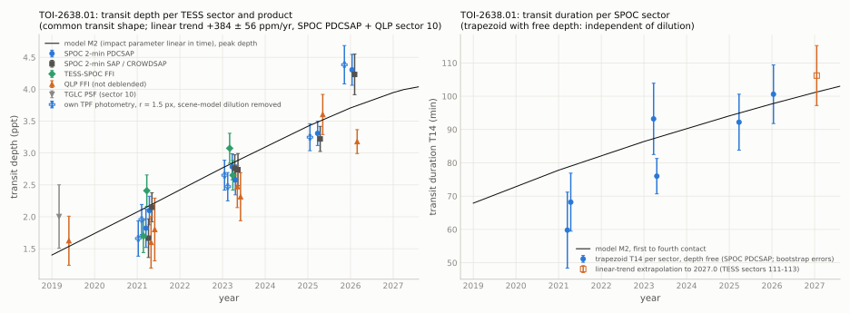

[README](../README.md) / [6. Other TESS results](6_other_results.md) / 6.9 TOI-2638.01: transit depth increasing from 2019 to 2026

### 6.9 TOI-2638.01: transit depth increasing from 2019 to 2026

TOI-2638.01 (TIC 458342769) is a TESS planet candidate with $`P = 3.93`$ d around an A-type star (Gaia DR3:
$`T_\mathrm{eff} \approx 8800`$-9500 K, $`v \sin i = 110 \pm 7`$ km/s). Its transit is grazing (V-shaped). In every
TESS light-curve product examined, the transit depth increases with time: from 1.8 ppt in 2021 to 4.3 ppt in 2026 in
the SPOC 2-min PDCSAP light curves (1.6 ppt in the 2019 QLP light curve), $`+384 \pm 56`$ ppm/yr (6.9 $`\sigma`$; 5.9
$`\sigma`$ in a bootstrap over sectors). The transit duration measured with a free depth also increases, from about 60
to about 100 min ($`+7.2`$ min/yr), but this shape change, which is what separates a change of the transit geometry from a
change of dilution, is significant at only about 2.6-3.1 $`\sigma`$ when calibrated by simulation (section [6.9.3](#693-results)). A
decreasing impact parameter of a grazing companion, from $`b \approx 1.00`$ (2019) to $`b \approx 0.95`$ (2026), describes
both changes. This section reports a candidate change of the transit; its cause is not established, the nature of the
companion is not established, and an eclipsing binary is not excluded.

The candidate was selected in a second pass of the search of known TESS planets for changing transits described in
section [6.6](6.6_L98-59d.md): 939 planets analysed (1,049 selected; the run stopped at a disk-space checkpoint with 110 low-priority planets
not run), 83 pipeline flags, and five planets that met follow-up rules fixed in advance: four known cases or earlier
candidates (TOI-1355 b, TOI-1518 b, L 98-59 d and TOI-620 b) and TOI-2638.01. None of 594 stable reference planets
met the rules. The search pipeline is not part of this repository and its significances are not corrected for the
number of planets searched; the values of this section come from the scripts in [`scripts/toi2638/`](../scripts/toi2638/), which use TESS data only.

#### 6.9.1 Target

| quantity | value | source |
|---|---|---|
| identifiers | TOI-2638, TIC 458342769, Gaia DR3 5353676910584543872, TYC 8605-546-1, 2MASS J10392222-5529306, WISE J103922.22-552930.6, UCAC4 173-054047, APASS 27978650 | ExoFOP, Gaia DR3 |
| position (ICRS, epoch 2016.0) | RA 159.8425557, Dec $`-`$55.4918063 | Gaia DR3 |
| proper motion (mas/yr); parallax (mas) | $`-10.770`$, 3.234; $`1.374 \pm 0.017`$ (about 730 pc) | Gaia DR3 |
| $`G`$, $`BP-RP`$, $`T`$ | 11.166, 0.132, $`11.167 \pm 0.010`$ | Gaia DR3; TIC v8.2 |
| star | GSP-Phot $`T_\mathrm{eff} = 9491`$ K, $`\log g = 4.26`$, $`A_G = 0.25`$; ESP-HS $`T_\mathrm{eff} = 8844`$ K, spectral type A, $`v \sin i = 110 \pm 7`$ km/s; FLAME $`R_\star = 1.67`$ (1.63-1.71) $`R_\odot`$, $`M_\star = 2.09`$ (2.05-2.13) $`M_\odot`$, $`L_\star = 20.4\,L_\odot`$; TIC v8.2: no $`T_\mathrm{eff}`$ or radius, distance $`648 \pm 25`$ pc | Gaia DR3 (Creevey et al. 2023); TIC v8.2 |
| Gaia DR3 astrometry and radial velocity | RUWE 0.821, non_single_star 0, ipd_frac_multi_peak 1; radial velocity $`-8.8 \pm 9.4`$ km/s from 16 transits, rv_amplitude_robust 126 km/s (not usable as a companion constraint for a broad-lined hot star); phot_variable_flag NOT_AVAILABLE, no epoch photometry | Gaia DR3 |
| TOI-table entry | TOI-2638.01; TESS and TFOPWG disposition PC; $`P = 3.9299344 \pm 0.0000089`$ d, epoch BJD 2459282.14906, duration 1.26 h, depth $`2252 \pm 150`$ ppm, S/N 17.1, sectors 36, 37, 63, 64; source spoc-s01-s65-b0A-PC; comment "no stellar radius; crowded field"; alerted 2021-04-29 | ExoFOP TOI table (retrieved 2026-10-21) |
| follow-up listed on ExoFOP | ground-based time-series photometry, high-resolution imaging and spectroscopy by TFOP members; TFOP status VPC in the TFOP notes; not used, refitted or quoted in this record | [ExoFOP target page](https://exofop.ipac.caltech.edu/tess/target.php?id=458342769) |
| nearest bright neighbour | Gaia DR3 5353676910584550272 (TIC 458342741, TYC 8605-330-1) at 17.1", $`\Delta G = 1.35`$, $`BP-RP = 0.15`$, parallax 0.63 mas; Gaia DR3 sources with $`G < 19`$ within 42" together give 0.41 of the target's $`G`$-band flux | Gaia DR3 |

#### 6.9.2 Data and method

TESS products (MAST; [`data/sectors_458342769.csv`](../data/sectors_458342769.csv)), all on camera 3: SPOC 2-min light curves and target pixel files of
sectors 36 (2021.21, CCD 1), 37 (2021.29, CCD 2), 63 (2023.23, CCD 1), 64 (2023.30, CCD 2), 90 (2025.23, CCD 1) and 99
(2026.04, CCD 3); TESS-SPOC full-frame-image light curves of sectors 36 and 37 (600 s) and 63 and 64 (200 s); QLP
light curves of sector 10 (2019.28, 1800 s), 36 and 37 (600 s) and 63, 64, 90 and 99 (200 s); the TGLC light curve of
sector 10. Cadences with quality flag 0. tess-point 0.9.5.post1 places the star on silicon in these seven sectors and in
sectors 111-113 (2026-11-25 to 2027-02-13), up to sector 134.

- Ephemeris: one mid-time per sector (common shape fixed, SPOC PDCSAP and QLP sector 10) and a weighted linear fit
  ([`data/ephemeris_458342769.csv`](../data/ephemeris_458342769.csv)): $`P = 3.9299465 \pm 0.0000034`$ d, $`T_0`$ = BTJD
  $`3398.25227 \pm 0.00055`$; $`\chi^2 = 1.5`$ for 5 degrees of freedom; the sector mid-times lie within 2.9 min of it.
- Windows of $`\pm 0.30`$ d around each transit, a quadratic polynomial fitted to the points more than 0.05 d from
  mid-transit divided out, per-point error from the out-of-transit scatter of each window.
- Model: batman, circular orbit, quadratic limb darkening fixed at (0.17, 0.27) (approximate TESS-band values for
  9000-9500 K, $`\log g = 4.2`$), averaged over each exposure using $`n = \max(3, \lceil \mathrm{cadence} / 40\ \mathrm{s} \rceil)`$ equally weighted
  midpoint samples.
- Depth per sector and product: amplitude of one common transit shape (fitted to SPOC PDCSAP and QLP sector 10:
  $`k = 0.0576`$, $`b = 0.947`$, $`a/R_\star = 9.96`$) times its peak depth; error = larger of the white error times a
  red-noise factor (residuals binned to 15-60 min; 1.00-1.12) and a bootstrap over transits. SAP fluxes are used with
  and without the correction for the header CROWDSAP (fraction of the aperture flux from the target); QLP fluxes are
  not deblended here.
- Shape per sector, independent of dilution: a trapezoid (depth, $`T_{14}`$, ingress fraction, centre) fitted to the SPOC
  PDCSAP transits of each sector, errors from a bootstrap over transits.
- Joint models over all sectors of a product: null (one shape), M0 (one shape, a free depth scale per sector), M1
  (common $`k`$ and $`a/R_\star`$, one $`b`$ per sector), M2 (common $`k`$ and $`a/R_\star`$, $`b`$ linear in time) and M5 (one
  shape whose depth scales linearly in time). M5 is what a change of dilution would give; M2 and M5 have the same number
  of parameters.
- Own photometry of the target pixel files: a scene model of Gaussian PSFs at the Gaia DR3 positions, fits of the
  per-pixel transit amplitude with the PSF of the target and of the 17" neighbour, and circular apertures with the
  scene-model dilution removed.

#### 6.9.3 Results

Depth per sector ([`data/depths_458342769.csv`](../data/depths_458342769.csv), [`data/pixels_458342769.csv`](../data/pixels_458342769.csv); ppm):

| sector (year) | transits (SPOC) | SPOC PDCSAP | SPOC SAP / CROWDSAP | SPOC SAP, no crowding correction | TESS-SPOC FFI | QLP FFI | own TPF photometry, $`r = 1.5`$ px, scene-model dilution removed |
|---|---|---|---|---|---|---|---|
| 10 (2019.28) | - | - | - | - | - | $`1625 \pm 384`$ (TGLC PSF: $`2004 \pm 497`$) | - |
| 36 (2021.21) | 6 | $`1822 \pm 302`$ | $`1665 \pm 303`$ | $`1215 \pm 219`$ | $`1698 \pm 259`$ | $`1599 \pm 403`$ | $`1660 \pm 277`$ |
| 37 (2021.29) | 6 | $`2098 \pm 224`$ | $`2150 \pm 227`$ | $`1419 \pm 150`$ | $`2409 \pm 247`$ | $`1801 \pm 492`$ | $`1958 \pm 236`$ |
| 63 (2023.23) | 6 | $`2784 \pm 203`$ | $`2760 \pm 212`$ | $`1991 \pm 152`$ | $`3074 \pm 235`$ | $`2473 \pm 329`$ | $`2652 \pm 234`$ |
| 64 (2023.30) | 6 | $`2578 \pm 234`$ | $`2739 \pm 253`$ | $`1929 \pm 193`$ | $`2652 \pm 233`$ | $`2314 \pm 376`$ | $`2472 \pm 222`$ |
| 90 (2025.23) | 7 | $`3308 \pm 190`$ | $`3221 \pm 196`$ | $`2320 \pm 141`$ | - | $`3604 \pm 315`$ | $`3248 \pm 211`$ |
| 99 (2026.04) | 5 | $`4304 \pm 242`$ | $`4232 \pm 318`$ | $`2936 \pm 212`$ | - | $`3179 \pm 187`$ | $`4384 \pm 300`$ |

The own-photometry errors are the white errors of the aperture fit divided by the target flux fraction. The sector-99
depth depends most on the product (QLP 3.2 ppt, SPOC 4.3 ppt); the QLP light curves of sectors 99-104 also carry the
timing notice of section [7](7_caveats.md), which does not affect a depth measured at the SPOC-based ephemeris by more
than a few per cent. Per-transit depths ([`data/pertransit_458342769.csv`](../data/pertransit_458342769.csv)) agree within each sector ($`\chi^2`$ = 1.0-11.0 for
4-6 degrees of freedom); the five sector-99 transits give 3.4-5.1 ppt.

Trends ([`data/trends_458342769.csv`](../data/trends_458342769.csv); year 2023 as reference):

| quantity | value |
|---|---|
| depth slope, SPOC PDCSAP + QLP sector 10 (7 sectors) | $`+384 \pm 56`$ ppm/yr (errors scaled by 1.21; $`\chi^2 = 7.3`$ for 5 degrees of freedom), 6.9 $`\sigma`$; depth in 2023 $`2682 \pm 110`$ ppm; $`+0.143`$ per yr relative to it |
| same, bootstrap over sectors (2000 resamples) | standard deviation 65 ppm/yr (5.9 $`\sigma`$); no resample with a slope $`\le 0`$ |
| same, red-noise null test (constant depth plus the observed residuals of each sector shifted cyclically; 1000 simulations) | standard deviation of the slopes 41 ppm/yr; no simulation reaches the observed slope |
| same, leaving out one sector | 310 (without sector 99) to 427 ppm/yr |
| depth slope in the other products | SPOC PDCSAP alone $`+415 \pm 65`$; SAP / CROWDSAP $`+377 \pm 66`$; SAP without crowding correction $`+281 \pm 40`$ (a similar relative slope, $`+0.152`$ per yr); TESS-SPOC (four sectors, 2021-2023) $`+394 \pm 199`$; QLP (seven sectors) $`+285 \pm 52`$ ppm/yr |
| $`\Delta\chi^2`$, constant transit (null) minus depth linear in time (M5) | 81.3 (SPOC PDCSAP + QLP sector 10), 73.0 (PDCSAP), 59.2 (SAP / CROWDSAP), 12.8 (TESS-SPOC), 36.3 (QLP), 83.5 (PDCSAP with the 7.31 c/d signal of the neighbour removed), white errors |
| trapezoid $`T_{14}`$, SPOC PDCSAP | 59.8 $`\pm`$ 11.4, 68.2 $`\pm`$ 8.7, 93.2 $`\pm`$ 10.7, 76.0 $`\pm`$ 5.3, 92.2 $`\pm`$ 8.4 and 100.6 $`\pm`$ 8.8 min in sectors 36-99 ([`data/shape_458342769.csv`](../data/shape_458342769.csv)); slope $`+7.2 \pm 2.1`$ min/yr with the bootstrap errors, $`\pm 2.5`$ min/yr calibrated by simulation |

Shape test. The depth trend alone cannot distinguish a change of the transit geometry from a change of the fraction
of light from other sources in the aperture. The following tests compare a changing impact parameter with a fixed transit shape scaled in depth. They do not exclude all instrumental or stellar explanations:

- Joint models: M2 ($`b`$ linear in time) fits better than M5 (one shape scaled in depth) by $`\Delta\chi^2`$ = 10.6
  (SPOC PDCSAP + QLP sector 10), 10.1 (PDCSAP), 9.3 (SAP / CROWDSAP), 6.3 (TESS-SPOC) and 3.4 (QLP), with the same number
  of parameters ([`data/jointfit_458342769.csv`](../data/jointfit_458342769.csv)). Calibration ([`data/simulations_458342769.csv`](../data/simulations_458342769.csv); best-fit M5 or M2 plus
  the observed residuals shifted cyclically, 500 simulations each): with M5 as the truth, $`\Delta\chi^2`$ =
  $`-6.4 \pm 5.5`$ (largest 8.0), and none of the 500 simulations reaches 10.6 (3.1 $`\sigma`$ for a Gaussian distribution);
  with M2 as the truth, $`6.6 \pm 5.6`$, and 113 of 500 simulations reach 10.6.
- Trapezoid duration: under M5 the slope is $`+0.6 \pm 2.5`$ min/yr and 1 of 500 simulations reaches $`+7.2`$
  (2.6 $`\sigma`$); under M2 it is $`+4.6 \pm 2.4`$ min/yr, and 69 of 500 reach $`+7.2`$. The bootstrap error of the slope ($`\pm 2.1`$ min/yr) underestimates
  its scatter.

These shape tests are the weak part of the result. The difference between a scaled shape and a changed impact
parameter lies in the wings and the ingress of a 1.5-4.5 ppt V-shaped transit, measured at a signal-to-noise ratio of
about 6-18 per sector.

Joint model M2 (SPOC PDCSAP + QLP sector 10): $`k = 0.069 \pm 0.012`$, $`a/R_\star = 9.2 \pm 0.8`$, $`b`$ = $`0.975 \pm 0.025`$
in 2023.0 and $`\mathrm{d}b/\mathrm{d}t = -0.0093 \pm 0.0024`$ yr$`^{-1}`$ (SAP / CROWDSAP: $`-0.0099 \pm 0.0025`$; TESS-SPOC:
$`-0.023 \pm 0.008`$; formal errors). Model M1 gives $`b`$ = 1.00, 1.00, 0.99, 0.97, 0.98, 0.96 and 0.94 (each $`\pm 0.02`$-0.03) in
sectors 10-99. In M2 the transit is grazing ($`b > 1 - k`$) until 2027.7 (SAP: 2026.9), and $`b = 1 + k`$ (no transit) in
about 2013; $`k`$, $`b`$ and $`a/R_\star`$ are strongly correlated at this geometry, so these dates are model-dependent.

<picture><source srcset="../figures/depth_t14_458342769_dark.svg" media="(prefers-color-scheme: dark)"></picture>

#### 6.9.4 Checks

[`data/checks_458342769.csv`](../data/checks_458342769.csv), [`data/pixels_458342769.csv`](../data/pixels_458342769.csv), [`data/sectors_458342769.csv`](../data/sectors_458342769.csv), [`data/neighbours_458342769.csv`](../data/neighbours_458342769.csv):

| check | result |
|---|---|
| products | the increase is present in SPOC PDCSAP and SAP, TESS-SPOC and QLP light curves (four extractions) and in own aperture photometry of the target pixel files at radii of 1-3 px; within one CCD: CCD 1 (sectors 36, 63, 90) 1.8, 2.8 and 3.3 ppt, CCD 2 (sectors 37, 64) 2.1 and 2.6 ppt (PDCSAP) |
| crowding keywords and target flux | CROWDSAP 0.660-0.730 and FLFRCSAP 0.739-0.830 in the six SPOC sectors; the target flux implied by them (SAP $`\times`$ CROWDSAP / FLFRCSAP) is 5162-5448 e-/s (range 5 % of the mean), lowest in sector 99; the SAP depth without any crowding correction rises by the same factor (1215 to 2936 ppm) |
| dilution as the cause | the header CROWDSAP values imply that removing all modelled contaminating light would increase the raw depth by at most a factor of 1.37-1.52, below the observed factor of 2.42. This comparison depends on the crowding model; constant inferred target flux and target-centred dimming do not by themselves exclude changing dilution. Gaia DR3 sources with $`G < 19`$ within 42" contribute 0.41 of the target's $`G`$-band flux; of the six Gaia DR3 sources with phot_variable_flag VARIABLE within 120", the nearest (15.1", $`\Delta G = 5.56`$) has 0.6 % and the brightest (81", $`\Delta G = 3.04`$) 6 % of the target's flux |
| pixel-level location | the per-pixel transit amplitude is fitted better by the target PSF than by the PSF of the 17" neighbour in every sector, $`\Delta\chi^2`$ (neighbour only minus target only) = 16, 34, 42, 102, 110 and 74 (sectors 36-99); in two-PSF fits the target term is 4.1-10.5 $`\sigma`$ and the neighbour term $`-2.9`$ to $`+2.4`$ $`\sigma`$; the separation is 0.82-0.88 px |
| systematics | per-transit depths agree within each sector; one sector-36 transit has one flagged in-transit cadence (bit 128), excluded; the aperture background in transit minus out of transit is within 9 e-/s for 34 of 36 transits (11 and 29 e-/s in the other two, whose depths are typical) against a target flux of about 5000 e-/s; the sector mid-times lie within 2.9 min of the linear ephemeris (section [6.9.2](#692-data-and-method)) |
| pulsations | out-of-transit amplitude spectra of the PDCSAP flux (0.05-360 c/d): above 1 c/d the highest peak per sector is 119-139 ppm at unrelated frequencies (median amplitude 29-40 ppm); peaks of 165-456 ppm below 0.35 c/d (PDC residuals); the 7.31 c/d signal of the neighbour (below) is 44-111 ppm in the target's flux; removing it changes the depth trend by less than 3 % ($`\Delta\chi^2`$ null minus M5 83.5 instead of 81.3); the star (ESP-HS 8844 K, GSP-Phot 9491 K) lies at or beyond the hot edge of the $`\delta`$ Scuti instability strip; no peak at the rotation frequency expected from $`v \sin i`$ and $`R_\star`$ ($`\ge 1.3`$ c/d) |
| odd and even transits | odd minus even depth $`-256 \pm 316`$, $`+277 \pm 296`$, $`+403 \pm 386`$ and $`-761 \pm 489`$ ppm in the 2021, 2023, 2025 and 2026 campaigns ($`-0.8`$, $`+0.9`$, $`+1.0`$, $`-1.6`$ $`\sigma`$; white errors) |
| secondary eclipse | at phase 0.5: $`3 \pm 76`$, $`-22 \pm 64`$ and $`-107 \pm 55`$ ppm for boxes of 0.040, 0.056 and 0.075 d (all SPOC sectors, white errors); the largest S/N over phases 0.15-0.85 is 3.4, against a 99.9th percentile of 3.5 over the scan |
| phase curve | ellipsoidal amplitude $`-1 \pm 16`$ ppm (weighted mean of six sectors; sector-to-sector standard deviation 53 ppm), reflection $`-10 \pm 16`$ ppm (standard deviation 111 ppm); with the error of the mean from the sector scatter, $`A_\mathrm{ell} < 70`$ ppm (3 $`\sigma`$), i.e. a companion mass below about 0.05 $`M_\odot`$ for $`a/R_\star = 8.0`$ and $`M_\star = 2.09\,M_\odot`$ (order of magnitude); PDC may suppress a 3.93-d signal, and SAP was not used |
| $`a/R_\star`$ against the stellar density | the FLAME mass and radius give $`a/R_\star = 8.0`$ ($`a = 0.062`$ au); the fits give 9.1 (M1), 9.2 (M2) and 10.0 (null), 1.4-2.2 $`\sigma`$ above it with the formal errors; $`k`$, $`b`$ and $`a/R_\star`$ are correlated at this grazing geometry |
| the neighbour's light curve | the QLP light curve of the 17" neighbour (TIC 458342741) shows dips at the times of the TOI-2638.01 transits that deepen from 2.1 ppt (2019) to 7.4 ppt (2025), 1.3-2.2 times the target's depth, consistent with target light in the neighbour's aperture after the QLP flux normalisation; the pixel-level fits above place the source on the target |

By-product: the 17" neighbour TYC 8605-330-1 (Gaia DR3 5353676910584550272, $`G`$ = 12.52, $`BP-RP = 0.15`$) shows a coherent
signal at 7.31 c/d with an amplitude of 0.9-1.2 ppt in its QLP light curves of sectors 10-90 (sector 99: 0.84 ppt, with a stronger peak of 1.1 ppt at 1.35 c/d); in the
target pixel files the centroid of its amplitude image lies closer to the neighbour than to the target in five of six
sectors (separation 0.8 px). This is consistent with a $`\delta`$ Scuti-type pulsation of the neighbour. VSX and the
ASAS-SN variable-star catalogue list no variable within 60" of it (2026-10-21), and its Gaia DR3 phot_variable_flag is
NOT_AVAILABLE; other catalogues were not checked for it.

#### 6.9.5 Interpretation

A rising depth together with a lengthening duration at a stable period is what a grazing companion whose impact
parameter decreases would show: the chord moves from the stellar limb toward the disc. Dilution that is constant within each
transit scales its depth without changing its normalised shape. The crowding and aperture checks disfavour a large
dilution change, while the shape tests provide only weak evidence for a geometric change. One mechanism that changes $`b`$ at this rate
is nodal precession of the orbit driven by the oblateness ($`J_2`$) of the rapidly rotating star, as reported for
Kepler-13 Ab (Szabó et al. 2012; Masuda 2015), WASP-33 b (Johnson et al. 2015) and KELT-9 b (Stephan et al. 2022). An
order-of-magnitude estimate ([`data/precession_458342769.csv`](../data/precession_458342769.csv)) uses the Gaia DR3 FLAME mass and radius, the ESP-HS
$`v \sin i`$, an assumed apsidal-motion constant of 0.003-0.007 and moment of inertia of $`0.06\,M_\star R_\star^2`$. The
grid gives $`J_2 = 1.0`$-$`2.4 \times 10^{-4}`$ for an equator-on star, rising to $`1.5 \times 10^{-3}`$ at
$`\sin i_\star = 0.4`$. Mutual precession periods at obliquity 45 deg span about 160-6000 yr. The instantaneous upper
envelopes of $`|\mathrm{d}b/\mathrm{d}t|`$ span 0.0055-0.032 yr$`^{-1}`$; these envelopes do not impose the observed
transiting geometry. The measured rate lies within some envelopes (33 of the 45 grid rows), but this calculation
establishes neither an obliquity nor a companion-mass constraint.

The nature of the companion is not established. The TESS data give no odd-even difference, no secondary eclipse and
no ellipsoidal signal at the levels above, which disfavours a stellar companion to the target but does not exclude a
brown dwarf, and a hierarchical system in which a third body drives the precession is not excluded. The depth of a
grazing transit constrains $`k`$ only weakly.

#### 6.9.6 Predictions and decisive tests

- TESS sectors 111-113 (2026-11-25 to 2027-02-13; about 21 transits) test the extrapolations. At 2027.0 the linear
  depth trend gives $`4.22 \pm 0.25`$ ppt, with the covariance neglected as stated in the CSV
  ([`data/predictions_458342769.csv`](../data/predictions_458342769.csv)); M2 gives 3.95 ppt. The trapezoid-duration trend gives $`106 \pm 9`$ min with
  bootstrap errors, or approximately $`\pm 11`$ min using the simulation-calibrated slope scatter; M2 gives a
  first-to-fourth-contact duration of 101 min. These are separate conditional extrapolations, not combined confidence
  intervals. The best-fit M2 grazing phase ends in 2027.7 for PDCSAP plus QLP sector 10, or 2026.9 for SAP.
- With comparable photometry, a return to about 2 ppt or a well-resolved V-shaped transit deeper than 4.5 ppt would
  contradict the continued best-fit M2 extrapolation. Such outcomes would not exclude every geometric or precession model.
- Ground-based photometry of complete transits in apertures that exclude the 17" neighbour, in two bands, tests the same
  predictions and the achromaticity expected for a dark companion. Radial velocities over the 3.93-d orbit
  distinguish a planet from a brown dwarf; Doppler tomography of the transit would measure the obliquity that the
  precession explanation requires.

#### 6.9.7 Catalogue and literature checks

| date (UTC) | source | result |
|---|---|---|
| 2026-10-21 | ExoFOP target page and TOI table | TOI-2638.01, PC (TESS and TFOPWG); one observing note "Active planet candidate" (2021-05-05); no note on a change of depth or duration |
| 2026-10-21 | ADS full text, plain and with the words of a depth or duration change: TOI-2638, TOI 2638, TOI 2638.01, TIC 458342769, TIC458342769, 458342769, 5353676910584543872, TYC 8605-546-1, TYC 8605-00546-1, UCAC4 173-054047, APASS 27978650, WISE J103922.22-552930.6, J10392222-5529306, J1039-5529 | 0 records (TOI-2674, a typing error in an ExoFOP note: one unrelated record) |
| 2026-10-21; 2026-10-22 | arXiv API; Zenodo (same aliases; repeated 2026-10-22 for TOI-2638, TOI 2638 and 458342769) | 0 records; 0 records (controls returned records) |
| 2026-10-21 | Planet Hunters TESS Talk (same aliases); PHT eclipsing-binary candidate list (orionlee/pht_eb_stats2) | 0 comments; not listed |
| 2026-10-21; 2026-10-22 | GitHub code and repository search | TOI and TFOP target lists, flux-triage lists and machine-learning training sets that contain the TIC number; no analysis of the transit |
| 2026-10-21 | VSX (60"), ASAS-SN variable stars (60"), Gaia DR3 variability tables, SIMBAD | no variable within 60" except Gaia DR3 5353676910584553216 (VSX type RS, 15", $`\Delta G = 5.56`$); not in the Gaia DR3 variability tables; SIMBAD object type "*" |
| 2026-10-21 | VizieR all-table cone (5") | catalogue listings only, including ExoMiner++ scores (Valizadegan et al. 2025), the TESS OBAF eclipsing-binary search (IJspeert et al. 2024; score 0) and the ellipsoidal-variable candidates of Green et al. (2023; score 0); none reports a change of the transit |

Not checked or not done: Reddit and non-English web pages; ADS and VizieR for the neighbour TYC 8605-330-1; the ground-based light curves, imaging and spectra on ExoFOP (not used in this record);
TRICERATOPS (it assumes a constant depth); a joint posterior with a stellar-density prior and a gravity-darkened model of
the rapidly rotating star; a phase curve from SAP or custom-detrended fluxes; TESScut photometry of sectors 36-99; the
20-s light curves (none exist); the intrinsic amplitude of the neighbour's 7.31 c/d signal after deblending; the TESS
sector schedule beyond the nominal sector windows of tess-point.

Reproduction, from the repository root, with the versions of `requirements.txt`:

```
python scripts/toi2638/download_toi2638.py --tpf    # MAST light curves and target pixel files -> work/458342769/dl/ (about 300 MB)
python scripts/toi2638/fit_toi2638.py               # ephemeris, depths, per-transit depths, shape, joint models, trends, predictions
python scripts/toi2638/checks_toi2638.py            # keywords, Gaia DR3 neighbours (ESA archive), EB tests, pulsations, J2 grid, future sectors
python scripts/toi2638/pixels_toi2638.py            # scene model, pixel-level location, own apertures, 7.31 c/d location
python scripts/toi2638/sims_toi2638.py              # calibration of the shape tests (about 1-2 h)
python figures/make_figures.py toi2638
```

The bootstraps and simulations are seeded. Without script in this repository: the search that selected the planet (section
[6.6](6.6_L98-59d.md) and above), the TOI-table and ExoFOP values, the Gaia DR3 astrophysical parameters of the target table, and the
catalogue and literature checks of section [6.9.7](#697-catalogue-and-literature-checks). References of this section: Creevey, O. L., et al. 2023, A&A 674,
A26; Claret, A. 2017, A&A 600, A30; Han, T., & Brandt, T. D. 2023, AJ 165, 71 (TGLC); Szabó, Gy. M., et al. 2012, MNRAS
421, L122; Masuda, K. 2015, ApJ 805, 28; Johnson, M. C., et al. 2015, ApJL 810, L23; Stephan, A. P., et al. 2022, ApJ
931, 111; Green, M. J., et al. 2023, MNRAS 522, 29; and those of section [8](8_data_and_reproduction.md).
